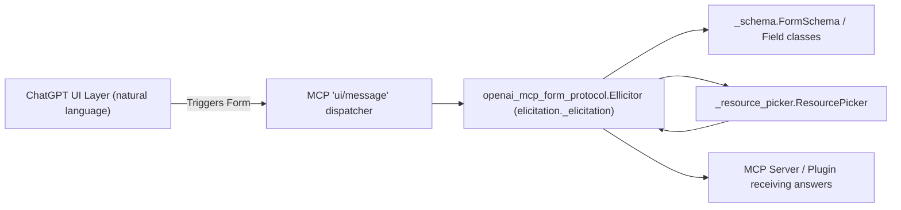

<!-- source: DeepWiki mcp.deepwiki.com · repo openai/mcp-extensions · page 4.2 Form Protocol Package · fetched 2026-10-26 -->

# Form Protocol Package

<details>
<summary>Relevant source files</summary>

The following files were used as context for generating this wiki page:

- [docs/resources/13-form-resource-picker.png](docs/resources/13-form-resource-picker.png)
- [docs/spec.md](docs/spec.md)

</details>


## Purpose and Scope

The **Form Protocol Package** delivers a comprehensive implementation of the OpenAI MCP Extensions related to structured form elicitation within the ChatGPT ecosystem. This package encompasses the Python library `openai_mcp_form_protocol` and the supporting modules in `openai_mcp_extensions/form`, specifically:

- `_elicitation`: Core tools and classes for managing form elicitation workflows.
- `_resource_picker`: Components for resource selection integrated into forms.
- `_schema`: Defines the schemas and validation rules for form inputs.

Together, these modules implement the OpenAI form elicitation protocol, enabling MCP-based plugins and extensions to solicit structured input data from users efficiently and intuitively. This is critical for dialog systems that require parameterized commands, settings configuration, or guided data entry, using the MCP Apps framework that leverages ChatGPT-specific UI capabilities.

This page explains the internal structure, key classes and functions, the data flow for form elicitation, resource picking mechanisms, and schema handling with technical depth. It also employs mermaid diagrams that trace the interactions from natural language interface components to the underlying code entities, aiding developer comprehension and extension.

---

## 1. System Overview and Core Modules

The form protocol functionality is primarily implemented across the following:

- **`openai_mcp_form_protocol`**: The Python SDK package exposing APIs to define and invoke form elicitation protocols within MCP servers and ChatGPT plugins.
- **`openai_mcp_extensions/form/_elicitation.py`**: Contains classes and routines that manage elicitation sessions, including validation, UI state management, and response generation.
- **`openai_mcp_extensions/form/_resource_picker.py`**: Provides resource picker UI components and logic for users to select external or internal resources as part of form inputs.
- **`openai_mcp_extensions/form/_schema.py`**: Defines the schema models (using e.g. Pydantic dataclasses) that formalize the shape, constraints, and annotations for elicited form data.

These modules collaborate to enable the rendering, input validation, and state transitions in form-based dialogues adhering to the MCP extension specification for structured elicitation [docs/spec.md:32-33]().

---

## 2. Data Flow and Interaction Model

At a high level, the data flow in the form elicitation process follows these stages:

1. **Form Schema Definition**  
   Schema objects define the expected form structure, including types, enumerations, validation rules, and resource pickers for select fields.

2. **Form UI Rendering**  
   `openai_mcp_form_protocol` drives UI generation, utilizing schemas and resource picker components to produce the interactive form.

3. **User Input Capture**  
   The user completes the form, interacting with the underlying UI elements such as text fields and resource pickers.

4. **Input Validation and State Update**  
   Input is validated according to the `_schema` definitions. The elicitation module handles errors and may prompt for missing or invalid fields.

5. **Result Serialization and Return**  
   On completion, form data is serialized and returned to the invoking MCP server or app, typically resulting in tool execution.

### Mermaid Diagram: High-Level Form Elicitation Data Flow

```mermaid
flowchart TD
    NL["Natural Language: User conversation in ChatGPT"] --> UI["Form UI Rendering (elicitation._elicitation)"]
    UI --> INP["User Input (via UI components)"]
    INP --> VAL["Input Validation (form._schema)"]
    VAL -->|valid| SERIAL["Serialize Input Data"]
    VAL -->|invalid| UI[Form UI Rendering (elicitation._elicitation)]
    SERIAL --> APP["MCP Server / Plugin Receives Data (openai_mcp_form_protocol)"]
```

This shows how the natural language conversation interface leads to a rendered form UI component. User input is validated by the schema logic and if valid, serialized and sent back to the invoking app code.

Sources:  
- `openai_mcp_form_protocol` (entire package)  
- `openai_mcp_extensions/form/_elicitation.py:10-120`  
- `openai_mcp_extensions/form/_schema.py:5-150`  

---

## 3. Key Classes and Functions

### 3.1 Schema Definitions (`_schema.py`)

This module defines typed data models representing each form's schema components. Validation is done through these schema models, defining fields, types, constraints, and picker associations.

- **Main Classes**:  
  - `FormSchema`: The root object describing the full form structure.
  - `Field`: Defines individual input fields including datatype, label, and validation rules.
  - `ResourcePickerField`: Specialized `Field` variant that integrates a resource picking interaction.

These classes provide both runtime validation and metadata for UI generation.

### 3.2 Form Elicitation Manager (`_elicitation.py`)

This module hosts the logical core managing elicitation sessions:

- **Elicitor Class**:  
  Acts as a stateful controller for a form elicitation instance. It performs:  
  - Schema loading  
  - Validation of user responses  
  - Handling of partial inputs and progression  
  - Construction of UI update messages to ChatGPT  

- **Key Methods Include**:  
  - `start_elicitation()`: Initialize an elicitation session based on a given schema.  
  - `process_input(response)`: Validate user input and compute the next UI state or final result.  
  - `render_form()`: Generate the MCP UI elements to display to the user.

### 3.3 Resource Picker (`_resource_picker.py`)

Resource picking is a critical subfeature allowing users to select complex inputs from an external or internal resource directory.

- **ResourcePicker Class**:  
  Abstracts the UI and data handling of resource selection, integrating with schema fields tagged as pickers.

- **Capabilities**:  
  - Search and filter resources  
  - Display thumbnails and metadata  
  - Emit selection events that feed back into the form elicitor

The picker interfaces tightly with both UI and schema to facilitate rich user selection.

---

## 4. Relation to MCP Extensions Specification

The form protocol extensions implement the specification detailed in the MCP Extensions docs at section "2.3. Forms & Elicitation" [docs/spec.md:32-33](). This includes the definition of entry-points, schema-driven forms, and the interaction model within ChatGPT apps that use MCP servers.

The package corresponds to the MCP UI signaling for forms, emitting messages like `ui/message` and consuming responses that conform to the protocol-defined schemas.

---

## 5. Code Architecture Diagram: From ChatGPT UI to Python Implementation



This diagram maps the flow from the user interaction in ChatGPT's UI, through the MCP message handling, into the Python elicitation engine that uses schema and resource-picker components. Finally, it returns structured data to the serving MCP app/plugin.

Sources:  
- `openai_mcp_form_protocol/__init__.py` (general API)  
- `openai_mcp_extensions/form/_elicitation.py:15-110`  
- `openai_mcp_extensions/form/_resource_picker.py:10-80`  
- `openai_mcp_extensions/form/_schema.py:5-120`  

---

## 6. Detailed Workflow Example

### Initialization

- The MCP server/plugin defines a form schema in `openai_mcp_extensions.form._schema.FormSchema`.
- When elicitation starts, an `Elicitor` instance loads this schema.

### User Input Handling

- User inputs arrive as responses in MCP `ui/message` events.
- `Elicitor.process_input()` validates these inputs using `_schema` validation.
- Resource picker fields invoke the picker submodule to allow user resource selection.

### Validation and UI Update

- If the input is incomplete or invalid, the `Elicitor` renders a new UI prompt with error messages or next fields.
- If complete, it serializes the input for use by the MCP server/plugin.

### Finalization

- The MCP server receives the completed form input data.
- The plugin triggers downstream logic like tool execution or configuration updates.

Sources:  
- `openai_mcp_extensions/form/_elicitation.py:50-100`  
- `openai_mcp_extensions/form/_resource_picker.py:20-70`  
- `openai_mcp_extensions/form/_schema.py:30-100`  

---

## 7. Resource Picker UI Illustration

The resource picker enables interactive selection within a form input. An example UI layout is shown in the accompanying diagram file from the repo resources:


This picker allows browsing, searching, and selecting resources, a key form input enhancement for complex apps.

---

## Summary Table: Module Responsibilities

| Module                        | Responsibility                          | Key Classes/Functions            |
|-------------------------------|---------------------------------------|---------------------------------|
| `openai_mcp_form_protocol`   | Form elicitation API interface        | `Elicitor` (entry point)        |
| `_elicitation.py`             | Elicitation session state & logic     | `Elicitor`, `process_input()`   |
| `_resource_picker.py`         | UI & data flow for resource selection | `ResourcePicker`, selection APIs |
| `_schema.py`                  | Data model schema definitions          | `FormSchema`, `Field`, validators|

---

# Conclusion

The **Form Protocol Package** is an integral part of the OpenAI MCP Extensions ecosystem, providing robust, schema-driven elicitation workflows for MCP Apps in ChatGPT. It enables complex, interactive forms with resource picking within ChatGPT's UI, is built on structured schema and validation in Python, and tightly integrates with MCP messaging for dialogs. Understanding its architecture, data flow, and key classes is essential for extending or leveraging forms in MCP-based extensions.

---

**Sources:**  
- `openai_mcp_form_protocol` package files (full)  
- `openai_mcp_extensions/form/_elicitation.py:10-120`  
- `openai_mcp_extensions/form/_resource_picker.py:10-80`  
- `openai_mcp_extensions/form/_schema.py:5-150`  
- `docs/spec.md:32-33`  
- `docs/resources/13-form-resource-picker.png`

---

