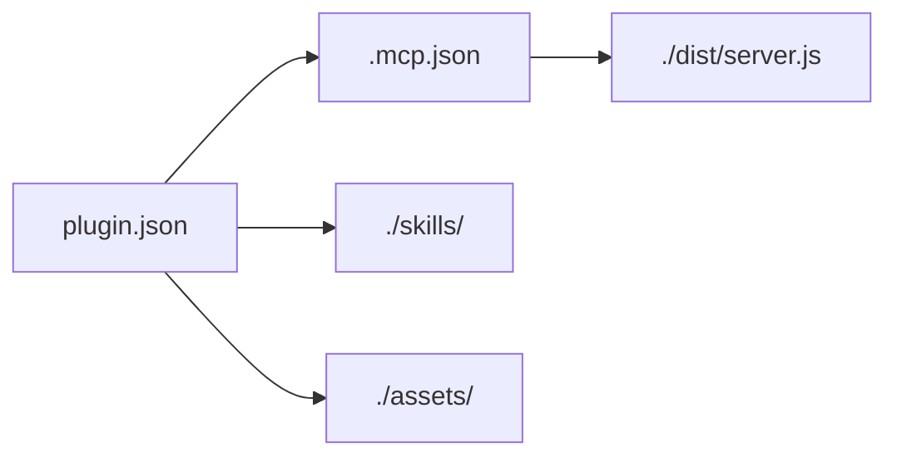
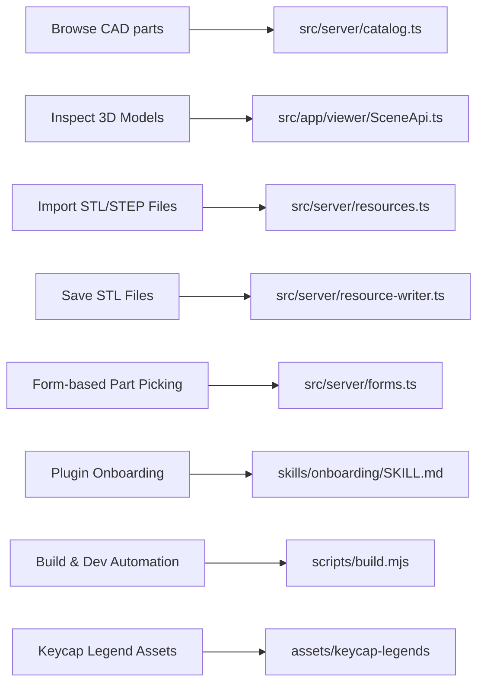
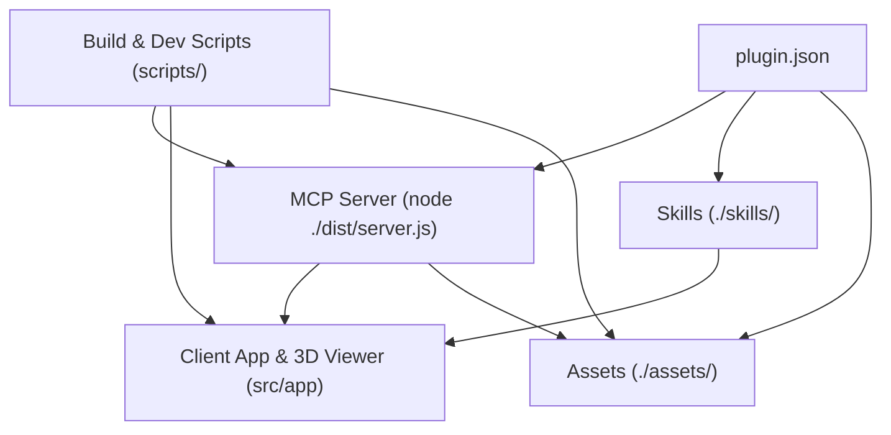

<!-- source: DeepWiki mcp.deepwiki.com · repo openai/mcp-extensions · page 5 Bits & Bolts Example Plugin · fetched 2026-10-26 -->

# Bits & Bolts Example Plugin

Relevant source files

The following files were used as context for generating this wiki page:

- [plugins/bits-and-bolts/.codex-plugin/plugin.json](plugins/bits-and-bolts/.codex-plugin/plugin.json)
- [plugins/bits-and-bolts/.gitignore](plugins/bits-and-bolts/.gitignore)
- [plugins/bits-and-bolts/.mcp.json](plugins/bits-and-bolts/.mcp.json)
- [plugins/bits-and-bolts/README.md](plugins/bits-and-bolts/README.md)

The **Bits & Bolts** plugin is a comprehensive demonstration plugin within the MCP Extensions ecosystem, designed to showcase the full range of available extension points through an interactive CAD parts library. It enables browsing, importing, inspecting, and selecting reusable CAD components with rich 3D visualization and integrated Codex interaction. Serving both as a practical tool and a kitchen-sink example, it illustrates how various extension mechanisms interoperate in a complex MCP plugin.

---

## Purpose and Scope

Bits & Bolts provides an end-to-end example of a plugin that includes:

- **Manifest and MCP configuration:** Defines plugin metadata, interface properties, onboard skill, and MCP server startup.
- **Server-side implementation:** Implements catalog management, local data stores, and form elicitation flows.
- **Client-side UI and 3D viewer:** Incorporates an interactive Three.js-based viewer supporting multiple CAD file formats and user controls.
- **Assets and model generation:** Bundles icons, keycap legends SVGs, and mesh model JSON, along with Python scripts to rebuild assets.
- **Build, development, and testing scripts:** Automates packaging, development live-reload, and test execution with scripts integrating Node.js and pnpm.

This page provides a high-level overview of the plugin components and how they fit together. For details on server logic, client UI, asset management, and build processes, see the linked child pages.

---

## Plugin Manifest and Configuration

At the core is the plugin manifest (`.codex-plugin/plugin.json`), which declares the plugin’s identity, display information, capabilities, and extensions such as onboarding skills. It specifies the main MCP server entry via `.mcp.json`, instructing to run `node ./dist/server.js` when hosting the server. The manifest defines the plugin as interactive, able to read and write CAD files, and equipped with a recognizable icon and short/long descriptions for UI display.

This structure delivers a seamless integration with Codex by exposing onboarding skills and framing the plugin capabilities clearly.

Sources: `plugins/bits-and-bolts/.codex-plugin/plugin.json:1-27`, `plugins/bits-and-bolts/.mcp.json:1-9`

---

## Server-Side Components

The server-side implementation in `src/server` manages the part catalog, local file storage, and form elicitation handling. It registers API routes for catalog access and file manipulation, integrates trusted file path handling, and supports resource read/write subscriptions to keep the viewer state synchronized.

Key responsibilities include:

- Serving the parts catalog and metadata
- Handling import, orientation, and STL re-saving
- Managing form-based interactions to pick and review CAD parts

This MCP server exposes an API surface that Codex can interact with to perform reads and writes of CAD files, maintain consistent model context, and synchronize form-driven workflows.

Sources: Overview supported by `README.md:30-45`

For detailed info, see the child page [Plugin MCP Server](#5.1).

---

## Client-Side App UI and 3D Viewer

The plugin’s interactive UI, implemented in `src/app`, presents the catalog and 3D viewer to users. It integrates with Three.js to render STL, 3MF, STEP/STP, and GLB files. Users can inspect parts with zoom, pan, rotate, and switch between rendering modes including solid, edges, wireframe, and X-ray.

Functional highlights:

- Viewer supports multiple camera presets and scene controls
- Grid visibility and unit scaling are customizable via structured settings
- PNG capture of the current view supports sharing and commenting
- Part selection communicates back with Codex model context and form elicitation

A shared `SceneApi` interface abstracts common viewer actions (camera, display mode, grid, units, capture) enabling uniform handling from UI buttons or automated tooling.

Sources: `README.md:48-53`

For deep dive, see the child page [Plugin App UI & 3D Viewer](#5.2).

---

## Assets, Keycap Legends & Model Generation

Assets supporting Bits & Bolts include icons, SVG keycap legends, and prebuilt mesh JSON files for CAD models. These assets come paired with Python scripts (`build-models.py`, `model_gltf.py`, `prepare-legends.py`) that allow rebuilding the 3D models and legends from source data.

This pipeline ensures that all built models are consistent, correctly dimensioned (millimeters units), and ready for inclusion in the plugin. Source references explain model origins, photo-reference methods, and build process, essential for asset maintainers and plugin updaters.

Sources: `README.md:5-7,26-27`

For details, see the child page [Assets, Keycap Legends & Model Generation](#5.3).

---

## Build, Development & Testing Scripts

Bits & Bolts includes Node.js scripts (`scripts/build.mjs`, `build-app.mjs`, `dev.mjs`, `test.mjs`) exposed under the toolkit to automate workflows:

- **Build:** Creates the distributable plugin package with server, viewer, and assets.
- **Dev:** Runs a local live-reload environment for iterative development.
- **Test:** Launches tests against server and client code.
- **Skills directory:** Contains Codex skills supporting onboarding & plugin tasks.

These scripts orchestrate the plugin lifecycle efficiently, managing dependencies and ensuring integration with the MCP Extensions SDK tools.

Sources: `README.md:11-26`

For more, see [Plugin Build, Dev & Test Scripts](#5.4).

---

## Diagram: Mapping Natural Language Concepts to Code Entities

---

## Diagram: Components and Their Interactions

---

## Summary

The Bits & Bolts plugin is a sophisticated demonstration of MCP extensions in action, providing a versatile CAD parts library with integrated file handling, 3D inspection, form elicitation, and onboarding capabilities. Through its manifest definition, server-side implementation, client UI, asset management, and automated tooling, it exemplifies how to build rich interactive plugins tailored for the Codex environment.

For further exploration of each aspect, visit the following child pages:

- [Plugin MCP Server](#5.1) — Detailed server implementation and form flows.
- [Plugin App UI & 3D Viewer](#5.2) — Client-side code with Three.js viewer controls.
- [Assets, Keycap Legends & Model Generation](#5.3) — Asset pipeline and source references.
- [Plugin Build, Dev & Test Scripts](#5.4) — Development tooling and scripts.

---

### Sources

- `plugins/bits-and-bolts/.codex-plugin/plugin.json:1-27`
- `plugins/bits-and-bolts/.mcp.json:1-9`
- `plugins/bits-and-bolts/README.md:1-53`

---

