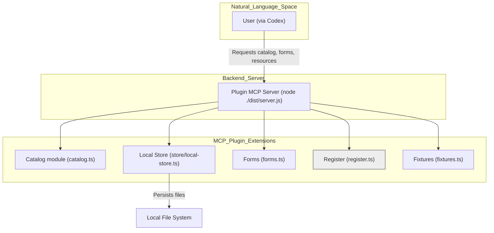
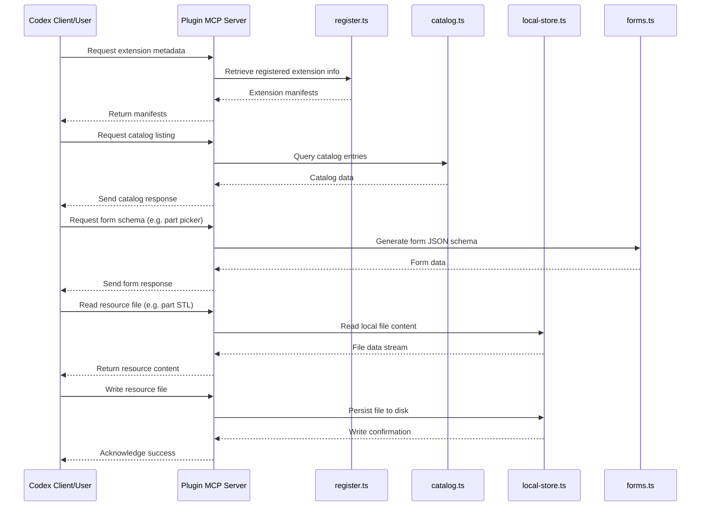

<!-- source: DeepWiki mcp.deepwiki.com · repo openai/mcp-extensions · page 5.1 Plugin MCP Server · fetched 2026-10-26 -->

# Plugin MCP Server

Relevant source files

The following files were used as context for generating this wiki page:

- [plugins/bits-and-bolts/.mcp.json](plugins/bits-and-bolts/.mcp.json)
- [plugins/bits-and-bolts/README.md](plugins/bits-and-bolts/README.md)

The **Plugin MCP Server** is the core backend component of the *Bits & Bolts* example plugin located in `src/server`. This server implements several essential features of the MCP extension system, including catalog management, local file storage, form handling, extension registration, and test fixtures. It serves as the authoritative source of extension metadata, data persistence, and business logic for the plugin.

---

## Purpose and Scope

This section documents the **Plugin MCP Server's** implementation details, including its key modules and their interactions:

- `catalog.ts` — Manages the parts catalog and index operations
- `store/local-store.ts` — Implements local resource storage for CAD files
- `forms.ts` — Defines form elicitations and schema compliance
- `register.ts` — Registers and exposes MCP extension endpoints and metadata
- `fixtures.ts` — Supplies test fixture data for development and testing
- Test files — Verify the correctness of each component via unit tests

These modules collectively enable the plugin to provide rich MCP extensions for CAD part management and 3D viewer integration.

---

## Architecture Overview

The Plugin MCP Server operates as a Node.js process (configured via `.mcp.json`) that listens and responds to MCP extension API requests. It abstracts physical file storage, presents a parts catalog, handles user input forms, and provides extension metadata dynamically.

### High-Level Architecture Diagram

*Diagram 1: Component relationships within Plugin MCP Server and their role bridging user requests to code modules and file storage*

Sources:  
- `plugins/bits-and-bolts/src/server/catalog.ts`  
- `plugins/bits-and-bolts/src/server/store/local-store.ts`  
- `plugins/bits-and-bolts/src/server/forms.ts`  
- `plugins/bits-and-bolts/src/server/register.ts`  
- `plugins/bits-and-bolts/src/server/fixtures.ts`  

---

## Module Details

### 1. Catalog Module (`catalog.ts`)

**Role:** Provides catalog data for the plugin parts and exposes catalog indexing functions.  
**Key features:**  
- Maintains an in-memory representation of part entries  
- Functions to query catalog entries by ID or tags  
- Interfaces tightly with resources for part data referencing  

**Data Flow:** When a catalog request arrives, the server consults the catalog module to return metadata like part names, tags, icons, and resource URIs, enabling the UI and form selections to populate dynamically.

### 2. Local Store (`store/local-store.ts`)

**Role:** Implements local file storage for CAD resources (e.g., STL, GLB files).  
**Key features:**  
- Reads and writes physical files on disk using paths from MCP resource URIs  
- Implements resource subscription to detect and signal file changes  
- Provides persistence abstraction tailored for local plugin scenarios  

**Data Flow:** The server's resource reads and writes route through this module to handle disk-based files. The system watches file changes to notify UI components for live updates.

### 3. Forms Module (`forms.ts`)

**Role:** Defines form schemas and elicitation protocols as per the MCP Forms specification.  
**Key features:**  
- Declares schemas for part picking, CAD review submission, and other elicited data  
- Supports validation, suggestions, and interaction hints embedded into forms  
- Binds form data to catalog and resource metadata enabling user-driven queries  

**Data Flow:** When a Codex session or plugin requests a structured form (e.g., part selection form), the server provides a JSON schema generated here, ensuring consistent UI display and input validation.

### 4. Register Module (`register.ts`)

**Role:** Central point registering all MCP extension metadata, handlers, and routes exposed by the server.  
**Key features:**  
- Combines catalog, store, forms, and other modules into one MCP server interface  
- Declares MCP extension namespaces, routes, and entrypoints  
- Serves extension manifests to the MCP runtime for plugin registration  

**Data Flow:** Upon server start, this module initializes and registers all MCP extension definitions, enabling the Codex backend and UI to discover and invoke plugin features.

### 5. Fixtures Module (`fixtures.ts`)

**Role:** Provides static fixture data for development and automated testing.  
**Key features:**  
- Supplies sample catalog entries, form responses, and resource data  
- Used by unit tests to validate server functionality without real file dependencies  

**Data Flow:** Test suites import fixtures to simulate typical plugin data, enabling robust regression testing.

---

## Data Flow and Request Handling

COMPONENT INTERACTIONS:

*Diagram 2: MCP extension request-response flow highlighting how user interactions are serviced by server modules*

Sources:  
- `plugins/bits-and-bolts/src/server/register.ts` (request routing)  
- `plugins/bits-and-bolts/src/server/catalog.ts` (catalog queries)  
- `plugins/bits-and-bolts/src/server/forms.ts` (form generation)  
- `plugins/bits-and-bolts/src/server/store/local-store.ts` (file operations)  

---

## Key Classes and Functions

While the server code is primarily function- and module-based, several key exports are central to the plugin's MCP server role:

- `createRegister()` (in `register.ts`) — Creates and returns an MCP extension register with all handlers wired up.  
- `getCatalog()` (in `catalog.ts`) — Returns the parts catalog for querying.  
- `LocalStore` class (in `store/local-store.ts`) — Encapsulates file read/write and subscription logic.  
- `getForms()` (in `forms.ts`) — Provides form schemas and elicitation interfaces.  
- `loadFixtures()` (in `fixtures.ts`) — Provides canned data for unit tests and demos.  

These core functions support the MCP server's lifecycle and interface implementation.

---

## Testing and Validation

Test files located alongside server code verify each module with unit tests:

- Catalog queries return expected parts  
- Store correctly reads/writes files and detects changes  
- Forms validate against schemas and elicit correct input  
- Registration exposes the correct MCP routes and manifests  
- Fixtures simulate realistic plugin data  

Tests use injected fixtures to isolate dependencies and ensure reliability.

---

## Summary

The Plugin MCP Server forms the essential backend foundation for the Bits & Bolts plugin by:

- Managing catalog metadata of CAD parts  
- Providing robust local resource file handling  
- Serving form elicitation schemas conforming to MCP standards  
- Registering and exposing plugin extensions in MCP namespaces  
- Supporting comprehensive test fixtures for development and CI

This modular design enables the Bits & Bolts example to demonstrate a full spectrum of MCP extension capabilities, facilitating seamless integration with the Codex runtime.

---

# Index of Server Source Files

| File Path                                  | Description                                  |
|--------------------------------------------|----------------------------------------------|
| `src/server/catalog.ts`                    | Parts catalog management                      |
| `src/server/store/local-store.ts`         | Local file resource store                     |
| `src/server/forms.ts`                      | Form elicitation and schema                   |
| `src/server/register.ts`                   | MCP extension registration and routes        |
| `src/server/fixtures.ts`                   | Test fixture data                             |
| Test files (not listed individually)      | Unit tests for all above modules              |

Sources:  
- `plugins/bits-and-bolts/src/server/catalog.ts`  
- `plugins/bits-and-bolts/src/server/store/local-store.ts`  
- `plugins/bits-and-bolts/src/server/forms.ts`  
- `plugins/bits-and-bolts/src/server/register.ts`  
- `plugins/bits-and-bolts/src/server/fixtures.ts`  

---

This completes the detailed technical overview of the Plugin MCP Server implementation for the Bits & Bolts plugin.

---

