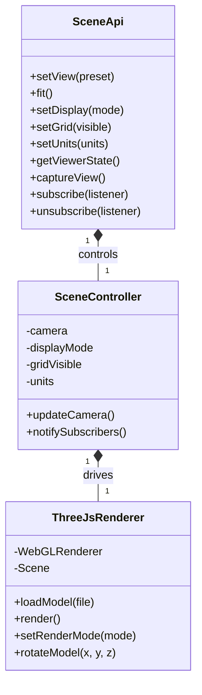
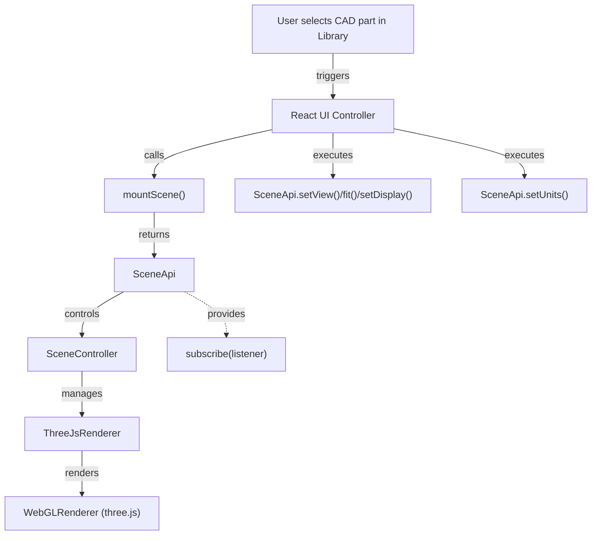

<!-- source: DeepWiki mcp.deepwiki.com · repo openai/mcp-extensions · page 5.2 Plugin App UI & 3D Viewer · fetched 2026-10-26 -->

# Plugin App UI & 3D Viewer

<details>
<summary>Relevant source files</summary>

The following files were used as context for generating this wiki page:

- [plugins/bits-and-bolts/README.md](plugins/bits-and-bolts/README.md)
- [plugins/bits-and-bolts/assets/models/README.md](plugins/bits-and-bolts/assets/models/README.md)

</details>


This section documents the implementation details of the Bits & Bolts plugin's App UI and 3D viewer components found in `src/app`. It covers the controller logic, viewer setup, integration with three.js renderers, and the HTML entrypoint. This UI module is responsible for displaying CAD parts from the plugin-specific catalog and handling the file viewer entrypoint for various CAD file types.

It is a self-contained leaf section describing all relevant classes, functions, data flows, and interactions involved in the rendering and UI logic that enable interactive 3D inspection of CAD models within the MCP environment.

---

## 1. Purpose and Scope

The Plugin App UI & 3D Viewer serves as the user-facing interface part of the Bits & Bolts example plugin. It enables users to:

- Browse and interact with a catalog of CAD parts (e.g., keyboard keycaps, assembly parts).
- Open and display 3D model files in supported formats such as STL, 3MF, STEP, and GLB.
- Manipulate camera views with predefined presets and interactive controls.
- Toggle model rendering modes like solid, wireframe, edges, and X-ray.
- Show and hide grid overlays and adjust units (millimeters/inches).
- Capture PNG screenshots of the current 3D view.
- Seamlessly return from a single-part view to the library catalog.

The viewer uses three.js for its 3D rendering engine, supporting physically-based materials and lighting sourced from the bundled GLB assets. The UI is implemented inside an iframe environment and interfaces with the MCP extensions APIs for resource loading, settings, and subscriptions.

This page explains the main modules and their roles, the key data flow for model loading and user interaction, and the classes providing viewer controls and state management.

---

## 2. Key Components and Data Flow

### 2.1 File & Directory Layout

- The viewer source code is under `plugins/bits-and-bolts/src/app`.
- Entry point: `index.html` - bootstraps the React-based UI and viewer.
- Core controller logic and React components handle user commands and state.
- Three.js renderer instances manage the visualization of loaded CAD parts.
- Viewer APIs expose scene control methods to external UI buttons and tools.

### 2.2 Data Flow Overview

```mermaid
flowchart TD
  subgraph Natural_Language_Space ["User Actions & Plugin Features"]
    A["User selects a CAD part from Library"] --> B["Request to load 3D model"]
    C["User uploads or opens a CAD file"] --> B
    D["User interacts: rotate, zoom, change camera"] --> E["Viewer updates scene camera"]
    F["User captures screenshot"] --> G["Viewer captures PNG from canvas"]
  end
  subgraph Code_Entity_Space ["Code Entities"]
    B --> H[mountScene -> SceneApi]
    H --> I[ThreeJsRenderer - renders mesh]
    H --> J[SceneController - camera, view state]
    I --> K[Three.js (WebGLRenderer)]
    J --> I
    G --> L[SceneApi.captureView()]
  end
  
  %% Cross references
  A -.->|UI event| M[React controller / hooks]
  C -.-> M
  D -.-> M
  F -.-> M
  M --> B
```

- Users trigger UI events via React components, which call into the controller logic.
- Controller requests mounting a 3D scene via `mountScene`, returning a `SceneApi` for scene commands.
- `SceneApi` routes updates to the `SceneController`, which manages camera and viewer state.
- The `ThreeJsRenderer` renders the actual 3D meshes with WebGL through three.js.
- Screenshots are captured by reading the WebGL canvas content.

Sources: `src/app/*`, `plugins/bits-and-bolts/README.md:3-55`()

---

## 3. Main Classes and APIs

### 3.1 `mountScene()` and `SceneApi`

- `mountScene` function initializes and attaches the 3D scene viewer to a DOM container.
- Returns a `SceneApi` object providing key controls:
  - `setView(preset)` — switch camera to predefined views.
  - `fit()` — zoom and pan so entire model fits in view.
  - `setDisplay(mode)` — switch rendering modes: solid, wireframe, edges, X-ray.
  - `setGrid(visible)` — toggle grid overlay visibility.
  - `setUnits(units)` — switch between millimeters and inches.
  - `getViewerState()` — returns current viewer state snapshot.
  - `captureView()` — returns a PNG data URL, pixel size, and viewer state for screenshot functionality.
  - `subscribe(listener)` / `unsubscribe(listener)` — subscribe to viewer state updates; listeners notified on camera or display mode changes.

These APIs enable decoupling the rendering engine from UI event handlers or external commands, facilitating future tooling integration.

### 3.2 ThreeJsRenderer

- Wraps three.js WebGLRenderer instances with scene graph management.
- Parses loaded models (GLB/STL/3MF/STEP) and converts geometry to three.js meshes.
- Applies materials, textures, and lighting appropriate for the model’s catalog metadata.
- Supports multiple rendering modes by switching material shaders and mesh edge visibility.
- Exposes methods for rotation, camera positioning, and grid rendering.

### 3.3 SceneController

- Coordinates camera operations, managing camera presets and transitions.
- Maintains viewer state including display mode, units, and grid settings.
- Updates scene according to user interaction or programmatic commands.
- Fires subscription callbacks on relevant state changes.

### 3.4 React UI Controller Components

- Render buttons, dropdowns, and sliders connecting user actions to SceneApi calls.
- Provide status displays such as bounding box dimensions in current units.
- Handle file open dialogs and resource pickers, translating file open requests to model loading.

Sources: `plugins/bits-and-bolts/src/app/*` and `plugins/bits-and-bolts/README.md:50-55`()

---

## 4. File Viewer Entrypoint

The viewer serves also as a file opener for MCP files like STL, 3MF, STEP, STP formats:

- When a user opens a file, the controller detects file type and loads the geometry.
- It converts STEP/GLB geometry coordinates to millimeters.
- Displays coordinates and bounds with unit conversions assumed.
- Allows model inspection controls identical to library parts mode.

This unification reduces UI complexity and leverages the same rendering pipeline for both catalog parts and arbitrary CAD files.

---

## 5. User Interaction Features

- **Camera Presets:** Seven predefined camera views for quick inspection.
- **Fit View:** Auto-zoom to show entire model.
- **Render Modes:** Solid, Wireframe, Edges, X-ray overlays toggleable on the fly.
- **Grid Overlay:** Shows a configurable grid with units scale.
- **Units Support:** Toggle between millimeters and inches, crucial for dimension display.
- **Screenshot Capture:** PNG export of canvas + viewer state for sharing or model context.
- **Subscription:** External tools and UI can subscribe to state changes dynamically.

---

## 6. Implementation Details Summary



- `SceneApi` instances control `SceneController` which manipulates the underlying `ThreeJsRenderer`.
- Rendering state is centralized, allowing robust state changes and reactive UI updates.

Sources: `plugins/bits-and-bolts/src/app/*`()

---

## 7. Summary

The Plugin App UI & 3D Viewer implementation provides a comprehensive 3D visualization solution integrated with MCP plugins. Using three.js, the viewer supports detailed CAD part inspection, intuitive user controls, and seamless file loading. Its architecture modularizes scene control (SceneController), rendering (ThreeJsRenderer), and UI interaction (React components with SceneApi), providing a extensible, maintainable foundation to build upon.

---

# Additional Diagram: Mapping Natural Language Features to Code Entities



- This diagram links explicit user interface actions and natural language features (like selecting a part) to the underlying code classes and methods managing viewer state and rendering.

Sources: `plugins/bits-and-bolts/README.md:50-55`, `src/app/*`()

---

# Table: Key Viewer Functionality vs Code Entities

| Functionality                  | Code Entity / Method                         | Description                                              |
|-------------------------------|---------------------------------------------|----------------------------------------------------------|
| Initialize 3D viewer           | `mountScene()`                              | Creates and returns `SceneApi` for viewer control        |
| Load part or file model        | `ThreeJsRenderer.loadModel(file)`           | Parses and loads 3D geometry for rendering               |
| Change camera view preset      | `SceneApi.setView(preset)`                   | Changes the camera to predefined viewpoints              |
| Fit model to view             | `SceneApi.fit()`                            | Zooms and pans to fit entire model                        |
| Switch rendering mode          | `SceneApi.setDisplay(mode)`                  | Toggles solid, wireframe, edges, X-ray                   |
| Toggle grid visibility         | `SceneApi.setGrid(visible)`                  | Shows/hides the grid overlay                              |
| Change measurement units       | `SceneApi.setUnits(units)`                    | Switches between mm and inches                            |
| Capture screenshot             | `SceneApi.captureView()`                      | Returns PNG data URL and viewer state snapshot            |
| Subscribe to state updates     | `SceneApi.subscribe(listener)`               | UI or tools get notified of changes                       |

Sources: `plugins/bits-and-bolts/README.md:50-55`, `src/app/*`()

---

# References

- Bits & Bolts plugin 3D viewer summary: `plugins/bits-and-bolts/README.md:3-55`
- CAD model assets and viewer considerations: `plugins/bits-and-bolts/assets/models/README.md`
- Source app directory and three.js integration: `plugins/bits-and-bolts/src/app/*` (implied from repo layout)

---

This concludes the technical documentation for section 5.2 "Plugin App UI & 3D Viewer". It covers the core integration of the CAD part viewer and file viewing capabilities as implemented in the Bits & Bolts example plugin.

---

