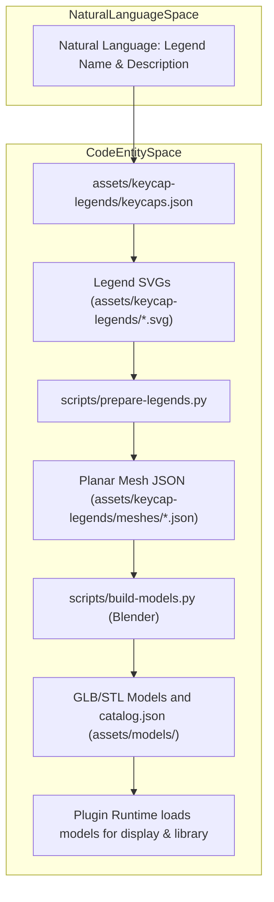
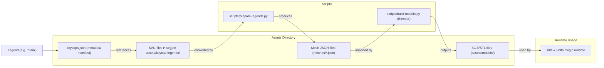
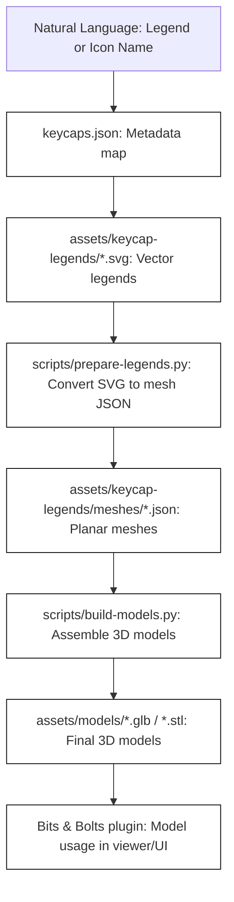

<!-- source: DeepWiki mcp.deepwiki.com · repo openai/mcp-extensions · page 5.3 Assets, Keycap Legends & Model Generation · fetched 2026-10-26 -->

# 5.3 Assets, Keycap Legends & Model Generation

<details>
<summary>Relevant source files</summary>

The following files were used as context for generating this wiki page:

- [plugins/bits-and-bolts/assets/icon-dark.svg](plugins/bits-and-bolts/assets/icon-dark.svg)
- [plugins/bits-and-bolts/assets/icon.svg](plugins/bits-and-bolts/assets/icon.svg)
- [plugins/bits-and-bolts/assets/keycap-legends/brain.svg](plugins/bits-and-bolts/assets/keycap-legends/brain.svg)
- [plugins/bits-and-bolts/assets/keycap-legends/keycaps.json](plugins/bits-and-bolts/assets/keycap-legends/keycaps.json)
- [plugins/bits-and-bolts/assets/keycap-legends/meshes/openai.json](plugins/bits-and-bolts/assets/keycap-legends/meshes/openai.json)
- [plugins/bits-and-bolts/assets/models/README.md](plugins/bits-and-bolts/assets/models/README.md)

</details>


This section details the management and generation of visual and 3D model assets used by the Bits & Bolts plugin within the OpenAI MCP Extensions codebase. It covers the organization of icon and keycap legend SVGs, the storage and usage of keycap mesh JSON data, and the model generation pipeline including README documentation and Python scripts responsible for building and preparing these models.

---

## 5.3.1 Asset Organization and Content

The plugin maintains several important asset directories under `plugins/bits-and-bolts/assets/`. These contain the core visual elements and mesh data for the plugin’s 3D models and UI icons.

### Icon SVGs

- `icon.svg` and `icon-dark.svg` are SVG icons used to represent the plugin in different UI themes.
- These files contain vector paths that define the outline of the plugin’s emblem. They use stroke properties to render consistent lines optimized for UI placement.

Example snippet from `icon.svg`:

```xml
<svg xmlns="http://www.w3.org/2000/svg" viewBox="0 0 32 32">
  <path fill="none" stroke="#27272a" stroke-width="3" stroke-linecap="round" stroke-linejoin="round" 
    d="M9.5 4.75h13L29 16l-6.5 11.25h-13L3 16zM13 10.8h6l3 5.2-3 5.2h-6L10 16z"/>
</svg>
```

### Keycap Legends

- The `keycap-legends/` directory contains SVG files illustrating individual keycap legends, such as `brain.svg`. Each SVG represents a stylized glyph graphic intended to be displayed on a keycap.
- Accompanying the SVG files is `keycaps.json`, a metadata manifest which enumerates all available keycap legends. Each entry includes:
  - A `slug` identifier used internally (e.g. `"bug"`, `"openai"`, `"brain"`).
  - A `name` for human-readable reference.
  - The number of `units` the keycap spans (e.g., 1 or 2).
  - The `source` SVG filename.

This JSON manifest enables programmatic loading and usage of the keycap legends in the app and model generation pipelines.

#### Example of a keycap JSON entry:

```json
{
  "slug": "brain",
  "name": "Brain",
  "units": 1,
  "source": "brain.svg"
}
```

### Keycap Meshes

- The subdirectory `keycap-legends/meshes/` contains JSON files representing planar 2D mesh outlines for each legend (e.g., `openai.json`).
- These meshes provide coordinate data (like vertices outlining the legend shape) and are used during the 3D model preparation phase to convert SVG vector graphics into mesh geometry suitable for rendering or 3D printing.

---

## 5.3.2 Codex Micro Model Assets

Contained within `assets/models/README.md`, this Markdown document explains the curated 3D models representing the Codex Micro keyboard assembly and its components, detailing usage notes and build instructions.

### Summary of the README Highlights

- The models are **visual replicas, not manufacturing CAD**; precise dimensions for fit verification are not guaranteed.
- The library includes:
  - Complete keyboard assembly
  - Sculpted dial
  - Joystick cap
  - Translucent agent keycap
  - All 32 icon keycaps in 1U sizes
  - A 2U microphone keycap
- Available file formats:
  - GLB (glTF Binary) models for preview and display with preserved materials and translucency
  - STL files for geometry-only exports, suitable for CAD and 3D printing
- Size references include:
  - 19.05 × 19.05 mm MX keycap pitch
  - Caps are approximately 18mm wide
  - 2U caps are 37.05 mm wide
- Blender 5.2 is the required tool for rebuilding models.
- The build process involves regenerating meshes from SVG legends and creating new GLB and STL files. Python scripts automate this.

### Build Commands from README

```sh
uv run --extra models python scripts/prepare-legends.py
```

This command prepares planar meshes from the legend SVGs by parsing and converting them into mesh JSON files used in model generation.

```sh
/Applications/Blender.app/Contents/MacOS/Blender --background --factory-startup --python scripts/build-models.py
```

Runs the Blender script headlessly to generate 3D model files and renders, creating GLB and STL outputs along with scene files. Optional flags `--skip-render` and `--preview` control rendering behaviors.

---

## 5.3.3 Model Generation Python Scripts

The `scripts/` directory holds scripts responsible for the transformation of legend SVGs into 3D models and final assembly assets.

### `prepare-legends.py`

- This script processes all keycap legend SVGs located in `assets/keycap-legends/`.
- It reads the SVG paths and converts them into planar meshes encoded as JSON files within `assets/keycap-legends/meshes/`.
- The planar mesh data represents the 2D outline of each legend for subsequent use in the Blender model build script.
- The script runs in a clean isolated Python environment defined by `pyproject.toml` dependencies to ensure reproducible builds.
- Executed via `uv run --extra models python scripts/prepare-legends.py`.

### `build-models.py`

- This Blender Python script imports SVG meshes and other assets, assembles complete 3D models, applies materials and textures, and exports output files.
- It writes the GLB preview models and ASCII STL files into the `assets/models/` directory.
- Additionally, it creates a `catalog.json` enumeration of available model parts.
- The script checks mesh quality constraints such as closed manifold edges and file size < 7 MiB before exporting meshes.
- It builds separate components (full assembly, caps, dials, etc.) and combines them into a single multi-part scene.
- Non-rendered outputs and editable Blender scenes are saved to `.local/codex-micro/`, which is excluded from version control.

### `model_gltf.py`

- A supporting module used by `build-models.py`, responsible for glTF/GLB export handling.
- Includes lower-level utilities for model serialization and material assignment.

---

## 5.3.4 Data Flow and Key Components

The asset and model generation pipeline integrates the following flow:



**Explanation:**

- The `keycaps.json` manifest maps legend slugs and metadata to individual SVG assets.
- The `prepare-legends.py` script acts as a converter of 2D SVG vector data into planar mesh JSON representations.
- The Blender `build-models.py` imports mesh JSONs, applies materials/textures, creates detailed 3D models, and exports final multiple-format assets.
- The plugin uses these GLB/STL files and the catalog at runtime for rendering parts and building the keyboard library UI.
- This pipeline bridges human-readable legend data to concrete 3D assets consistent with the app’s UI and library requirements.

Sources:
- `plugins/bits-and-bolts/assets/icon.svg` and `icon-dark.svg` (lines 1-11)
- `plugins/bits-and-bolts/assets/keycap-legends/brain.svg` (lines 1-3)
- `plugins/bits-and-bolts/assets/keycap-legends/keycaps.json` (lines 1-194)
- `plugins/bits-and-bolts/assets/keycap-legends/meshes/openai.json` (lines 1-237 shown)
- `plugins/bits-and-bolts/assets/models/README.md` (lines 1-45)

---

## 5.3.5 Code-Level Mapping of Natural Language Concepts

To clarify system structure with respect to terminology and implementation, the following diagram maps key terms to code entities and files:



---

## 5.3.6 Summary Table: Asset Types and Their Roles

| Asset Type            | Location (Example)                        | Purpose                                        | Format(s)                | Related Script or Component         |
|-----------------------|-----------------------------------------|------------------------------------------------|--------------------------|------------------------------------|
| Plugin Icon           | `assets/icon.svg`, `icon-dark.svg`      | UI icon for plugin representation               | SVG vector graphic       | Loaded by plugin UI                 |
| Keycap Legends        | `assets/keycap-legends/*.svg`            | Visual glyph art for key legends                 | SVG vector graphic       | Input for prepare-legends.py       |
| Keycap Legend Manifest| `assets/keycap-legends/keycaps.json`    | Defines available legends and metadata           | JSON                     | Referenced by prepare-legends.py & plugin |
| Keycap Mesh JSON      | `assets/keycap-legends/meshes/*.json`    | Planar meshes derived from legend SVGs           | JSON                     | Output of prepare-legends.py, input to build-models.py |
| 3D Model Assets       | `assets/models/*.glb`, `*.stl`            | 3D visual and print models of keyboard and parts| glTF Binary (GLB), STL    | Output of build-models.py, consumed at runtime |
| Models Catalog        | `assets/models/catalog.json`              | Catalog of model parts                            | JSON                     | Output of build-models.py          |
| Model Generation Scripts | `scripts/prepare-legends.py`, `build-models.py`, `model_gltf.py` | Build pipeline utilities                          | Python scripts            | Core automation scripts            |

---

## 5.3.7 Implementation Details & Development Notes

- **Asset Loading**  
  The plugin loads the icon SVGs and keycap legend SVGs directly from assets to render UI elements.

- **Legend Mesh Preparation**  
  The `prepare-legends.py` script converts direct SVG paths into curated planar polygon meshes. This bridging step enables offline pre-processing of vector data into a mesh format friendly to Blender’s build script.

- **Model Building with Blender**  
  The `build-models.py` script leverages Blender 5.2’s Python API:
  - Imports mesh JSONs and assembles 3D geometry.
  - Applies materials and translucency suitable for previewing models.
  - Generates GLB files preserving materials and renders.
  - Exports STL files stripped of materials for manufacturing compatibility.
  - Creates and verifies mesh manifoldness and size constraints to fit plugin transport limits.

- **Development Workflow**  
  Rebuilding requires Python 3.10+ with a virtual environment layered by `uv run`. Legend changes require running `prepare-legends.py` before trigger Blender build. Model outputs are not commited directly; only source assets and scripts are tracked.

- **Plugin Runtime Usage**  
  At runtime, the plugin references these prebuilt GLB models to display parts in UI scenes or 3D viewers. Editable or user-imported models bypass bundled versions.

---

## 5.3.8 Summary

The `plugins/bits-and-bolts/assets/` directory structures all vector graphics, mesh data, and 3D model files necessary for rendering the Codex Micro keyboard components and its keycaps within the Bits & Bolts plugin. The `keycap-legends/` folder contains glyph SVGs and a comprehensive manifest, while planar mesh JSON files generated by `prepare-legends.py` assist in building geometry inside Blender.

The `build-models.py` script automates the assembly and export of complex 3D models, producing GLB previews and STL manufacturing files according to precise reference scaling. Together, this asset pipeline allows the plugin to manage visually accurate and performant models tightly integrated with the user interface and library display.

---

# Summary Mermaid Diagram: Natural Language to Code Entity Bridging



Sources:
- `plugins/bits-and-bolts/assets/`
- `plugins/bits-and-bolts/assets/keycap-legends/`
- `plugins/bits-and-bolts/assets/models/README.md`
- `plugins/bits-and-bolts/scripts/prepare-legends.py`
- `plugins/bits-and-bolts/scripts/build-models.py`
- `plugins/bits-and-bolts/scripts/model_gltf.py`
- `plugins/bits-and-bolts/assets/keycap-legends/keycaps.json`
- `plugins/bits-and-bolts/assets/keycap-legends/meshes/openai.json`
- `plugins/bits-and-bolts/assets/icon.svg`
- `plugins/bits-and-bolts/assets/icon-dark.svg`

---

