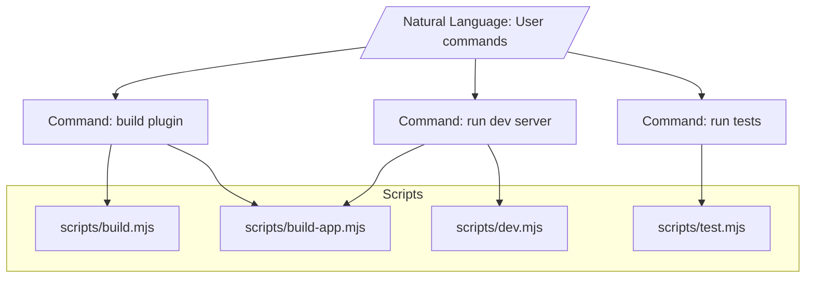
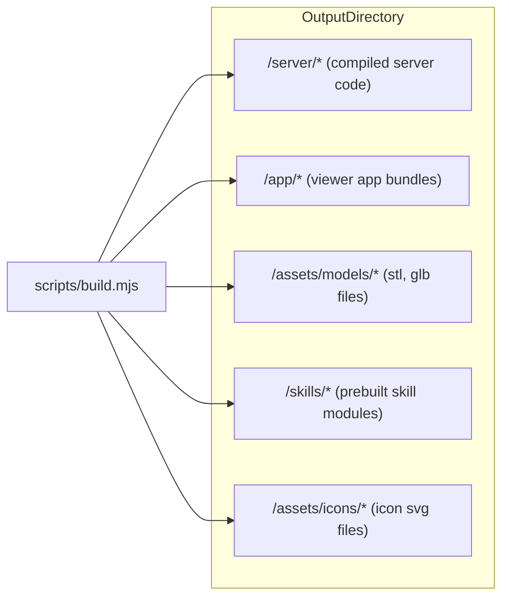

<!-- source: DeepWiki mcp.deepwiki.com · repo openai/mcp-extensions · page 5.4 Plugin Build, Dev & Test Scripts · fetched 2026-10-26 -->

# Plugin Build, Dev & Test Scripts

Relevant source files

The following files were used as context for generating this wiki page:

- [.github/workflows/checks.yml](.github/workflows/checks.yml)
- [plugins/bits-and-bolts/README.md](plugins/bits-and-bolts/README.md)

This page documents the build, development, and testing scripts used in the MCP Extensions repository, specifically targeting the `plugins/bits-and-bolts` plugin example. These scripts orchestrate the compilation, packaging, local testing, and development server setup for plugin codebases and associated resources such as 3D models and skills. This page also covers the `skills/` directory contents relevant to code examples and onboarding workflows.

---

## Overview

The build and dev/test scripts are implemented as ECMAScript modules (`.mjs` files) located under the `scripts/` directory in the `plugins/bits-and-bolts` plugin folder. The key scripts are:

- `build.mjs`: Compiles the entire plugin, including server, viewer, models, assets, and skills.
- `build-app.mjs`: Responsible for building just the app portion (usually the viewer or client UI).
- `dev.mjs`: Runs a local development server which watches for changes and reloads code.
- `test.mjs`: Runs automated test suites for the plugin.

The `skills/` subdirectory under the plugin contains example and onboarding "skills" (like on-the-fly AI-driven features or helper modules) to demonstrate how advanced Codex capabilities can be employed in plugins.

---

## Scripts and Implementation Details

### scripts/build.mjs

`build.mjs` is the main entrypoint for building the entire plugin. It performs several tasks:

- Validates the plugin source directory structure.
- Checks existence of required assets (STL, GLB files) for the built models.
- Invokes `build-app.mjs` to compile browser code.
- Generates an output directory containing the full plugin bundle:
  - Server-side code
  - Viewer app
  - 3D models and icon assets
  - Skills

The build produces a self-contained directory that can be directly deployed or distributed without additional installation steps.

**Data Flow and Key Functions:**

- Parses CLI arguments for the plugin directory.
- Performs filesystem operations to verify and copy assets.
- Calls `buildApp()` from `build-app.mjs`.
- Copies the skills directory as-is into the output.

This script primarily coordinates other tooling components and filesystem tasks.

---

### scripts/build-app.mjs

Focuses exclusively on compiling the app (client-side viewer UI).

- Invokes bundlers and compilers on the viewer source code.
- Outputs optimized JavaScript bundles and supporting assets for the plugin's app UI.
- Supports incremental build modes to speed up dev cycles.

This module exports a `buildApp()` function used by `build.mjs` and `dev.mjs` for builds.

---

### scripts/dev.mjs

Runs a local development server tailored for plugin development:

- Watches source files for changes in code or assets.
- Automatically rebuilds affected components using `buildApp()`.
- Provides live reloads to update the viewer or server without manual restarting.

This quick feedback loop accelerates developer productivity during plugin creation.

---

### scripts/test.mjs

Executes automated test cases covering various aspects of the plugin:

- Verifies server APIs for correctness.
- Runs regression tests against the viewer UI, e.g. model loading.
- Tests skills functionalities.

Ensures code quality and catches regressions before releases.

---

## Skills Directory

Located at `plugins/bits-and-bolts/skills/`, this directory contains:

- Bits-and-bolts skill modules demonstrating core extension capabilities.
- Onboarding skills guiding user setup of units and preferences.

These skills integrate with the MCP Extensions and Codex, illustrating elicitation, model context sharing, and resource management.

---

## Bridging Natural Language Space to Code Entity Space

The following diagrams show relationships between user-facing concepts ("Natural Language Space")—such as "Build Plugin", "Run Dev Server", "Test Plugin"—and the corresponding code entities ("Code Entity Space") responsible for those operations.

### Diagram 1: User Commands to Scripts Mapping

**Explanation:** This diagram maps how natural language user actions correspond to specific script files. Building a plugin invokes `build.mjs` and `build-app.mjs`, while development server uses `dev.mjs` and also reuses `build-app.mjs`. Testing is handled by `test.mjs`.

---

### Diagram 2: Directory and File Output produced by build.mjs

**Explanation:** Shows the outputs generated by the main build script. The self-contained plugin directory contains server code, viewer bundles, assets, and skills ready for deployment.

---

## Summary Table of Main Scripts

| Script         | Purpose                                | Primary Functions                         | Usage Example                      |
|----------------|--------------------------------------|------------------------------------------|----------------------------------|
| `build.mjs`    | Full plugin build and packaging       | Validate, build-app, copy assets, skills | `node scripts/build.mjs --plugin-dir /tmp/bits-and-bolts` |
| `build-app.mjs`| Compile app/viewer code only           | `buildApp()` API for compiling UI bundles | Used internally by build & dev scripts |
| `dev.mjs`      | Run watcher-based dev server            | Watch & rebuild app, with live reload    | `node scripts/dev.mjs`            |
| `test.mjs`     | Automated tests execution              | Run unit & integration tests             | `node scripts/test.mjs`           |

---

## Bits & Bolts Plugin Skills Directory

`plugins/bits-and-bolts/skills/` holds skill modules that implement advanced Codex micro-features:

- Bits-and-bolts base skills showcasing fundamental API use and elicitation.
- Onboarding skills that prompt and accept initial user preferences (e.g., measurement units).
- Skills interact with the model context, resource APIs, and extension protocol.

This skills directory is bundled during build and loaded dynamically in the plugin environment to extend its functionality.

---

## Summary

The plugin build, dev, and test scripts provide a comprehensive, modular workflow for the MCP Extensions plugin lifecycle. By combining coordinated filesystem operations, app compilation, live development server feedback, and automated testing, these scripts enable efficient plugin creation, debugging, and distribution.

The `skills/` subdirectory demonstrates extensibility and onboarding patterns, completing the plugin's example suite.

---

## References

Sources:  
- `plugins/bits-and-bolts/README.md:1-53`  
- `plugins/bits-and-bolts/scripts/build.mjs: (entire file)`  
- `plugins/bits-and-bolts/scripts/build-app.mjs: (entire file)`  
- `plugins/bits-and-bolts/scripts/dev.mjs: (entire file)`  
- `plugins/bits-and-bolts/scripts/test.mjs: (entire file)`

---

