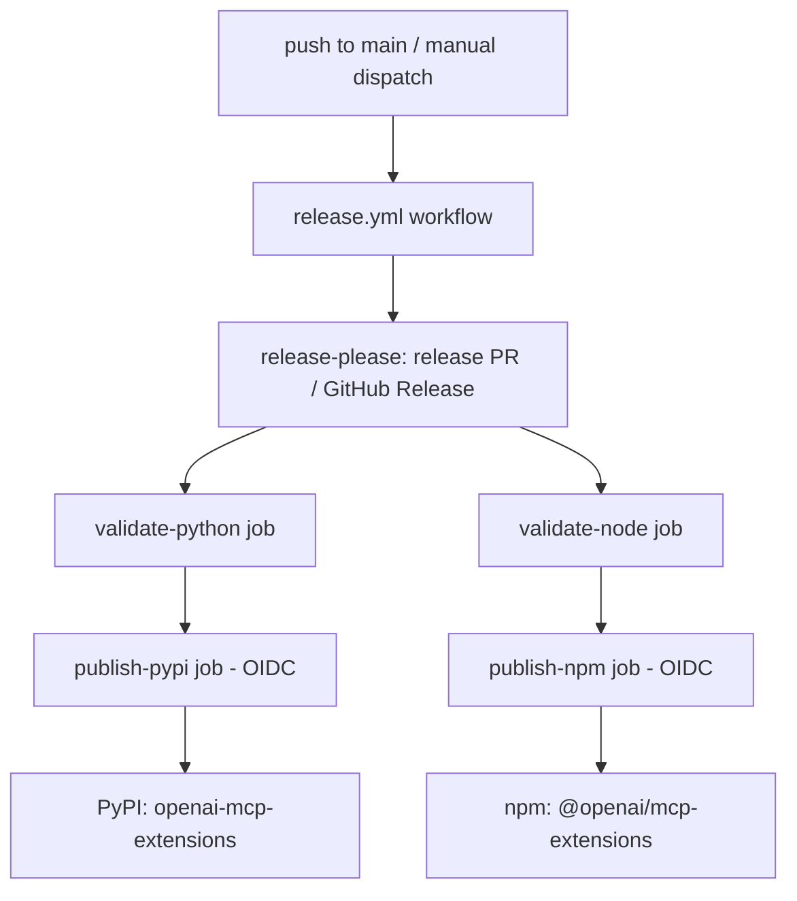
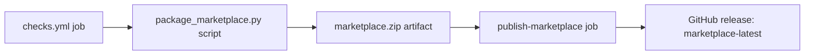

<!-- source: DeepWiki mcp.deepwiki.com · repo openai/mcp-extensions · page 6 CI, Release & Distribution · fetched 2026-10-26 -->

# CI, Release & Distribution

<details>
<summary>Relevant source files</summary>

The following files were used as context for generating this wiki page:

- [.github/workflows/checks.yml](.github/workflows/checks.yml)
- [.github/workflows/ci.yml](.github/workflows/ci.yml)
- [.github/workflows/release.yml](.github/workflows/release.yml)

</details>


This section provides a high-level overview of the automation infrastructure supporting continuous integration, release management, package validation, and distribution for the OpenAI MCP Extensions repository. It describes how the system orchestrates quality checks using GitHub Actions workflows, automates releases with release-please, validates package artifacts to ensure consistency, and manages marketplace packaging and publishing. Detailed technical insights and usage instructions for each automation sub-topic are delegated to child pages.

---

## Continuous Integration (CI) Workflows

The repository employs GitHub Actions workflows to enforce code quality, run tests, and validate builds with every push and pull request against the `main` branch. The primary CI orchestration happens via the `ci.yml` workflow, which invokes the modularized `checks.yml` workflow containing a comprehensive set of linting, type checking, testing, and packaging validation jobs.

Key automation steps include:

- Setting up Node.js and Python environments to support building and testing both TypeScript and Python SDKs.
- Running linting tools (`ruff`) and type checkers (`pyright` for Python, TypeScript built-in checks).
- Executing the Bits & Bolts example plugin test suite.
- Building and validating release artifacts (Python wheels, source distributions, and npm packages).
- Uploading validated package artifacts for later use in release or publishing steps.
- Packaging the Agent Marketplace into a zipped artifact for deployment.

Additionally, the CI workflow triggers a marketplace publishing job on pushes to the `main` branch after all checks pass, managing concurrency and safely updating a special `marketplace-latest` release tag on GitHub.

This setup ensures a robust gate on changes, guaranteeing that only verified code merges into `main`, and prebuilt marketplace data is consistently updated.

For a detailed breakdown of the workflows, triggers, gating jobs, and specific steps, see [CI Workflows](#6.1).

```mermaid
flowchart LR
  subgraph GitHub_Actions_Flow
    A[ci.yml (CI start)]
    B[checks.yml (lint, test, build, package validation)]
    C[upload artifact: packages & marketplace]
    D[publish-marketplace job]
  end
  A --> B --> C --> D
  B -->|bit-and-bolts tests| E[bits-and-bolts plugin tests]
  B -->|lint & type checks| F[ruff, pyright, pnpm check]
  B -->|package validation| G[python wheel/sdist, npm package]
```

Sources:  
`.github/workflows/ci.yml:1-68`  
`.github/workflows/checks.yml:1-139`  

---

## Release Automation via release-please

Release management is automated using the `release-please` GitHub Action along with a configuration manifest (`release-please-config.json`). This system automates:

- Version bumping and release PR generation on changes merged to `main`.
- Tagging of releases for Python and Node packages.
- Automated release PR creation or direct GitHub releases using conventional commits.

The `release.yml` workflow coordinates these processes, enforcing bootstrap commit ancestry, creating bot tokens for authenticated API access, and managing outputs used for downstream validation and publishing jobs.

Post release-please execution, separate validation jobs confirm that tagged artifacts match expectations, verifying tag ancestry and package integrity by running full package checks.

Upon successful validations and under proper environment control, publishing jobs deploy the packages:

- Python packages are published to PyPI using OpenID Connect (OIDC) for secure tokens.
- Node packages are similarly published to npm with trusted publishing controls.

This flow ensures that releases are reproducible, properly versioned, and secure, with automation covering the entire lifecycle from detection to publication, minimizing manual intervention.

For the complete release workflow and instructions, see [Release Automation (release-please)](#6.2).



Sources:  
`.github/workflows/release.yml:1-165`  

---

## Package Validation Scripts

To maintain consistency and security of release artifacts, the repository includes Python scripts (`check_packages.py`) executed as part of the validation steps in the CI and release workflows. These scripts perform:

- Version synchronization checks between package manifests and tags.
- Verification of tag ancestry ensuring the release commit is on the main branch history.
- Detailed inspection of built Python wheels, source distributions, and npm tarballs to confirm metadata correctness and quality.

This automated validation is crucial for preventing publishing corrupted or mismatched artifacts, enabling early fail-fast behavior in release pipelines.

Unit tests accompany these validation scripts to guarantee their reliability.

For source code and usage of these validation scripts, see [Package Validation Scripts](#6.3).

Sources:  
`.github/workflows/checks.yml:88-115` (execution context for validation scripts referenced)  

---

## Agent Marketplace Packaging and Publishing

The Agent Marketplace packages and describes available MCP Extensions plugins. It uses:

- A JSON manifest (`.agents/plugins/marketplace.json`) listing marketplace metadata and plugins.
- A Python packaging script (`package_marketplace.py`) that builds a marketplace ZIP archive containing all relevant assets.

As part of the checks workflow, the marketplace is packaged and uploaded as an artifact. The `publish-marketplace` job subsequently downloads and publishes this artifact to a dedicated `marketplace-latest` GitHub release. This channel serves as a "latest prebuilt" marketplace snapshot that can be safely consumed by clients.

The marketplace publishing step intelligently compares commits to avoid regressions and skips builds when appropriate. It maintains concurrency to prevent race conditions on publishing.

This flow decouples marketplace content deployment from package releases, allowing continuous updates to plugin availability.

For detailed marketplace packaging and release mechanics, see [Agent Marketplace Packaging](#6.4).



Sources:  
`.github/workflows/checks.yml:127-138`  
`.github/workflows/ci.yml:27-67`  

---

## Closing Notes

Together, these components form a cohesive automation suite ensuring that OpenAI MCP Extensions codebase maintains high quality, reproducible releases, secure and trusted package publishing, and timely marketplace updates. The layered workflow approach allows for modular validation, efficient handling of package formats, and compliance with internal security policies using OIDC and fine-grained GitHub permissions.

Use the child pages linked below for detailed configuration, scripts, and usage examples:

- [CI Workflows](#6.1)  
- [Release Automation (release-please)](#6.2)  
- [Package Validation Scripts](#6.3)  
- [Agent Marketplace Packaging](#6.4)

---

