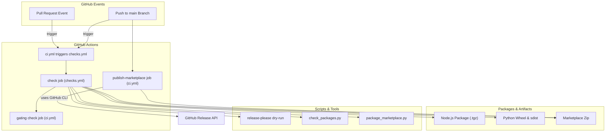
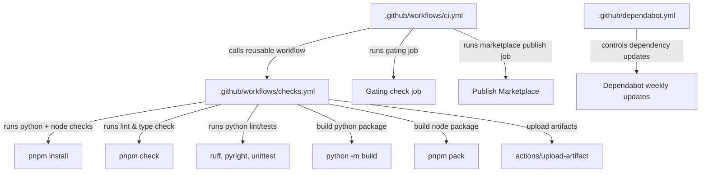

<!-- source: DeepWiki mcp.deepwiki.com · repo openai/mcp-extensions · page 6.1 CI Workflows · fetched 2026-10-26 -->

# 6.1 CI Workflows

Relevant source files

The following files were used as context for generating this wiki page:

- [.github/dependabot.yml](.github/dependabot.yml)
- [.github/workflows/checks.yml](.github/workflows/checks.yml)
- [.github/workflows/ci.yml](.github/workflows/ci.yml)

This page documents the Continuous Integration (CI) workflows implemented for the OpenAI MCP Extensions repository. The workflows automate code checking, building, packaging, releasing, and marketplace publishing processes. The main workflow files involved in these processes are `.github/workflows/ci.yml` and `.github/workflows/checks.yml`. Additionally, the repository configuration includes a Dependabot policy defined in `.github/dependabot.yml`.

---

## Purpose and Scope

The CI workflows are designed to:

- Automatically validate code quality and package integrity on pull requests and pushes to the `main` branch.
- Gate merging of code changes behind successful linting, type checking, unit testing, and build steps.
- Build Python and Node.js packages and verify their correctness.
- Upload build artifacts for release automation and marketplace packaging.
- Govern dependency updates through Dependabot with a security-first policy.
- Publish the latest marketplace assets as a release prerelease.

These workflows ensure code and package stability and enable automated, trustworthy release pipelines.

---

## Workflow Files and Triggers

### `.github/workflows/ci.yml`

- **Trigger:** Runs on all pull requests and pushes targeting the `main` branch.
- **Jobs:**
  - **checks:** Delegates to the `checks.yml` workflow as a reusable workflow call.
  - **check:** A gating job which depends on the `checks` job; ensures all checks passed before allowing merges.
  - **publish-marketplace:** Runs only on push events to `main`, after `check` succeeds; responsible for publishing the marketplace ZIP artifact as a GitHub prerelease named `marketplace-latest`.

This separation optimizes job dependencies, with reusable jobs performing heavy checks, followed by a quick gating job and a controlled publish job.

### `.github/workflows/checks.yml`

- **Trigger:** Designed as a reusable workflow called by other workflows.
- **Permission Configuration:** Read access to contents.
- **Environment Variables:** Custom package registries configured to internal firewall proxies for npm and Python.
- **Job `check`:**
  - Runs on an Ubuntu runner.
  - Performs a series of steps to checkout code, verify release tags for package publishing, install dependencies, run lint/type checks, run tests, build distribution packages, and upload artifacts.
  - Uploads packaged artifacts for both Python and Node.js with retention configured.
  - Packages the marketplace ZIP file and optionally uploads it for the main branch.

---

## Detailed Job Steps in `checks.yml`

### Step-by-step breakdown of `check` job:

1. **Checkout Code**
   - Uses GitHub Actions' `actions/checkout` at full depth to clone the repository code for the given ref.
2. **Release Tag Verification**
   - If a package release is requested (`package` input), validates the release tag matches the current commit and that the version follows semantic versioning.
   - Checks the tag ancestry to ensure the commit is on branch `main`.
3. **Record Source SHA**
   - Captures the commit SHA used for building artifacts for downstream steps.
4. **Setup PNPM and Node.js**
   - Sets up the `pnpm` package manager and Node.js runtime (version 22).
5. **Setup Python**
   - Sets Python version to 3.10 using `actions/setup-python`.
6. **Install Dependencies**
   - Runs `pnpm install --frozen-lockfile` to install dependencies from `pnpm-lock.yaml`.
7. **Rehearse release-please**
   - Runs a dry-run script to validate the release-please integration using a pinned version of the `release-please` npm package.
8. **Install Python Development Tools**
   - Installs Python packages, including `pyjwt` pinned to `2.14.0` and editable install of the repository’s Python code.
9. **TypeScript Checks**
   - Runs `pnpm check` to perform linting, type-checking, and build validations for the TypeScript SDK.
10. **Bits-and-Bolts Plugin Tests**
    - Runs the test suite for the `bits-and-bolts` example plugin via `pnpm` filter.
11. **Python Checks**
    - Runs Python linting (`ruff`), formatting checks, type checking (`pyright`), basic import sanity checks, and unit tests using unittest framework.
12. **Build and Check Release Distributions**
    - Builds Python distribution wheels and source archives via `python -m build`.
    - Checks distributions with `twine check`.
    - Packs Node.js packages using `pnpm`.
    - Runs package validation scripts on built artifacts.
    - Installs built Python wheels in a new virtual environment to smoke test wheel compatibility and imports.
13. **Upload Release Distributions**
    - Uploads the created Python and Node.js packages as artifacts (`packages-python` / `packages-node`) retained for 7 days.
14. **Package Marketplace**
    - Uses a custom Python script to package the marketplace assets as a zip.
15. **Upload Marketplace**
    - On main branch push events (without an input `ref`), uploads marketplace zip as an artifact retained for 1 day.

---

## Gating Job in `ci.yml`

The gating job `check` runs after the reusable `checks` job completes and insists all checks pass before proceeding. It runs a simple validation shell script to fail if any earlier check failed, corresponding to branch protection rules.

---

## Marketplace Publishing

Marketplace publishing runs only on pushes to `refs/heads/main` after checks succeed. It downloads the marketplace artifact previously uploaded and performs idempotent publishing to a GitHub prerelease called `marketplace-latest`.

- If the `marketplace-latest` release already exists, it ensures the current commit is ahead or identical to the released one, then uploads the updated asset and moves the release tag.
- Otherwise, it creates a new prerelease marking it as latest.
- Uses the GitHub CLI, requiring `GH_TOKEN` and repository name environment variables.

This enables continuous deployment of marketplace data safely tied to the canonical main branch state.

---

## Dependabot Policy

Managed in `.github/dependabot.yml`:

- **Ecosystem:** NPM package management.
- **Directory:** Root `/`.
- **Schedule:** Weekly update runs to reduce noise while maintaining currency.
- **Pull Request Limit:** 0 open PRs limit to avoid stale PRs piling up.
- **Grouping:** Security updates are grouped to prioritize timely attention.

This configuration balances security focus with manageable update cadence.

---

## Architecture and Data Flow Diagram

---

## Code Entity Diagram: CI Workflows and Key Files

---

## Summary Table of Key Workflow Features

| Feature                    | Description                                                   | Location/Reference                |
|----------------------------|---------------------------------------------------------------|---------------------------------|
| CI triggers                | PR and push to main trigger entire CI pipeline                | `.github/workflows/ci.yml:3-6`   |
| Reusable workflow          | Checks job is reusable for other workflows                    | `.github/workflows/checks.yml:3-14`   |
| Gating job                 | Ensures all checks succeed before merges allowed               | `.github/workflows/ci.yml:16-26` |
| Lint, type, test steps     | pnpm check, ruff, pyright and unittest                         | `.github/workflows/checks.yml:91-103` |
| Build release artifacts    | Python wheels/sdist and Node tgz                               | `.github/workflows/checks.yml:110-118` |
| Artifact upload            | Upload packages and marketplace zip with retention policies   | `.github/workflows/checks.yml:120-138` |
| Marketplace publishing     | Publishes `marketplace-latest` prerelease on main push        | `.github/workflows/ci.yml:27-68` |
| Release tag validation     | Validates semver tags and ancestry on release artifacts build | `.github/workflows/checks.yml:42-56` |
| Dependabot Policy          | Weekly updates with security group priorities                  | `.github/dependabot.yml:1-13`    |

---

## References

- CI workflow triggers and jobs: `.github/workflows/ci.yml` [1-68]()
- Package checks reusable workflow: `.github/workflows/checks.yml` [1-139]()
- Dependabot configuration file: `.github/dependabot.yml` [1-13]()

---

# End of 6.1 CI Workflows page

---

