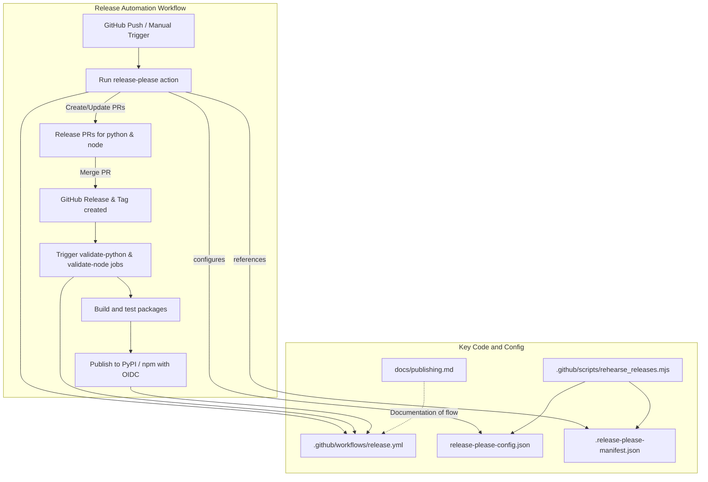
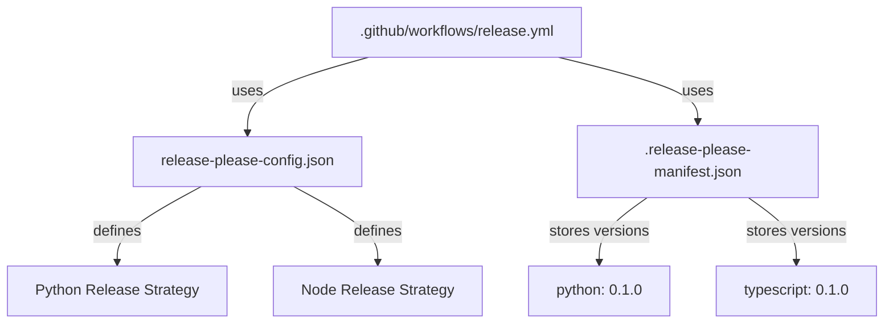
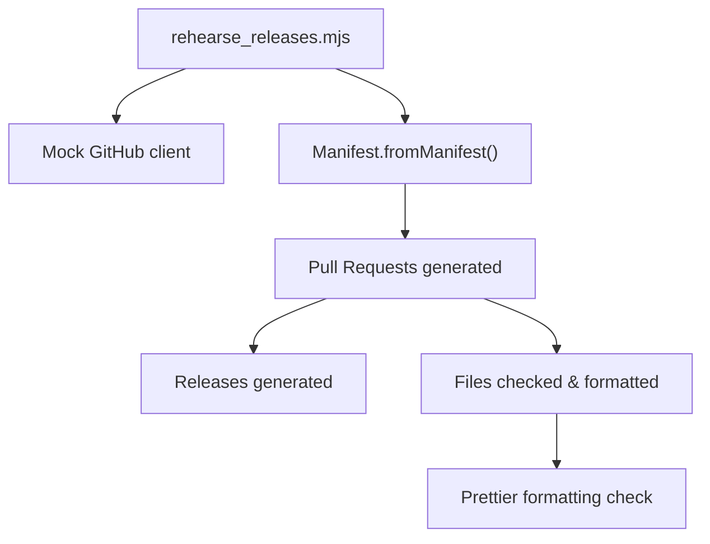

<!-- source: DeepWiki mcp.deepwiki.com · repo openai/mcp-extensions · page 6.2 Release Automation (release-please) · fetched 2026-10-26 -->

# Release Automation (release-please)

<details>
<summary>Relevant source files</summary>

The following files were used as context for generating this wiki page:

- [.github/scripts/rehearse_releases.mjs](.github/scripts/rehearse_releases.mjs)
- [.github/workflows/release.yml](.github/workflows/release.yml)
- [.release-please-manifest.json](.release-please-manifest.json)
- [docs/publishing.md](docs/publishing.md)

</details>


This section covers the release automation setup for the OpenAI MCP Extensions repository, focusing on the use of the [release-please](https://github.com/googleapis/release-please) tool to manage versioning, changelog generation, and publishing of Python and Node packages. It details the implementation of the GitHub Actions workflows, the release-please manifest and configuration, a dry-run rehearsal harness, and the trusted publishing process for PyPI and npm.

---

## Purpose and Scope

The release automation system orchestrates how package versions are bumped, release pull requests are generated, GitHub releases are created, and final artifacts are validated and published. This enables consistent, reliable, and auditable package releases for the two independently versioned packages within the repository:

- **Python package:** `openai-mcp-extensions`
- **Node package:** `@openai/mcp-extensions`

This page explains the key components and flow of this automation, including configuration files, workflow design, dry-run testing, and publishing controls.

---

## Release-Please Configuration and Manifest

### `release-please-config.json` (implicit from code context)

The release-please configuration defines:

- Separate release strategies for the **Python** and **Node** packages:
  - `python/` directory uses the native Python release-please strategy.
  - `typescript/` directory uses the native Node (JavaScript) release-please strategy.

Each package has its own changelog and independent versioning, without linked versions. This allows releasing either package in isolation if desired.

### Manifest File: `.release-please-manifest.json`

This JSON file tracks the last released version for each package, initially set as:

```json
{
  "python": "0.1.0",
  "typescript": "0.1.0"
}
```

This manifest is consulted by the release process to detect version bumps and generate release pull requests accordingly.

---

## GitHub Actions Workflow: `release.yml`

The core release automation is implemented as a multi-job workflow triggered on pushes to the `main` branch or manually via workflow dispatch. Key features of this workflow include:

### Workflow Triggers and Inputs

- Runs on every push to `main` if the variable `RELEASE_PLEASE_ENABLED` is `true`.
- Can be triggered manually via workflow dispatch, requiring inputs:
  - `version`: exact release version (e.g., `0.1.1`).
  - `package`: either `python` or `node`.
  - `publish`: boolean to indicate whether to publish the release publicly after validation.

### Permissions and Concurrency

- Requires read permissions for repository contents during most steps.
- The `release-please` job needs write permissions for contents, issues, and pull requests to create/update release PRs.
- The workflow runs exclusively in the concurrency group `package-release` to avoid conflicts.

### Jobs Overview

1. **release-please**  
   Runs the release-please tool (`googleapis/release-please-action`) configured with the manifest and config file, to generate or update release PRs and GitHub releases for either or both packages.  
   - Uses `GITHUB_TOKEN` or optionally a GitHub App token (`USE_SDK_RELEASE_APP`) for authentication.
   - Outputs tags, SHAs, and version numbers for both packages.

2. **validate-python** and **validate-node**  
   Dependent on `release-please`, these jobs validate the generated release artifacts for each package by running shared checks defined in `.github/workflows/checks.yml`.  
   - Triggered only if a new release tag is present or a manual dispatch for the package type is requested.
   - Validate tasks include linting, typing, building, packaging, and artifact integrity verification.

3. **publish-pypi**  
   Runs if Python validation succeeds, publishing the Python package using PyPI's OIDC auth and environment protections.

4. **publish-npm**  
   Runs if Node validation succeeds, publishing the Node package to npm with OIDC authentication and registry settings ensuring trusted publishing.

### Environment and Security Controls

- The workflow uses GitHub Environments:
  - `release` for the release generation step.
  - `pypi` and `npm` for package publication, with restricted access and publishing review.
- The bootstrap SHA in the release config ensures release-please only acts on the intended commit history slice.
- Publication steps carry minimal permissions (`id-token: write`) and do not perform rebuilds but rather upload pre-validated artifacts from CI runs.

---

## Dry-Run Harness: `rehearse_releases.mjs`

To ensure correctness without altering GitHub state, the repo includes a rehearsal script exercising the pinned release-please version (17.6.0) in isolation:

- Installs release-please temporarily and runs through generating PRs and releases based on test commit fixtures.
- Validates version bumps and changelog updates for Python and Node packages separately.
- Uses a mocked GitHub interface to stub out remote file access, releasing iterator, tag iterator, and PR iterator, simulating repository state and commits.
- Asserts that generated changelogs are always formatted per the prettier configuration.
- Confirms that version manifests and release tags conform to expected formats.
- Exercises varied commit scenarios (Python fix, Node feature, both, infrastructure only, explicit initial releases).

This harness is implemented fully in `.github/scripts/rehearse_releases.mjs` and validates the internal logic of release-please configuration and handling before running the actual release workflows.

---

## Data Flow and Component Interaction



---

## Release Workflow Implementation Details

### release.yml job: `release-please`

- Uses the `googleapis/release-please-action` (v5.0.0) pinned to a specific commit.
- Reads repository variables to decide on token usage (`GITHUB_TOKEN` vs. GitHub App token).
- Verifies that the `bootstrap-sha` from `release-please-config.json` is an ancestor of the HEAD, enforcing repository history consistency.
- Output variables include exact tags, versions, and SHAs for python and node packages, passed downstream to validation and publishing jobs.

### Validation Jobs: `validate-python` and `validate-node`

- These jobs run the common `checks.yml` workflow using the release SHA or tag as input.
- Validation includes extensive static checks, build, lint, and packaging confirmation.
- The build artifact from validation jobs is uploaded and downloaded by the subsequent publishing jobs.

### Publishing Jobs: `publish-pypi` and `publish-npm`

- Utilize GitHub OIDC to authenticate against public registries in a secure and ephemeral manner.
- Publish steps do not rebuild from source but rely on validated packages from the CI artifact store.
- npm publishing installs a custom global npm version with trusted publishing support via a private registry proxy.
- Publish steps run only after successful validation and environmental approval.

---

## Trusted Publishing and Security

The system uses GitHub Environments and secrets with strict permissions to guard actual release publishing:

- Require reviewers on environments for PyPI and npm.
- Disallow self-approval where enforced.
- Utilize OIDC authentication for package registry access, eliminating static tokens.
- npm publication requires pre-approved Trusted Publisher setup, mandatory two-factor auth, and no token-based publish access.
- Release-please itself does not push directly to registries, it only manages GitHub releases, PRs, and tags.

This ensures the production release flow is auditable, secure, and reproducible.

---

## Documentation: `docs/publishing.md`

The companion publishing document explains:

- The independence of Python and Node package versions.
- The avoidance of manual version bumps or combined version tagging.
- The significance of configuration files (`release-please-config.json`, `.github/workflows/release.yml`, `.github/workflows/checks.yml`).
- Required repo variables for activating release automation and publishing.
- Step-by-step activation checklist with security considerations for PyPI and npm.
- How the bootstrap SHA maintains history boundaries to prevent accidental cross-repository release errors.
- Notes on eliminating the old merged-release PR label workflow.

This document is the human-readable guide complementing the automated flow.

---

## Summary of Key Files

| File                              | Role                                                       |
|----------------------------------|------------------------------------------------------------|
| `.github/workflows/release.yml`  | Main GitHub Actions workflow orchestrating release steps.  |
| `release-please-config.json`     | Configuration for release-please, defines package strategies. |
| `.release-please-manifest.json`  | Tracks last released versions per package.                  |
| `.github/scripts/rehearse_releases.mjs` | Dry-run testing harness for release-please config and logic. |
| `docs/publishing.md`              | Release and publishing process documentation.              |

---

# Supplementary Diagrams

### Diagram 1: Release-Please Configuration Mapping



### Diagram 2: Element Connections in Rehearse Releases Script



---

# Implementation Notes and Citation

- The main release workflow is defined in `.github/workflows/release.yml:1-161`, which configures jobs for release-please, validation, and publishing steps.
- The dry-run rehearsal script is extensively implemented in `.github/scripts/rehearse_releases.mjs:1-193`, including mocked GitHub API responses and assertions on PR and release content.
- The package version manifest `.release-please-manifest.json:1-4` tracks versions for Python and TypeScript.
- The publishing documentation located at `docs/publishing.md:1-34` provides activation instructions, security guidelines, and usage notes for the release system.

Sources:  
`.github/workflows/release.yml:1-161`  
`.github/scripts/rehearse_releases.mjs:1-193`  
`.release-please-manifest.json:1-4`  
`docs/publishing.md:1-34`

---

