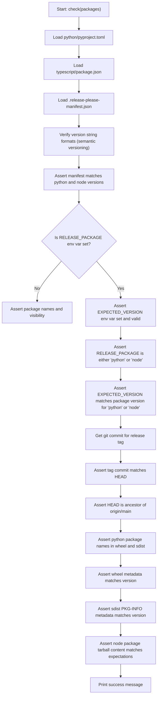
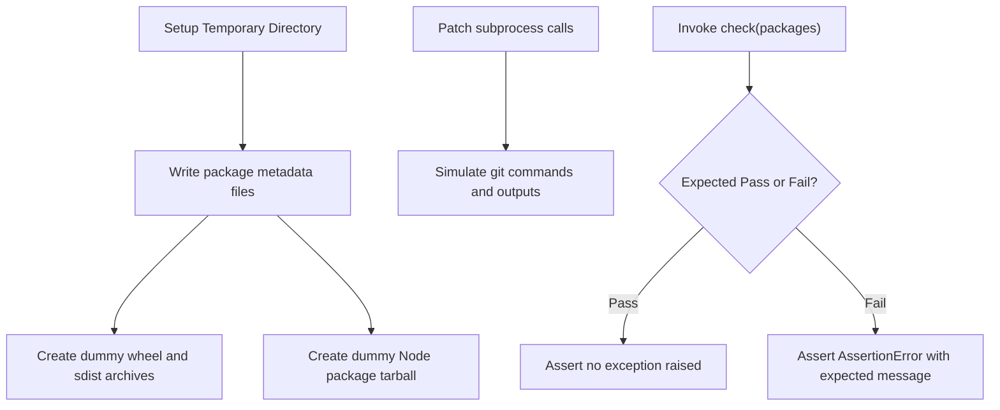

<!-- source: DeepWiki mcp.deepwiki.com · repo openai/mcp-extensions · page 6.3 Package Validation Scripts · fetched 2026-10-26 -->

# Package Validation Scripts

<details>
<summary>Relevant source files</summary>

The following files were used as context for generating this wiki page:

- [.github/scripts/check_packages.py](.github/scripts/check_packages.py)
- [.github/scripts/test_check_packages.py](.github/scripts/test_check_packages.py)

</details>


This section covers the package validation scripts, primarily focusing on the `check_packages.py` script and its accompanying unit tests. These scripts ensure the integrity, consistency, and correctness of release artifacts across Python and Node.js packages in the MCP Extensions repository. The validation tasks include verifying version synchronization, confirming proper Git tag ancestry, and inspecting release artifacts such as Python wheels, source distributions, and Node tarballs.

---

## Purpose and Scope

`check_packages.py` performs comprehensive checks during the CI and release processes to validate that:

- The Python and Node.js package versions are synchronized correctly but can differ independently.
- Release tags in Git correspond correctly to the tested commits.
- The packaged distribution artifacts (wheel, sdist, Node `.tgz`) contain expected metadata and files.
- The package manifests and export definitions conform to expectations.
- The Node package is public (not marked private) and publishable.

These validations help catch any release inconsistencies that might cause publishing errors or unexpected behavior by consumers of the packages.

The script is exercised by automated tests in `test_check_packages.py` that mock different scenarios to ensure correct behavior and failure modes.

---

## Implementation Overview

The main script is located at `.github/scripts/check_packages.py` and contains a single primary function:

```python
def check(packages: Path) -> None:
    ...
```

It reads package metadata from:

- `python/pyproject.toml` (Python package info),
- `typescript/package.json` (Node package info),
- `.release-please-manifest.json` (a manifest file that tracks release versions).

The script then performs a series of validations on versioning, Git tags, and package archive contents located under the provided `packages` directory.

### Key Data Sources
- Python package project info (version, name) from the PEM format `pyproject.toml`.
- Node package version and export fields from `package.json`.
- Release manifest versions used to verify consistency between published versions.
- Environment variables `RELEASE_PACKAGE` and `EXPECTED_VERSION` for release-specific checks.

---

## Detailed Data Flow and Validation Steps

The `check` function performs validation in the following sequence:



- **Version Checks** (lines 20-30): Python and Node versions must be valid semver strings (`\d+\.\d+\.\d+`). The manifest must precisely map Python and Node versions.
- **Git Tag & Commit Checks** (lines 33-50): If releasing, the release tags `refs/tags/{package}-v{version}` must exist and point to the current HEAD commit, and HEAD must be an ancestor of `origin/main` to ensure upstream inclusion.
- **Package Meta Checks** (lines 51-54): Package names must be exact (`openai-mcp-extensions` Python, `@openai/mcp-extensions` Node). Node package must not be private.
- **Python Artifacts Checks** (lines 55-75):
  - Confirm one wheel and one sdist exist.
  - Open wheel archive and read METADATA, ensuring name & version matches.
  - Confirm presence of expected Python packages (`openai_mcp_extensions`, `openai_mcp_form_protocol`) inside wheel.
  - Open sdist tarball, extract `PKG-INFO` file, and validate metadata.
- **Node Artifact Checks** (lines 76-86):
  - Open `package.tgz` tarball, extract `package.json`, confirm its name and version.
  - Assert package isn't private.
  - Inspect exports definitions from `package.json` and verify files exist inside tarball.
  - Assert license file presence.
- Prints validation success message. (line 87)

The script raises assertion errors if any validation fails, which breaks the CI or publishing pipeline.

---

## Key Functions and Classes

The script uses no custom classes but leverages:

- `Path` from `pathlib` to manage file paths.
- `tomllib` (or `tomli` fallback) for parsing TOML files.
- `json` to parse JSON manifests.
- `subprocess` calls to:
  - `git rev-parse` to get tag and HEAD commit hashes.
  - `git merge-base --is-ancestor` to verify tag ancestry.
- `zipfile` to open Python wheel archives.
- `tarfile` to open Python sdist and Node tarballs.
- `email.message_from_bytes` to parse metadata files (formatted like email headers).

---

## System to Code Mapping Diagram

```mermaid
graph TD
    "Version/Application State" -- Reads --> "python/pyproject.toml (project.version)"["project.version (check_packages.py:20-25)"]
    "Version/Application State" -- Reads --> "typescript/package.json (version)"["node.version (check_packages.py:21-28)"]
    "Version/Application State" -- Reads --> ".release-please-manifest.json"["manifest (check_packages.py:22-29)"]
    
    "Git Tags" -- subprocess.check_output() --> "refs/tags/{package}-v{version}"["Git Tag Parsing (check_packages.py:43-50)"]
    "Git Commit" -- subprocess.check_output() --> "HEAD (current commit)"["Git HEAD Parsing (check_packages.py:45-46)"]

    "Python Release Artifacts" --> "Wheel File *.whl"["Wheel archive inspection (check_packages.py:55-66)"]
    "Python Release Artifacts" --> "Source Dist *.tar.gz"["sdist tarball inspection (check_packages.py:67-75)"]

    "Node Release Artifact" --> "package.tgz"["Node package tarball inspection (check_packages.py:76-86)"]

    "check(packages)"["check() Function Entry Point (check_packages.py:19-91)"]
    
    "check(packages)" -- Verifies --> "Version/Application State"
    "check(packages)" -- Verifies --> "Git Tags"
    "check(packages)" -- Verifies --> "Python Release Artifacts"
    "check(packages)" -- Verifies --> "Node Release Artifact"
```

---

## Unit Testing: `test_check_packages.py`

The test suite located at `.github/scripts/test_check_packages.py` uses Python's `unittest` framework to validate the behavior of `check_packages.py`. It particularly tests:

- Passing scenario with correctly prepared package versions and artifacts.
- Failure when Node export files are missing.
- Failure when version metadata is inconsistent.
- Failure if required environment variables are missing for release.
- Correct tag usage per package with Git mocks.
- Failure on tag pointing to incorrect commits.

### Testing Approach

- Uses `tempfile.TemporaryDirectory` to create isolated test directories.
- Mocks environment variables with `patch.dict`.
- Creates dummy wheel and sdist archives with custom metadata for testing.
- Creates dummy Node `.tgz` archives with `package.json` and required files.
- Mocks subprocess Git calls to simulate Git operations.
- Validates correct exceptions and assertion messages on failure.

---

## Test Process Data Flow



The tests afford confidence that `check_packages.py` reliably detects both proper and broken release states, enforcing consistent repository standards.

---

## Summary

The package validation scripts within `.github/scripts/` provide critical guardrails to ensuring the MCP Extensions repository publishes clean, version-correct, and complete Python and Node.js packages. By inspecting version files, Git tags, and release distribution contents, they catch issues early in CI and release workflows.

| Script / Test File         | Primary Purpose                                  | Location                        |
| ------------------------- | ---------------------------------------------- | ------------------------------ |
| `check_packages.py`       | Validation of package versions and artifacts   | `.github/scripts/check_packages.py`       |
| `test_check_packages.py`  | Unit test coverage and failure mode testing    | `.github/scripts/test_check_packages.py` |

---

## References and Sources
- Source implementation of `check_packages.py`: `.github/scripts/check_packages.py:1-92`  
- Unit tests in `test_check_packages.py`: `.github/scripts/test_check_packages.py:1-123`

---

