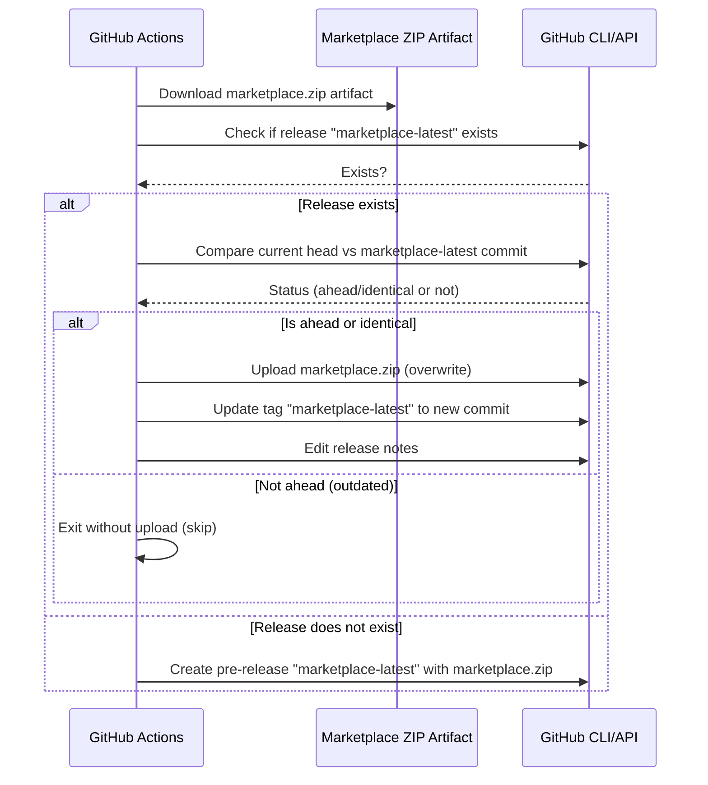
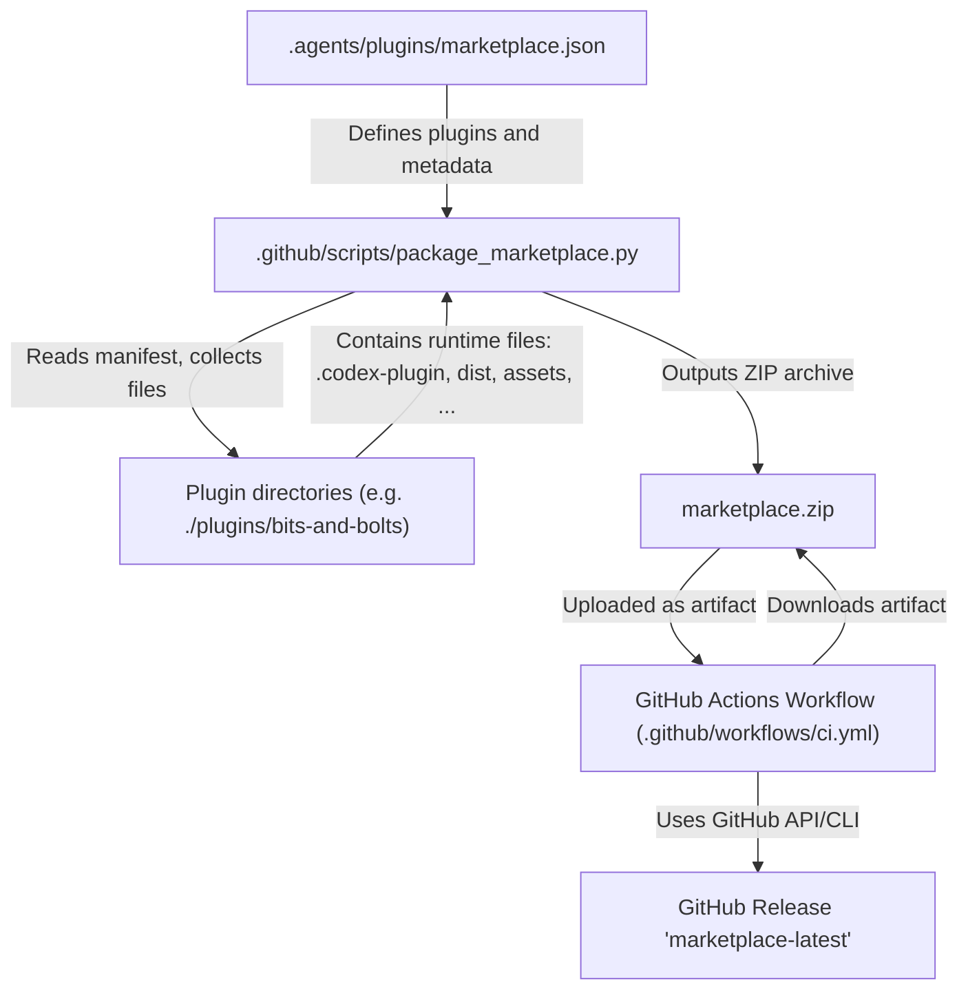
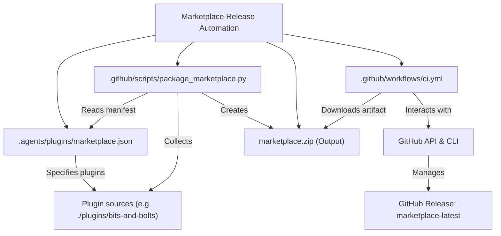

<!-- source: DeepWiki mcp.deepwiki.com · repo openai/mcp-extensions · page 6.4 Agent Marketplace Packaging · fetched 2026-10-26 -->

# Agent Marketplace Packaging

<details>
<summary>Relevant source files</summary>

The following files were used as context for generating this wiki page:

- [.agents/plugins/marketplace.json](.agents/plugins/marketplace.json)
- [.github/scripts/package_marketplace.py](.github/scripts/package_marketplace.py)
- [.github/workflows/ci.yml](.github/workflows/ci.yml)

</details>


This page documents the implementation details of the **Agent Marketplace Packaging** within the OpenAI MCP Extensions repository. It focuses on how the `.agents/plugins/marketplace.json` manifest defines the marketplace plugins and how the `package_marketplace.py` script builds a distributable ZIP archive of the marketplace plugins without source dependencies. Finally, it covers the automated GitHub Actions release flow that publishes the latest marketplace release to GitHub.

This is a leaf-level documentation page (no children) within the CI, Release & Distribution section of the repo.

---

## 1. `.agents/plugins/marketplace.json` Manifest

The marketplace manifest is a JSON file located at `.agents/plugins/marketplace.json`. It describes the marketplace as a collection of plugins bundled together as a single entity for distribution.

### Key Structure

- `name`: A unique name for the marketplace package. Example: `"mcp-extensions-early-access"`.
- `interface.displayName`: A human-readable display name for the marketplace.
- `plugins`: An array of plugin entries, each describing a plugin included in the marketplace.

Each plugin entry contains the following fields:

- `name`: The plugin's short identifier (e.g., `"bits-and-bolts"`).
- `source`: Describes the plugin's source location. The `source` field is currently expected to be `"local"`, with a `path` pointing to a relative directory (e.g., `"./plugins/bits-and-bolts"`).
- `policy`: Installation and authentication policies such as `"AVAILABLE"` for installation and `"ON_INSTALL"` for authentication.
- `category`: A category string grouping the plugin in the marketplace UI (e.g., `"Developer Tools"`).

### Example

```json
{
  "name": "mcp-extensions-early-access",
  "interface": {
    "displayName": "OpenAI MCP Extensions (Early Access)"
  },
  "plugins": [
    {
      "name": "bits-and-bolts",
      "source": {
        "source": "local",
        "path": "./plugins/bits-and-bolts"
      },
      "policy": {
        "installation": "AVAILABLE",
        "authentication": "ON_INSTALL"
      },
      "category": "Developer Tools"
    }
  ]
}
```

This manifest clearly enumerates the available plugins and their locations, serving as the source of truth for packaging and publishing workflows.

Sources: `.agents/plugins/marketplace.json:1-20`


---

## 2. `package_marketplace.py` ZIP Builder Script

The `package_marketplace.py` script, residing in `.github/scripts/`, automates the process of packaging the marketplace described in `marketplace.json` into a zipped archive suitable for distribution.

### Main Responsibilities

- Reads the marketplace manifest `.agents/plugins/marketplace.json`.
- Validates that all plugins use a local source and that their essential runtime files exist.
- Collects all needed files (specified manifest, LICENSE, plugin runtime files).
- Creates a ZIP archive with the marketplace name as the root directory, preserving relative paths.
- Outputs the ZIP file path for downstream uses.

### Workflow Breakdown

```mermaid
flowchart TD
  A[Read marketplace.json] --> B{For each plugin:}
  B -->|Check source==local| C[Resolve plugin path]
  C --> D[Check for mandatory files/folders]
  D --> E[Collect all files (rglob)]
  E --> F[Add files to package file list]

  F --> G[Add manifest and LICENSE to file list]
  G --> H[Create ZIP file]
  H --> I[Write files with marketplace-relative paths]
  I --> J[Print ZIP output path]
```

### Important Script Details

- The script sets the root directory as two levels above its own location.
- Raises an error if any plugin source is not local.
- Paths mandatory for plugin runtime include files/folders:
  - `.codex-plugin`
  - `.mcp.json`
  - `assets`
  - `dist`
  - `package.json`
  - `skills`
- The ZIP entries are prefixed with the marketplace `name` to preserve inside-archive structure.
- Usage pattern example from CI scripts: `python .github/scripts/package_marketplace.py <output_zip_path>`

### Snippet of core packaging loop

```python
for entry in marketplace["plugins"]:
    source = entry["source"]
    if source["source"] != "local":
        raise ValueError(f"Expected a local plugin source: {entry['name']}")
    plugin = (root / source["path"]).resolve()
    # Ensure required files/directories exist.
    for name in (".codex-plugin", ".mcp.json", "assets", "dist", "package.json", "skills"):
        path = plugin / name
        if not path.exists():
            raise FileNotFoundError(f"Missing {path}; run pnpm build first")
        # Collect files either recursively or directly
        if path.is_dir():
            files.extend(item for item in path.rglob("*") if item.is_file())
        else:
            files.append(path)
```

Sources: `.github/scripts/package_marketplace.py:1-44`


---

## 3. Marketplace Release Automation in GitHub Actions

The marketplace packaging and publishing are integrated into GitHub Actions workflows, particularly visible in `.github/workflows/ci.yml`.

### `publish-marketplace` Job

This specific job runs upon `push` events to the `main` branch after passing other CI checks.

#### Workflow Steps and Logic



#### Process Details

- Downloads the marketplace ZIP built and uploaded as an artifact by previous jobs.
- Checks if a GitHub release named `marketplace-latest` exists.
- If it exists:
  - Verifies that the current commit is ahead or identical to the release's commit.
  - If valid, uploads the new ZIP, updates the Git tag, and modifies release notes.
  - If the commit is behind, the update is skipped.
- If the release does not exist:
  - Creates a new pre-release named `marketplace-latest` targeting the current commit with the ZIP attached.
- This ensures a single canonical latest marketplace release that can be reliably retrieved by users or automation.

### Key Environment Variables

- `GH_TOKEN`: GitHub API token for authenticated requests.
- `GH_REPO`: The repository slug (owner/name).
- `GITHUB_SHA`: The current Git commit hash for reference.

Sources: `.github/workflows/ci.yml:27-68`


---

## 4. Data Flow and Components Diagram

This diagram illustrates how the marketplace packaging components relate to each other from manifest declaration, file collection, packaging, and final release publishing.



Sources: `.agents/plugins/marketplace.json`, `.github/scripts/package_marketplace.py`, `.github/workflows/ci.yml`


---

## 5. Mapping Natural Language Concepts to Code Entities

This section bridges the natural language concepts involved in agent marketplace packaging to their concrete code entities, showing how the system is implemented.

### Packaging Natural Language → Code Entities



Sources: `.agents/plugins/marketplace.json`, `.github/scripts/package_marketplace.py`, `.github/workflows/ci.yml`


---

## 6. Summary

- The **agent marketplace manifest** at `.agents/plugins/marketplace.json` declares all plugins in the marketplace with detailed metadata.
- The **`package_marketplace.py` script** builds a ZIP archive of all necessary plugin runtime files and metadata for distribution.
- The **GitHub Actions workflow** automates the continuous delivery of the packaged marketplace as a special `marketplace-latest` release, safeguarding update correctness by commit comparisons.
- This packaging and release flow facilitates seamless distribution and installation of agent plugins to MCP environments.

This tightly integrated system ensures the marketplace remains up-to-date and easily consumed by clients via a stable release artifact.

---

Sources:  
`.agents/plugins/marketplace.json:1-20`  
`.github/scripts/package_marketplace.py:1-44`  
`.github/workflows/ci.yml:27-68`

---

