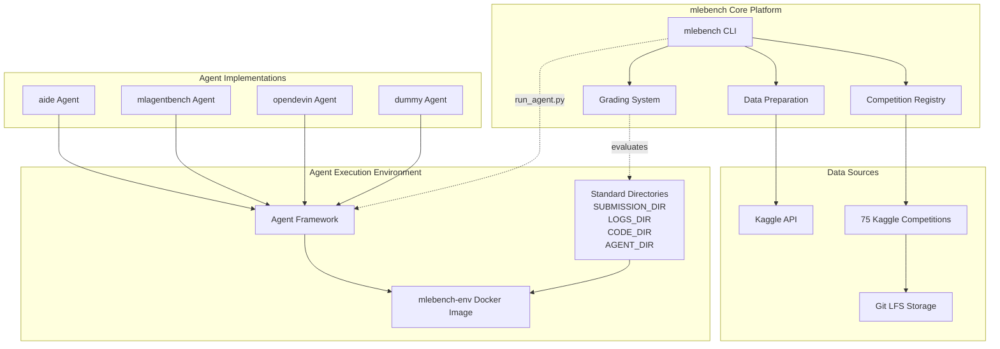
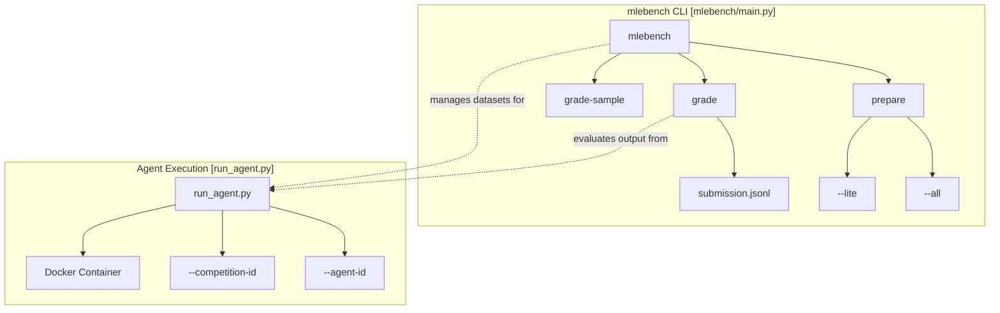
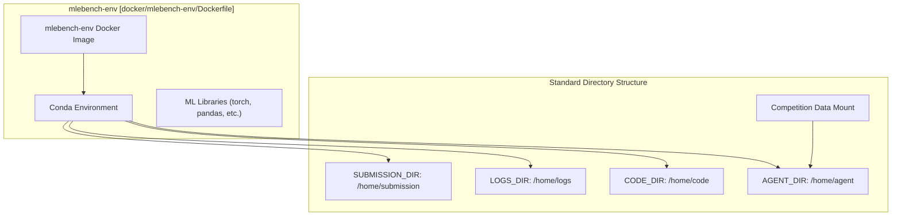

<!-- source: DeepWiki mcp.deepwiki.com · repo openai/mle-bench · page 1 Overview · fetched 2026-10-26 -->

# Overview

Relevant source files

The following files were used as context for generating this wiki page:

- [README.md](README.md)
- [runs/README.md](runs/README.md)

MLE-bench is a machine learning agent benchmarking system designed to evaluate AI agents on end-to-end machine learning engineering tasks. It utilizes 75 Kaggle competitions to provide a standardized framework for data preparation, agent execution, and submission grading across diverse ML domains such as image classification, tabular data analysis, and natural language processing. [README.md:1-4]()

## Purpose and Architecture

MLE-bench evaluates agents on their ability to perform complex, long-running ML engineering workflows—from initial data exploration and preprocessing to model training and submission generation. The system is composed of the `mlebench` CLI for management, a Docker-based execution environment (`mlebench-env`), and a standardized agent framework. [README.md:149-156]()

### System Overview

Sources: [README.md:1-25](), [README.md:149-156]()

## Competition Dataset

The benchmark contains 75 Kaggle competitions categorized by complexity and data type. These are split into `low` (Lite), `medium`, and `high` tiers based on the difficulty of the engineering task. [README.md:35-61]()

| Complexity Level | Competition Count | Total Dataset Size | Description |
|------------------|-------------------|-------------------|-------------|
| Low | 22 | 158GB | Lite evaluation subset |
| Medium | 27 | ~1.1TB | Moderate complexity tasks |
| High | 26 | ~2.1TB | Complex ML engineering challenges |
| **All** | **75** | **3.3TB** | Complete benchmark |

### Competition Categories and Examples

| Category | Example Competitions | Data Types |
|----------|---------------------|------------|
| Image Classification | `aerial-cactus-identification` | Images (JPG, PNG) |
| Tabular | `new-york-city-taxi-fare-prediction` | CSV, structured data |
| Text Classification | `jigsaw-toxic-comment-classification` | Text, NLP |
| Audio Classification | `mlsp-2013-birds` | Audio files |

Sources: [README.md:35-61](), [README.md:82-96]()

### CLI and Execution Flow

The `mlebench` CLI manages the lifecycle of a benchmark run, while `run_agent.py` handles the containerized execution of specific agents. [README.md:97-138]()

Sources: [README.md:97-120](), [README.md:125-138]()

## Agent Evaluation Framework

MLE-bench evaluates agents through a standardized Docker-based execution environment. It supports various agent architectures and large language models (LLMs). [README.md:140-151]()

### Agent Types and Capabilities

| Agent | LLM Support | Execution Environment |
|-------|-------------|----------------------|
| `aide` | GPT-4o, Claude-3.5, o1-preview | Sysbox runtime + Conda |
| `mlagentbench` | GPT-4o, etc. | MLAgentBench framework |
| `opendevin` | GPT-4o | Privileged Docker-in-Docker |
| `dummy` | None | Minimal environment |

### Standardized Agent Environment

Agents interact with a fixed directory structure inside the container to ensure reproducibility and ease of grading. [README.md:22-27]()

Sources: [README.md:140-151](), [README.md:22-27]()

## Benchmarking Standards

To produce comparable results for the leaderboard, MLE-bench enforces specific resource constraints and reporting requirements: [README.md:5-24](), [README.md:53-70]()

*   **Runtime**: Typically 12-24 hours maximum per competition. [README.md:8-37]()
*   **Compute**: Standard configurations involve 24-64 vCPUs and high-memory instances (e.g., 440GB RAM), often with one or more GPUs (A10, V100, A100, or H100). [runs/README.md:30-63]()
*   **Evaluation methodology**: Agents should be run across multiple seeds (minimum 3) to account for variance. Results are reported as the mean and standard error (SEM) of the `any_medal_percentage`. [README.md:18-22](), [README.md:67-68]()
*   **Aggregation**: Results are aggregated by complexity split (low, medium, high, split75) using the `aggregate_grading_reports.py` script. [README.md:53-65]()

## Key Concepts

### Competition Structure
Each competition includes a unique ID, metadata, and scripts for preparation and grading. The datasets are stored via Git LFS and prepared locally using the CLI. [README.md:82-96]()

### Submission and Grading
Agents must output a `submission.csv` to the `/home/submission` directory. The `mlebench grade` command uses competition-specific logic to compare this file against ground truth labels and determine if the performance reaches "medal" thresholds (Bronze, Silver, or Gold). [README.md:119-134]()

### Lite Evaluation
The "Lite" subset consists of the 22 `low` complexity competitions. It is designed for faster iteration and lower storage requirements (158GB). [README.md:25-56]()

Sources: [README.md:1-171](), [runs/README.md:1-63]()

---

