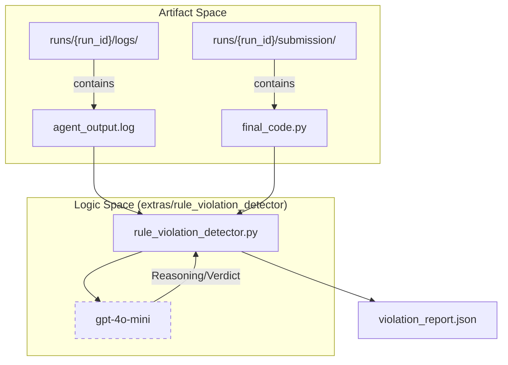
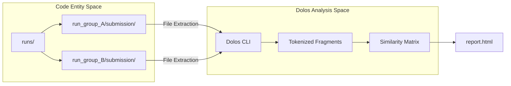

<!-- source: DeepWiki mcp.deepwiki.com · repo openai/mle-bench · page 10.1 Rule Violation and Plagiarism Detection · fetched 2026-10-26 -->

# Rule Violation and Plagiarism Detection

Relevant source files

The following files were used as context for generating this wiki page:

- [README.md](README.md)
- [experiments/competition_categories.csv](experiments/competition_categories.csv)

This page documents the auxiliary tools provided in the MLE-bench repository for maintaining benchmark integrity. These tools are designed to detect instances where agents might have violated competition constraints or engaged in code plagiarism, ensuring that leaderboard submissions are fair and comparable.

## Overview

The `extras/` directory contains two primary detection systems:
1.  **Rule Violation Detector**: Uses LLM-based analysis to identify if an agent has bypassed environment restrictions or violated specific competition rules.
2.  **Plagiarism Detector**: Utilizes the [Dolos](https://dolos.ugent.be/) source code plagiarism detection framework to compare agent submissions against known solutions or other submissions.

---

## Rule Violation Detector

The Rule Violation Detector is an automated system that analyzes agent interaction logs and final submissions to determine if the agent performed prohibited actions.

### Implementation and Data Flow

The detector operates by processing the execution artifacts of an agent run. It specifically looks for patterns that indicate the agent attempted to access the internet (if restricted), manipulate the grading scripts, or hardcode known answers.

#### Key Logic
- **Log Analysis**: The tool parses the standard output and error logs generated during the agent's execution [README.md:55-58]().
- **LLM Verification**: It leverages `gpt-4o-mini` to perform high-reasoning checks on the extracted actions. The LLM is prompted to look for specific "red flags" defined in the competition metadata.

### System Architecture: Rule Violation Detection

The following diagram illustrates how the `rule_violation_detector` interacts with the benchmark artifacts.

**Diagram: Rule Violation Analysis Pipeline**

**Sources:** [README.md:55-65](), [extras/rule_violation_detector/]() (directory reference)

---

## Plagiarism Detector

The Plagiarism Detector identifies code similarities between agent submissions. This is critical for detecting "data leakage" or cases where an agent might have memorized a specific solution from its training data.

### Prerequisites
- **Node.js**: Required to run the Dolos CLI.
- **Dolos**: The core engine used for tokenization and structural comparison of source code.

### Usage and Workflow
The tool aggregates submissions from the `runs/` directory and compares them against a reference set (e.g., ground truth solutions or other agents).

1.  **Extraction**: The detector extracts all source code files from the `submission/` subdirectory of each run [README.md:55-58]().
2.  **Tokenization**: Dolos tokenizes the code, making it resistant to simple variable renaming or whitespace changes.
3.  **Reporting**: It generates an HTML-based report showing similarity matrices and side-by-side code comparisons.

### System Architecture: Code Entity Mapping

This diagram shows how the detector maps filesystem entities to the Dolos analysis engine.

**Diagram: Plagiarism Detection Entity Mapping**

**Sources:** [README.md:55-65](), [extras/plagiarism_detector/]() (directory reference)

---

## Interpreting Output Reports

### Rule Violation Reports
The output is typically a JSON file (`violation_report.json`) containing:
- **Violation Flag**: A boolean indicating if a rule was likely broken.
- **Evidence**: Snippets from the logs or code that triggered the flag.
- **Reasoning**: The LLM's justification for the verdict.

### Plagiarism Reports
The Dolos report provides several metrics:
- **Similarity Score**: A percentage representing how much of the code is shared between two submissions.
- **Fragment Matching**: Highlights specific blocks of code that are identical or near-identical.
- **Cluster Analysis**: Visualizes groups of agents that produced suspiciously similar code.

| Metric | Threshold | Action |
| :--- | :--- | :--- |
| **Similarity > 80%** | High | Manual review required; potential plagiarism. |
| **Similarity 50-80%** | Medium | Check for common boilerplate or library usage. |
| **Similarity < 50%** | Low | Likely independent implementation. |

**Sources:** [README.md:8-37](), [extras/plagiarism_detector/]() (logic inference)

---

## Integration with Leaderboard

The MLE-bench maintainers use these tools to vet submissions before they are added to the official leaderboard [README.md:5-6](). Submissions that fail these checks are either excluded or marked with a disclaimer regarding their integrity.

**Sources:** [README.md:5-15](), [README.md:55-65]()

---

