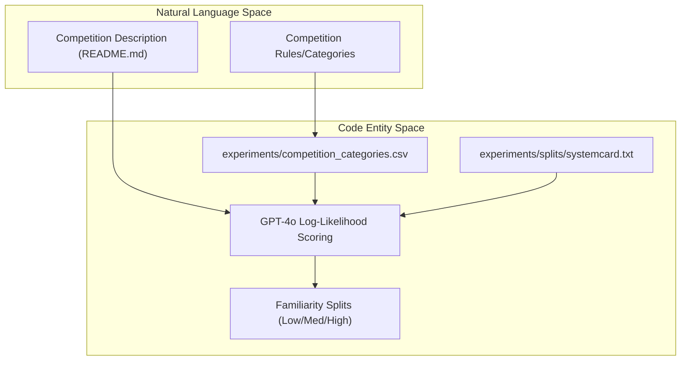
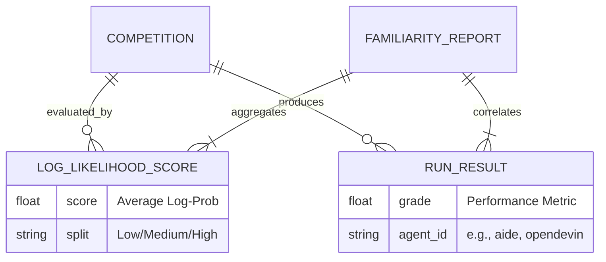

<!-- source: DeepWiki mcp.deepwiki.com · repo openai/mle-bench · page 10.2 Familiarity Experiments · fetched 2026-10-26 -->

# Familiarity Experiments

Relevant source files

The following files were used as context for generating this wiki page:

- [experiments/competition_categories.csv](experiments/competition_categories.csv)
- [experiments/splits/systemcard.txt](experiments/splits/systemcard.txt)

The Familiarity Experiments sub-system is designed to quantify the extent to which a Large Language Model (LLM), specifically GPT-4o, has encountered the competition datasets and descriptions during its pre-training. By measuring the log-likelihood of competition-specific text, the system establishes a "familiarity score" that can be correlated with agent performance to detect potential data contamination or training set leakage.

## Overview and Purpose

The core hypothesis of these experiments is that if an LLM is highly familiar with a competition's description and requirements, it may achieve higher benchmark scores not through general reasoning, but through memorization of the problem space. The sub-system uses log-likelihood scoring of competition metadata to categorize benchmarks into different "familiarity splits."

### Key Objectives
*   **Quantify Pre-training Exposure:** Measure how "surprised" the model is by competition descriptions.
*   **Performance Correlation:** Analyze if higher familiarity scores lead to disproportionately better performance on the MLE-bench tasks.
*   **Split Generation:** Categorize competitions into "Low", "Medium", and "High" familiarity groups for robust evaluation.

## Data Flow and Scoring Logic

The familiarity scoring process involves feeding competition descriptions into a model and calculating the average log-probability of the tokens. 

### Familiarity Scoring Pipeline

The diagram below illustrates the relationship between the competition metadata and the scoring mechanism.

**Familiarity Scoring Data Flow**

**Sources:** `[experiments/competition_categories.csv:1-4]()`, `[experiments/splits/systemcard.txt:1-30]()`

## Implementation Details

The system relies on a set of curated files to define the scope of the experiments and categorize the competitions.

### Competition Categories
The file `experiments/competition_categories.csv` contains the ground truth categorization for all competitions in the benchmark, including metadata that the scoring system uses to evaluate domain-specific familiarity [experiments/competition_categories.csv:1-4]().

### System Card Splits
The `experiments/splits/systemcard.txt` file identifies a specific subset of 30 competitions used for detailed system card analysis and familiarity reporting [experiments/splits/systemcard.txt:1-30](). These competitions span various domains:
*   **Computer Vision:** `aptos2019-blindness-detection`, `cassava-leaf-disease-classification`, `hubmap-kidney-segmentation` [experiments/splits/systemcard.txt:1-10]().
*   **Natural Language Processing:** `jigsaw-unintended-bias-in-toxicity-classification`, `tweet-sentiment-extraction` [experiments/splits/systemcard.txt:12-26]().
*   **Time Series/Tabular:** `new-york-city-taxi-fare-prediction`, `ventilator-pressure-prediction` [experiments/splits/systemcard.txt:16-29]().

### Scoring Methodology
The familiarity score ($S$) for a competition ($C$) is calculated as:
$$S_C = \frac{1}{N} \sum_{i=1}^{N} \log P(token_i | token_{<i})$$
Where $N$ is the number of tokens in the competition description. A higher value (closer to zero) indicates higher familiarity.

## Correlation with Benchmark Performance

The familiarity sub-system maps these scores against the results stored in the `runs/` directory to produce correlation reports.

**Code Entity Relationship: Familiarity vs. Performance**

**Sources:** `[experiments/competition_categories.csv:1-4]()`, `[experiments/splits/systemcard.txt:1-30]()`

## Key Files and Data Structures

| File Path | Description |
| :--- | :--- |
| `experiments/competition_categories.csv` | Master list of competition domains and metadata used for categorization [experiments/competition_categories.csv:1-4](). |
| `experiments/splits/systemcard.txt` | Defines the subset of 30 competitions used for the GPT-4o system card familiarity analysis [experiments/splits/systemcard.txt:1-30](). |

## Usage in MLE-bench
The familiarity splits are used during the evaluation phase to ensure that an agent's performance is consistent across both well-known and obscure competitions. If an agent performs significantly better on "High Familiarity" tasks compared to "Low Familiarity" tasks, it may indicate that the agent's underlying LLM is relying on training data leakage rather than general machine learning proficiency.

**Sources:**
*   `experiments/competition_categories.csv`
*   `experiments/splits/systemcard.txt`

---

