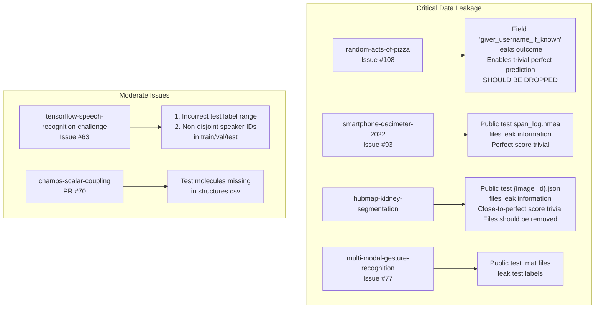
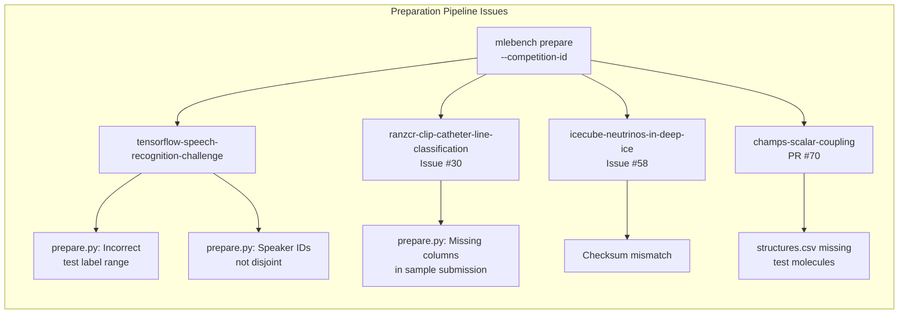
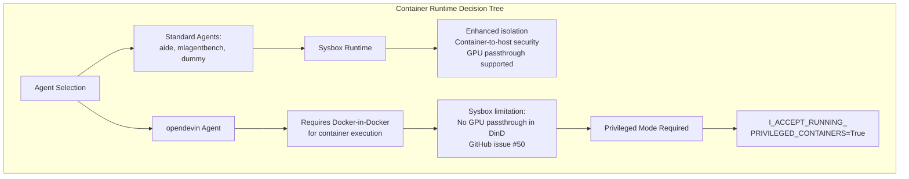
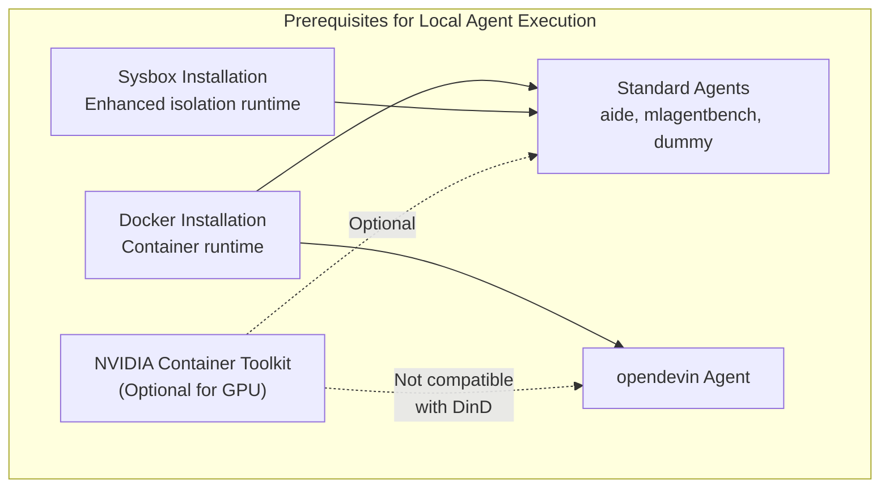
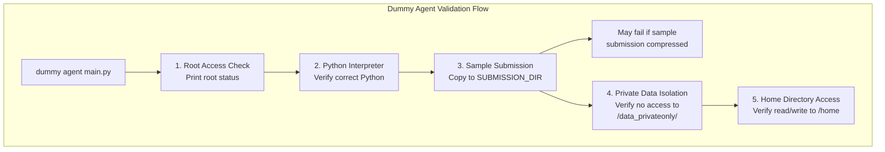
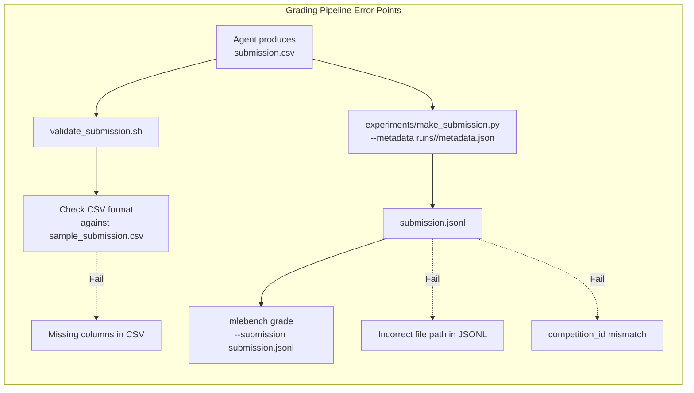

<!-- source: DeepWiki mcp.deepwiki.com · repo openai/mle-bench · page 11 Known Issues and Troubleshooting · fetched 2026-10-26 -->

# Known Issues and Troubleshooting

<details>
<summary>Relevant source files</summary>

The following files were used as context for generating this wiki page:

- [README.md](README.md)
- [mlebench/cli.py](mlebench/cli.py)
- [mlebench/competitions/the-icml-2013-whale-challenge-right-whale-redux/prepare.py](mlebench/competitions/the-icml-2013-whale-challenge-right-whale-redux/prepare.py)
- [mlebench/registry.py](mlebench/registry.py)

</details>


This document catalogs known issues in MLE-bench v1, common troubleshooting scenarios, and guidance for resolving errors during dataset preparation, agent execution, and grading. For information about the overall evaluation system, see [System Architecture](#2). For details on specific agent configurations, see [Agent Implementations](#7).

## Purpose and Scope

MLE-bench v1 has several documented issues that affect specific competitions. These issues are being deferred to v2 to maintain consistency with existing leaderboard submissions. This page documents:

- Competition-specific data preparation issues
- Container runtime and security troubleshooting
- Common execution errors and their resolutions
- Planned improvements in v2

Users submitting to the v1 leaderboard should **include all competitions with known issues** in their overall scores to ensure fair comparison with existing submissions [README.md:220-222]().

## Competition-Specific Known Issues

### Data Leakage Issues

Several competitions have data leakage problems where test set information is inadvertently exposed to agents, making the competition too easy or trivial to solve.



**Sources:** [README.md:224-253]()

#### Critical Leakage (Should Consider Exclusion)

| Competition ID | Issue | Impact | GitHub Reference |
|----------------|-------|--------|------------------|
| `random-acts-of-pizza` | Field `giver_username_if_known` leaks the outcome | Trivial perfect prediction possible | [#108](https://github.com/openai/mle-bench/issues/108) |
| `smartphone-decimeter-2022` | Public test `span_log.nmea` files leak information | Perfect score trivial | [#93](https://github.com/openai/mle-bench/issues/93) |
| `hubmap-kidney-segmentation` | Public test `{image_id}.json` files leak information | Close-to-perfect score trivial | Not linked in README |
| `multi-modal-gesture-recognition` | Public test `.mat` files leak test labels | Compromised evaluation | [#77](https://github.com/openai/mle-bench/issues/77) |

**Sources:** [README.md:243-253]()

### Data Preparation Issues

These issues affect the quality of the prepared datasets but do not necessarily make competitions trivial.



**Sources:** [README.md:224-242]()

| Competition ID | Component | Issue Description | Reference |
|----------------|-----------|-------------------|-----------|
| `tensorflow-speech-recognition-challenge` | `prepare.py` | Test set has much larger range of labels than intended | [#63](https://github.com/openai/mle-bench/issues/63) |
| `tensorflow-speech-recognition-challenge` | `prepare.py` | Speaker IDs not properly disjoint between train/val/test | [#63](https://github.com/openai/mle-bench/issues/63) |
| `ranzcr-clip-catheter-line-classification` | `prepare.py` | Missing columns in sample submission | [#30](https://github.com/openai/mle-bench/issues/30) |
| `icecube-neutrinos-in-deep-ice` | Checksums | Checksum mismatch during validation | [#58](https://github.com/openai/mle-bench/issues/58) |
| `champs-scalar-coupling` | `structures.csv` | Test molecules missing from structures file | [#70](https://github.com/openai/mle-bench/pull/70) |

**Sources:** [README.md:224-242]()

### Crowded Leaderboard Issues

Three competitions have leaderboards where there is minimal difference between top and median scores, reducing their effectiveness as benchmarks.

| Competition ID | Issue |
|----------------|-------|
| `tabular-playground-series-dec-2021` | Very little difference between top and median scores |
| `tabular-playground-series-may-2022` | Very little difference between top and median scores |
| `jigsaw-toxic-comment-classification-challenge` | Very little difference between top and median scores |

These competitions remain in the benchmark but have reduced discriminative power for agent evaluation.

**Sources:** [README.md:235-240]()

## Container Runtime and Security Issues

### Sysbox Runtime Limitations

The default container runtime uses Sysbox for enhanced isolation, but this creates limitations for certain agent configurations.



**Sources:** [agents/README.md:60-64]()

#### OpenHands Privileged Mode Requirement

OpenHands uses Docker-in-Docker (DinD) for its container execution model, which conflicts with Sysbox's GPU passthrough capabilities. The workaround requires running in privileged mode:

**Issue:** Sysbox runtime does not support GPU passthrough in Docker-in-Docker configurations ([nestybox/sysbox#50](https://github.com/nestybox/sysbox/issues/50))

**Solution:** Run OpenHands in privileged mode with explicit acknowledgment:

```bash
export I_ACCEPT_RUNNING_PRIVILEGED_CONTAINERS=True
python run_agent.py --agent-id opendevin --competition-set experiments/splits/spaceship-titanic.txt
```

**Security Implications:** Privileged mode reduces container-to-host isolation. This configuration is acceptable when the virtual machine boundary provides an adequate security layer.

**Sources:** [agents/README.md:64](), [README.md:172-182]()

### Installation Requirements



**Sources:** [agents/README.md:12-16]()

## Common Troubleshooting Scenarios

### Dataset Preparation Errors

#### Kaggle API Credentials Missing

**Symptom:** `mlebench prepare` fails with authentication error.

**Solution:** Ensure `kaggle.json` is in `~/.kaggle/` directory [README.md:128-131]().

```bash
# Verify credentials file exists
ls -la ~/.kaggle/kaggle.json

# Check permissions (should be 600)
chmod 600 ~/.kaggle/kaggle.json
```

#### Git LFS Files Not Downloaded

**Symptom:** Competition data files are missing or corrupted.

**Solution:** Pull Git LFS files before running prepare [README.md:95-101]():

```bash
git lfs fetch --all
git lfs pull
```

#### Checksum Validation Failures

**Symptom:** Specific competitions fail checksum validation during preparation.

**Known Affected Competitions:**
- `icecube-neutrinos-in-deep-ice` ([#58](https://github.com/openai/mle-bench/issues/58))

**Current Status:** Known issue in v1. Use `--skip-verification` with `mlebench prepare` if necessary [mlebench/cli.py:76-81]().

### Agent Execution Errors

#### Dummy Agent Validation Failures

The dummy agent performs critical environment checks. Failures indicate misconfiguration:



**Sources:** [agents/README.md:51-58]()

### Build and Configuration Errors

#### Missing Build Arguments

**Symptom:** Docker build fails with undefined variables.

**Solution:** Export all required environment variables before building [agents/README.md:21-27]():

```bash
export SUBMISSION_DIR=/home/submission
export LOGS_DIR=/home/logs
export CODE_DIR=/home/code
export AGENT_DIR=/home/agent

docker build --platform=linux/amd64 -t <agent> agents/<agent>/ \
  --build-arg SUBMISSION_DIR=$SUBMISSION_DIR \
  --build-arg LOGS_DIR=$LOGS_DIR \
  --build-arg CODE_DIR=$CODE_DIR \
  --build-arg AGENT_DIR=$AGENT_DIR
```

### Grading and Submission Errors

#### Submission Format Validation Failures



**Sources:** [README.md:154-169]()

**Common Format Errors:**

1. **Missing columns:** Competition requires specific columns not present in submission.
2. **Incorrect JSONL format:** `submission.jsonl` missing required fields like `competition_id` or `submission_path` [mlebench/cli.py:89-93]().
3. **File path errors:** Submission CSV not found at specified path.

## Leaderboard Submission Guidelines

### Including Known Issues in Scores

Per the v1 leaderboard policy, **all competitions with known issues must be included** in overall scores to maintain consistency with existing submissions [README.md:220-222]().

### Aggregate Grading Reports Process

To produce the scores for the leaderboard, organize your grading reports in the `runs/` folder and identify them in `runs/run_group_experiments.csv` [README.md:55-58]().

```bash
# Generate scores for each split
uv run python experiments/aggregate_grading_reports.py --experiment-id <exp_id> --split low
uv run python experiments/aggregate_grading_reports.py --experiment-id <exp_id> --split medium
uv run python experiments/aggregate_grading_reports.py --experiment-id <exp_id> --split high
uv run python experiments/aggregate_grading_reports.py --experiment-id <exp_id> --split split75
```

Report `any_medal_percentage` metric as mean ± standard error of the mean (SEM) [README.md:67-68]().

## Planned v2 Improvements

The MLE-bench team is planning a v2 release on the [openai/frontier-evals](https://github.com/openai/frontier-evals) repository that will address known issues in a batched update [README.md:215-222]().

**Planned Fixes:**
1. Data leakage issues in competitions like `random-acts-of-pizza` and `smartphone-decimeter-2022`.
2. Data preparation script corrections for `tensorflow-speech-recognition-challenge` and `ranzcr-clip-catheter-line-classification`.
3. Checksum validation for `icecube-neutrinos-in-deep-ice`.

**Sources:** [README.md:215-222]()

---

