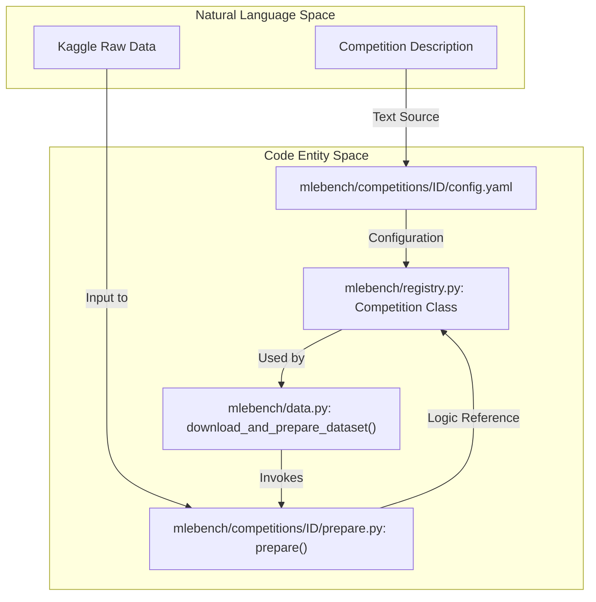
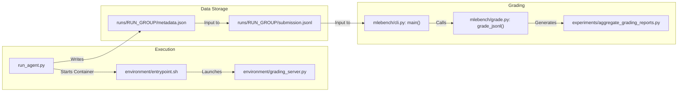

<!-- source: DeepWiki mcp.deepwiki.com · repo openai/mle-bench · page 12 Glossary · fetched 2026-10-26 -->

# Glossary

Relevant source files

The following files were used as context for generating this wiki page:

- [README.md](README.md)
- [agents/README.md](agents/README.md)
- [environment/Dockerfile](environment/Dockerfile)
- [environment/entrypoint.sh](environment/entrypoint.sh)
- [mlebench/cli.py](mlebench/cli.py)
- [mlebench/competitions/the-icml-2013-whale-challenge-right-whale-redux/prepare.py](mlebench/competitions/the-icml-2013-whale-challenge-right-whale-redux/prepare.py)
- [mlebench/registry.py](mlebench/registry.py)
- [runs/README.md](runs/README.md)

This glossary defines codebase-specific terms, abbreviations, and domain concepts used throughout the MLE-bench repository. It provides technical context and code pointers for onboarding engineers to understand the evaluation lifecycle and system components.

## Core System Entities

### Competition
The fundamental unit of evaluation in MLE-bench. A `Competition` represents a machine learning task (typically sourced from Kaggle) that has been standardized for agent consumption [mlebench/registry.py:17-31]().

*   **Implementation**: Defined as a frozen dataclass in `mlebench/registry.py`.
*   **Attributes**: Includes `id`, `name`, `grader`, `answers` (path to ground truth), and `prepare_fn` (logic to split raw data) [mlebench/registry.py:17-31]().

### Registry
A central management class used to fetch competition configurations and manage data directory paths [mlebench/registry.py:74-76]().

*   **Functionality**: It resolves competition metadata from `config.yaml` files located in `mlebench/competitions/<competition_id>/` [mlebench/registry.py:81-82]().
*   **Global Instance**: A singleton instance is initialized at the module level for use across the CLI and evaluation scripts [mlebench/registry.py:155]().

### Run Group
A collection of execution results across multiple competitions and seeds for a specific agent configuration [runs/README.md:5-9]().

*   **Structure**: Each run group directory contains subdirectories for every competition evaluated, housing logs, code, and agent-generated submissions [agents/README.md:37-41]().
*   **Metadata**: A `metadata.json` file is created upon completion to summarize the group's results [agents/README.md:37-41]().

### Experiment ID
A unique identifier used to map one or more **Run Groups** to a specific research hypothesis or agent setup (e.g., `models-o1-preview-aide`) [runs/README.md:24-28](). These mappings are maintained in `runs/run_group_experiments.csv` [runs/README.md:24-25]().

---

## Technical Infrastructure

### Grading Server
A Flask-based service that runs inside the agent's Docker container to provide a standardized interface for agents to submit predictions [environment/Dockerfile:63-67]().

*   **Location**: The server logic resides in `/private/grading_server.py` within the container [environment/Dockerfile:77]().
*   **Lifecycle**: It is launched by the `entrypoint.sh` script and remains active throughout the container's lifetime [environment/entrypoint.sh:17-18]().

### Sysbox
A container runtime used to provide enhanced isolation, allowing agents to run with near-host capabilities (like Docker-in-Docker) while maintaining a security boundary [agents/README.md:62-63]().

*   **Usage**: Required for most agents to ensure they cannot compromise the host system while still being able to manage their own environments [agents/README.md:15-16]().

### MLE-bench Lite
A subset of the benchmark consisting of "low complexity" competitions, used for faster iteration and debugging [mlebench/registry.py:128-134]().

*   **Implementation**: Defined by the IDs listed in `experiments/splits/low.txt` [mlebench/registry.py:131-134]().

---

## Data & Logic Flow Diagrams

### From Competition Definition to Execution
This diagram bridges the natural language concept of a "Machine Learning Competition" to the code entities that manage its lifecycle.

**Sources**: [mlebench/registry.py:17-116](), [mlebench/competitions/the-icml-2013-whale-challenge-right-whale-redux/prepare.py:9-12](), [mlebench/data.py:5-8]()

### Execution and Grading Lifecycle
This diagram maps the process of running an agent to the specific code routes and files involved in scoring.

**Sources**: [agents/README.md:31-47](), [environment/entrypoint.sh:17-18](), [mlebench/cli.py:192-196](), [README.md:61-64]()

---

## Key Terms Table

| Term | Definition | Code Pointer |
| :--- | :--- | :--- |
| **Any Medal** | A metric indicating if the agent achieved a score equivalent to Bronze, Silver, or Gold on the original leaderboard. | [README.md:67-68]() |
| **Private Dir** | Directory containing test set labels, inaccessible to the agent during the run. | [mlebench/registry.py:28]() |
| **Public Dir** | Directory containing training data and test features provided to the agent. | [mlebench/registry.py:29]() |
| **Gold Submission** | A reference submission (often the ground truth) used to verify grader consistency. | [mlebench/registry.py:23]() |
| **Split75** | The primary evaluation split containing 75 representative competitions. | [agents/README.md:31-32]() |
| **Nonroot User** | The security-restricted user account (`nonroot`) that executes the agent's code. | [environment/Dockerfile:84-86]() |

**Sources**: [mlebench/registry.py:17-116](), [environment/Dockerfile:84-86](), [README.md:67-68](), [agents/README.md:31-32]()