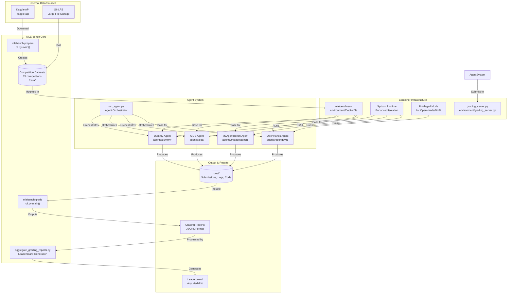
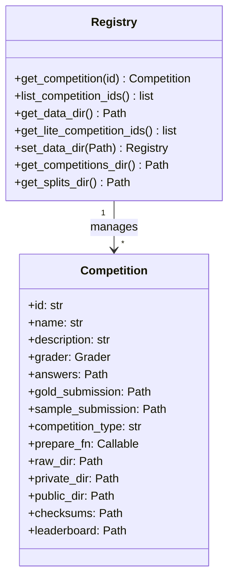
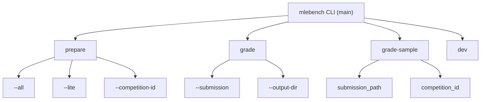
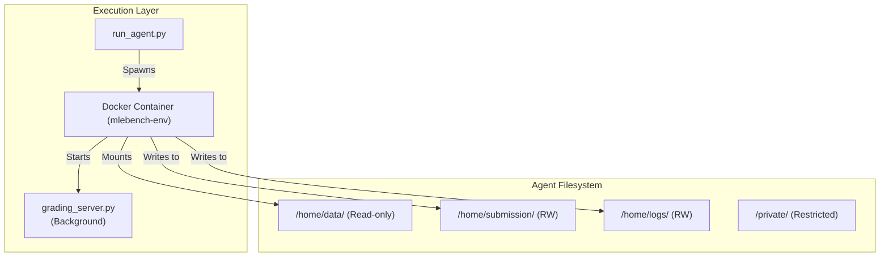
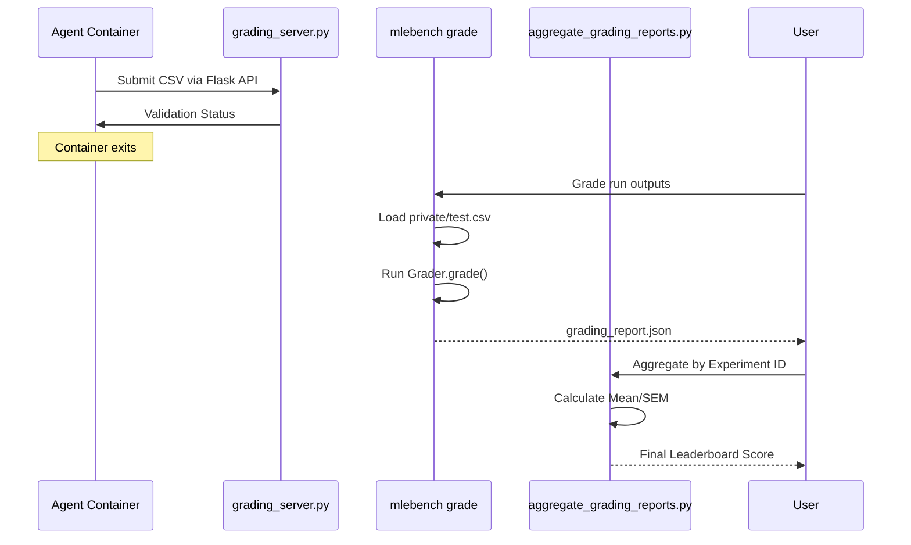

<!-- source: DeepWiki mcp.deepwiki.com · repo openai/mle-bench · page 2 System Architecture · fetched 2026-10-26 -->

# System Architecture

Relevant source files

The following files were used as context for generating this wiki page:

- [README.md](README.md)
- [environment/Dockerfile](environment/Dockerfile)
- [environment/entrypoint.sh](environment/entrypoint.sh)
- [mlebench/cli.py](mlebench/cli.py)
- [mlebench/competitions/the-icml-2013-whale-challenge-right-whale-redux/prepare.py](mlebench/competitions/the-icml-2013-whale-challenge-right-whale-redux/prepare.py)
- [mlebench/registry.py](mlebench/registry.py)

## Purpose and Scope

This document describes the high-level architecture of MLE-bench, detailing its core components and their interactions. It provides a technical overview of how the system is organized to facilitate the evaluation of machine learning engineering capabilities of AI systems using Kaggle competitions as benchmark tasks.

## High-Level Architecture Overview

### MLE-bench Ecosystem Architecture

Sources: [mlebench/cli.py:13-221](), [environment/Dockerfile:1-92](), [environment/entrypoint.sh:1-20](), [README.md:1-70]()

MLE-bench consists of three main pipelines: (1) Dataset preparation from external sources via `mlebench prepare`, (2) Agent execution in isolated containers producing submissions via `run_agent.py`, and (3) Evaluation and leaderboard generation via `mlebench grade` and aggregation scripts. The system maintains strict separation between public training data (accessible to agents) and private test data (used only for evaluation). The container infrastructure provides two security models: Sysbox runtime for standard agents and privileged mode for OpenHands due to Docker-in-Docker requirements.

## Core Benchmarking System

### Registry System

The `Registry` is the central source of truth for all competition metadata. It maps competition IDs to `Competition` objects which encapsulate paths and logic.

Sources: [mlebench/registry.py:16-156]()

- **Registry**: Loads competition configurations from `mlebench/competitions/<id>/config.yaml` [mlebench/registry.py:81-82](). It handles the resolution of data directories and complexity splits (e.g., `low.txt` for Lite version) [mlebench/registry.py:128-134]().
- **Competition**: A frozen dataclass containing all paths required for preparation and grading. It dynamically imports the `prepare_fn` specified in the competition's config [mlebench/registry.py:90-109]().

### Command-Line Interface

The CLI, implemented in `mlebench/cli.py`, serves as the primary entry point for users and developers.

Sources: [mlebench/cli.py:13-156]()

- **prepare**: Triggers `download_and_prepare_dataset` which uses competition-specific logic to transform raw Kaggle data into a structured format [mlebench/cli.py:185-191]().
- **grade**: Evaluates a batch of submissions provided in a JSONL file using `grade_jsonl` [mlebench/cli.py:192-196]().
- **grade-sample**: Grades a single CSV file for a specific competition using `grade_csv` [mlebench/cli.py:197-201]().

## Agent Execution Framework

### Docker Environment & Entrypoint

The benchmarking environment is standardized via a base Docker image defined in `environment/Dockerfile`.

- **Conda Management**: The image creates two primary environments: `agent` (for running the agent's ML code) and `mleb` (for internal tools like the grading server) [environment/Dockerfile:38-67]().
- **Permissions**: The `entrypoint.sh` script runs as root to set broad read/write permissions on `/home` (excluding the read-only `/home/data` volume) so that non-root agents can function [environment/entrypoint.sh:11-15]().
- **Grading Server**: The entrypoint automatically starts `grading_server.py` in the background, which listens for agent submission requests during the run [environment/entrypoint.sh:18]().

### Agent Execution Architecture

Sources: [environment/Dockerfile:72-92](), [environment/entrypoint.sh:1-20](), [mlebench/registry.py:98-100]()

### Data Flow & Preparation Logic

Each competition has a custom `prepare.py` script. For example, in `the-icml-2013-whale-challenge-right-whale-redux`:
1. **Unpack**: Extracts raw archives [mlebench/competitions/the-icml-2013-whale-challenge-right-whale-redux/prepare.py:14]().
2. **Split**: Distributes data based on timestamps or metadata into `public` (agent-visible) and `private` (grading-only) folders [mlebench/competitions/the-icml-2013-whale-challenge-right-whale-redux/prepare.py:23-35]().
3. **Format**: Generates `test.csv` (answers) and `sampleSubmission.csv` [mlebench/competitions/the-icml-2013-whale-challenge-right-whale-redux/prepare.py:81-88]().

## Evaluation and Results Pipeline

The evaluation pipeline translates agent outputs into leaderboard metrics.

Sources: [environment/grading_server.py:1-18](), [mlebench/cli.py:192-204](), [README.md:53-68]()

- **Grading Reports**: Individual runs generate a `grading_report.json` which includes the competition score and medal status [README.md:119-134]().
- **Aggregation**: The `aggregate_grading_reports.py` script groups these reports by `experiment_id` (defined in `runs/run_group_experiments.csv`) and calculates the "Any Medal Percentage" across the requested split (low, medium, high, or split75) [README.md:53-65]().

## Resource and Security Constraints

The architecture enforces strict limits to ensure reproducibility and security:
- **Resource Limits**: Standard evaluations are capped at 24 hours with specific CPU/RAM/GPU allocations [README.md:8-37]().
- **Isolation**: The `/private` directory inside the container is owned by root and restricted (mode 700) to prevent agents from reading ground truth answers [environment/Dockerfile:74]().
- **Runtime**: Agents typically run under the **Sysbox** runtime for enhanced isolation, except for those requiring Docker-in-Docker (like OpenHands), which use privileged mode [README.md:35]().

Sources: [environment/Dockerfile:74-92](), [README.md:8-37]()

---

