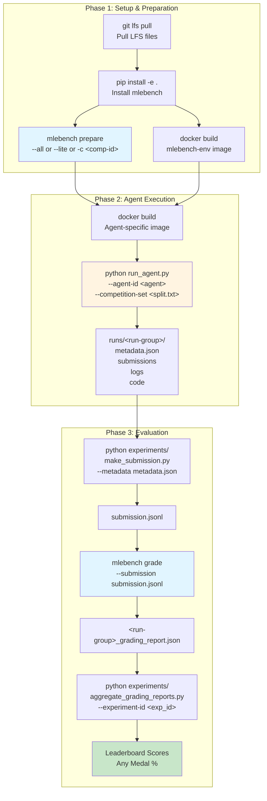
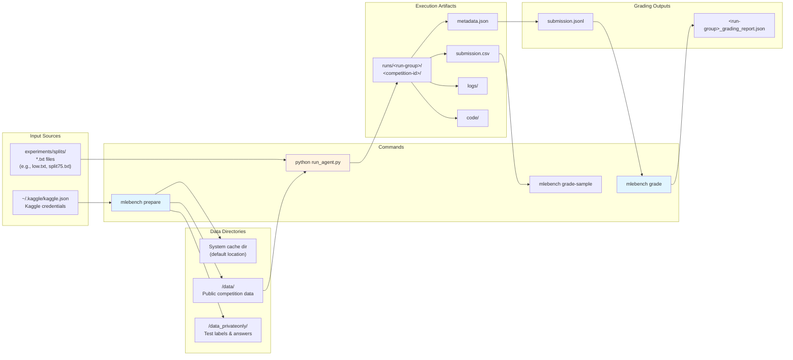
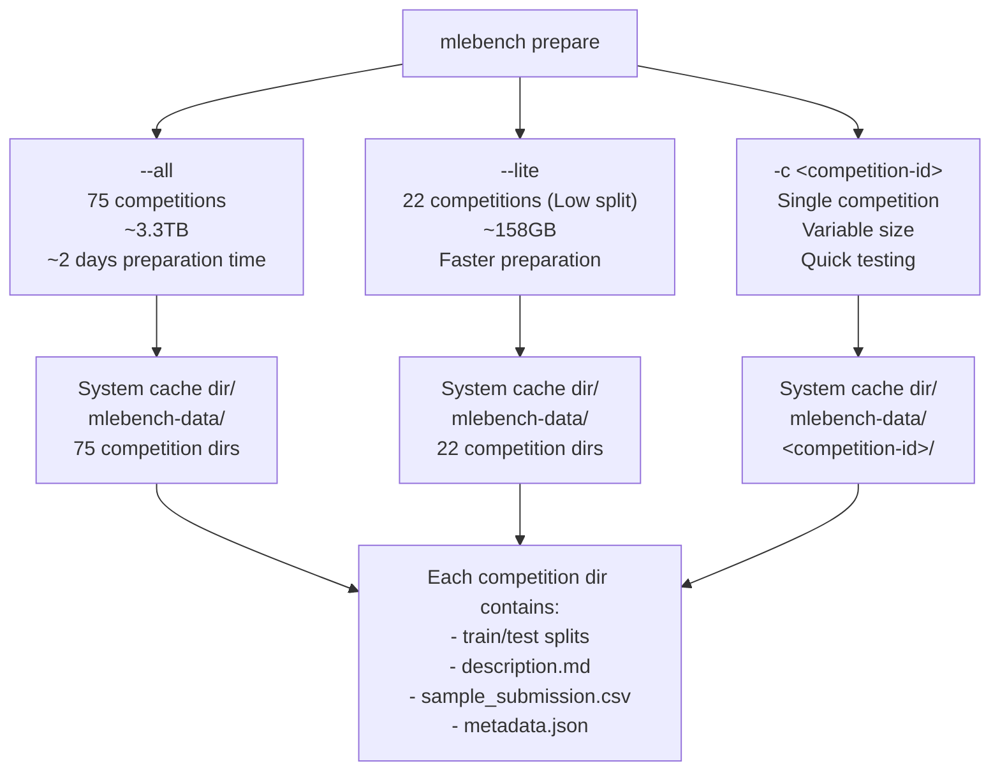
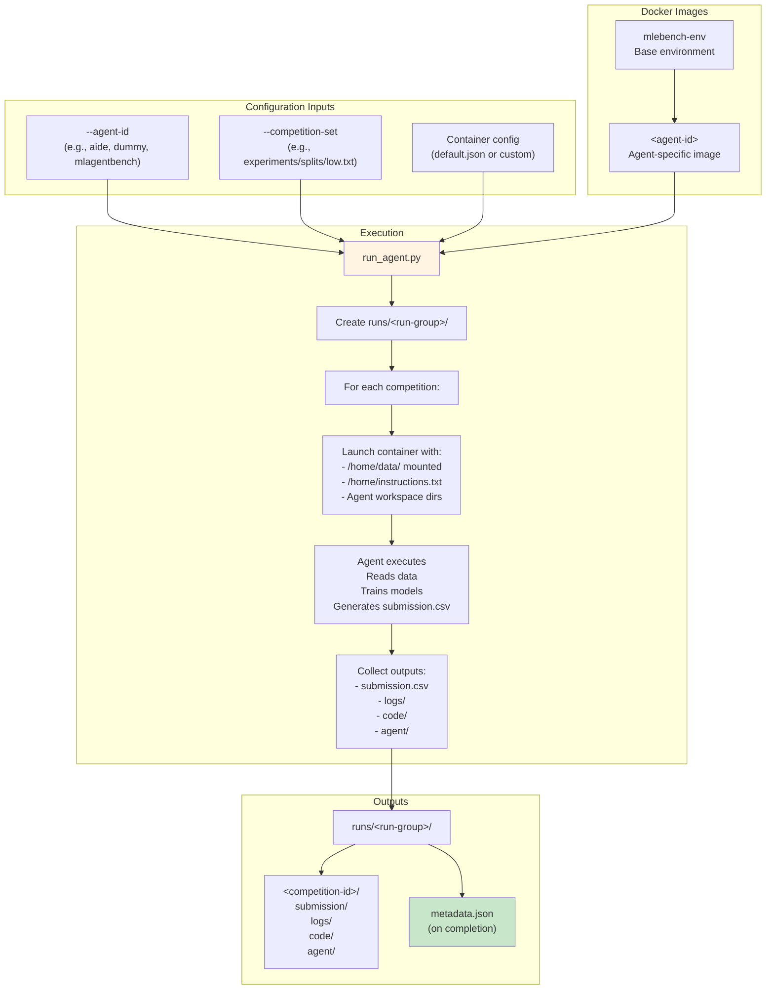
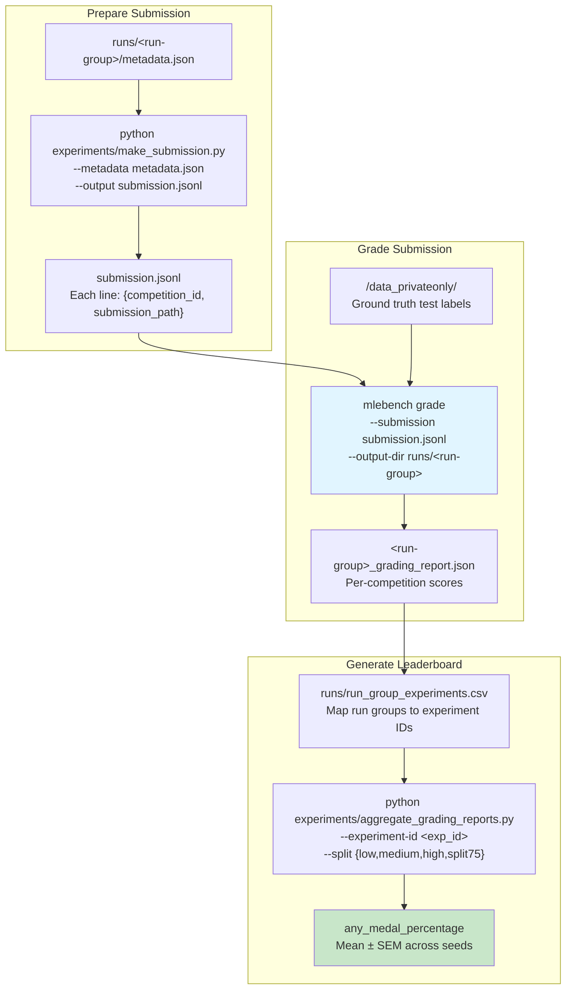
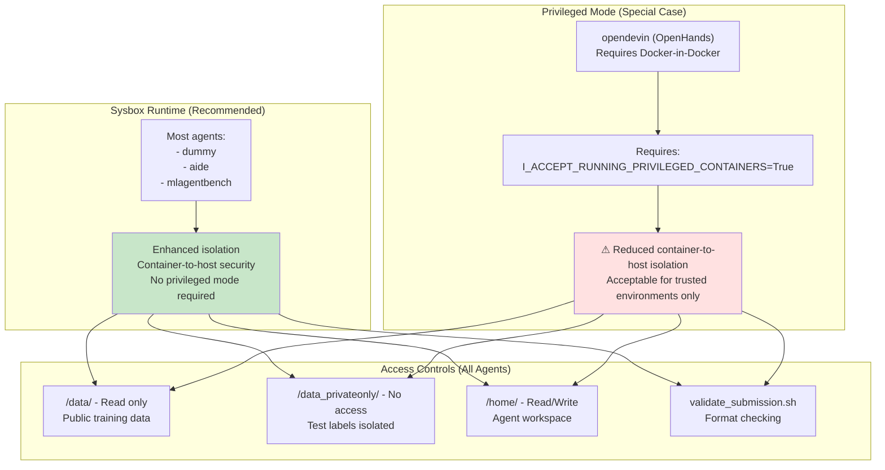

<!-- source: DeepWiki mcp.deepwiki.com · repo openai/mle-bench · page 3 Getting Started · fetched 2026-10-26 -->

# Getting Started

Relevant source files

The following files were used as context for generating this wiki page:

- [README.md](README.md)
- [pyproject.toml](pyproject.toml)

This page provides an overview of the initial setup and basic workflows for using MLE-bench. It covers the foundational steps required to prepare your environment, obtain competition datasets, execute agents, and evaluate their submissions. For detailed installation instructions, see [Installation and Setup](#3.1). For a comprehensive walkthrough of your first evaluation, see [Quick Start Guide](#3.2).

The typical MLE-bench workflow consists of three sequential phases: (1) environment setup and dataset preparation, (2) agent execution, and (3) submission grading and leaderboard generation. Each phase produces artifacts that serve as inputs to the next.

## Overview of MLE-bench Workflows

The following diagram illustrates the complete workflow for evaluating agents on MLE-bench, from initial setup through leaderboard generation:

**Sources:** [README.md:93-186](), [agents/README.md:1-65]()

## Prerequisites and System Requirements

Before using MLE-bench, ensure your system meets the requirements defined in `pyproject.toml` and the documentation:

| Component | Requirement | Purpose |
|-----------|-------------|---------|
| Git LFS | Installed and configured | Pull large data files (CSVs, competition solutions) |
| Python | >=3.11 | Run `mlebench` CLI and scripts [pyproject.toml:8-8]() |
| Docker | >=7.1 (Python SDK) | Build and run agent containers [pyproject.toml:12-12]() |
| Sysbox Runtime | Installed (recommended) | Enhanced container-to-host isolation for security |
| NVIDIA Container Toolkit | Optional | GPU support for agent execution |
| Kaggle API | Credentials in `~/.kaggle/kaggle.json` | Download competition data [pyproject.toml:14-14]() |
| Disk Space | 3.3TB (full) or 158GB (lite) | Store prepared competition datasets |

**Sources:** [README.md:93-150](), [agents/README.md:12-16](), [pyproject.toml:8-34]()

## Core Commands and Directory Structure

The following diagram maps MLE-bench commands to the directories and files they interact with:

**Sources:** [README.md:93-169](), [agents/README.md:29-47](), [pyproject.toml:40-40]()

## Dataset Preparation Options

MLE-bench provides three dataset preparation options to balance evaluation coverage with resource constraints:

### Preparation Commands

The lite dataset is specifically designed for cost-effective evaluation and corresponds to the Low complexity split. See [Dataset Preparation](#4.1) for detailed information about the preparation process.

**Sources:** [README.md:130-150](), [README.md:60-92]()

## Agent Execution Workflow

The `run_agent.py` script orchestrates agent execution across multiple competitions. The following diagram shows the complete execution flow:

The standard resource allocation for benchmarking is 24 hours runtime with 36 vCPUs, 440GB RAM, and one 24GB A10 GPU. These defaults are typically configured in container JSON files and can be customized per execution.

**Sources:** [agents/README.md:29-49](), [README.md:52-64](), [README.md:173-183]()

## Grading and Leaderboard Generation

After agent execution completes, submissions must be formatted and graded. The following diagram shows the evaluation pipeline:

The grading process uses the private test data prepared during `mlebench prepare`, which is isolated from agents during execution. Leaderboard metrics should be computed using `aggregate_grading_reports.py` to capture agent variance [README.md:53-65]().

**Sources:** [README.md:154-169](), [README.md:33-49](), [agents/README.md:37-47](), [README.md:53-65]()

## Common Usage Patterns

The following table summarizes typical usage scenarios and their corresponding commands:

| Scenario | Commands | Expected Output |
|----------|----------|-----------------|
| **Quick environment test** | `python run_agent.py --agent-id dummy --competition-set experiments/splits/spaceship-titanic.txt` | Single run group with validation checks passed |
| **Lite evaluation (22 comps)** | `mlebench prepare --lite` `python run_agent.py --agent-id aide --competition-set experiments/splits/low.txt` | 158GB dataset, run group with 22 competition submissions |
| **Full benchmark (75 comps)** | `mlebench prepare --all` `python run_agent.py --agent-id aide --competition-set experiments/splits/split75.txt` | 3.3TB dataset, run group with 75 competition submissions |
| **Single competition dev** | `mlebench prepare -c spaceship-titanic` `python run_agent.py --agent-id aide --competition-set experiments/splits/spaceship-titanic.txt` | ~50MB dataset, single competition run for testing |
| **Grade single submission** | `mlebench grade-sample <path/to/submission.csv> <comp-id>` | Immediate score output to stdout |
| **Grade multiple submissions** | `python experiments/make_submission.py --metadata runs/<run-group>/metadata.json --output submission.jsonl` `mlebench grade --submission submission.jsonl --output-dir runs/<run-group>` | Grading report JSON file |
| **Generate leaderboard scores** | `python experiments/aggregate_grading_reports.py --experiment-id <exp_id> --split low` | `any_medal_percentage` with mean ± SEM [README.md:61-65]() |

**Sources:** [README.md:130-150](), [agents/README.md:31-47](), [README.md:154-169](), [README.md:33-49](), [README.md:61-65]()

## Security Considerations

MLE-bench employs a two-tier security model for agent execution:

The `dummy` agent performs validation checks to verify the security model is properly configured [agents/README.md:52-58](). See [Container Security Models](#6.3) for complete details on isolation mechanisms.

**Sources:** [agents/README.md:60-64](), [agents/README.md:52-58]()

## Next Steps

After completing the initial setup, proceed to:

- **[Installation and Setup](#3.1)** - Detailed installation instructions, dependency management, and troubleshooting.
- **[Quick Start Guide](#3.2)** - Step-by-step walkthrough of running your first agent evaluation from start to finish.
- **[Dataset Preparation](#4.1)** - In-depth coverage of dataset preparation options, Git LFS configuration, and storage management.
- **[Running Agents](#4.2)** - Comprehensive guide to agent execution, configuration, and output management.
- **[Agent Implementations](#7)** - Detailed documentation for each available agent (aide, mlagentbench, opendevin, dummy).

For developers interested in extending MLE-bench or contributing new agents, see [Development Guide](#9).

**Sources:** [README.md:1-273](), [agents/README.md:1-65]()

---

