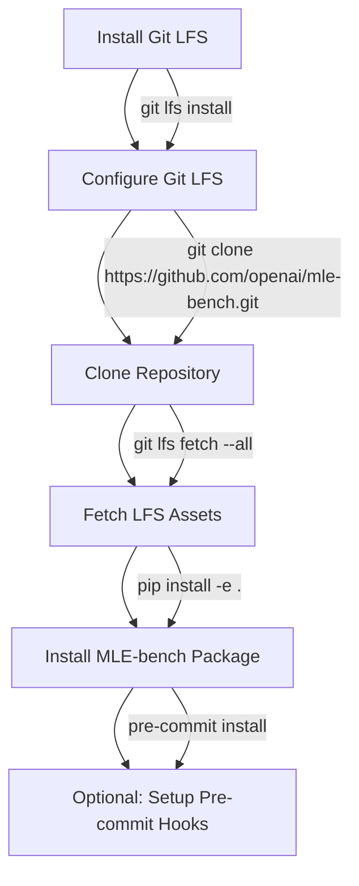
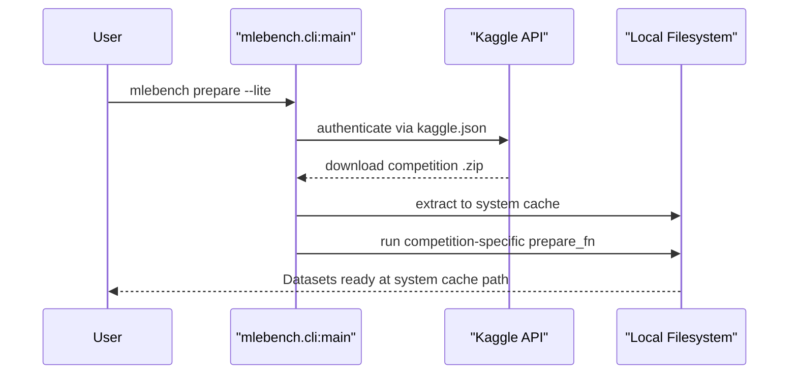

<!-- source: DeepWiki mcp.deepwiki.com · repo openai/mle-bench · page 3.1 Installation and Setup · fetched 2026-10-26 -->

# Installation and Setup

<details>
<summary>Relevant source files</summary>

The following files were used as context for generating this wiki page:

- [README.md](README.md)
- [pyproject.toml](pyproject.toml)

</details>


This page provides detailed instructions for installing MLE-bench and configuring the benchmarking environment. This includes installing the `mlebench` Python package, building the `mlebench-env` Docker image, and preparing competition datasets using the Kaggle API.

## Prerequisites

Before installing MLE-bench, ensure you have the following requirements:

| Requirement | Description |
|-------------|-------------|
| Git LFS | Required to download competition data and grading reports stored via Large File Storage |
| Python 3.11+ | Required for running MLE-bench (specified in `pyproject.toml`) |
| Docker | Required for building and running the agent execution environment |
| Kaggle API | Required for downloading competition datasets |
| uv (Recommended) | Fast Python package installer used for running scripts in the repository |

Sources: [pyproject.toml:8-8](), [README.md:58-66]()

## Installation Process

The following diagram illustrates the workflow from cloning the repository to a functional environment.



### 1. Git LFS Setup
MLE-bench stores competition metadata and grading reports using Git LFS. Initialize Git LFS before cloning:
```bash
git lfs install
```

### 2. Clone and Pull
Clone the repository and ensure all LFS-tracked files (like competition data indices) are downloaded:
```bash
git clone https://github.com/openai/mle-bench.git
cd mle-bench
git lfs fetch --all
git lfs pull
```
Sources: [README.md:60-66]()

### 3. Install Python Dependencies
The project uses `pyproject.toml` to manage dependencies. You can install the package in editable mode:
```bash
pip install -e .
```
Key dependencies include `docker`, `kaggle`, `pandas`, `openai`, and various ML libraries like `tensorflow` and `scikit-learn` for evaluation logic.
Sources: [pyproject.toml:10-34]()

### 4. Development Setup (Optional)
To contribute or ensure code quality, install development dependencies and pre-commit hooks:
```bash
pip install -e ".[dev,formatters]"
pre-commit install
```
Sources: [pyproject.toml:42-44](), [README.md:74-80]()

## Docker Environment Setup

MLE-bench executes agents inside a isolated Docker container defined by the `mlebench-env` image. This ensures a consistent environment for machine learning tasks.

### Docker Environment Architecture

```mermaid
classDiagram
    class "mlebench-env" {
        <<Docker Image>>
        - Conda Environment
        - Python 3.11
        - Installed ML Packages
        - Grading Server Scripts
    }
    
    class "Dockerfile" {
        <<Build Configuration>>
        + INSTALL_HEAVY_DEPENDENCIES: bool
    }
    
    class "pyproject.toml" {
        <<Dependencies>>
        + mlebench core
    }

    "Dockerfile" ..> "mlebench-env" : builds
    "pyproject.toml" --|> "mlebench-env" : defines core deps
```

### Building the Image
Build the Docker image with the following command:
```bash
docker build --platform=linux/amd64 -t mlebench-env -f environment/Dockerfile .
```

#### Heavy vs. Light Build
By default, the environment installs a large set of ML libraries. To speed up the build for testing purposes:
```bash
docker build --platform=linux/amd64 -t mlebench-env -f environment/Dockerfile . --build-arg INSTALL_HEAVY_DEPENDENCIES=false
```
Sources: [README.md:136-147]()

## Dataset Preparation

The benchmark utilizes the `mlebench` CLI to download and prepare competition data.

### Dataset Preparation Flow



### Kaggle API Configuration
1. Obtain `kaggle.json` from your Kaggle Account settings.
2. Place it in `~/.kaggle/kaggle.json`.
3. Ensure permissions are restricted: `chmod 600 ~/.kaggle/kaggle.json`.

Sources: [README.md:93-96]()

### Preparing Datasets
The CLI entry point is defined in `pyproject.toml` as `mlebench = "mlebench.cli:main"`.

*   **Full Dataset (75 competitions, ~3.3TB):**
    ```bash
    mlebench prepare --all
    ```
*   **Lite Dataset (22 competitions, ~158GB):**
    ```bash
    mlebench prepare --lite
    ```
*   **Single Competition:**
    ```bash
    mlebench prepare -c <competition-id>
    ```
Sources: [pyproject.toml:40-40](), [README.md:97-115]()

## Resource Requirements

Running the full benchmark requires significant resources to accommodate complex ML training tasks.

| Resource | Specification |
|----------|---------------|
| **Compute** | 36 vCPUs, 440GB RAM, 1x 24GB A10 GPU (recommended) |
| **Storage** | 3.3TB for full dataset / 158GB for lite dataset |
| **Time** | ~24 hours for a full agent run |

Sources: [README.md:9-12](), [README.md:27]()

## Verification

To verify the installation, use the `grade-sample` command to test the grading pipeline with a provided sample submission:

```bash
mlebench grade-sample examples/sample_submissions/spaceship-titanic.csv spaceship-titanic
```
This command checks if the grading logic and environment are correctly configured without running a full agent.
Sources: [README.md:127-132]()

---

