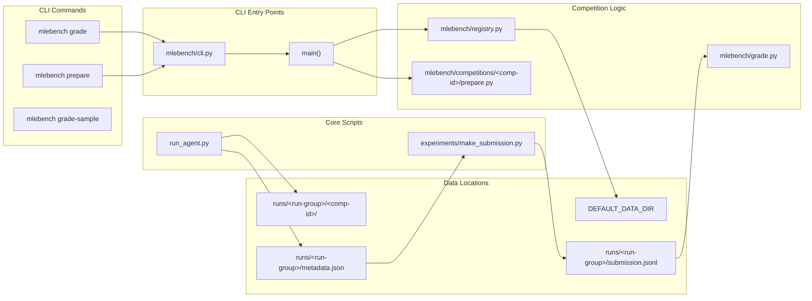

<!-- source: DeepWiki mcp.deepwiki.com · repo openai/mle-bench · page 3.2 Quick Start Guide · fetched 2026-10-26 -->

# Quick Start Guide

<details>
<summary>Relevant source files</summary>

The following files were used as context for generating this wiki page:

- [README.md](README.md)
- [agents/README.md](agents/README.md)
- [mlebench/cli.py](mlebench/cli.py)
- [mlebench/competitions/the-icml-2013-whale-challenge-right-whale-redux/prepare.py](mlebench/competitions/the-icml-2013-whale-challenge-right-whale-redux/prepare.py)
- [mlebench/registry.py](mlebench/registry.py)

</details>


This guide provides a streamlined walkthrough for running your first agent evaluation on MLE-bench. It covers the essential steps from dataset preparation through grading, using a simple test case. For detailed installation instructions, see [Installation and Setup](#3.1). For comprehensive usage documentation, see the [User Guide](#4).

## Purpose and Scope

This guide walks through evaluating the `dummy` agent on a single competition (`spaceship-titanic`) to verify your MLE-bench installation and understand the basic evaluation workflow. The process takes approximately 10-15 minutes and demonstrates:

1. Dataset preparation using `mlebench prepare`
2. Agent container building with Docker
3. Agent execution using `run_agent.py`
4. Submission grading using `mlebench grade`

## Prerequisites

Before starting, ensure you have completed the setup steps from [Installation and Setup](#3.1):

- Docker installed and running
- Sysbox runtime installed and configured [agents/README.md:15-15]()
- Git LFS configured and data pulled
- MLE-bench installed via `pip install -e .`
- Kaggle API credentials configured in `~/.kaggle/kaggle.json`

Verify your installation by checking Docker and Sysbox:

```bash
docker --version
docker info | grep -i runtime
```

## End-to-End Quick Start Workflow

The following diagram shows the complete quick start flow with actual commands and outputs:

```mermaid
graph TB
    Start["Start: Fresh MLE-bench Installation"]
    
    Prepare["Step 1: Prepare Dataset<br/>Command: mlebench prepare -c spaceship-titanic"]
    PrepareOut["Output: ~/.cache/mle-bench/data/spaceship-titanic/<br/>├── train.csv<br/>├── test.csv<br/>├── description.md<br/>└── sample_submission.csv"]
    
    Build["Step 2: Build Agent Container<br/>Command: docker build agents/dummy/"]
    BuildOut["Output: Docker image 'dummy'<br/>Contains: mlebench-env + dummy agent code"]
    
    Run["Step 3: Run Agent<br/>Command: python run_agent.py<br/>--agent-id dummy<br/>--competition-set experiments/splits/spaceship-titanic.txt"]
    RunOut["Output: runs/&lt;run-group&gt;/<br/>├── spaceship-titanic/<br/>│   ├── submission/<br/>│   ├── logs/<br/>│   └── code/<br/>└── metadata.json"]
    
    MakeSub["Step 4: Create Submission File<br/>Command: python experiments/make_submission.py<br/>--metadata runs/&lt;run-group&gt;/metadata.json"]
    MakeSubOut["Output: runs/&lt;run-group&gt;/submission.jsonl<br/>{&quot;competition_id&quot;: &quot;spaceship-titanic&quot;,<br/>&quot;submission_path&quot;: &quot;...&quot;}"]
    
    Grade["Step 5: Grade Submission<br/>Command: mlebench grade<br/>--submission runs/&lt;run-group&gt;/submission.jsonl"]
    GradeOut["Output: runs/&lt;run-group&gt;/<br/>spaceship-titanic_grading_report.json<br/>{&quot;score&quot;: ..., &quot;medal&quot;: ..., &quot;percentile&quot;: ...}"]
    
    Start --> Prepare
    Prepare --> PrepareOut
    PrepareOut --> Build
    Build --> BuildOut
    BuildOut --> Run
    Run --> RunOut
    RunOut --> MakeSub
    MakeSub --> MakeSubOut
    MakeSubOut --> Grade
    Grade --> GradeOut
```



**Sources:** [agents/README.md:18-47](), [mlebench/cli.py:18-128](), [mlebench/registry.py:13-13]()

## Step-by-Step Instructions

### Step 1: Prepare the Dataset

Prepare the `spaceship-titanic` competition dataset. This downloads the raw data from Kaggle and creates a train/test split:

```bash
mlebench prepare -c spaceship-titanic
```

This command executes the preparation logic defined in the competition's `prepare.py` (e.g., [mlebench/competitions/the-icml-2013-whale-challenge-right-whale-redux/prepare.py:9-9]()) and stores the prepared dataset in your system's cache directory (typically `~/.cache/mle-bench/data/` [mlebench/registry.py:13-13]()).

**Expected Output:**
```
Preparing spaceship-titanic...
Downloading competition data from Kaggle...
Creating train/test split...
Dataset prepared successfully at: ~/.cache/mle-bench/data/spaceship-titanic
```

**Verification:** Check that the dataset directory exists and contains the required files:

```bash
ls ~/.cache/mle-bench/data/spaceship-titanic
# Should show: train.csv, test.csv, description.md, sample_submission.csv
```

**Sources:** [mlebench/cli.py:18-60](), [mlebench/registry.py:13-13](), [mlebench/cli.py:158-191]()

### Step 2: Build the Agent Container

Build the Docker image for the `dummy` agent. First, set the required environment variables used as build arguments [agents/README.md:21-27]():

```bash
export SUBMISSION_DIR=/home/submission
export LOGS_DIR=/home/logs
export CODE_DIR=/home/code
export AGENT_DIR=/home/agent

docker build --platform=linux/amd64 -t dummy \
  agents/dummy/ \
  --build-arg SUBMISSION_DIR=$SUBMISSION_DIR \
  --build-arg LOGS_DIR=$LOGS_DIR \
  --build-arg CODE_DIR=$CODE_DIR \
  --build-arg AGENT_DIR=$AGENT_DIR
```

The build process extends the base `mlebench-env` image and adds the agent's code.

**Expected Output:**
```
[+] Building 45.2s (12/12) FINISHED
 => [internal] load build definition from Dockerfile
 ...
 => exporting to image
 => => naming to docker.io/library/dummy
```

**Sources:** [agents/README.md:18-27]()

### Step 3: Run the Agent

Execute the `dummy` agent on the `spaceship-titanic` competition using `run_agent.py` [agents/README.md:31-35]():

```bash
python run_agent.py \
  --agent-id dummy \
  --competition-set experiments/splits/spaceship-titanic.txt
```

The script orchestrates the container execution, mounting the prepared dataset and creating output directories. The agent runs in an isolated environment with access to standardized paths like `/home/submission` and `/home/logs` [agents/README.md:21-26]().

**Expected Output:**
```
Running agent dummy on competitions: ['spaceship-titanic']
Creating run group: runs/dummy_20240101_120000
Starting container for spaceship-titanic...
Agent execution completed
Results saved to: runs/dummy_20240101_120000/spaceship-titanic
```

**Run Group Structure:**
```
runs/dummy_20240101_120000/
├── spaceship-titanic/
│   ├── submission/
│   │   └── submission.csv
│   ├── logs/
│   │   └── agent.log
│   ├── code/
│   └── agent/
└── metadata.json
```

The `metadata.json` file summarizes the results of the runs [agents/README.md:37-37]().

**Sources:** [agents/README.md:29-37]()

### Step 4: Create Submission JSONL

Convert the run metadata into a submission file format required by `mlebench grade` [agents/README.md:39-41]():

```bash
python experiments/make_submission.py \
  --metadata runs/<run-group>/metadata.json \
  --output runs/<run-group>/submission.jsonl
```

This generates a JSONL file where each line maps a competition ID to its submission path.

**Sources:** [agents/README.md:37-41]()

### Step 5: Grade the Submission

Grade the submission using the MLE-bench grading system [agents/README.md:43-47]():

```bash
mlebench grade \
  --submission runs/<run-group>/submission.jsonl \
  --output-dir runs/<run-group>
```

The grading command processes the JSONL and saves evaluation metrics to the output directory [mlebench/cli.py:84-105]().

**Expected Output:**
```
Grading submissions from runs/<run-group>/submission.jsonl
Processing spaceship-titanic...
Score: 0.7531
Percentile: 0.45
Medal: None
Grading report saved to: runs/<run-group>/spaceship-titanic_grading_report.json
```

**Sources:** [mlebench/cli.py:84-105](), [agents/README.md:43-47]()

## Code Entity Mapping

The following diagram maps the workflow steps to the actual code entities and file paths in the repository:



**Sources:** [mlebench/cli.py:13-156](), [mlebench/registry.py:74-155](), [agents/README.md:29-47]()

## Directory Structure After Quick Start

After completing the quick start, your repository will have the following structure:

| Directory | Description | Example Contents |
|-----------|-------------|------------------|
| `~/.cache/mle-bench/data/` | Prepared dataset storage [mlebench/registry.py:13-13]() | `spaceship-titanic/`, `raw/` |
| `runs/<run-group>/` | Run group directory [agents/README.md:37-37]() | `metadata.json`, `submission.jsonl` |
| `runs/<run-group>/<comp-id>/` | Competition-specific outputs | `submission/`, `logs/`, `code/` |

**Sources:** [mlebench/registry.py:13-13](), [agents/README.md:37-47]()

## Verifying the Quick Start

The `dummy` agent performs validation checks to ensure the environment is configured correctly [agents/README.md:51-59]():

1. Checks for root access.
2. Identifies the Python interpreter.
3. Attempts to use the sample submission.
4. Verifies private data isolation (access to test labels should be denied).
5. Checks read/write access to `/home`.

Review the logs to confirm all checks passed:
```bash
cat runs/<run-group>/spaceship-titanic/logs/agent.log
```

**Sources:** [agents/README.md:51-59]()

## Next Steps

1. **Run on multiple competitions:** Use competition sets from `experiments/splits/` [agents/README.md:31-32]().
2. **Evaluate other agents:** Build and run `aide`, `mlagentbench`, or `opendevin` [agents/README.md:5-10]().
3. **Prepare the full dataset:** Use `mlebench prepare --all` or `--lite` [mlebench/cli.py:30-40]().
4. **Generate leaderboard metrics:** Use `experiments/aggregate_grading_reports.py` [README.md:53-65]().

**Sources:** [mlebench/cli.py:30-40](), [README.md:53-65](), [agents/README.md:5-32]()

---

