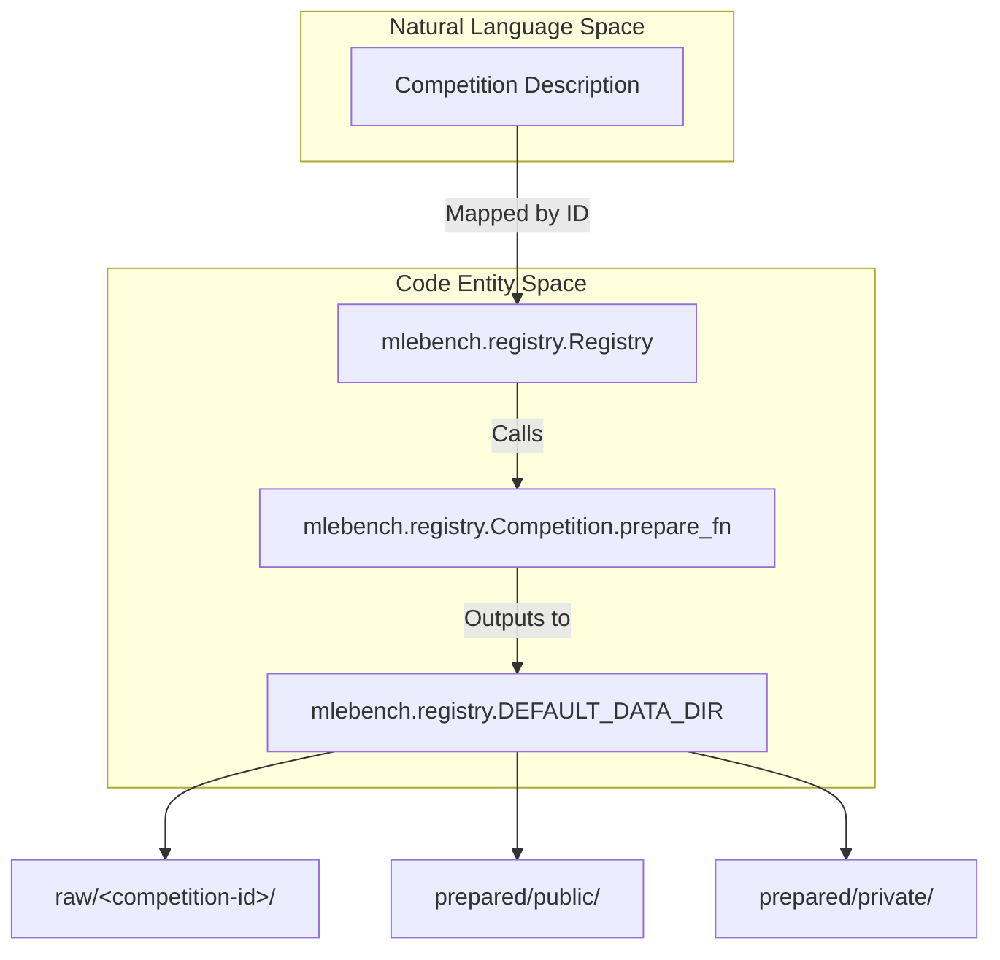
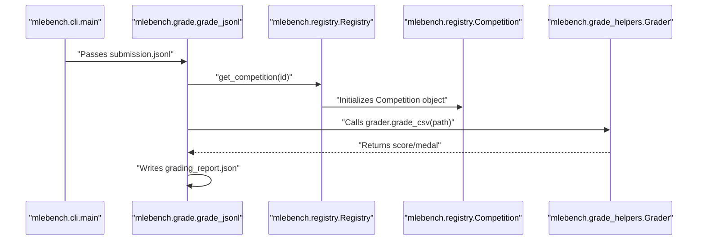

<!-- source: DeepWiki mcp.deepwiki.com · repo openai/mle-bench · page 4 User Guide · fetched 2026-10-26 -->

# User Guide

<details>
<summary>Relevant source files</summary>

The following files were used as context for generating this wiki page:

- [README.md](README.md)
- [mlebench/cli.py](mlebench/cli.py)
- [mlebench/competitions/the-icml-2013-whale-challenge-right-whale-redux/prepare.py](mlebench/competitions/the-icml-2013-whale-challenge-right-whale-redux/prepare.py)
- [mlebench/registry.py](mlebench/registry.py)

</details>


This guide covers the core features of MLE-bench for benchmarking machine learning agents. It explains how to prepare datasets, execute agents, evaluate submissions, and generate leaderboard metrics.

For installation instructions, see [Getting Started](#3). For agent implementation details, see [Agent Framework](#6) and [Agent Implementations](#7). For system architecture, see [System Architecture](#2).

## Core Workflow Overview

MLE-bench provides four main commands for benchmarking agents:

| Command | Purpose | Key Options |
|---------|---------|-------------|
| `mlebench prepare` | Download and prepare competition datasets | `--all`, `--lite`, `-c competition-id` |
| `run_agent.py` | Execute agents in Docker containers | `--agent-id`, `--competition`, `--run-group` |
| `mlebench grade` | Evaluate submissions and generate reports | `submission.jsonl` input file |
| `aggregate_grading_reports.py` | Generate leaderboard metrics | `--experiment-id`, `--split` |

### MLE-bench Command Flow

```mermaid
graph LR
    PrepareCmd["mlebench prepare"] --> DataDir["DEFAULT_DATA_DIR"]
    DataDir --> RunAgent["run_agent.py"]
    RunAgent --> RunsDir["runs/&lt;run-group&gt;/"]
    RunsDir --> MakeSubmission["make_submission.py"]
    MakeSubmission --> SubmissionJSONL["submission.jsonl"]
    SubmissionJSONL --> GradeCmd["mlebench grade"]
    GradeCmd --> GradingReports["grading_report.json"]
    GradingReports --> AggregateCmd["aggregate_grading_reports.py"]
    AggregateCmd --> Leaderboard["any_medal_percentage"]
```



Sources: [mlebench/cli.py:18-128](), [README.md:53-65](), [mlebench/registry.py:13-13]()

## Prerequisites

Before using MLE-bench, ensure the following are configured:

**Required Setup:**
1. Git LFS installed and fetched: `git lfs fetch --all && git lfs pull`
2. MLE-bench installed: `pip install -e .`
3. Kaggle credentials in `~/.kaggle/kaggle.json`
4. Docker installed and running

Sources: [README.md:104-123]()

## Dataset Preparation

The `mlebench prepare` command downloads and prepares competition datasets from Kaggle. It uses the Kaggle API to fetch raw data, then runs competition-specific preparation scripts (e.g., `prepare.py` in each competition directory) to create train/test splits. For details, see [Dataset Preparation](#4.1).

### Prepare Command Options

**Full Dataset (75 competitions):**
```bash
mlebench prepare --all
```
Downloads all competitions in the benchmark [mlebench/cli.py:31-34]().

**Lite Dataset (22 competitions):**
```bash
mlebench prepare --lite
```
Downloads only the low complexity split competitions [mlebench/cli.py:36-40]().

**Single Competition:**
```bash
mlebench prepare -c <competition-id>
```
Prepares one specific competition [mlebench/cli.py:22-28]().

### Dataset Storage and Structure



**Directory Structure:**
- Raw data: `~/.cache/mle-bench/data/<competition-id>/raw` [mlebench/registry.py:98-98]()
- Prepared Public data: `~/.cache/mle-bench/data/<competition-id>/prepared/public` [mlebench/registry.py:100-100]()
- Prepared Private data: `~/.cache/mle-bench/data/<competition-id>/prepared/private` [mlebench/registry.py:99-99]()

Sources: [mlebench/cli.py:18-82](), [mlebench/registry.py:13-116](), [mlebench/competitions/the-icml-2013-whale-challenge-right-whale-redux/prepare.py:9-12]()

## Running Agents

Agents are executed using `run_agent.py`. This script handles container orchestration, volume mounting for data access, and result collection. For details, see [Running Agents](#4.2).

## Evaluating Submissions

The grading process involves comparing agent-generated predictions against ground truth labels stored in the private data directory. For details, see [Evaluating Submissions](#4.3).

### Submission Format and Grading



**Required JSONL Format:**
- `competition_id`: Competition identifier [mlebench/cli.py:118-121]()
- `submission_path`: Path to `.csv` file containing predictions [mlebench/cli.py:113-116]()

**Individual Grading Option:**
- Use `mlebench grade-sample PATH_TO_SUBMISSION competition-id` for single submissions [mlebench/cli.py:108-128]().

Sources: [mlebench/cli.py:84-128](), [mlebench/registry.py:17-47](), [mlebench/grade.py:6-7]()

## Leaderboard Generation

Once grading reports are generated for a set of runs, they are aggregated to produce the final leaderboard metrics using `aggregate_grading_reports.py`. For details, see [Leaderboard Generation](#4.4).

### Aggregation Command
```bash
uv run python experiments/aggregate_grading_reports.py --experiment-id <exp_id> --split <low|medium|high|split75>
```
This script reports the mean and standard error of the mean (SEM) for the `any_medal_percentage` metric.

Sources: [README.md:53-65]()

---

