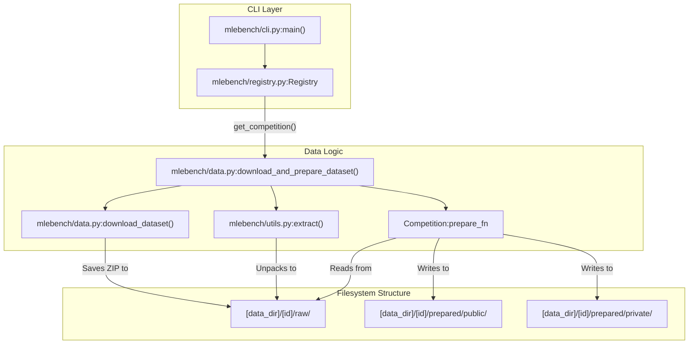

<!-- source: DeepWiki mcp.deepwiki.com · repo openai/mle-bench · page 4.1 Dataset Preparation · fetched 2026-10-26 -->

# Dataset Preparation

<details>
<summary>Relevant source files</summary>

The following files were used as context for generating this wiki page:

- [.gitattributes](.gitattributes)
- [mlebench/cli.py](mlebench/cli.py)
- [mlebench/competitions/the-icml-2013-whale-challenge-right-whale-redux/prepare.py](mlebench/competitions/the-icml-2013-whale-challenge-right-whale-redux/prepare.py)
- [mlebench/data.py](mlebench/data.py)
- [mlebench/registry.py](mlebench/registry.py)

</details>


This page explains how to prepare competition datasets for MLE-bench evaluation. Dataset preparation downloads raw data from Kaggle and transforms it into a standardized format with train/test splits. For information about how prepared data is used during agent execution, see [Data Management and Storage](#5.4). For details about the competition structure itself, see [Competition Framework](#5.3).

## Overview

MLE-bench consists of 75 Kaggle competitions used to evaluate machine learning agents. Since Kaggle does not provide held-out test sets for these competitions, the `mlebench prepare` command downloads the publicly available competition data and creates new train/test splits. The preparation process handles data download, validation, transformation, and organization into a standardized directory structure.

Sources: [mlebench/cli.py:18-21](), [mlebench/data.py:37-47]()

## Prerequisites

### Kaggle API Credentials

The preparation system uses the Kaggle API to download competition data. Before running any preparation commands, you must:

1. Download your Kaggle API credentials file (`kaggle.json`).
2. Place the file in the `~/.kaggle/` directory.

The system uses `authenticate_kaggle_api` to initialize the connection before downloading datasets.

Sources: [mlebench/utils.py:19]() (refers to authentication logic), [mlebench/data.py:60-64]()

### Git LFS Setup

Competition data and outputs are stored using Git Large File Storage (LFS). Before pulling the repository or working with prepared data, install Git LFS and run:

```bash
git lfs fetch --all
git lfs pull
```

The following file types are tracked with Git LFS:

| File Pattern | Purpose |
|--------------|---------|
| `*.csv` | All CSV files including competition data and submissions |
| `mlebench/competitions/*/top_solutions/**` | Reference solutions from top Kaggle submissions |
| `runs/**/*.json` | Grading reports and run metadata |
| `runs/**/*.jsonl` | Batch submission files |

Sources: [.gitattributes:1-4]()

## Preparation Commands

The `mlebench prepare` command is the primary entry point for dataset setup. It is managed by the `main()` function in `mlebench/cli.py`.

### Prepare All Competitions

To download and prepare the complete MLE-bench dataset:

```bash
mlebench prepare --all
```

This iterates through all competition IDs found in the registry and executes the `download_and_prepare_dataset` function for each.

Sources: [mlebench/cli.py:30-34](), [mlebench/cli.py:166-170](), [mlebench/cli.py:184-191]()

### Prepare Lite Dataset

For cost-effective evaluation, use the lite dataset consisting of competitions from the "low" complexity split:

```bash
mlebench prepare --lite
```

The `Registry.get_lite_competition_ids()` method retrieves IDs from `experiments/splits/low.txt`.

Sources: [mlebench/cli.py:35-40](), [mlebench/registry.py:128-134](), [mlebench/registry.py:123-126]()

### Prepare Specific Competition

To prepare an individual competition by its ID:

```bash
mlebench prepare -c <competition-id>
```

Sources: [mlebench/cli.py:22-28](), [mlebench/cli.py:182]()

## Data Preparation Flow

The preparation process involves downloading raw ZIP files from Kaggle, extracting them, and running a custom `prepare_fn` for each competition.



**Diagram: Data Preparation Implementation Flow**

Sources: [mlebench/cli.py:184-191](), [mlebench/data.py:37-108](), [mlebench/registry.py:98-100]()

## Implementation Details

### The Registry and Competition Objects

The `Registry` class manages the configuration and paths for all competitions. It constructs `Competition` dataclasses by loading `config.yaml` files from `mlebench/competitions/[id]/`.

Key attributes of the `Competition` class used during preparation:
- `prepare_fn`: A callable (imported via `import_fn`) that performs the data transformation.
- `raw_dir`: Path where Kaggle ZIPs are extracted.
- `public_dir`: Path for data accessible to agents (e.g., training sets, sample submissions).
- `private_dir`: Path for ground truth answers used for grading.

Sources: [mlebench/registry.py:16-31](), [mlebench/registry.py:74-116]()

### The Preparation Function (`prepare_fn`)

Each competition has a unique `prepare.py` script. For example, in `the-icml-2013-whale-challenge-right-whale-redux`, the `prepare` function:
1. Unpacks `train2.zip`.
2. Splits the original training data into a new training set and a new test set based on timestamps in filenames.
3. Copies files to the `public` directory.
4. Generates `test.csv` (answers) in the `private` directory.
5. Creates a `sampleSubmission.csv` in the `public` directory.

Sources: [mlebench/competitions/the-icml-2013-whale-challenge-right-whale-redux/prepare.py:9-96]()

### Checksum Validation

To ensure data integrity, the system generates and verifies SHA-256 checksums for the raw ZIP and the final prepared files.
- `generate_checksums()`: Recursively hashes files in a directory.
- `checksums.yaml`: Stores the expected hashes for `zip`, `public`, and `private` folders.

Developers can use `--overwrite-checksums` to update these values when modifying preparation logic.

Sources: [mlebench/data.py:66-81](), [mlebench/data.py:112-141](), [mlebench/cli.py:62-67]()

## Storage Locations

### Default Data Directory
By default, data is stored in a platform-specific user cache directory:
- `DEFAULT_DATA_DIR`: `(Path(user_cache_dir()) / "mle-bench" / "data")`.

This can be overridden using the `--data-dir` flag in the CLI.

Sources: [mlebench/registry.py:13](), [mlebench/cli.py:55-60]()

### Directory Layout
After preparation, the directory structure for a competition ID `example-comp` looks like:

```text
[data-dir]/
└── example-comp/
    ├── raw/                # (Optional) Original Kaggle files
    └── prepared/
        ├── public/         # Mounted into agent containers
        │   ├── train.csv
        │   ├── description.md
        │   └── sample_submission.csv
        └── private/        # Used only by the grader
            └── test.csv    # Ground truth
```

Sources: [mlebench/registry.py:98-100](), [mlebench/data.py:109-111]()

## Execution Summary

| CLI Flag | Functionality |
|----------|---------------|
| `--keep-raw` | Prevents deletion of the `raw/` directory after preparation. |
| `--overwrite-leaderboard` | Re-downloads the Kaggle leaderboard CSV. |
| `--skip-verification` | Skips checking file checksums against `checksums.yaml`. |

Sources: [mlebench/cli.py:49-81](), [mlebench/data.py:143-145]()

---

