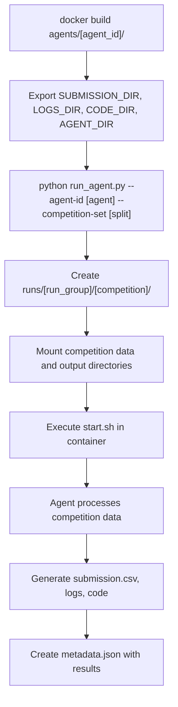
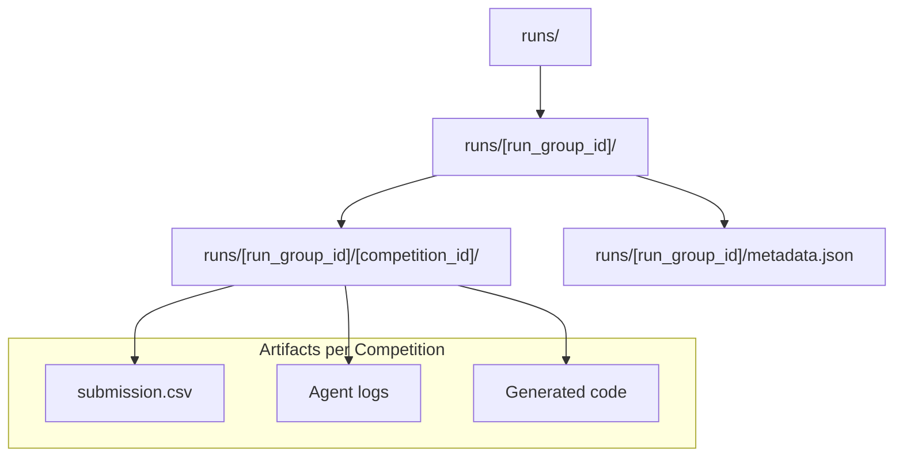

<!-- source: DeepWiki mcp.deepwiki.com · repo openai/mle-bench · page 4.2 Running Agents · fetched 2026-10-26 -->

# Running Agents

<details>
<summary>Relevant source files</summary>

The following files were used as context for generating this wiki page:

- [README.md](README.md)
- [agents/README.md](agents/README.md)

</details>


This document covers the practical execution of ML agents within the MLE-bench system using the `run_agent.py` script and Docker containers. It focuses on the mechanics of launching agents, configuring their execution environment, and managing their outputs.

For information about agent implementation details and architecture, see **6. Agent Framework**. For evaluating agent submissions after execution, see **4.3. Evaluating Submissions**. For preparing competition datasets before running agents, see **4.1. Dataset Preparation**.

## Purpose and Execution Overview

The MLE-bench system executes agents in isolated Docker containers with standardized directory structures and environment variables. Each agent receives access to competition data and must produce a submission file within a specified time limit.

## Agent Execution Workflow

The following diagram illustrates the flow from building an agent image to generating the final execution metadata.

**Agent Run Data Flow**


**Sources:** [agents/README.md:29-47]()

## Prerequisites and Environment Setup

### Required Dependencies

Before running agents, ensure the following are installed:
- **Docker Engine**: For container execution [agents/README.md:14]().
- **Sysbox**: For enhanced container security and isolation [agents/README.md:15]().
- **NVIDIA Container Toolkit**: (Optional) Required to run agents with GPU support [agents/README.md:16]().

**Sources:** [agents/README.md:12-16]()

### Environment Variables

The system requires four standardized directory environment variables that define the container filesystem layout. These must be exported before building Docker images or running agents.

| Variable | Purpose | Default Path |
|----------|---------|--------------|
| `SUBMISSION_DIR` | Agent output location | `/home/submission` |
| `LOGS_DIR` | Agent log storage | `/home/logs` |
| `CODE_DIR` | Agent code storage | `/home/code` |
| `AGENT_DIR` | Agent workspace | `/home/agent` |

**Sources:** [agents/README.md:21-24]()

## Building Agent Images

Each agent requires a Docker image built from its respective directory in `agents/<agent_id>/`. The build process uses the environment variables as build arguments to ensure the agent knows where to read data and write outputs.

```bash
docker build --platform=linux/amd64 -t <agent> agents/<agent>/ \
  --build-arg SUBMISSION_DIR=$SUBMISSION_DIR \
  --build-arg LOGS_DIR=$LOGS_DIR \
  --build-arg CODE_DIR=$CODE_DIR \
  --build-arg AGENT_DIR=$AGENT_DIR
```

**Sources:** [agents/README.md:18-27]()

## Executing Agents with run_agent.py

### Basic Execution

The `run_agent.py` script is the primary entry point for launching agents against competitions.

```bash
python run_agent.py --agent-id <agent_id> --competition-set <split_file>
```

### Competition Sets

Competition sets are text files containing competition IDs, located in `experiments/splits/`:
- `experiments/splits/split75.txt`: Contains all 75 competitions used in the benchmark [agents/README.md:31]().
- `experiments/splits/spaceship-titanic.txt`: Contains only the Spaceship Titanic competition, ideal for quick testing [agents/README.md:31-32]().

**Sources:** [agents/README.md:31-35]()

## Directory Structure and Output Management

The execution results are organized into a hierarchical structure under the `runs/` directory.

**Run Artifact Organization**


### Run Group Creation

Each execution of `run_agent.py` creates a "run group" directory. Upon completion, a `metadata.json` file is generated within this directory, summarizing the execution status across all targeted competitions [agents/README.md:37-38]().

**Sources:** [agents/README.md:37-41]()

## Container Configuration

### Default Configuration

Container behavior, including resource limits and security settings, is controlled by configuration files. The default configuration is located at `environment/config/container_configs/default.json` [agents/README.md:49]().

### GPU Configuration

To enable GPU access (e.g., for agents that train models or use local LLMs), users can modify the container config JSON to set `"gpus": -1` [agents/README.md:49]().

**Sources:** [agents/README.md:49]()

## Security Models

### Sysbox Runtime

The system uses the [Sysbox](https://github.com/nestybox/sysbox) runtime by default for agents like `aide`, `mlagentbench`, and the `dummy` agent [agents/README.md:62](). Sysbox provides enhanced isolation to prevent malicious code from compromising the host system [agents/README.md:62]().

### Privileged Mode (OpenHands/OpenDevin)

The `opendevin` agent requires Docker-in-Docker (DinD) capabilities. Because Sysbox does not yet support GPU-passthrough in DinD scenarios, `opendevin` must be run in "privileged" mode [agents/README.md:64](). 

**Security Requirement**: Users must explicitly acknowledge this risk by setting the environment variable `I_ACCEPT_RUNNING_PRIVILEGED_CONTAINERS=True` when running `opendevin` via `run_agent.py` [agents/README.md:64]().

**Sources:** [agents/README.md:60-64]()

## Agent Validation with Dummy Agent

The `dummy` agent is a diagnostic tool used to verify that the MLE-bench environment is correctly configured [agents/README.md:52](). It performs the following checks:

1. **Root Access**: Checks if `main.py` is running with root privileges [agents/README.md:54]().
2. **Interpreter Check**: Verifies the Python interpreter in use [agents/README.md:55]().
3. **Submission Capability**: Attempts to use the competition's sample submission [agents/README.md:56]().
4. **Data Privacy**: Confirms it cannot read "private" data (test set labels) [agents/README.md:57]().
5. **Write Access**: Validates read/write permissions for the `/home` working directory [agents/README.md:58]().

**Sources:** [agents/README.md:51-58]()

## Post-Execution Workflow

Once `run_agent.py` finishes, the outputs must be processed for grading:

1. **Generate Submission JSONL**:
   Use `experiments/make_submission.py` to aggregate results from the `metadata.json` [agents/README.md:39-40]().
   ```bash
   python experiments/make_submission.py --metadata runs/<run-group>/metadata.json --output runs/<run-group>/submission.jsonl
   ```

2. **Grade the Submission**:
   Use the `mlebench grade` CLI command [agents/README.md:43-46]().
   ```bash
   mlebench grade --submission runs/<run-group>/submission.jsonl --output-dir runs/<run-group>
   ```

**Sources:** [agents/README.md:39-47]()

---

