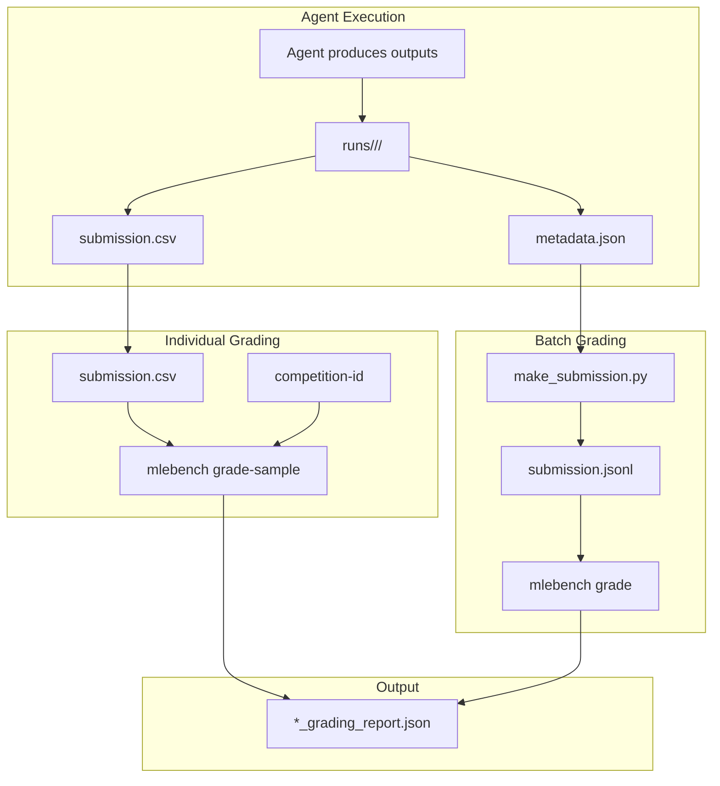
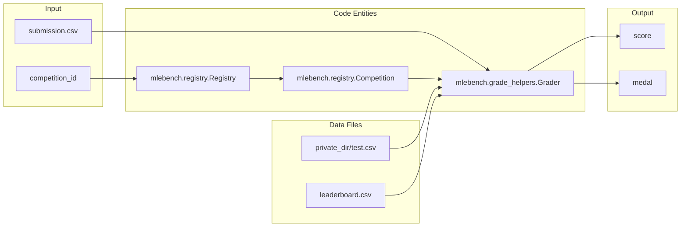

<!-- source: DeepWiki mcp.deepwiki.com · repo openai/mle-bench · page 4.3 Evaluating Submissions · fetched 2026-10-26 -->

# Evaluating Submissions

<details>
<summary>Relevant source files</summary>

The following files were used as context for generating this wiki page:

- [README.md](README.md)
- [mlebench/cli.py](mlebench/cli.py)
- [mlebench/competitions/the-icml-2013-whale-challenge-right-whale-redux/prepare.py](mlebench/competitions/the-icml-2013-whale-challenge-right-whale-redux/prepare.py)
- [mlebench/registry.py](mlebench/registry.py)

</details>


## Purpose and Scope

This page explains how to evaluate agent submissions on MLE-bench competitions using the grading system. It covers submission format requirements, the grading commands (`mlebench grade` and `mlebench grade-sample`), and the underlying implementation of the grading logic. For information about aggregating grading reports into leaderboard metrics, see [Leaderboard Generation](4.4).

## Submission Format Requirements

All competition submissions must be in CSV format. The specific structure varies by competition and is defined in the competition's configuration and sample files.

- **Competition Description**: Each competition's `description.md` file describes the expected submission format.
- **Sample Submission**: Each competition includes a `sample_submission.csv` file showing the required structure [mlebench/registry.py:24]().
- **Answers/Gold Submission**: The ground truth used for grading is typically a `test.csv` or similar file stored in the private data directory [mlebench/registry.py:92-95]().

### Validation Script

MLE-bench provides a validation script that agents can use to check submission format correctness before grading:

```bash
/home/validate_submission.sh <competition_id> <submission.csv>
```

This script verifies that the submission matches the expected format (columns, data types) but does not evaluate prediction accuracy.

**Sources:** [mlebench/registry.py:17-48](), [mlebench/competitions/the-icml-2013-whale-challenge-right-whale-redux/prepare.py:85-95]()

## Grading Workflows

MLE-bench provides two grading workflows: individual submission grading for testing and batch grading for evaluating multiple submissions.

### Workflow Overview



**Workflow Diagram: Individual vs Batch Grading Paths**

**Sources:** [mlebench/cli.py:83-128](), [README.md:53-65]()

### Individual Submission Grading

Use `mlebench grade-sample` to grade a single submission for one competition. This is useful for testing or debugging submissions.

**Command Structure:**
```bash
mlebench grade-sample <PATH_TO_SUBMISSION> <COMPETITION_ID>
```

**Implementation Details:**
The CLI calls `grade_csv` which loads the competition from the `Registry` [mlebench/cli.py:197-201](). The `Registry` fetches the `Competition` object containing the `Grader` instance [mlebench/registry.py:78-116]().

**Parameters:**
| Parameter | Type | Description |
|-----------|------|-------------|
| `PATH_TO_SUBMISSION` | File path | Path to the submission CSV file |
| `COMPETITION_ID` | String | ID of the competition (e.g., `spaceship-titanic`) |

**Sources:** [mlebench/cli.py:108-128](), [mlebench/registry.py:74-116]()

### Batch Submission Grading

Use `mlebench grade` to grade multiple submissions across different competitions in a single command. This is the standard workflow for evaluating agent runs.

**Command Structure:**
```bash
mlebench grade --submission <SUBMISSION_JSONL> --output-dir <OUTPUT_DIR>
```

**Implementation Details:**
The CLI invokes `grade_jsonl`, which iterates through the entries in the JSONL file, grading each one and saving the resulting metrics to the specified output directory [mlebench/cli.py:192-196]().

**Parameters:**
| Parameter | Type | Description |
|-----------|------|-------------|
| `--submission` | File path | Path to JSONL file containing submission information |
| `--output-dir` | Directory path | Directory where grading reports will be saved |

**Sources:** [mlebench/cli.py:84-106](), [mlebench/registry.py:155]()

## Submission JSONL Format

The `mlebench grade` command requires a JSONL (JSON Lines) file where each line represents one submission.

### Required Fields

| Field | Type | Description |
|-------|------|-------------|
| `competition_id` | String | The ID of the competition in the MLE-bench dataset |
| `submission_path` | String | Path to the `.csv` file containing predictions |

### Creating Submission JSONL

For agent runs organized in run groups, use `experiments/make_submission.py` to generate the submission JSONL from the run's metadata. This script reads the `metadata.json` file produced by `run_agent.py` and extracts submission information for all completed competitions.

### Example JSONL Content

```json
{"competition_id": "spaceship-titanic", "submission_path": "runs/my-run/spaceship-titanic/submission.csv"}
{"competition_id": "dog-breed-identification", "submission_path": "runs/my-run/dog-breed-identification/submission.csv"}
```

**Sources:** [mlebench/cli.py:89-93](), [README.md:55-58]()

## Grading Process

### Grading Logic Implementation



**Grading Implementation Flow**

The grading process follows these steps:
1. **Registry Lookup**: The `Registry` class locates the competition configuration and instantiates a `Competition` object [mlebench/registry.py:78-85]().
2. **Grader Initialization**: Each `Competition` contains a `Grader` object [mlebench/registry.py:21]().
3. **Metric Calculation**: The grader compares the `submission.csv` against the `answers` path (ground truth) [mlebench/registry.py:59-61]().
4. **Leaderboard Comparison**: The raw score is compared against the competition's `leaderboard.csv` to determine the percentile rank and medal status [mlebench/registry.py:31, 85]().

### Private Data Isolation

Test labels and ground truth are stored in the `private_dir` (e.g., `/data/mle-bench/data/<comp_id>/prepared/private/`) and are never accessible to agents during execution [mlebench/registry.py:99](). Agents only have access to the `public_dir` [mlebench/registry.py:100]().

**Sources:** [mlebench/registry.py:17-48, 98-116](), [mlebench/cli.py:192-202]()

## Grading Reports

### Report Format and Contents

Grading produces a JSON report for each competition with the filename pattern `<competition-id>_grading_report.json`.

Each grading report contains:
- `competition_id`: ID of the graded competition.
- `submission_path`: Path to the submission that was graded.
- `score`: Raw score on the competition metric.
- `percentile_rank`: Percentile rank on the historical leaderboard (0-100).
- `medal`: Medal achieved ("gold", "silver", "bronze", or null).

### Using Grading Reports

Grading reports are the primary input for generating aggregate leaderboard metrics. Use the `aggregate_grading_reports.py` script to process these files:

```bash
uv run python experiments/aggregate_grading_reports.py --experiment-id <exp_id> --split low
```

This aggregates reports across multiple seeds to compute the mean and standard error of the mean (SEM) for the `any_medal_percentage` metric [README.md:61-68]().

**Sources:** [README.md:53-68](), [mlebench/cli.py:192-196]()

## Command Reference Summary

| Command | Purpose | Implementation |
|---------|---------|----------------|
| `mlebench grade-sample` | Grade single submission | `mlebench.grade.grade_csv` |
| `mlebench grade` | Grade batch of submissions | `mlebench.grade.grade_jsonl` |
| `mlebench prepare` | Setup data for grading | `mlebench.data.download_and_prepare_dataset` |

**Sources:** [mlebench/cli.py:13-196]()

---

