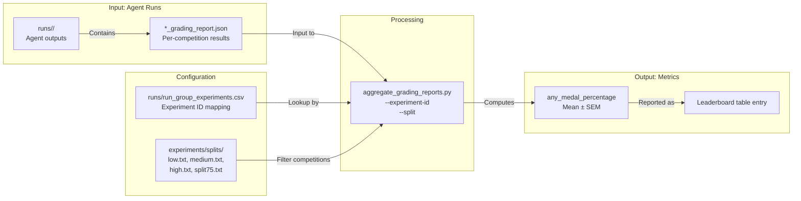
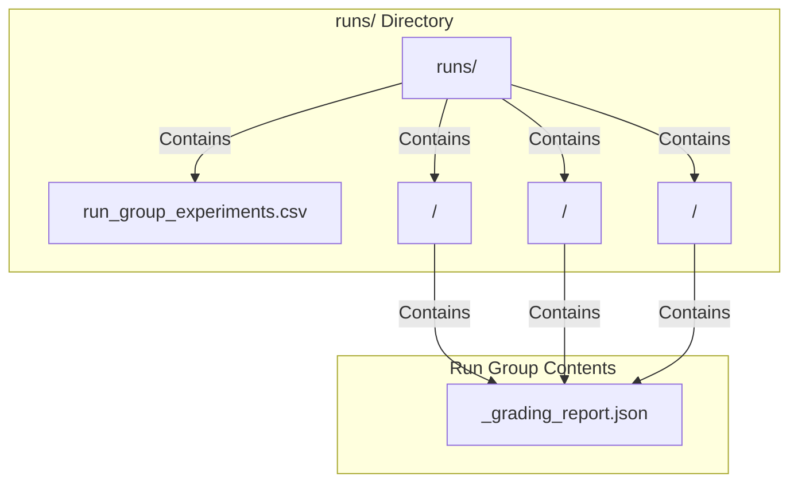
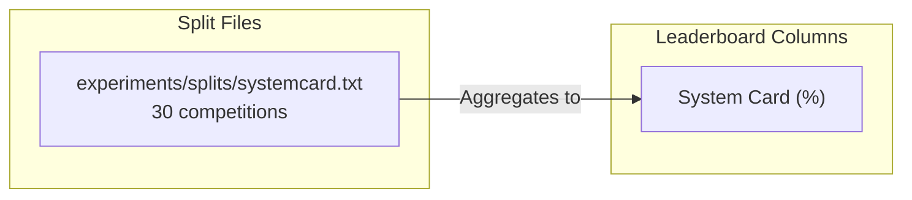

<!-- source: DeepWiki mcp.deepwiki.com · repo openai/mle-bench · page 4.4 Leaderboard Generation · fetched 2026-10-26 -->

# Leaderboard Generation

<details>
<summary>Relevant source files</summary>

The following files were used as context for generating this wiki page:

- [experiments/splits/systemcard.txt](experiments/splits/systemcard.txt)
- [runs/README.md](runs/README.md)
- [runs/run_group_experiments.csv](runs/run_group_experiments.csv)

</details>


## Purpose and Overview

This document explains how to aggregate grading reports from multiple agent runs and generate leaderboard metrics for MLE-bench. The leaderboard generation process takes individual grading reports produced by `mlebench grade` and computes aggregate statistics across different competition splits, enabling fair comparison of agent performance.

The leaderboard generation system produces the "Any Medal %" metric, which represents the percentage of competitions where an agent achieved at least a bronze medal (top 40% of the competition leaderboard). This metric is reported with standard error of the mean (SEM) to account for variance across multiple evaluation seeds.

**Leaderboard Generation Pipeline**


Sources: [runs/README.md:1-26]()

## Prerequisites

Before generating leaderboard metrics, ensure you have:

1.  **Completed Agent Runs**: Agent executions that produced submission files.
2.  **Grading Reports**: Generated using `mlebench grade` on the agent submissions.
3.  **Proper Directory Structure**: Runs organized in the `runs/` directory with appropriate metadata.

**Required Directory Structure**


Sources: [runs/README.md:3-9]()

## Competition Splits

MLE-bench evaluates agents across different competition splits, each representing a different subset of the total competitions. One example is the `systemcard` split which includes specific high-impact competitions.

| Split | Description | Number of Competitions | File Location |
|-------|-------------|----------------------|---------------|
| `systemcard` | Competitions used for system card evaluation | 30 | `experiments/splits/systemcard.txt` |

The split files are simple text files containing one competition ID per line. The `aggregate_grading_reports.py` script uses these files to filter which grading reports to include in the aggregation.

**Competition Split Distribution**


Sources: [experiments/splits/systemcard.txt:1-30]()

## Experiment Configuration

### Run Group Organization

Agent runs must be organized into **run groups** in the `runs/` directory. Each run group represents a collection of run results across multiple competitions and seeds.

- `grading_report.json`: Contains the scores achieved for the run group.

Sources: [runs/README.md:5-9]()

### Linking Run Groups to Experiments

The `runs/run_group_experiments.csv` file maps run groups to experiment IDs. This allows you to aggregate results from multiple run groups (e.g., different seeds or different competitions) into a single experiment.

An experiment typically represents a specific agent setup (e.g., `biggpu-gpt4o-aide` or `models-o1-preview-aide`).

| Experiment ID | Description |
|---------------|-------------|
| `scaffolding-gpt4o-aide` | GPT-4o on AIDE scaffolding |
| `scaffolding-gpt4o-mlab` | GPT-4o on MLAB scaffolding |
| `scaffolding-gpt4o-opendevin` | GPT-4o on OpenDevin scaffolding |
| `deepseek-r1-InternAgent` | Deepseek-R1 on InternAgent scaffolding |

Sources: [runs/README.md:24-63]()

## Running the Aggregation Script

### Basic Usage

The `aggregate_grading_reports.py` script aggregates grading reports for a specific experiment ID and competition split.

**Basic Command Syntax:**
```bash
python aggregate_grading_reports.py --experiment-id <exp_id> --split <split_name>
```

**Execution Flow**
```mermaid
sequenceDiagram
    participant User
    participant Script["aggregate_grading_reports.py"]
    participant CSV["run_group_experiments.csv"]
    participant SplitFile["experiments/splits/<split>.txt"]
    participant GradingReports["runs/<run-group>/grading_report.json"]
    
    User->>Script: "--experiment-id scaffolding-gpt4o-aide --split systemcard"
    Script->>CSV: "Load experiment-to-run-group mapping"
    CSV-->>Script: "List of run groups for exp_id"
    Script->>SplitFile: "Read competition IDs"
    SplitFile-->>Script: "Competition ID list"
    
    loop "For each run group"
        Script->>GradingReports: "Load grading reports"
        GradingReports-->>Script: "Scores"
    end
    
    Script->>Script: "Aggregate across seeds"
    Script-->>User: "Final aggregated metrics"
```

Sources: [runs/README.md:14-22](), [runs/README.md:24-26]()

### Handling Multiple Seeds

In cases where there are more seeds for a competition than reported (often due to hardware failures in earlier seeds), the aggregation logic takes the final *N* seeds for computing the result, where *N* is the number of seeds for the competition with the least number of seeds in the experiment.

Sources: [runs/README.md:18-22]()

---

