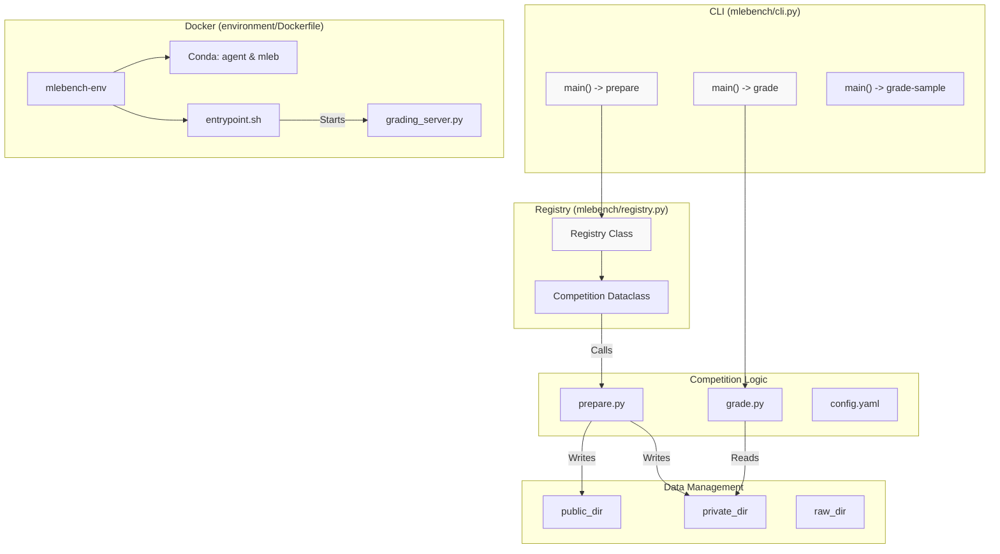
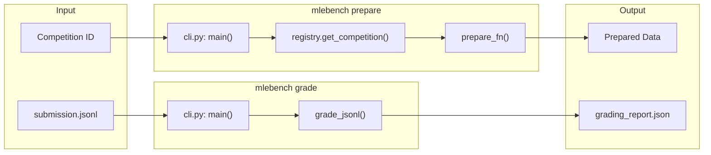

<!-- source: DeepWiki mcp.deepwiki.com · repo openai/mle-bench · page 5 Core Components · fetched 2026-10-26 -->

# Core Components

Relevant source files

The following files were used as context for generating this wiki page:

- [environment/Dockerfile](environment/Dockerfile)
- [environment/entrypoint.sh](environment/entrypoint.sh)
- [mlebench/cli.py](mlebench/cli.py)
- [mlebench/competitions/the-icml-2013-whale-challenge-right-whale-redux/prepare.py](mlebench/competitions/the-icml-2013-whale-challenge-right-whale-redux/prepare.py)
- [mlebench/registry.py](mlebench/registry.py)

This page documents the fundamental components that comprise the MLE-bench system. These core components provide the infrastructure for dataset preparation, agent execution, evaluation, and result aggregation.

**Scope**: This page covers the four primary subsystems that form the foundation of MLE-bench. For detailed information about specific components, see:
- Command-line interface details: [Command-Line Interface](#5.1)
- Docker environment specifics: [Docker Environment](#5.2)
- Competition organization: [Competition Framework](#5.3)
- Data storage patterns: [Data Management and Storage](#5.4)

For information about agent implementations that use these components, see [Agent Framework](#6).

---

## System Overview

MLE-bench is built on four core components that work together to provide a complete benchmarking pipeline:

| Component | Purpose | Primary Interfaces |
|-----------|---------|-------------------|
| **Command-Line Interface** | Dataset preparation and evaluation | `mlebench prepare`, `mlebench grade`, `mlebench grade-sample` |
| **Docker Environment** | Isolated execution environment | `mlebench-env` base image, container runtime |
| **Competition Framework** | Competition organization and structure | 75 competitions, split definitions, metadata |
| **Data Management** | Storage and version control | `/data/`, `/data_privateonly/`, Git LFS |

**Sources**: [mlebench/cli.py:1-205](), [environment/Dockerfile:1-93]()

---

## Core Component Architecture

The following diagram shows how the core components relate to each other and to the agent execution pipeline. It bridges the logical "Natural Language Space" of benchmark components to the "Code Entity Space" of specific files and classes.

**Sources**: [mlebench/registry.py:16-156](), [mlebench/cli.py:158-205](), [environment/Dockerfile:63-82]()

---

## CLI Command Flow

The MLE-bench CLI provides three primary commands that orchestrate the workflow. The CLI uses the `Registry` class in `mlebench/registry.py` to resolve competition metadata and paths.

**CLI Implementation**: The command-line interface is implemented in `mlebench/cli.py` using Python's `argparse` module [mlebench/cli.py:13-156](). It maps user commands to the `Registry` and utility functions like `download_and_prepare_dataset` [mlebench/cli.py:185-191]().

**Sources**: [mlebench/cli.py:158-205](), [mlebench/registry.py:78-116]()

---

## Docker Environment Structure

The `mlebench-env` Docker image provides a standardized execution environment. It features a dual-conda environment setup to isolate agent dependencies from the benchmark grading infrastructure.

| Layer | Component | Path/Command |
|-------|-----------|--------------|
| **Base OS** | Ubuntu 20.04 | `FROM ubuntu:20.04` [environment/Dockerfile:1]() |
| **Agent Env** | Conda `agent` | `conda create -n agent python=3.11` [environment/Dockerfile:48]() |
| **Grading Env** | Conda `mleb` | `conda create -n mleb python=3.11` [environment/Dockerfile:65]() |
| **Grading App** | Flask Server | `pip install flask && pip install -e /mlebench` [environment/Dockerfile:66-67]() |
| **Security** | Private Dir | `mkdir /private && chmod 700 /private` [environment/Dockerfile:74]() |
| **Entrypoint** | Orchestrator | `/entrypoint.sh` [environment/Dockerfile:92]() |

**Heavy Dependencies**: The Dockerfile includes an `INSTALL_HEAVY_DEPENDENCIES` argument [environment/Dockerfile:49]() that, when true, installs large frameworks like TensorFlow and PyTorch into the agent environment [environment/Dockerfile:53-57]().

**Sources**: [environment/Dockerfile:1-93](), [environment/entrypoint.sh:1-20]()

---

## Competition Framework

Competitions are the central unit of evaluation. Each competition is defined by a directory in `mlebench/competitions/` and registered via a `config.yaml`.

**The Competition Registry**:
The `Registry` class [mlebench/registry.py:74]() is responsible for:
1. Loading competition configurations [mlebench/registry.py:81-82]().
2. Resolving paths for raw, public, and private data [mlebench/registry.py:98-100]().
3. Importing the specific `prepare` function for the dataset [mlebench/registry.py:90]().

**Data Splits**:
The framework supports different splits defined in `experiments/splits/` (e.g., `low.txt` for MLE-bench Lite) [mlebench/registry.py:123-134]().

**Sources**: [mlebench/registry.py:16-156](), [mlebench/competitions/the-icml-2013-whale-challenge-right-whale-redux/prepare.py:9-96]()

---

## Data Management and Storage

MLE-bench uses a structured directory hierarchy to manage massive datasets while keeping the repository lightweight via Git LFS.

| Directory | Content Type | Code Reference |
|-----------|--------------|----------------|
| `raw_dir` | Original Kaggle downloads | `Competition.raw_dir` [mlebench/registry.py:27]() |
| `public_dir` | Cleaned features for agents | `Competition.public_dir` [mlebench/registry.py:29]() |
| `private_dir` | Ground truth labels (answers) | `Competition.private_dir` [mlebench/registry.py:28]() |
| `/private/` | Container-internal grading | `environment/Dockerfile:74` |

**Preparation Logic**:
The `prepare.py` script for each competition (e.g., Whale Challenge) unzips raw data, splits it into new train/test sets, and generates `answers.csv` and `sampleSubmission.csv` [mlebench/competitions/the-icml-2013-whale-challenge-right-whale-redux/prepare.py:9-88]().

**Sources**: [mlebench/registry.py:13-31](), [mlebench/competitions/the-icml-2013-whale-challenge-right-whale-redux/prepare.py:41-55]()

---

