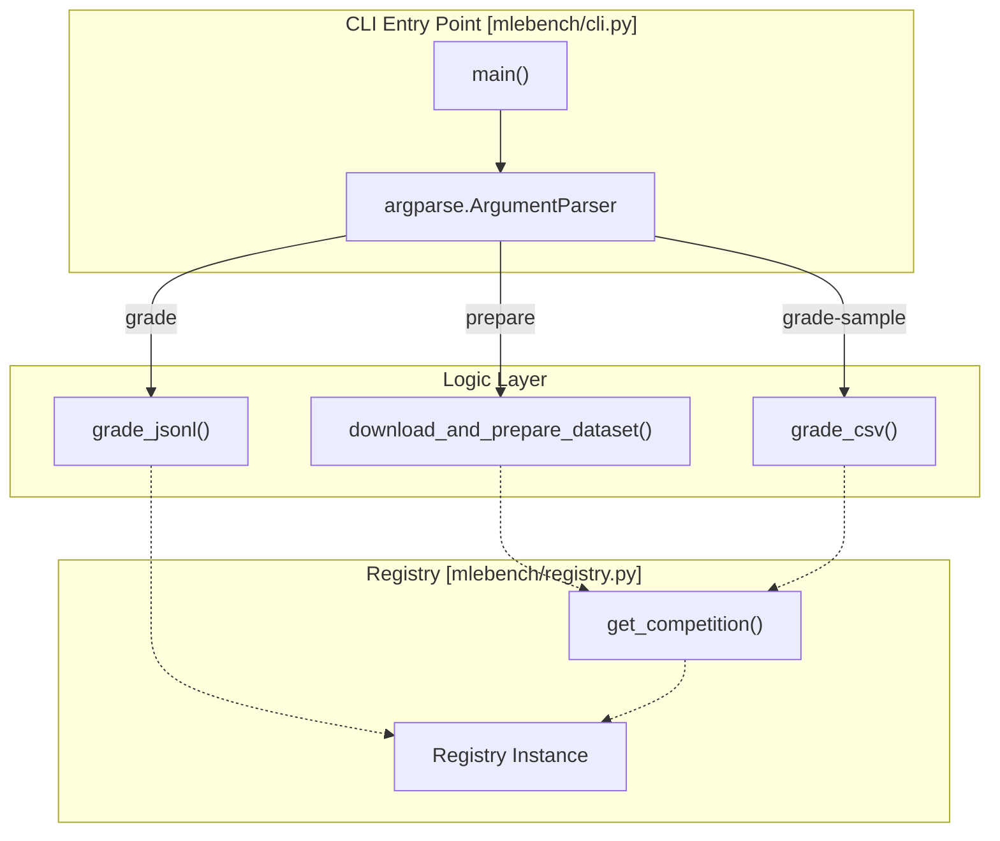
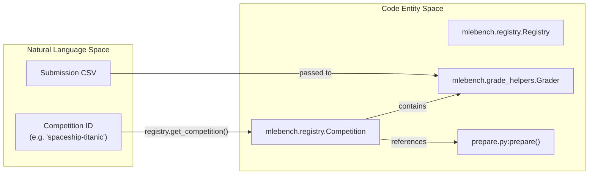

<!-- source: DeepWiki mcp.deepwiki.com · repo openai/mle-bench · page 5.1 Command-Line Interface · fetched 2026-10-26 -->

# Command-Line Interface

<details>
<summary>Relevant source files</summary>

The following files were used as context for generating this wiki page:

- [README.md](README.md)
- [mlebench/cli.py](mlebench/cli.py)
- [mlebench/competitions/the-icml-2013-whale-challenge-right-whale-redux/prepare.py](mlebench/competitions/the-icml-2013-whale-challenge-right-whale-redux/prepare.py)
- [mlebench/registry.py](mlebench/registry.py)

</details>


## Purpose and Scope

This document describes the `mlebench` command-line interface (CLI), which provides the primary user interface for dataset preparation, submission evaluation, and competition management. The CLI exposes three main commands: `prepare`, `grade`, and `grade-sample`, as well as developer-focused subcommands under `dev`.

The CLI implementation is primarily contained in `mlebench/cli.py` [mlebench/cli.py:1-205]().

## Overview

The `mlebench` CLI is installed as a Python package and provides a command-line entry point for core MLE-bench operations. All commands follow the pattern `mlebench <command> [options]`, where each command corresponds to a distinct phase in the benchmark workflow:

- **prepare**: Downloads and prepares competition datasets from Kaggle.
- **grade**: Evaluates multiple submissions in batch from a JSONL file.
- **grade-sample**: Evaluates a single submission for a specific competition.
- **dev**: Developer tools, such as downloading leaderboards.

Sources: [mlebench/cli.py:13-156]()

## Command Architecture

The CLI uses `argparse` to define sub-parsers for each command. The following diagram illustrates how the CLI entry point in `mlebench/cli.py` dispatches to internal logic and interacts with the `Registry` [mlebench/registry.py:74-154]() and data utilities.



Sources: [mlebench/cli.py:13-205](), [mlebench/registry.py:74-154]()

## Command Reference

### mlebench prepare

The `prepare` command downloads competition data and processes it into the MLE-bench format. It utilizes `download_and_prepare_dataset` from `mlebench.data` [mlebench/cli.py:5]().

**Basic Usage:**

```bash
# Prepare all competitions
mlebench prepare --all

# Prepare only the low complexity competitions (Lite)
mlebench prepare --lite

# Prepare a specific competition
mlebench prepare -c <competition-id>
```

**Arguments and Options:**

| Option | Type | Description |
|--------|------|-------------|
| `-c`, `--competition-id` | string | ID of the competition to prepare. |
| `--all` | flag | Prepare all competitions in the registry. |
| `--lite` | flag | Prepare competitions defined in `experiments/splits/low.txt`. |
| `-l`, `--list` | path | Prepare a list of IDs from a text file. |
| `--keep-raw` | flag | Keep raw Kaggle files after preparation. |
| `--data-dir` | path | Directory for storage (default: `~/.cache/mle-bench/data`). |
| `--skip-verification`| flag | [Dev] Skip checksum verification. |

Sources: [mlebench/cli.py:18-81](), [mlebench/registry.py:128-134]()

### mlebench grade

The `grade` command evaluates a batch of submissions. It processes a JSONL file where each line identifies a competition and a path to a submission CSV. This command calls `grade_jsonl` [mlebench/cli.py:196]().

**Input JSONL Format:**
Each line must be a JSON object:
`{"competition_id": "titanic", "submission_path": "/path/to/sub.csv"}`

**Key Options:**
- `--submission`: Path to the input JSONL file [mlebench/cli.py:89-93]().
- `--output-dir`: Directory where grading reports are saved [mlebench/cli.py:95-99]().
- `--data-dir`: Path to the prepared datasets [mlebench/cli.py:101-105]().

Sources: [mlebench/cli.py:84-106](), [mlebench/grade.py:1-100]()

### mlebench grade-sample

Evaluates a single CSV submission for a specific competition. It uses `grade_csv` to return a `GradingReport` object [mlebench/cli.py:201]().

**Positional Arguments:**
1. `submission`: Path to the CSV file.
2. `competition_id`: ID of the competition.

Sources: [mlebench/cli.py:108-127]()

## Data Flow and Entity Mapping

The CLI acts as a bridge between the user's local file system and the `Registry` system which manages competition metadata.



Sources: [mlebench/registry.py:17-116](), [mlebench/cli.py:199-201](), [mlebench/competitions/the-icml-2013-whale-challenge-right-whale-redux/prepare.py:9-12]()

## Internal Implementation Details

### Registry Integration
The CLI heavily relies on the global `registry` instance [mlebench/registry.py:155](). When `--data-dir` is provided in the CLI, it calls `registry.set_data_dir(Path(args.data_dir))` to create a new registry instance pointing to the specified location [mlebench/cli.py:159]().

### Preparation Logic
For each competition identified by the CLI arguments (lite, all, list, or ID), the `prepare` command:
1. Retrieves the `Competition` object from the registry [mlebench/cli.py:163-182]().
2. Invokes `download_and_prepare_dataset` [mlebench/cli.py:185-191]().
3. This in turn executes the competition-specific `prepare_fn` (e.g., [mlebench/competitions/the-icml-2013-whale-challenge-right-whale-redux/prepare.py:9-12]()) to split raw data into `public` and `private` directories.

### Developer Tools (`dev`)
The CLI includes a `dev` sub-parser for maintenance tasks:
- `download-leaderboard`: Downloads the current Kaggle leaderboard for a competition to `leaderboard.csv` in the competition's directory [mlebench/cli.py:134-154](). This is used to establish medal thresholds.

Sources: [mlebench/cli.py:130-154](), [mlebench/registry.py:78-116]()

---

