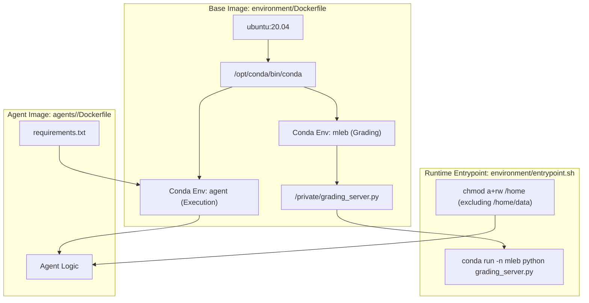
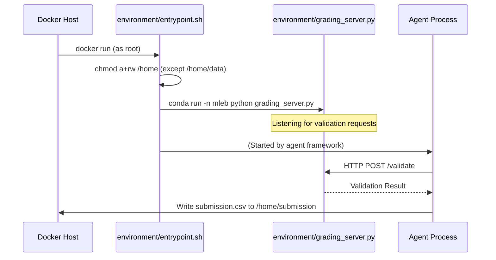

<!-- source: DeepWiki mcp.deepwiki.com · repo openai/mle-bench · page 5.2 Docker Environment · fetched 2026-10-26 -->

# Docker Environment

<details>
<summary>Relevant source files</summary>

The following files were used as context for generating this wiki page:

- [environment/Dockerfile](environment/Dockerfile)
- [environment/entrypoint.sh](environment/entrypoint.sh)

</details>


This document describes the Docker-based execution environment for MLE-bench agents. It covers the `mlebench-env` base image, the build process for agent images, environment variables and directory structure, container configuration options, and security models. For information about specific agent implementations and their customizations, see [Agent Implementations](#7). For the orchestration of agent execution, see [Running Agents](#4.2).

## Base Image Overview

The `mlebench-env` base image provides the foundational execution environment for all agents in MLE-bench. This image is built on Ubuntu 20.04 and contains the core infrastructure required to run machine learning tasks and evaluate agent performance.

### Key Components
- **Conda environment**: A pre-configured Python environment named `agent` (Python 3.11) used to execute agents [environment/Dockerfile:38-48]().
- **Common ML packages**: Optionally installed heavy dependencies like `tensorflow`, `torch`, `torchvision`, and `torchaudio` (controlled by `INSTALL_HEAVY_DEPENDENCIES` build argument) [environment/Dockerfile:49-57]().
- **Grading Infrastructure**: A secondary conda environment named `mleb` that runs a Flask-based grading server to validate agent submissions [environment/Dockerfile:63-67]().
- **Security & Permissions**: A dedicated `nonroot` user and a restricted `/private` directory for sensitive grading logic [environment/Dockerfile:74-84]().

**Sources**: [environment/Dockerfile:1-92]()

### Building the Base Image

The base image is built from the repository root to include the `mlebench` package and environment scripts.

```bash
docker build --platform=linux/amd64 -t mlebench-env -f environment/Dockerfile .
```

To exclude heavy dependencies (reducing image size):

```bash
docker build --platform=linux/amd64 -t mlebench-env -f environment/Dockerfile . \
  --build-arg INSTALL_HEAVY_DEPENDENCIES=false
```

**Sources**: [environment/Dockerfile:49-57]()

## Agent Image Structure

Each agent extends the `mlebench-env` base image. The build process follows a specific sequence to ensure that agent-specific code and dependencies are correctly isolated within the container.

### Docker Entity Mapping

The following diagram bridges the conceptual agent setup with the specific code entities and file paths defined in the Docker environment.



**Sources**: [environment/Dockerfile:1-92](), [environment/entrypoint.sh:1-20]()

### Standard Directory Structure

All agents use a consistent directory layout defined by environment variables. These are typically passed as build arguments to the agent-specific Dockerfiles.

| Environment Variable | Default Path | Purpose |
|---------------------|--------------|---------|
| `SUBMISSION_DIR` | `/home/submission` | Output location for `submission.csv` [environment/Dockerfile:85]() |
| `LOGS_DIR` | `/home/logs` | Agent execution and entrypoint logs [environment/entrypoint.sh:8-9]() |
| `CODE_DIR` | `/home/code` | Generated code artifacts from the agent |
| `AGENT_DIR` | `/home/agent` | Agent-specific source code and configuration |

**Sources**: [environment/Dockerfile:84-88](), [environment/entrypoint.sh:8-19]()

## Execution Flow and Entrypoint

The container lifecycle is managed by `environment/entrypoint.sh`. This script is executed as `root` at runtime to handle permission setup before starting the background services.

### Entrypoint Logic
1. **Log Initialization**: Creates `/home/logs` to capture startup output [environment/entrypoint.sh:8-9]().
2. **Permission Management**: Recursively updates permissions for `/home` (excluding the read-only `/home/data` volume) to ensure the `nonroot` user can write logs and submissions [environment/entrypoint.sh:14]().
3. **Service Launch**: Starts the `grading_server.py` within the `mleb` conda environment [environment/entrypoint.sh:18](). This server remains active to service agent validation requests during the run.



**Sources**: [environment/entrypoint.sh:1-20](), [environment/Dockerfile:90-92]()

## Security Models

MLE-bench implements a tiered security model to balance agent capabilities with host protection.

### Isolation and Access Control
- **Private Data**: The `/private` directory is created with `chmod 700` and owned by root, making it inaccessible to the agent process [environment/Dockerfile:74]().
- **Read-Only Volumes**: Competition data is typically mounted at `/home/data` as a read-only volume, which is explicitly skipped during the entrypoint's `chmod` operation [environment/entrypoint.sh:14]().
- **User Privileges**: While the entrypoint starts as root to configure the environment, agent execution is intended to run under restricted privileges where possible [environment/Dockerfile:90-91]().

### Runtime Environments
1. **Sysbox Runtime**: Recommended for most agents (e.g., `aide`, `mlagentbench`). It provides enhanced isolation and allows for "container-in-container" patterns without full privileged access.
2. **Privileged Mode**: Required specifically for agents like `opendevin` that utilize Docker-in-Docker (DinD) with GPU passthrough, as Sysbox has known limitations in these configurations.

**Sources**: [environment/Dockerfile:74-92](), [environment/entrypoint.sh:11-14]()

## Docker Build Optimization

The `.dockerignore` file is critical for performance, ensuring that the 3.3TB+ dataset and previous run artifacts are not sent to the Docker daemon during image builds.

```text
/data/
/*runs/
/runs*/
```

This ensures that the build context remains small, containing only the source code and configuration files.

**Sources**: [.dockerignore:1-3]()

---

