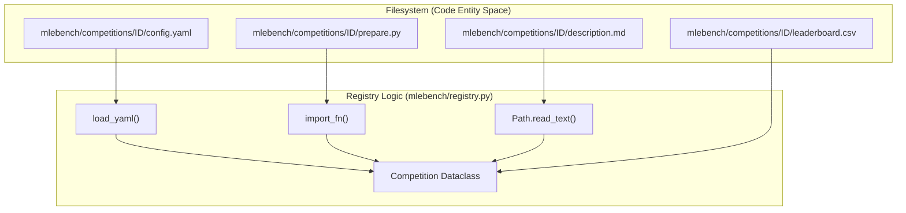
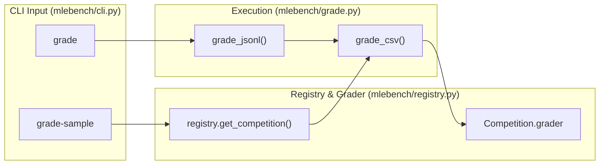

<!-- source: DeepWiki mcp.deepwiki.com · repo openai/mle-bench · page 5.3 Competition Framework · fetched 2026-10-26 -->

# Competition Framework

Relevant source files

The following files were used as context for generating this wiki page:

- [experiments/competition_categories.csv](experiments/competition_categories.csv)
- [experiments/splits/systemcard.txt](experiments/splits/systemcard.txt)
- [mlebench/cli.py](mlebench/cli.py)
- [mlebench/competitions/detecting-insults-in-social-commentary/description.md](mlebench/competitions/detecting-insults-in-social-commentary/description.md)
- [mlebench/competitions/the-icml-2013-whale-challenge-right-whale-redux/prepare.py](mlebench/competitions/the-icml-2013-whale-challenge-right-whale-redux/prepare.py)
- [mlebench/registry.py](mlebench/registry.py)

This document describes the technical framework that structures, prepares, and evaluates the 75 Kaggle competitions within MLE-bench. This covers the internal competition data organization, preparation pipeline, and grading system architecture.

## Overview

The competition framework is the core of MLE-bench, providing a standardized interface for agents to interact with diverse machine learning tasks. It manages the lifecycle of a competition from raw data ingestion to final score calculation, abstracting away the idiosyncrasies of different Kaggle tasks.

## Competition Structure and Registry

Competitions are managed by a central `Registry` class [mlebench/registry.py:74-74](), which loads competition configurations from YAML files located in `mlebench/competitions/<competition-id>/config.yaml` [mlebench/registry.py:81-82]().

### The Competition Class

Each competition is represented by a `Competition` dataclass [mlebench/registry.py:17-31](). This class encapsulates all necessary paths and functions required for the benchmark:

| Attribute | Description |
|-----------|-------------|
| `id` | Unique identifier (e.g., `house-prices-advanced-regression-techniques`) |
| `grader` | A `Grader` instance containing the metric and logic for scoring [mlebench/registry.py:21-21]() |
| `prepare_fn` | A callable that transforms raw data into public/private splits [mlebench/registry.py:26-26]() |
| `raw_dir` | Path where raw Kaggle downloads are stored [mlebench/registry.py:27-27]() |
| `public_dir` | Path to data visible to the agent (train set, sample submission) [mlebench/registry.py:29-29]() |
| `private_dir` | Path to data hidden from the agent (ground truth answers) [mlebench/registry.py:28-28]() |

Sources: [mlebench/registry.py:16-48](), [mlebench/registry.py:78-116]()

### Registry Logic Flow

The `Registry` bridges the gap between the filesystem and the Python objects used during execution.

Sources: [mlebench/registry.py:78-116]()

## Competition Splits and Complexity

MLE-bench categorizes competitions into different "splits" to allow for varying levels of evaluation intensity. These splits are defined as text files in `experiments/splits/` [mlebench/registry.py:126-126]().

### Complexity Tiers
*   **Low (Lite)**: 22 competitions with lower complexity and smaller dataset sizes, used for rapid iteration [mlebench/registry.py:128-134]().
*   **Medium/High**: Competitions requiring more compute or complex reasoning.
*   **System Card**: A specific subset of 30 competitions used for detailed performance analysis [experiments/splits/systemcard.txt:1-30]().

### Split Retrieval
The `Registry` provides helper methods to access these subsets:
- `get_lite_competition_ids()`: Reads `experiments/splits/low.txt` [mlebench/registry.py:131-134]().
- `list_competition_ids()`: Scans the registry directory for all available `config.yaml` files [mlebench/registry.py:149-152]().

Sources: [mlebench/registry.py:118-152](), [experiments/splits/systemcard.txt:1-30]()

## Data Preparation Pipeline

The preparation pipeline transforms raw Kaggle data into a standardized format. Because Kaggle's private test sets are not available, MLE-bench typically splits the original Kaggle training data into new `public` and `private` sets.

### The prepare.py Interface
Each competition must implement a `prepare(raw, public, private)` function [mlebench/competitions/the-icml-2013-whale-challenge-right-whale-redux/prepare.py:9-9]().

**Example Workflow (Whale Challenge):**
1.  **Unpack**: Extract raw archives like `train2.zip` [mlebench/competitions/the-icml-2013-whale-challenge-right-whale-redux/prepare.py:14-14]().
2.  **Split**: Group files by timestamp/date and partition into new train and test sets [mlebench/competitions/the-icml-2013-whale-challenge-right-whale-redux/prepare.py:23-38]().
3.  **Standardize**: Rename files to follow a standard convention (e.g., `TRAIN{idx}`, `Test{idx}`) [mlebench/competitions/the-icml-2013-whale-challenge-right-whale-redux/prepare.py:44-53]().
4.  **Ground Truth**: Generate `test.csv` in the `private` directory containing the labels [mlebench/competitions/the-icml-2013-whale-challenge-right-whale-redux/prepare.py:81-83]().
5.  **Sample Submission**: Generate `sampleSubmission.csv` in the `public` directory with dummy values [mlebench/competitions/the-icml-2013-whale-challenge-right-whale-redux/prepare.py:86-88]().

Sources: [mlebench/competitions/the-icml-2013-whale-challenge-right-whale-redux/prepare.py:9-96]()

## Grading and Evaluation

The framework provides a unified interface for grading agent submissions via the CLI.

### Grading Logic Flow

The `mlebench grade` command processes a JSONL file containing submissions for multiple competitions, while `mlebench grade-sample` evaluates a single CSV [mlebench/cli.py:84-128]().

Sources: [mlebench/cli.py:84-128](), [mlebench/cli.py:192-201](), [mlebench/registry.py:51-51]()

### Submission Format
Agents are expected to produce a CSV file where the columns match the competition's `sample_submission.csv` [mlebench/registry.py:96-96](). The grader then compares this against the `answers` path (which defaults to the private `test.csv`) [mlebench/registry.py:92-93]().

## Competition Metadata

In addition to technical configuration, competitions are associated with metadata for analysis:
- **Descriptions**: Detailed Markdown files explaining the task [mlebench/competitions/detecting-insults-in-social-commentary/description.md:1-40]().
- **Leaderboards**: Historical Kaggle leaderboard data stored in `leaderboard.csv` to allow for "medal" equivalent scoring (e.g., comparing agent performance to human benchmarks) [mlebench/registry.py:85-85]().
- **Categories**: Competitions are categorized by domain (e.g., NLP, CV) in `experiments/competition_categories.csv` [experiments/competition_categories.csv:1-4]().

Sources: [mlebench/registry.py:81-88](), [experiments/competition_categories.csv:1-4]()

---

