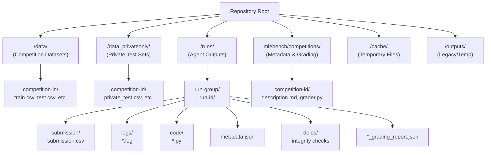
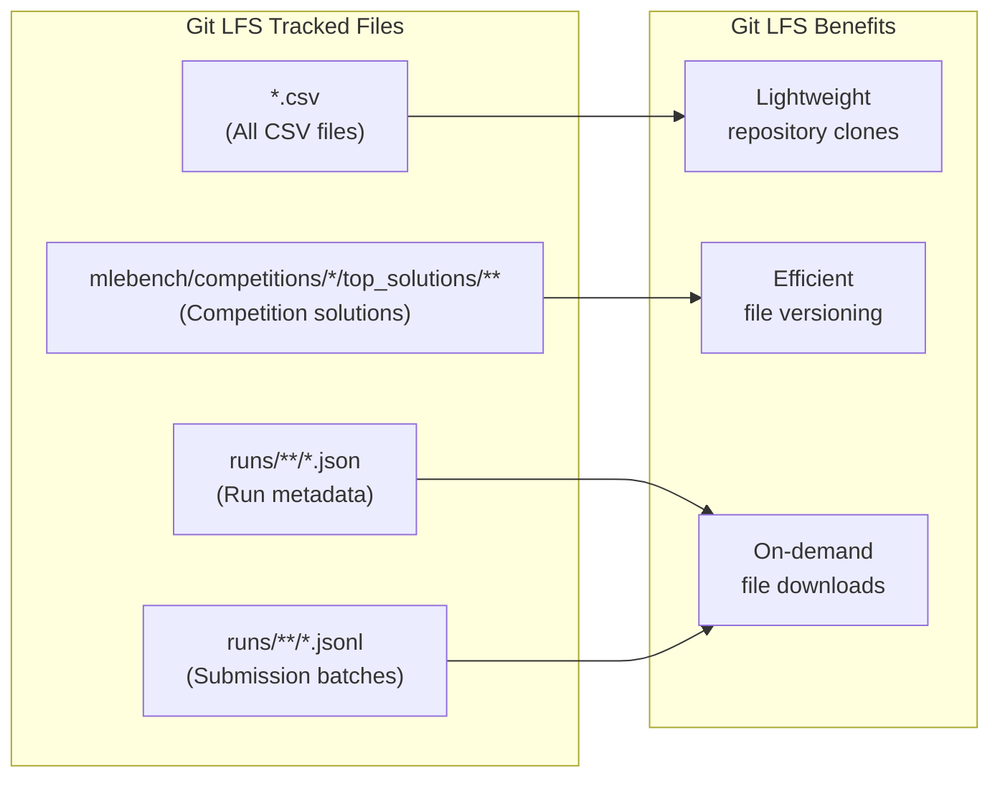
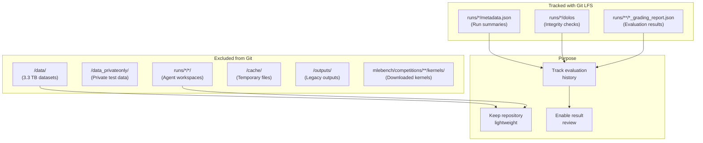
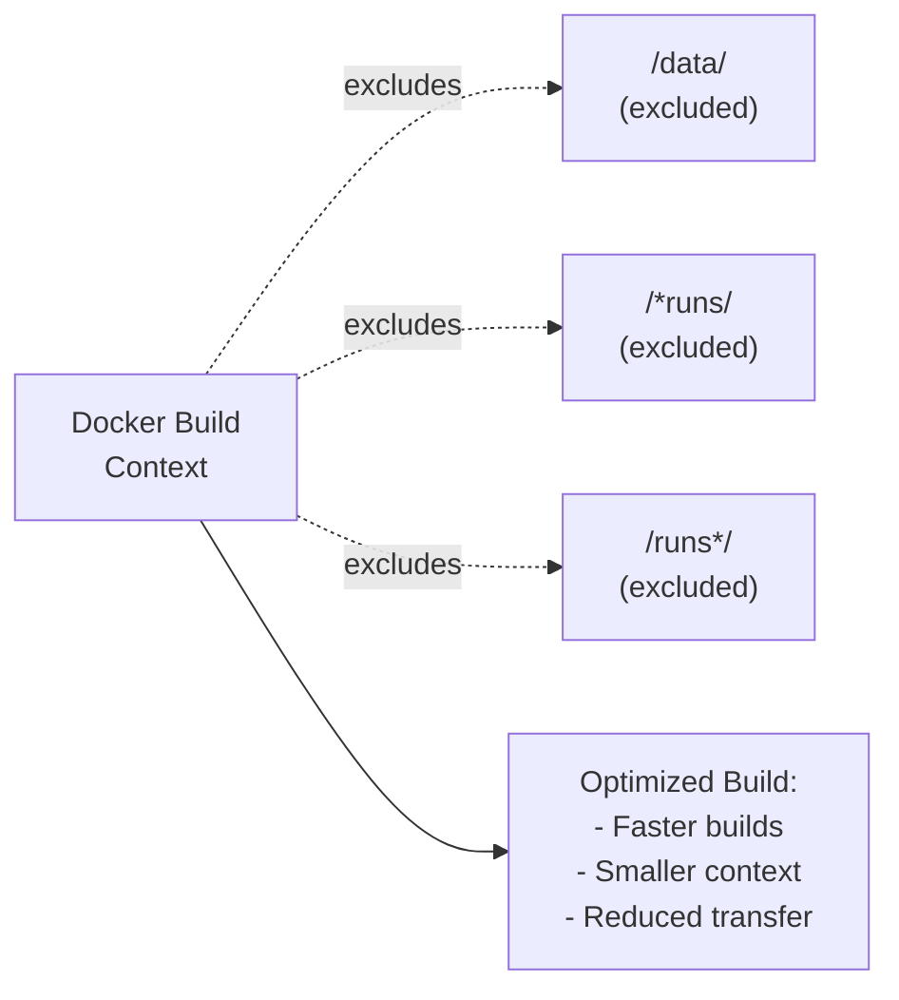
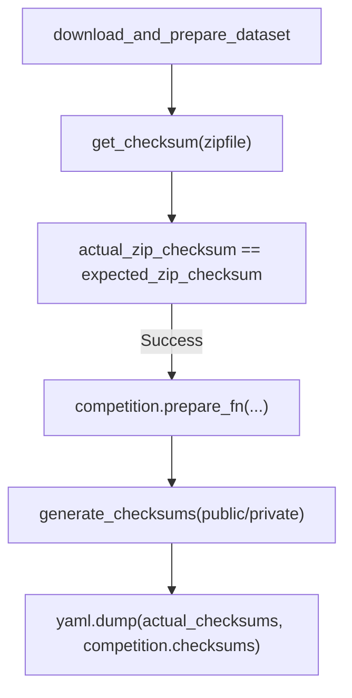

<!-- source: DeepWiki mcp.deepwiki.com · repo openai/mle-bench · page 5.4 Data Management and Storage · fetched 2026-10-26 -->

# Data Management and Storage

Relevant source files

The following files were used as context for generating this wiki page:

- [.gitattributes](.gitattributes)
- [mlebench/data.py](mlebench/data.py)
- [runs/run_group_experiments.csv](runs/run_group_experiments.csv)

This document describes MLE-bench's data management and storage architecture, including directory structure, data access controls, version control strategy for large files, and storage optimization patterns. This covers the physical organization of datasets, outputs, and artifacts, but does not cover the dataset preparation process itself (see [Dataset Preparation](#4.1)) or the competition framework structure (see [Competition Framework](#5.3)).

## Overview

MLE-bench manages several categories of data with different storage requirements and access patterns:

| Data Category | Size | Access Pattern | Version Control Strategy |
|---------------|------|----------------|--------------------------|
| Competition datasets (full) | 3.3 TB | Read-only by agents | Git LFS for metadata, excluded from repository |
| Competition datasets (lite) | 158 GB | Read-only by agents | Git LFS for metadata, excluded from repository |
| Private test data | Varies | Isolated from agents | Excluded from repository |
| Agent outputs (runs) | Varies | Write by agents, read by grading | Selective tracking via Git LFS |
| Grading reports | Small | Generated post-run | Tracked via Git LFS |
| Competition metadata | Small | Read-only | Tracked in repository |

The storage architecture maintains strict separation between data accessible to agents (public training data) and data used only for evaluation (private test sets), while optimizing for version control and Docker build performance.

## Directory Structure

MLE-bench organizes data into a standardized directory hierarchy. The `mlebench/data.py` module handles the physical creation of these directories via functions like `create_prepared_dir` [mlebench/data.py:32-35]() and `download_and_prepare_dataset` [mlebench/data.py:37-43]().

**Sources:** [.gitignore:1-18](), [.dockerignore:1-3](), [mlebench/data.py:32-58]()

### Data Directory (`/data/`)

Contains public competition datasets prepared using `mlebench prepare`. The system uses the `Competition.public_dir` property to resolve this path [mlebench/data.py:160]().

This directory is:
- **Excluded from Git** via `.gitignore` ([.gitignore:4]())
- **Excluded from Docker builds** via `.dockerignore` ([.dockerignore:1]())
- **Mounted read-only** to agent containers at `/home/data/`
- **Accessible by agents** for training data

### Private Data Directory (`/data_privateonly/`)

Contains private test sets used only for evaluation. The system uses the `Competition.private_dir` property to manage this location [mlebench/data.py:161]().

This directory is:
- **Excluded from Git** via `.gitignore` ([.gitignore:5]())
- **Not mounted to agent containers** (agents cannot access)
- **Used only by grading system** during evaluation

Access isolation is verified by the dummy agent's validation checks and the `is_dataset_prepared` function [mlebench/data.py:153-186]().

**Sources:** [.gitignore:4-5](), [.dockerignore:1](), [mlebench/data.py:153-186]()

## Git LFS Configuration

MLE-bench uses Git Large File Storage (LFS) to track large files efficiently. The `.gitattributes` file defines LFS tracking rules [/.gitattributes:1-4](). This includes run group experiment tracking files like `runs/run_group_experiments.csv` [/runs/run_group_experiments.csv:1-3]().

**LFS Tracking Rules:**

| Pattern | Purpose | Example Files |
|---------|---------|--------------|
| `*.csv` | All CSV files across repository | `runs/run_group_experiments.csv` |
| `mlebench/competitions/*/top_solutions/**` | Competition solution files | Reference implementations |
| `runs/**/*.json` | Run metadata and grading reports | `metadata.json`, `*_grading_report.json` |
| `runs/**/*.jsonl` | Submission batch files | `submission.jsonl` |

**Sources:** [.gitattributes:1-4](), [runs/run_group_experiments.csv:1-3]()

## Version Control Strategy

The repository employs a selective tracking strategy that balances completeness with practicality.

### Exclusion Pattern Details

The `.gitignore` file implements a hierarchical exclusion strategy:

**Broad Exclusions:**
- Line 4: `/data/` - Competition training datasets
- Line 5: `/data_privateonly/` - Private test datasets
- Line 7: `runs/*/*/` - All agent workspace contents
- Line 17: `cache/` - Temporary cache files (used by `dc.Cache` in [mlebench/data.py:29]())
- Line 2: `mlebench/competitions/**/kernels/` - Downloaded Kaggle kernels
- Line 3: `outputs/` - Legacy output directory

**Selective Re-inclusion:**
- Line 10: `!runs/*/metadata.json` - Run configuration and summary
- Line 13: `!runs/*/dolos` - Integrity check results
- Lines 14-15: `!runs/**/*_grading_report.json`, `!runs/**/grading_report_*.json` - Evaluation reports

**Sources:** [.gitignore:1-18](), [mlebench/data.py:29]()

## Docker Build Optimization

The `.dockerignore` file excludes large directories from Docker build contexts, significantly reducing build times and image sizes.

**Exclusion Rules:**

| Pattern | Purpose | Typical Size Avoided |
|---------|---------|---------------------|
| `/data/` | Exclude competition datasets | Up to 3.3 TB |
| `/*runs/` | Exclude run directories at root | Varies by runs |
| `/runs*/` | Exclude directories starting with "runs" | Varies by runs |

**Sources:** [.dockerignore:1-3]()

## Data Integrity and Checksums

The `mlebench/data.py` module implements strict integrity checks to ensure data consistency across environments.

| Function | Role | Code Entity |
|----------|------|-------------|
| Checksum Generation | Computes SHA256 for files/dirs | `get_checksum` [mlebench/data.py:68](), `generate_checksums` [mlebench/data.py:117]() |
| Verification | Compares actual vs expected | `download_and_prepare_dataset` [mlebench/data.py:129-139]() |
| Status Check | Validates directory structure | `is_dataset_prepared` [mlebench/data.py:153-186]() |

**Sources:** [mlebench/data.py:66-141](), [mlebench/data.py:153-186]()

## Best Practices

### For Dataset Management

1. **Use Git LFS for all CSV files**: Ensure `.gitattributes` is respected [/.gitattributes:1]().
2. **Keep `/data/` separate from repository**: Verified by `.gitignore:4` [/.gitignore:4]().
3. **Use lite dataset for development**: Reduces storage and download time.
4. **Verify private data isolation**: Use `is_dataset_prepared` with `grading_only=True` for evaluation checks [mlebench/data.py:153]().

### For Output Management

1. **Archive complete runs selectively**: Keep only successful runs or interesting failures.
2. **Track grading reports**: Always commit `*_grading_report.json` files to Git [/.gitignore:14-15]().
3. **Preserve metadata.json**: Essential for reproducing evaluation conditions [/.gitignore:10]().

**Sources:** [.gitignore:1-18](), [.gitattributes:1-4](), [mlebench/data.py:153-186]()

---

