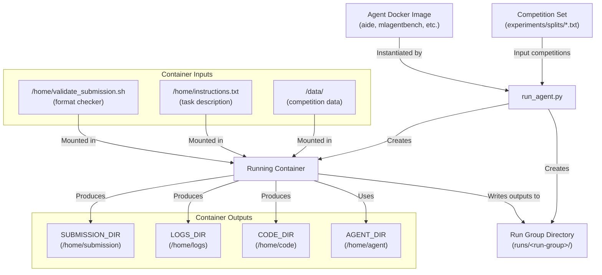
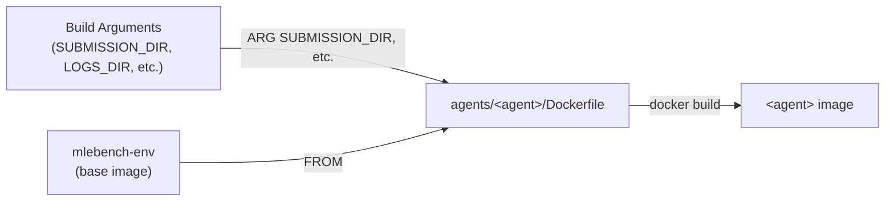
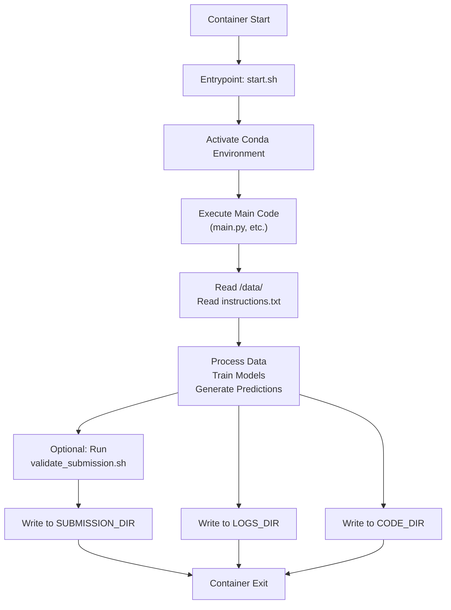
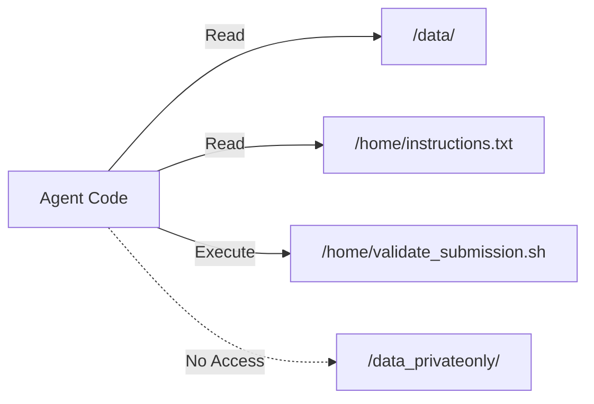
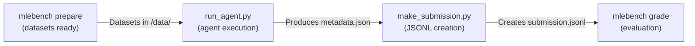

<!-- source: DeepWiki mcp.deepwiki.com · repo openai/mle-bench · page 6.1 Agent Architecture Overview · fetched 2026-10-26 -->

# Agent Architecture Overview

<details>
<summary>Relevant source files</summary>

The following files were used as context for generating this wiki page:

- [README.md](README.md)
- [agents/README.md](agents/README.md)

</details>


## Purpose and Scope

This document describes the standardized agent execution model used by MLE-bench to evaluate machine learning agents on Kaggle competitions. It covers the directory structure, build process, container lifecycle, and common patterns that all agents must follow.

For agent-specific configuration details (LLM settings, resource limits), see [Agent Configuration System](6.2). For container security models (Sysbox vs privileged mode), see [Container Security Models](6.3). For implementation details of individual agents, see [Agent Implementations](7).

## Agent Execution Model

MLE-bench uses a containerized execution model where each agent runs in an isolated Docker container with standardized inputs and outputs. The system is agent-agnostic, supporting multiple implementations through a consistent interface.

**Figure 1: Agent Execution Data Flow**


**Execution Flow**

The execution lifecycle is orchestrated by `run_agent.py`:

1.  **Initialization**: `run_agent.py` reads a competition set file and creates a run group directory in the `runs/` directory [agents/README.md:31-37]().
2.  **Container Creation**: For each competition, a container is instantiated from the agent's Docker image [agents/README.md:29-35]().
3.  **Data Mounting**: Competition data and instructions are mounted into the container [agents/README.md:57-59]().
4.  **Execution**: The agent's entrypoint script activates the environment and runs the main code.
5.  **Output Collection**: The agent writes submission files, logs, and code to standardized directories [agents/README.md:21-26]().
6.  **Metadata Generation**: After all competitions complete, a `metadata.json` file summarizes the results [agents/README.md:37-37]().

Sources: [agents/README.md:21-47]()

## Standardized Directory Structure

All agents use a consistent directory structure. These directories are passed as build arguments and environment variables to ensure uniform output organization.

### Core Directories

| Directory Variable | Path | Purpose | Access |
| :--- | :--- | :--- | :--- |
| `SUBMISSION_DIR` | `/home/submission` | Final competition submission file | Write |
| `LOGS_DIR` | `/home/logs` | Agent execution logs | Write |
| `CODE_DIR` | `/home/code` | Generated code and notebooks | Write |
| `AGENT_DIR` | `/home/agent` | Agent-specific internal state | Read/Write |

### Input Directories

| Path | Contents | Access |
| :--- | :--- | :--- |
| `/data/` | Competition public data (train, test, etc.) | Read-only |
| `/home/instructions.txt` | Competition description and task requirements | Read-only |
| `/home/validate_submission.sh` | Script to validate submission format | Execute |
| `/data_privateonly/` | Private test labels (evaluation only) | No access |

### Example Directory Layout

```
/home/
├── submission/        # Agent writes submission.csv here
├── logs/              # Agent writes execution logs here
├── code/              # Agent writes generated code here
├── agent/             # Agent internal state (e.g., AIDE's journal)
├── instructions.txt   # Competition task description
└── validate_submission.sh  # Submission format validator

/data/                 # Mounted competition data
├── train.csv
├── test.csv
├── sample_submission.csv
└── ...
```

Sources: [agents/README.md:21-26](), [agents/README.md:52-59]()

## Agent Build Process

Agents are built as Docker images using a standardized build command that passes directory paths as build arguments.

**Figure 2: Agent Build Pipeline**


The build process as specified in [agents/README.md:18-27]():

```bash
export SUBMISSION_DIR=/home/submission
export LOGS_DIR=/home/logs
export CODE_DIR=/home/code
export AGENT_DIR=/home/agent

docker build --platform=linux/amd64 -t <agent> agents/<agent>/ \
  --build-arg SUBMISSION_DIR=$SUBMISSION_DIR \
  --build-arg LOGS_DIR=$LOGS_DIR \
  --build-arg CODE_DIR=$CODE_DIR \
  --build-arg AGENT_DIR=$AGENT_DIR
```

### Build Arguments

Each agent's Dockerfile receives four build arguments that define the standardized directory structure:

*   `SUBMISSION_DIR`: Where the agent writes its final submission.
*   `LOGS_DIR`: Where the agent writes execution logs.
*   `CODE_DIR`: Where the agent writes generated code.
*   `AGENT_DIR`: Where the agent stores internal state.

### Platform Specification

All agents are built for the `linux/amd64` platform to ensure consistent execution across different host architectures [agents/README.md:26-26]().

Sources: [agents/README.md:18-27]()

## Container Lifecycle

**Figure 3: Agent Runtime Lifecycle**


### Output Collection

After container exit, `run_agent.py` creates a subdirectory for each competition in the run group directory, containing the agent's logs, code, and submission [agents/README.md:36-37]().

```
runs/<run-group>/<competition-id>/
├── submission/
│   └── submission.csv      # From SUBMISSION_DIR
├── logs/
│   └── *.log               # From LOGS_DIR
├── code/
│   └── *.py, *.ipynb       # From CODE_DIR
└── agent/
    └── ...                 # From AGENT_DIR (agent-specific)
```

Sources: [agents/README.md:29-47]()

## Common Patterns

### Docker Image Structure

All agents follow a common Dockerfile pattern:

1.  Extend from `mlebench-env` base image.
2.  Declare build arguments for directory paths.
3.  Set environment variables from build arguments.
4.  Create required directories.
5.  Install agent-specific dependencies.
6.  Copy agent code into the container.
7.  Set an entrypoint script (e.g., `start.sh`).

### Data Access Pattern

All agents follow a consistent data access pattern:

**Figure 4: Security and Access Boundary**


**Read Access**:
*   Competition data in `/data/` [agents/README.md:57-57]().
*   Task instructions in `/home/instructions.txt`.

**Execute Access**:
*   Submission validator at `/home/validate_submission.sh`.

**No Access**:
*   Private test labels in `/data_privateonly/` [agents/README.md:57-57]().

### Validation Pattern

The `dummy` agent implements standard validation checks that all agents should pass:

1.  **Root Access Check**: Prints whether its script is running with root access [agents/README.md:54-54]().
2.  **Python Interpreter Check**: Prints the Python interpreter being used [agents/README.md:55-55]().
3.  **Sample Submission Check**: Attempts to use the sample submission as its output [agents/README.md:56-56]().
4.  **Private Data Isolation**: Verifies it cannot read labels of the test set [agents/README.md:57-57]().
5.  **Working Directory Access**: Checks read/write access to `/home` [agents/README.md:58-58]().

Sources: [agents/README.md:51-59]()

## Integration with MLE-bench Pipeline

**Figure 5: Full Pipeline Integration**


The agent architecture integrates with the broader MLE-bench pipeline:

1.  **Upstream**: Prepared datasets from `mlebench prepare` are mounted into agent containers.
2.  **Agent Execution**: This architecture handles agent execution and output collection.
3.  **Downstream**: Output `metadata.json` files are consumed by `make_submission.py` to create evaluation batches [agents/README.md:37-41]().
4.  **Evaluation**: The `mlebench grade` command evaluates submissions and generates grading reports [agents/README.md:43-47]().

Sources: [agents/README.md:29-47]()

---

