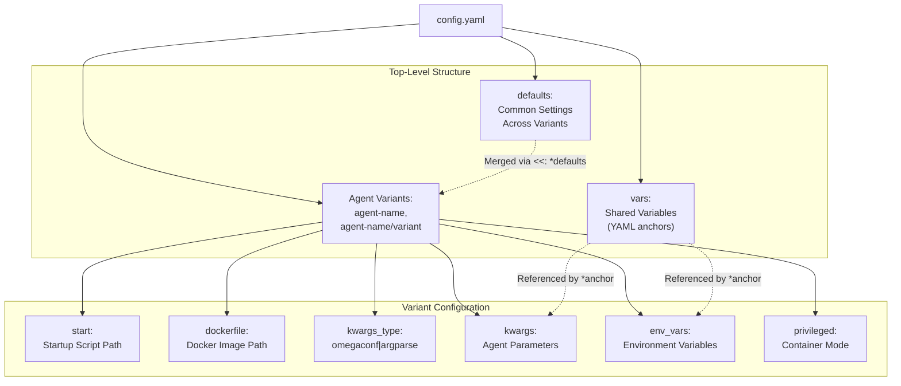
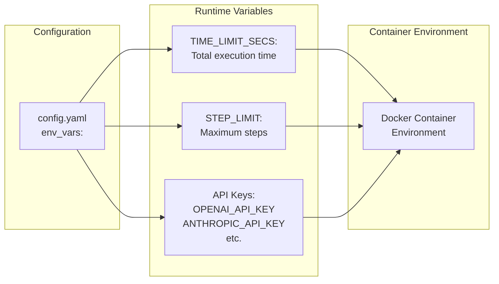
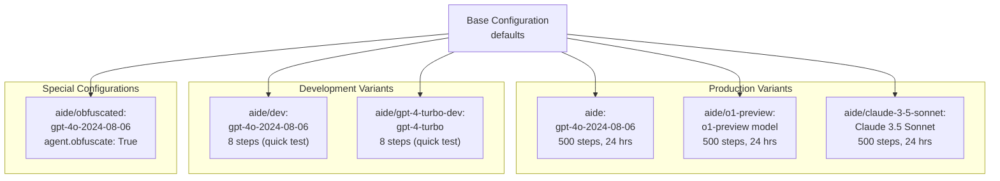
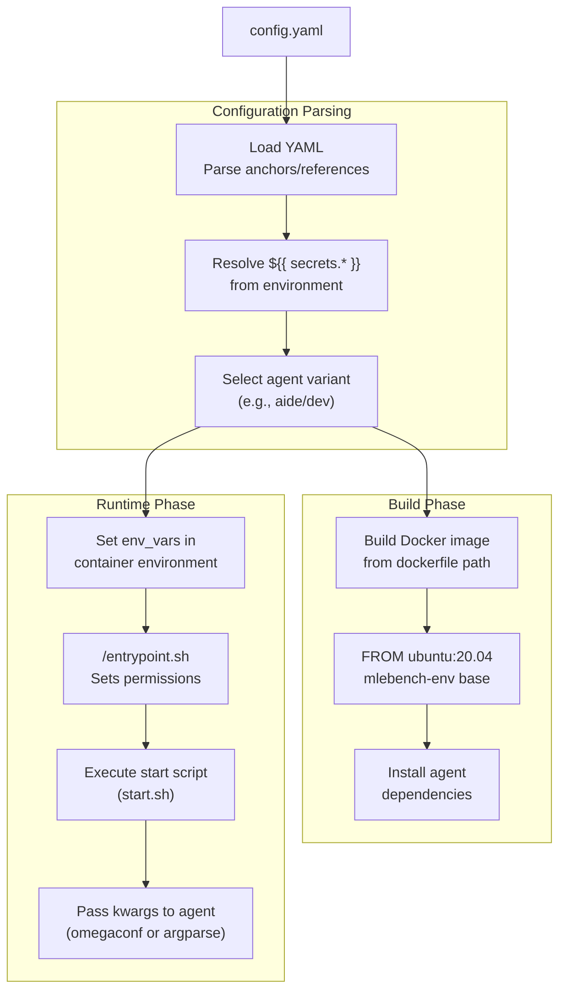

<!-- source: DeepWiki mcp.deepwiki.com · repo openai/mle-bench · page 6.2 Agent Configuration System · fetched 2026-10-26 -->

# Agent Configuration System

<details>
<summary>Relevant source files</summary>

The following files were used as context for generating this wiki page:

- [agents/README.md](agents/README.md)
- [environment/Dockerfile](environment/Dockerfile)
- [environment/entrypoint.sh](environment/entrypoint.sh)

</details>


The Agent Configuration System defines how agents are configured for execution in MLE-bench. Each agent is configured through a `config.yaml` file that specifies the agent's runtime parameters, LLM models, resource limits, environment variables, and Docker build settings. This system provides a standardized way to define agent variants and execution profiles while maintaining flexibility for agent-specific requirements.

For information about the agent execution lifecycle and directory structure, see [Agent Architecture Overview](#6.1). For details about container security models, see [Container Security Models](#6.3).

## Configuration File Structure

Each agent's configuration is defined in `agents/<agent-name>/config.yaml`. The configuration file follows a hierarchical YAML structure that supports multiple agent variants, parameter reuse through YAML anchors, and secret injection.

### Core Configuration Elements



Sources: `agents/aide/config.yaml`, `agents/mlagentbench/config.yaml`, `agents/opendevin/config.yaml`

### Configuration Schema

The following table describes the configuration parameters available for each agent variant:

| Parameter | Type | Required | Description |
|-----------|------|----------|-------------|
| `start` | string | Yes | Path to the startup script (e.g., `aide/start.sh`) |
| `dockerfile` | string | Yes | Path to the Dockerfile (e.g., `aide/Dockerfile`) |
| `kwargs_type` | string | Yes | Parameter format: `omegaconf` or `argparse` |
| `kwargs` | dict/object | Yes | Agent-specific parameters passed at runtime |
| `env_vars` | dict | No | Environment variables set in the container |
| `privileged` | boolean | No | Whether to run container in privileged mode (default: false) |

Sources: [agents/aide/config.yaml:5-12](), [agents/mlagentbench/config.yaml:5-21](), [agents/opendevin/config.yaml:1-13]()

## Configuration Parameter Types

MLE-bench supports two parameter passing formats controlled by the `kwargs_type` field:

### OmegaConf Configuration

Used by agents that support hierarchical configuration with dot notation (e.g., AIDE agent):

```yaml
kwargs_type: omegaconf
kwargs:
  agent.code.model: gpt-4o-2024-08-06
  agent.feedback.model: gpt-4o-2024-08-06
  agent.steps: 500
  agent.search.max_debug_depth: 20
  exec.timeout: 32400
```

OmegaConf parameters are passed as nested configuration objects, allowing for complex hierarchical settings.

Sources: [agents/aide/config.yaml:8,22-26]()

### Argparse Configuration

Used by agents that accept command-line style arguments (e.g., MLAgentBench, OpenDevin):

```yaml
kwargs_type: argparse
kwargs:
  llm-name: gpt-4o-2024-08-06
  max-steps: 2000
  max-time: 86400
```

Argparse parameters are converted to command-line arguments with dashes (e.g., `--llm-name gpt-4o-2024-08-06`).

Sources: [agents/mlagentbench/config.yaml:8-17](), [agents/opendevin/config.yaml:4-10]()

## Environment Variables and Build Arguments

Environment variables are specified in the `env_vars` section and are set in the container at runtime. Additionally, Docker build arguments are used to define directory paths during image creation.

### Docker Build Arguments

When building an agent image, specific environment paths are passed as `--build-arg` to ensure the container filesystem is consistent with the host's expectations.

| Build Arg | Default Value | Description |
|-----------|---------------|-------------|
| `SUBMISSION_DIR` | `/home/submission` | Where the agent must save its final output |
| `LOGS_DIR` | `/home/logs` | Where execution logs are stored |
| `CODE_DIR` | `/home/code` | Where generated code is placed |
| `AGENT_DIR` | `/home/agent` | The agent's working directory |

Sources: [agents/README.md:21-27](), [environment/Dockerfile:83-86]()

### Standard Environment Variables



Sources: [agents/aide/config.yaml:9-11,27-29](), [agents/mlagentbench/config.yaml:18-21]()

### Common Environment Variables

| Variable | Purpose | Example Value |
|----------|---------|---------------|
| `TIME_LIMIT_SECS` | Maximum execution time in seconds | `86400` (24 hours) |
| `STEP_LIMIT` | Maximum number of agent steps | `500` or `2000` |
| `OPENAI_API_KEY` | OpenAI API authentication | `${{ secrets.OPENAI_API_KEY }}` |
| `ANTHROPIC_API_KEY` | Anthropic API authentication | `${{ secrets.ANTHROPIC_API_KEY }}` |
| `I_ACCEPT_RUNNING_PRIVILEGED_CONTAINERS` | Security acknowledgment for OpenHands | `True` |

Sources: [agents/aide/config.yaml:27-143](), [agents/mlagentbench/config.yaml:18-21](), [agents/opendevin/config.yaml:11-12](), [agents/README.md:64]()

## Runtime Parameters and Container Config

While `config.yaml` defines the agent's internal parameters, the `run_agent.py` script uses a separate container configuration (e.g., `environment/config/container_configs/default.json`) to manage hardware resources.

| Parameter | Purpose | Example |
|-----------|---------|---------|
| `gpus` | Number of GPUs to allocate | `-1` (all) or `0` |
| `shm_size` | Shared memory size | `"100G"` |
| `memory` | RAM limit | `"32g"` |

Sources: [agents/README.md:49](), [agents/opendevin/config.yaml:13]()

## YAML Anchors and References

Configuration files use YAML anchors (`&anchor`) and references (`*anchor`) to reduce duplication and maintain consistency across agent variants.

### Variable Declaration

Variables are declared at the top of the configuration file:

```yaml
vars:
  step_count: &step_count 500
  time_limit: &time_limit 86400  # 24 hrs
```

These anchors can then be referenced throughout the configuration:

```yaml
kwargs:
  agent.steps: *step_count
  agent.time_limit: *time_limit
env_vars:
  TIME_LIMIT_SECS: *time_limit
  STEP_LIMIT: *step_count
```

Sources: [agents/aide/config.yaml:1-11]()

### Default Inheritance

Default configurations are defined and merged into variants using YAML merge keys (`<<:`):

```yaml
defaults: &defaults
  start: aide/start.sh
  dockerfile: aide/Dockerfile
  kwargs_type: omegaconf
  env_vars: &env_vars
    TIME_LIMIT_SECS: *time_limit

aide:
  <<: *defaults  # Inherits all defaults
  kwargs:
    agent.code.model: gpt-4o-2024-08-06
```

Sources: [agents/aide/config.yaml:5-29]()

## Agent Variants

Configuration files define multiple agent variants, each with different parameters. Variants are specified using path-like identifiers (e.g., `aide/dev`, `aide/gpt-4-turbo`).

### Variant Configuration Example



Sources: [agents/aide/config.yaml:20-143]()

## Secret Management

API keys and sensitive credentials are injected through the `env_vars` section using the `${{ secrets.KEY_NAME }}` syntax:

```yaml
env_vars:
  OPENAI_API_KEY: ${{ secrets.OPENAI_API_KEY }}
  ANTHROPIC_API_KEY: ${{ secrets.ANTHROPIC_API_KEY }}
```

The `run_agent.py` orchestrator resolves these references at runtime by looking up the secret in environment variables or local configuration and injecting the actual value into the container environment.

Sources: [agents/aide/config.yaml:29,108,119,130,142]()

## Configuration to Execution Flow



Sources: [environment/Dockerfile:1-92](), [environment/entrypoint.sh:1-19](), [agents/aide/config.yaml]()

## Special Configuration Cases

### Privileged Mode Configuration

Some agents (e.g., OpenDevin) require privileged container mode for Docker-in-Docker:

```yaml
opendevin:
  start: opendevin/start.sh
  dockerfile: opendevin/Dockerfile
  privileged: true  # Required for Docker-in-Docker
  kwargs:
    shm_size: "100G"  # Large shared memory requirement
```

The `privileged: true` flag requires explicit user acknowledgment through the `I_ACCEPT_RUNNING_PRIVILEGED_CONTAINERS=True` environment variable.

Sources: [agents/opendevin/config.yaml:1-13](), [agents/README.md:64]()

### Agent-Specific Parameters

Different agents have specialized parameters:

**AIDE Agent:**
- `agent.code.model`: LLM for code generation
- `agent.feedback.model`: LLM for feedback analysis
- `agent.search.max_debug_depth`: Maximum debugging iterations
- `exec.timeout`: Per-step timeout limit

Sources: [agents/aide/config.yaml:13-18,22-26]()

**MLAgentBench Agent:**
- `llm-name`: Primary LLM model
- `edit-script-llm-name`: LLM for script editing
- `max-retries`: Number of retry attempts

Sources: [agents/mlagentbench/config.yaml:9-17]()

**OpenDevin Agent:**
- `agent`: Agent type (e.g., `CodeActAgent`)
- `model`: LLM model identifier
- `max_time_in_hours`: Time limit in hours

Sources: [agents/opendevin/config.yaml:5-10]()

---

