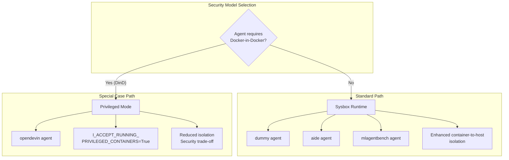
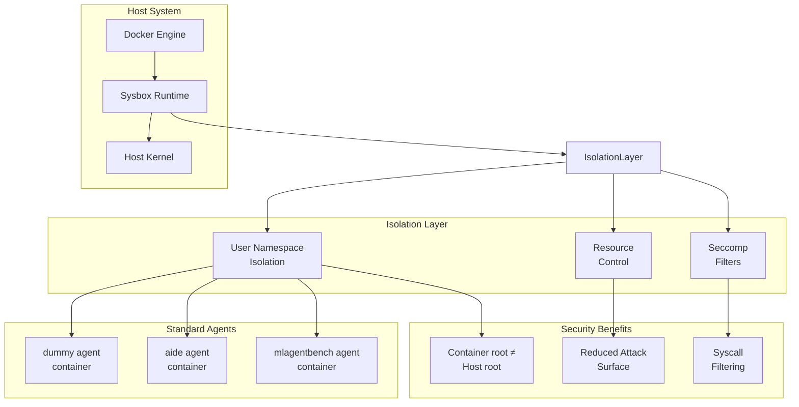
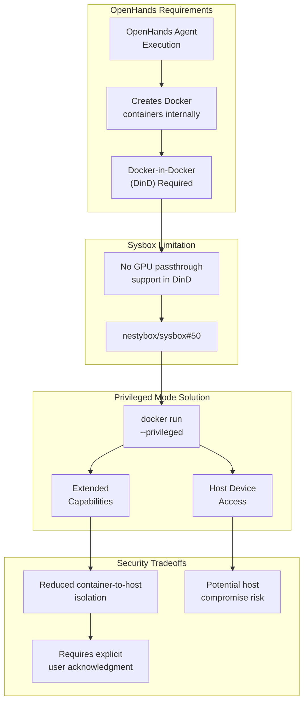
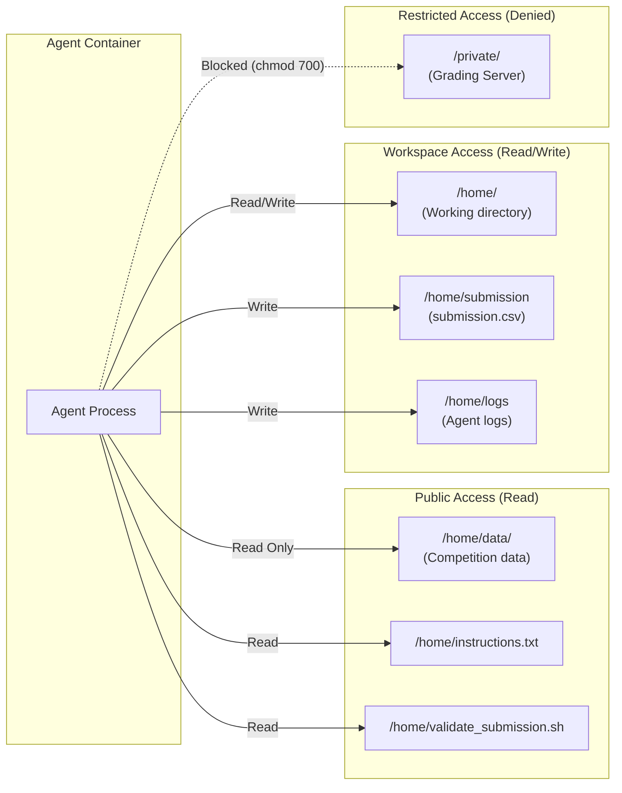
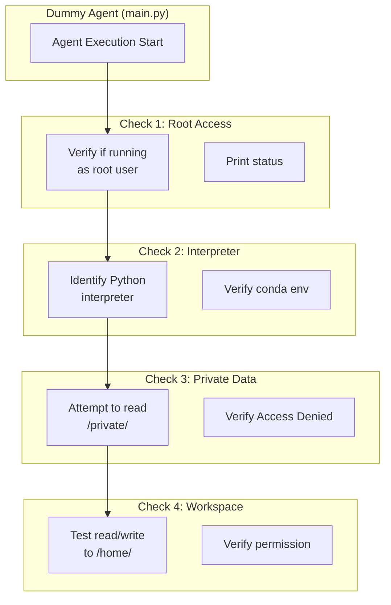

<!-- source: DeepWiki mcp.deepwiki.com · repo openai/mle-bench · page 6.3 Container Security Models · fetched 2026-10-26 -->

# Container Security Models

<details>
<summary>Relevant source files</summary>

The following files were used as context for generating this wiki page:

- [agents/README.md](agents/README.md)
- [environment/Dockerfile](environment/Dockerfile)
- [environment/entrypoint.sh](environment/entrypoint.sh)

</details>


## Purpose and Scope

This document describes the container security models used in MLE-bench to isolate agent execution environments from the host system. MLE-bench supports two distinct security models: the Sysbox runtime for standard agents and privileged mode for agents requiring Docker-in-Docker capabilities. This page covers the security implications, configuration requirements, and trade-offs of each model.

For information about the broader agent architecture, see [Agent Architecture Overview](#6.1). For agent-specific configurations, see [Agent Configuration System](#6.2). For details about the base Docker environment, see [5.2 Docker Environment]().

## Security Models Overview

MLE-bench employs a defense-in-depth approach with two container security models to balance security with functionality requirements:

**Security Model Decision Flow**


**Sources:** [agents/README.md:60-64]()

| Security Model | Agents | Isolation Level | GPU Support | DinD Support | User Acknowledgment Required |
|----------------|--------|----------------|-------------|--------------|------------------------------|
| Sysbox Runtime | dummy, aide, mlagentbench | Enhanced | Yes | No | No |
| Privileged Mode | opendevin | Reduced | Yes | Yes | Yes |

The security model is determined by agent requirements and is handled by the `run_agent.py` orchestrator based on the agent ID. [agents/README.md:5-10]().

**Sources:** [agents/README.md:1-64]()

## Sysbox Runtime

### Overview

The Sysbox runtime provides enhanced container-to-host isolation beyond standard Docker capabilities. MLE-bench uses Sysbox as the default runtime for most agents to mitigate security risks when running potentially untrusted AI agent code. [agents/README.md:60-62]().

**Sysbox Isolation Model**


**Sources:** [agents/README.md:60-62]()

### Installation and Configuration

Sysbox must be installed as a prerequisite before running standard agents. [agents/README.md:12-15](). The runtime is automatically selected when executing agents through `run_agent.py` for all agents except `opendevin`.

### Security Guarantees

Sysbox provides several layers of security:
1. **User Namespace Isolation**: Container root user is mapped to an unprivileged user on the host.
2. **Resource Isolation**: Prevents containers from accessing host resources without explicit permission.
3. **Enhanced Syscall Filtering**: Restricts dangerous system calls that could compromise the host.
4. **Container-to-Host Boundary**: Mitigates risks from malicious container code.

**Sources:** [agents/README.md:60-62]()

### Limitations

Sysbox has known limitations that affect agent functionality:
- **GPU Passthrough in DinD**: Sysbox does not yet support GPU passthrough when using Docker-in-Docker (DinD). [agents/README.md:63-64]().
- This limitation necessitates the privileged mode for agents like OpenHands that require DinD to run ML tasks on GPUs.

**Sources:** [agents/README.md:63-64]()

## Privileged Mode

### Overview and Rationale

Privileged mode is required for the OpenHands (opendevin) agent due to its Docker-in-Docker architecture. This mode grants the container extended capabilities and reduced isolation from the host system. [agents/README.md:63-64]().

**OpenHands Privileged Rationale**


**Sources:** [agents/README.md:63-64]()

### Docker-in-Docker Implementation

The OpenHands agent installs and manages Docker within its own environment to execute sub-containers. This requires elevated privileges to access the host's Docker socket or run an internal daemon with GPU access.

### User Acknowledgment Requirement

To run OpenHands, users must explicitly acknowledge the security risks by setting an environment variable:

```bash
export I_ACCEPT_RUNNING_PRIVILEGED_CONTAINERS=True
```

The `run_agent.py` orchestrator checks for this environment variable before launching the OpenHands agent in privileged mode. [agents/README.md:64]().

**Sources:** [agents/README.md:64]()

## Access Controls and Isolation

### Directory Access Model

MLE-bench enforces a strict directory access model regardless of the security runtime. The base environment [environment/Dockerfile:1-93]() sets up specific permissions.

**File Access and Permissions Flow**


**Sources:** [environment/Dockerfile:74-86](), [environment/entrypoint.sh:11-14](), [agents/README.md:52-58]()

### Entrypoint Permission Enforcement

The `entrypoint.sh` script is responsible for enforcing permissions at runtime. It runs as root and adjusts the `/home` directory so that `nonroot` users can work on everything except the read-only `/home/data` volume. [environment/entrypoint.sh:11-14]().

### Private Data Isolation

The `/private` directory is created with `chmod 700` and owned by root to prevent agent processes (running as `nonroot` or restricted users) from accessing the `grading_server.py`. [environment/Dockerfile:74-77]().

**Sources:** [environment/Dockerfile:74-77](), [environment/entrypoint.sh:11-14]()

## Security Validation via Dummy Agent

The dummy agent serves as a security gate, verifying that the environment is properly configured before running production agents. It performs five critical validation checks:

**Dummy Agent Security Verification**


**Sources:** [agents/README.md:51-58]()

### Validation Checks Detail

1. **Root Access Check**: Prints whether its script is running with root access. [agents/README.md:54]().
2. **Python Interpreter Check**: Ensures the agent is using the correct environment. [agents/README.md:55]().
3. **Private Data Isolation Check**: Explicitly checks that it cannot read "private" data, including test set labels. [agents/README.md:57]().
4. **Workspace Access Check**: Verifies read/write access to `/home`. [agents/README.md:58]().

**Sources:** [agents/README.md:51-58]()

---

