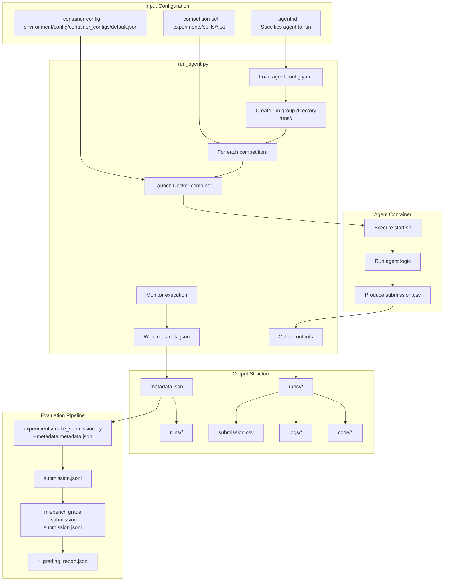
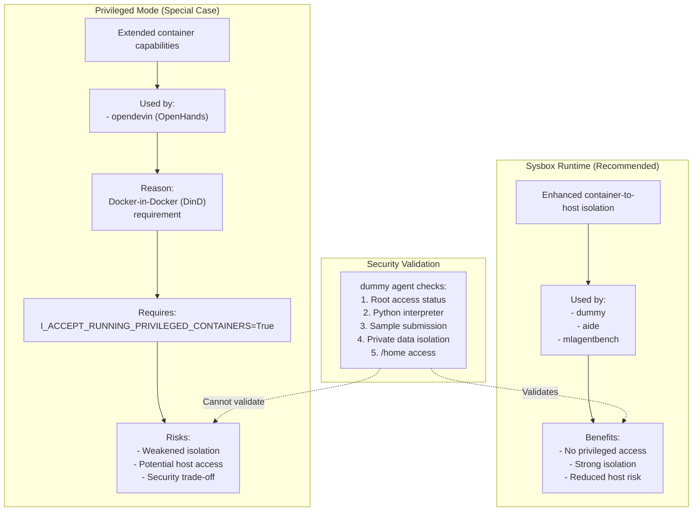

<!-- source: DeepWiki mcp.deepwiki.com · repo openai/mle-bench · page 7 Agent Implementations · fetched 2026-10-26 -->

# Agent Implementations

<details>
<summary>Relevant source files</summary>

The following files were used as context for generating this wiki page:

- [agents/README.md](agents/README.md)

</details>


## Purpose and Scope

This page provides an overview of the agent implementations available in MLE-bench, their common architectural patterns, build process, and execution model. Each agent implementation is designed to solve machine learning competitions from Kaggle using autonomous approaches.

For detailed information about the agent framework architecture and standardized interfaces, see [Agent Framework](#6). For information about container security models, see [Container Security Models](#6.3). For detailed documentation of each individual agent, see their respective pages: [aide Agent](#7.1), [mlagentbench Agent](#7.2), [opendevin Agent](#7.3), and [dummy Agent](#7.4).

---

## Agent Overview

MLE-bench includes four agent implementations, each with a unique identifier used throughout the repository. Three are open-source ML agents evaluated in the benchmark, and one is a verification tool.

| Agent ID | Name | Purpose | Detailed Documentation |
|----------|------|---------|----------------------|
| `dummy` | Dummy Agent | Environment verification and validation checks | [dummy Agent](#7.4) |
| `aide` | AIDE | Iterative ML development with LLM feedback loops | [aide Agent](#7.1) |
| `mlagentbench` | MLAgentBench | Research task automation using the MLAgentBench framework | [mlagentbench Agent](#7.2) |
| `opendevin` | OpenHands | Code action execution using CodeActAgent | [opendevin Agent](#7.3) |

Each agent extends the `mlebench-env` base Docker image ([Docker Environment](#5.2)) and implements a standardized interface for competition solving.

**Sources:** [agents/README.md:1-11]()

---

## Agent Directory Structure

Each agent implementation follows a consistent directory structure within the repository:

```mermaid
graph TB
    subgraph "agents/<agent-id>/"
        Dockerfile["Dockerfile<br/>Agent-specific dependencies"]
        StartSh["start.sh<br/>Initialization script"]
        ConfigYaml["config.yaml<br/>Agent configuration"]
        AgentCode["Agent-specific code<br/>(main.py, train.py, etc.)"]
    end
    
    subgraph "Runtime Environment Variables"
        SUBMISSION_DIR["SUBMISSION_DIR=/home/submission"]
        LOGS_DIR["LOGS_DIR=/home/logs"]
        CODE_DIR["CODE_DIR=/home/code"]
        AGENT_DIR["AGENT_DIR=/home/agent"]
    end
    
    subgraph "Container Mounts"
        DataMount["/home/data/<br/>Competition data (read-only)"]
        InstructionsMount["/home/instructions.txt<br/>Competition description"]
        ValidationMount["/home/validate_submission.sh<br/>Format validation script"]
    end
    
    subgraph "Agent Outputs"
        SubmissionOutput["${SUBMISSION_DIR}/submission.csv<br/>Final submission"]
        LogsOutput["${LOGS_DIR}/*<br/>Execution logs"]
        CodeOutput["${CODE_DIR}/*<br/>Generated code"]
        AgentOutput["${AGENT_DIR}/*<br/>Agent internals"]
    end
    
    Dockerfile -->|"Uses build-arg"| SUBMISSION_DIR
    Dockerfile -->|"Uses build-arg"| LOGS_DIR
    Dockerfile -->|"Uses build-arg"| CODE_DIR
    Dockerfile -->|"Uses build-arg"| AGENT_DIR
    
    StartSh -->|"Reads from"| DataMount
    StartSh -->|"Reads from"| InstructionsMount
    StartSh -->|"May use"| ValidationMount
    
    AgentCode -->|"Executed by"| StartSh
    
    AgentCode -->|"Writes to"| SubmissionOutput
    AgentCode -->|"Writes to"| LogsOutput
    AgentCode -->|"Writes to"| CodeOutput
    AgentCode -->|"Writes to"| AgentOutput
```



**Agent Directory Structure and Build Arguments**

The directory structure ensures each agent is self-contained with its dependencies, initialization logic, and configuration. Build arguments define the standardized output directories used across all agents.

**Sources:** [agents/README.md:18-27]()

---

## Building Agent Images

Agent Docker images are built using a standardized command that passes environment directory paths as build arguments:

```bash
export SUBMISSION_DIR=/home/submission
export LOGS_DIR=/home/logs
export CODE_DIR=/home/code
export AGENT_DIR=/home/agent

docker build --platform=linux/amd64 -t <agent> agents/<agent>/ \
  --build-arg SUBMISSION_DIR=$SUBMISSION_DIR \
  --build-arg LOGS_DIR=$LOGS_DIR \
  --build-arg CODE_DIR=$CODE_DIR \
  --build-arg AGENT_DIR=$AGENT_DIR
```

The build process:
1. Uses the platform specification `linux/amd64` for consistency [agents/README.md:26-26]()
2. Tags the image with the agent ID (`<agent>`) [agents/README.md:26-26]()
3. Uses the agent's directory (`agents/<agent>/`) as build context [agents/README.md:26-26]()
4. Passes standardized directory paths as build arguments [agents/README.md:26-26]()

These build arguments are used within each agent's `Dockerfile` to configure paths and environment variables consistently across all implementations.

**Sources:** [agents/README.md:18-27]()

---

## Agent Execution Flow

The following diagram shows how `run_agent.py` orchestrates agent execution and produces outputs:



**Agent Execution and Evaluation Flow**

The execution flow shows how `run_agent.py` manages the complete lifecycle from agent selection through grading. Each competition produces a subdirectory with the agent's outputs, and the run group's `metadata.json` enables batch evaluation [agents/README.md:37-47]().

**Example execution:**
```bash
python run_agent.py --agent-id dummy \
  --competition-set experiments/splits/spaceship-titanic.txt
```

This creates a run group directory structure:
```
runs/<run-group>/
├── metadata.json
├── spaceship-titanic/
│   ├── submission/
│   │   └── submission.csv
│   ├── logs/
│   ├── code/
│   └── agent/
```

**Sources:** [agents/README.md:29-47]()

---

## Container Configuration

Agents are executed within Docker containers with configurable resources. The default container configuration is located at `environment/config/container_configs/default.json`, and custom configurations can be specified using the `--container-config` argument to `run_agent.py` [agents/README.md:49-49]().

Key configuration options:
- **GPU allocation**: Set `"gpus": -1` in the container config JSON file to enable GPU access for the agent [agents/README.md:49-49]().
- **Memory limits**: Configure container memory constraints.
- **CPU allocation**: Control CPU resource allocation.
- **Runtime selection**: Specify Docker runtime (e.g., `sysbox` or privileged mode).

**Sources:** [agents/README.md:49]()

---

## Security Models

MLE-bench supports two container security models, selected based on agent requirements:



**Container Security Models**

### Sysbox Runtime

The [Sysbox](https://github.com/nestybox/sysbox) runtime is the recommended security model for running agents [agents/README.md:62-62](). It provides enhanced isolation between containers and the host system, mitigating risks from malicious containers that might attempt to compromise the host through shared resources.

Agents using Sysbox runtime: `dummy`, `aide`, `mlagentbench` [agents/README.md:62-62]().

### Privileged Mode

OpenHands (`opendevin`) requires privileged mode due to its use of Docker-in-Docker (DinD) during execution [agents/README.md:64-64](). The Sysbox runtime does not yet support GPU passthrough in DinD scenarios ([nestybox/sysbox#50](https://github.com/nestybox/sysbox/issues/50)).

Running OpenHands in privileged mode requires explicit user acknowledgment of security risks by setting the environment variable [agents/README.md:64-64]():
```bash
export I_ACCEPT_RUNNING_PRIVILEGED_CONTAINERS=True
```

This security trade-off was deemed acceptable in internal evaluation infrastructure that does not rely solely on Docker container-to-host isolation for security. Users should carefully evaluate whether privileged mode is appropriate for their environment.

**Sources:** [agents/README.md:60-64]()

---

## Dummy Agent Validation Checks

The `dummy` agent serves as an environment verification tool, performing five validation checks to ensure the execution environment is configured correctly:

| Check | Purpose | Expected Outcome |
|-------|---------|------------------|
| 1. Root access | Verify privilege level | Reports whether `main.py` runs with root access [agents/README.md:54-54]() |
| 2. Python interpreter | Verify Python environment | Prints the Python interpreter path being used [agents/README.md:55-55]() |
| 3. Sample submission | Verify submission process | Attempts to copy sample submission to output directory [agents/README.md:56-56]() |
| 4. Private data isolation | Verify security | Confirms agent cannot read private test labels [agents/README.md:57-57]() |
| 5. `/home` access | Verify workspace | Confirms read/write access to working directory [agents/README.md:58-58]() |

**Note:** Check 3 may sometimes fail legitimately, as some competitions compress the sample submission with other data, making it unavailable in the expected format [agents/README.md:56-56]().

The dummy agent should be run before evaluating production agents to ensure the environment meets all requirements. See [dummy Agent](#7.4) for detailed documentation.

**Sources:** [agents/README.md:51-59]()

---

## Prerequisites and Installation

To run agents locally, the following components must be installed:

1. **Docker**: Required for container execution [agents/README.md:14-14]().
   - Installation: [Docker Engine Installation Guide](https://docs.docker.com/engine/install/)

2. **Sysbox**: Required for secure agent execution (except OpenHands) [agents/README.md:15-15]().
   - Installation: [Sysbox Installation Guide](https://github.com/nestybox/sysbox)
   - See [Container Security Models](#6.3) for details

3. **NVIDIA Container Toolkit** (Optional): Required for GPU-enabled agent execution [agents/README.md:16-16]().
   - Installation: [NVIDIA Container Toolkit Guide](https://docs.nvidia.com/datacenter/cloud-native/container-toolkit/install-guide.html)

**Sources:** [agents/README.md:12-16]()

---

## Agent Modifications and Forks

The open-source agents evaluated in MLE-bench have been slightly modified to elicit better capabilities for competition solving [agents/README.md:3-3](). The modified versions are maintained in dedicated forks:

| Agent | Original Source | MLE-bench Fork |
|-------|----------------|----------------|
| AIDE | [Technical Report](https://www.weco.ai/blog/technical-report) | https://github.com/thesofakillers/aideml [agents/README.md:8-8]() |
| MLAgentBench | [OpenReview Paper](https://openreview.net/forum?id=1Fs1LvjYQW) | https://github.com/JunShern/MLAgentBench [agents/README.md:9-9]() |
| OpenHands | [arXiv Paper](https://arxiv.org/abs/2407.16741) | https://github.com/thesofakillers/OpenHands [agents/README.md:10-10]() |

For details on the specific modifications and capabilities of each agent, see their respective documentation pages: [aide Agent](#7.1), [mlagentbench Agent](#7.2), [opendevin Agent](#7.3).

**Sources:** [agents/README.md:3-10]()

---

