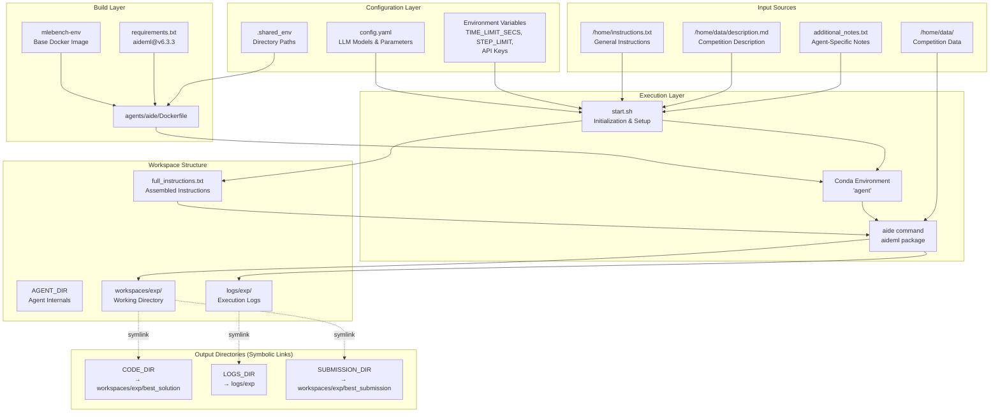
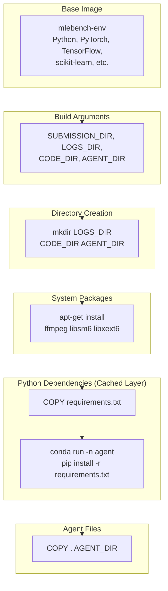
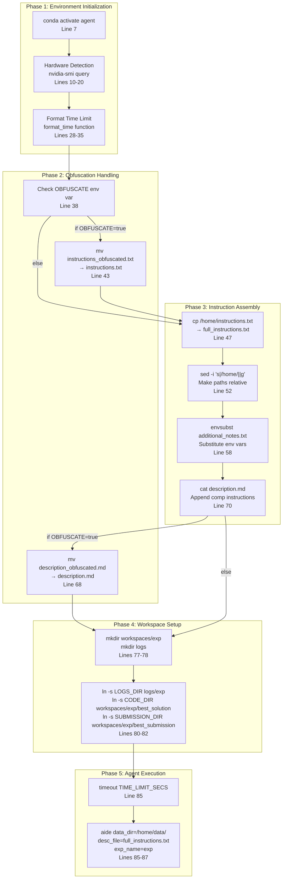

<!-- source: DeepWiki mcp.deepwiki.com · repo openai/mle-bench · page 7.1 aide Agent · fetched 2026-10-26 -->

# aide Agent

Relevant source files

The following files were used as context for generating this wiki page:

- [README.md](README.md)
- [agents/README.md](agents/README.md)

The aide agent is a machine learning development agent that uses large language models (LLMs) to iteratively develop solutions for Kaggle-style competitions. It implements a code-feedback loop where one LLM generates code and another provides feedback, enabling the agent to refine solutions over multiple steps. This document covers the aide agent's architecture, configuration system, build process, execution flow, and integration with MLE-bench.

For information about the agent framework architecture and standardized interfaces, see [Agent Architecture Overview](). For details on container security models, see [Container Security Models]().

## Architecture Overview

The aide agent is built on top of the `aideml` package (version 6.3.3), which provides the core agent logic [agents/aide/requirements.txt:1-1](). The MLE-bench integration wraps this package with competition-specific configuration, instruction assembly, and output management.

### System Diagram: aide Agent Architecture

**Sources:** [agents/aide/Dockerfile:1-33](), [agents/aide/config.yaml:1-144](), [agents/aide/start.sh:1-91]()

## Configuration System

The aide agent uses a hierarchical configuration system defined in `agents/aide/config.yaml`. The configuration is organized around agent variants that specify different LLM models and execution parameters.

### Configuration Structure

| Configuration Section | Purpose | Key Parameters |
|----------------------|---------|----------------|
| `vars` | Global constants | `step_count: 500`, `time_limit: 86400` (24 hours) [agents/aide/config.yaml:1-3]() |
| `defaults` | Shared base settings | `start`, `dockerfile`, `kwargs_type: omegaconf` [agents/aide/config.yaml:5-8]() |
| `env_vars` | Environment variables | `TIME_LIMIT_SECS`, `STEP_LIMIT`, API keys [agents/aide/config.yaml:9-12]() |
| `kwargs_common` | Shared runtime parameters | `agent.search.*`, `agent.time_limit`, `exec.timeout` [agents/aide/config.yaml:13-18]() |
| Agent variants | Model-specific configs | `agent.code.model`, `agent.feedback.model`, `agent.steps` [agents/aide/config.yaml:20-144]() |

### Common Runtime Parameters

The `kwargs_common` section [agents/aide/config.yaml:13-18]() defines parameters shared across all aide variants:

- **`agent.search.max_debug_depth: 20`**: Maximum depth for debugging down a solution branch.
- **`agent.search.debug_prob: 1`**: Probability of debugging when errors occur (always debug).
- **`agent.time_limit: 86400`**: Total time limit in seconds (24 hours).
- **`exec.timeout: 32400`**: Per-step timeout in seconds (9 hours, matching Kaggle's limit).
- **`copy_data: False`**: Use symbolic links instead of copying data.

### Agent Variants

The configuration defines multiple agent variants, each optimized for different LLM models. Major variants include `aide` (GPT-4o), `aide/o1-preview`, and variants for Claude, Llama, and Gemini models [agents/aide/config.yaml:20-144]().

**Sources:** [agents/aide/config.yaml:1-144]()

## Build Process

The aide agent's build process is defined in `agents/aide/Dockerfile` and follows a multi-stage approach to optimize Docker layer caching.

### Build Arguments and Environment Variables

The Dockerfile accepts four build arguments that define output directory locations [agents/aide/Dockerfile:3-14]():

- `SUBMISSION_DIR`: Where `submission.csv` will be placed.
- `LOGS_DIR`: Where execution logs will be written.
- `CODE_DIR`: Where generated code will be saved.
- `AGENT_DIR`: Where agent-specific files are stored.

### Dependency Installation

The build process installs dependencies in two phases:
1. **System Dependencies**: `ffmpeg`, `libsm6`, `libxext6` [agents/aide/Dockerfile:25]().
2. **Python Dependencies**: Installs `aideml@v6.3.3` from GitHub into the `agent` conda environment [agents/aide/Dockerfile:28-29]().

### Build Optimization Diagram

**Sources:** [agents/aide/Dockerfile:1-33](), [agents/aide/requirements.txt:1-1]()

## Execution Flow

The aide agent's execution is orchestrated by `agents/aide/start.sh`, which handles initialization, instruction assembly, workspace setup, and agent invocation.

### Execution Phases Diagram

### Hardware Detection
The start script detects available GPU hardware via `nvidia-smi` and makes it available to the agent through the `HARDWARE` environment variable [agents/aide/start.sh:10-25]().

### Instruction Assembly
Instructions are assembled from:
1. **Base Instructions**: From `/home/instructions.txt` [agents/aide/start.sh:47]().
2. **Agent-Specific Notes**: From `additional_notes.txt` with variable substitution [agents/aide/start.sh:56-58]().
3. **Competition Description**: From `/home/data/description.md` [agents/aide/start.sh:70]().

### Workspace Symbolic Linking
The aide agent writes to internal directories, which are symbolically linked to standardized output locations [agents/aide/start.sh:73-82]():
- `workspaces/exp/best_solution` → `CODE_DIR`
- `workspaces/exp/best_submission` → `SUBMISSION_DIR`
- `logs/exp` → `LOGS_DIR`

**Sources:** [agents/aide/start.sh:1-91](), [agents/aide/additional_notes.txt:1-18]()

## Integration with MLE-bench

The aide agent integrates with the benchmark via the `run_agent.py` script [agents/README.md:31-35]().

### Security Model
AIDE is typically run using the **Sysbox** runtime [agents/README.md:62-63](). Sysbox provides enhanced isolation between containers and the host system, which is recommended when running agents that generate and execute arbitrary code [agents/README.md:62-63]().

### Performance on Leaderboard
As of the initial benchmark, the AIDE agent was evaluated using several models:
- **o1-preview**: Achieved 17.12% across all splits [README.md:32-32]().
- **gpt-4o-2024-08-06**: Achieved 8.63% across all splits [README.md:33-33]().
- **claude-3-5-sonnet-20240620**: Achieved 7.56% across all splits [README.md:34-34]().

**Sources:** [README.md:32-36](), [agents/README.md:12-65]()

---

