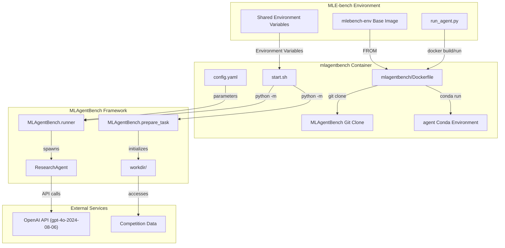
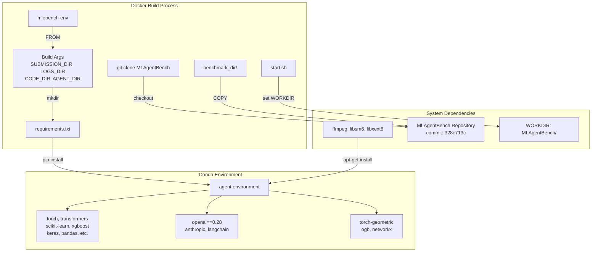
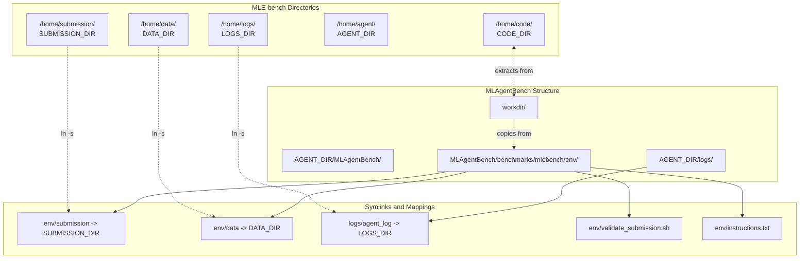
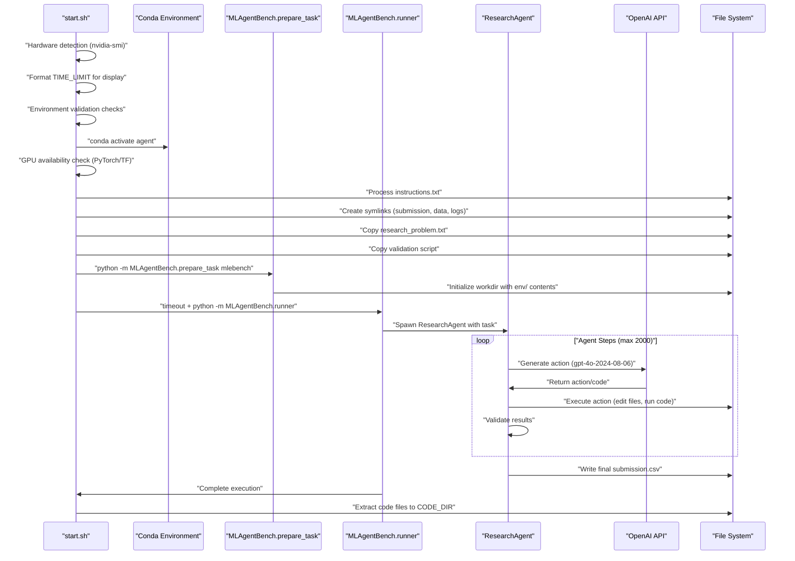
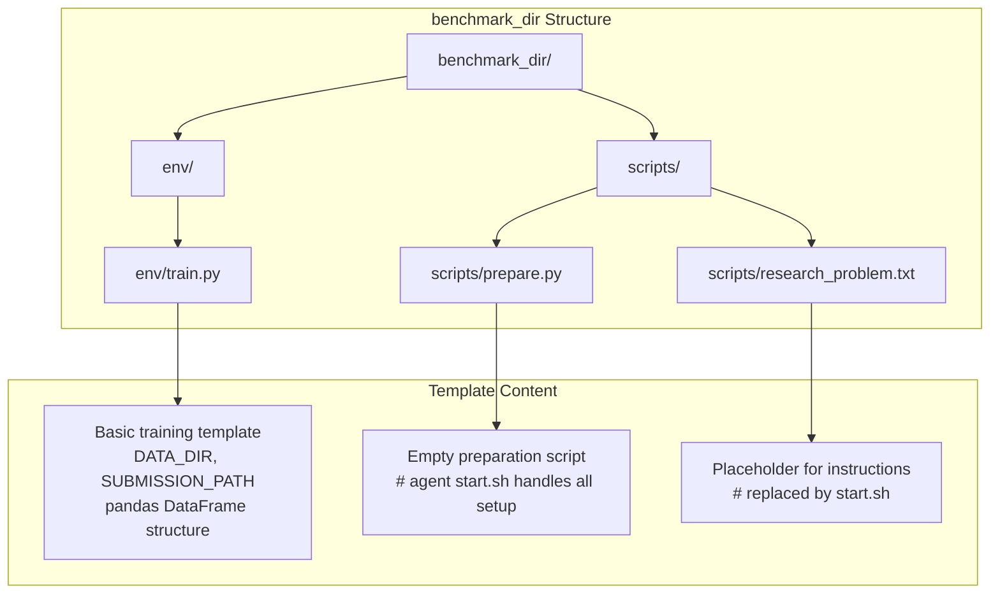

<!-- source: DeepWiki mcp.deepwiki.com · repo openai/mle-bench · page 7.2 mlagentbench Agent · fetched 2026-10-26 -->

# mlagentbench Agent

Relevant source files

The following files were used as context for generating this wiki page:

- [agents/README.md](agents/README.md)

This document covers the MLAgentBench agent implementation within MLE-bench, which integrates the Stanford MLAgentBench framework for automated machine learning research. The mlagentbench agent enables AI-powered experimentation and iterative model development on Kaggle competitions through a multi-step reasoning framework.

For information about other agents in the MLE-bench ecosystem, see [aide Agent](#7.1), [opendevin Agent](#7.3), and [dummy Agent](#7.4). For the shared agent environment configuration, see [Agent Architecture Overview](#6.1).

## Agent Architecture Overview

The mlagentbench agent integrates the external MLAgentBench framework into MLE-bench's standardized agent interface. It provides a research-oriented approach where the agent can iteratively develop and refine machine learning solutions through a series of structured steps.

Sources: [agents/mlagentbench/Dockerfile:1-42](), [agents/mlagentbench/start.sh:1-97](), [agents/mlagentbench/config.yaml:1-22](), [agents/README.md:31-35]()

## Configuration

The agent configuration is defined in `config.yaml` with specific parameters for the MLAgentBench framework integration. It uses the `gpt-4o-2024-08-06` model by default for all tasks.

| Parameter | Value | Purpose |
|-----------|-------|---------|
| `time_limit` | 86400 seconds (24 hours) | Maximum execution time |
| `step_count` | 2000 steps | Maximum number of agent steps |
| `llm-name` | gpt-4o-2024-08-06 | Primary LLM model |
| `edit-script-llm-name` | gpt-4o-2024-08-06 | LLM for code editing |
| `fast-llm-name` | gpt-4o-2024-08-06 | LLM for quick operations |
| `max-retries` | 10 | Retry limit for invalid actions |
| `max-tokens` | 16384 | Output token limit |

The configuration uses YAML anchors to ensure consistency between `max-steps`, `agent-max-steps`, and the step count limit.

Sources: [agents/mlagentbench/config.yaml:1-22]()

## Docker Environment Setup

The mlagentbench agent extends the `mlebench-env` base image and sets up a comprehensive machine learning environment with MLAgentBench framework integration. It is designed to run with the [sysbox](https://github.com/nestybox/sysbox) runtime for enhanced security isolation.

The Dockerfile performs several key operations:
- Creates standard MLE-bench directory structure using build arguments at [agents/mlagentbench/Dockerfile:16-21]()
- Installs OpenCV system dependencies at [agents/mlagentbench/Dockerfile:24]()
- Sets up conda environment with comprehensive ML package requirements at [agents/mlagentbench/Dockerfile:27-28]()
- Clones MLAgentBench repository at specific commit `328c713c` at [agents/mlagentbench/Dockerfile:31-33]()
- Copies custom benchmark directory to integrate with MLAgentBench at [agents/mlagentbench/Dockerfile:34]()

Sources: [agents/mlagentbench/Dockerfile:1-42](), [agents/mlagentbench/requirements.txt:1-77](), [agents/README.md:20-27](), [agents/README.md:62-62]()

## File System Organization

The mlagentbench agent uses a structured file system that bridges MLE-bench's standardized directories with MLAgentBench's workspace requirements.

The file system integration involves several key components:
- Symbolic links connecting MLE-bench directories to MLAgentBench workspace at [agents/mlagentbench/start.sh:69-73]()
- Research problem instructions copied to MLAgentBench benchmark at [agents/mlagentbench/start.sh:75]()
- Validation script made available to agent workspace at [agents/mlagentbench/start.sh:79]()
- Code extraction from workdir to `CODE_DIR` for analysis at [agents/mlagentbench/start.sh:96-97]()

Sources: [agents/mlagentbench/start.sh:63-80](), [agents/mlagentbench/start.sh:95-97]()

## Execution Workflow

The mlagentbench agent follows a comprehensive startup and execution process that prepares the MLAgentBench environment and launches the research agent.

The execution process includes several critical phases:

### Environment Setup
- Hardware detection and GPU verification at [agents/mlagentbench/start.sh:15-26](), [agents/mlagentbench/start.sh:49-50]()
- Time limit formatting for agent display at [agents/mlagentbench/start.sh:29-36]()
- Environment validation checks at [agents/mlagentbench/start.sh:41-45]()

### Workspace Preparation  
- Instructions processing and environment variable substitution at [agents/mlagentbench/start.sh:57-60]()
- Symbolic link creation for data and output directories at [agents/mlagentbench/start.sh:69-73]()
- MLAgentBench task preparation at [agents/mlagentbench/start.sh:84]()

### Agent Execution
- MLAgentBench runner launch with timeout at [agents/mlagentbench/start.sh:87-93]()
- Code extraction for analysis at [agents/mlagentbench/start.sh:96-97]()

Sources: [agents/mlagentbench/start.sh:1-97]()

## MLAgentBench Framework Integration

The mlagentbench agent integrates with the external MLAgentBench framework, which provides a structured environment for AI agents to conduct iterative machine learning research.

### Framework Components

The integration involves several key MLAgentBench components:

- **MLAgentBench.prepare_task**: Initializes the benchmark environment and workspace.
- **MLAgentBench.runner**: Main execution engine that manages agent interactions.
- **ResearchAgent**: The core agent that performs ML research tasks.
- **Benchmark Environment**: Custom `mlebench` benchmark integrated into MLAgentBench.

### Benchmark Directory Structure

The agent includes a custom benchmark directory that provides a template for machine learning tasks:

The `train.py` template at [agents/mlagentbench/benchmark_dir/env/train.py:1-18]() provides a starting point for ML development with predefined paths and pandas structure. The preparation script at [agents/mlagentbench/benchmark_dir/scripts/prepare.py:1-2]() is intentionally empty since setup is handled by `start.sh`.

### Agent Capabilities and Limitations

The mlagentbench agent provides several capabilities through the MLAgentBench framework:
- **Iterative Development**: Multi-step refinement process with up to 2000 steps.
- **Code Generation and Editing**: LLM-powered code creation and modification.
- **Validation Integration**: Built-in submission validation through provided tools.
- **Time Management**: 24-hour execution window with step and time tracking.

The additional notes template at [agents/mlagentbench/additional_notes.txt:1-8]() emphasizes optimization strategy, encouraging agents to use the full time allocation for iterative improvement rather than submitting the first working solution.

Sources: [agents/mlagentbench/benchmark_dir/env/train.py:1-18](), [agents/mlagentbench/benchmark_dir/scripts/prepare.py:1-2](), [agents/mlagentbench/benchmark_dir/scripts/research_problem.txt:1-3](), [agents/mlagentbench/additional_notes.txt:1-8]()

---

