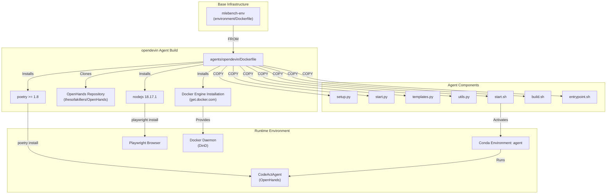
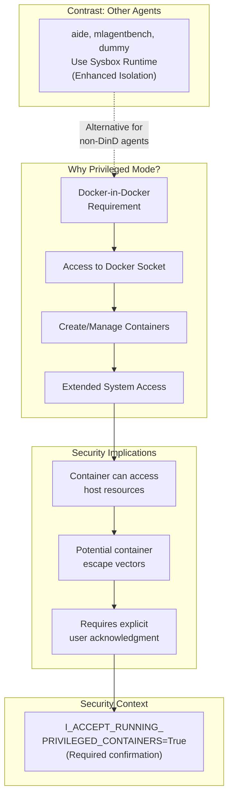
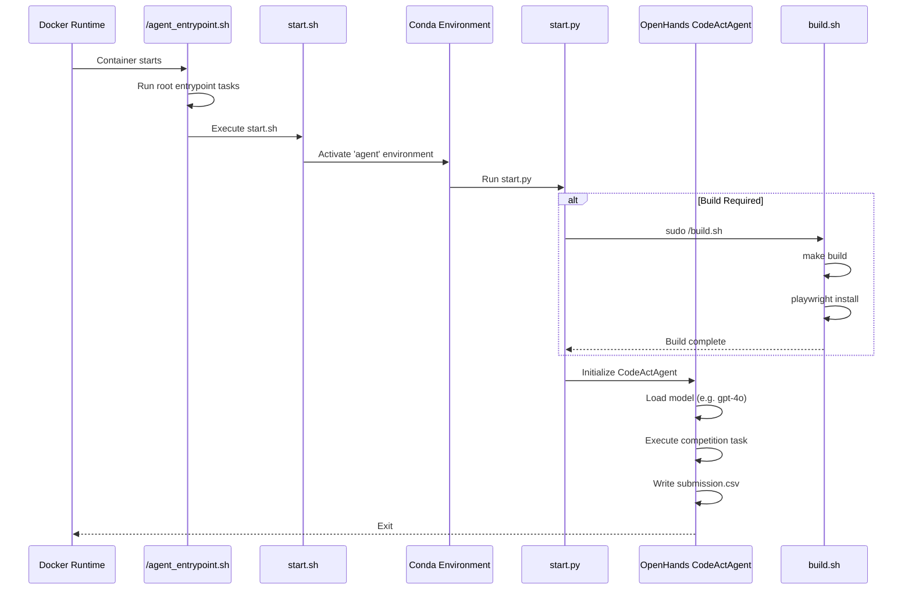

<!-- source: DeepWiki mcp.deepwiki.com · repo openai/mle-bench · page 7.3 opendevin Agent · fetched 2026-10-26 -->

# opendevin Agent

<details>
<summary>Relevant source files</summary>

The following files were used as context for generating this wiki page:

- [agents/README.md](agents/README.md)
- [environment/Dockerfile](environment/Dockerfile)
- [environment/entrypoint.sh](environment/entrypoint.sh)

</details>


## Purpose and Scope

The `opendevin` agent (also known as OpenHands) is a specialized agent implementation in MLE-bench that leverages the OpenHands framework's `CodeActAgent` to execute code actions for solving machine learning competitions. This agent requires privileged Docker mode due to Docker-in-Docker (DinD) requirements, distinguishing it from other agents that use the Sysbox runtime.

For information about the general agent framework architecture, see [Agent Architecture Overview](#6.1). For details on the security trade-offs of privileged mode, see [Container Security Models](#6.3). For other agent implementations, see [aide Agent](#7.1), [mlagentbench Agent](#7.2), and [dummy Agent](#7.4).

## Architecture Overview

The opendevin agent integrates the OpenHands framework into MLE-bench's evaluation infrastructure. It implements a code-action-based approach where the agent can execute shell commands, edit files, and browse the web to solve machine learning tasks.

### Natural Language Space to Code Entity Space: Architecture



**Sources:** [agents/opendevin/Dockerfile:1-54](), [agents/README.md:10-10]()

### Key Architectural Characteristics

| Characteristic | Value | Reason |
|---------------|-------|---------|
| **Base Image** | `mlebench-env` | Provides common ML packages and conda environment [environment/Dockerfile:1-93]() |
| **Container Runtime** | Privileged Mode | Required for Docker-in-Docker functionality [agents/README.md:62-65]() |
| **Agent Type** | `CodeActAgent` | OpenHands agent that executes code actions |
| **OpenHands Version** | `v2.1.0` | Specific fork from `thesofakillers/OpenHands` [agents/README.md:10-10]() |
| **Python Version** | 3.11 | Set via `PYTHON_VERSION` arg [agents/opendevin/Dockerfile:24-24]() |
| **Default LLM** | `gpt-4o` | Configurable in `config.yaml` |

**Sources:** [agents/opendevin/Dockerfile:22-32](), [agents/README.md:62-65]()

## Build Process

The opendevin agent follows a multi-stage build process that sets up Docker-in-Docker, installs the OpenHands framework, and configures build tools.

### Natural Language Space to Code Entity Space: Build Flow

```mermaid
graph LR
    subgraph "Stage 1: Base Setup"
        S1_CreateDirs["Create Directories<br/>mkdir -p ${LOGS_DIR} ${AGENT_DIR} ${CODE_DIR} ${SUBMISSION_DIR}"]
        S1_Docker["Install Docker<br/>(get-docker.sh)"]
        S1_Usermod["usermod -aG docker nonroot"]
        S1_Clone["Clone OpenHands<br/>branch: v2.1.0"]
    end
    
    subgraph "Stage 2: Dependencies"
        S2_NodeJS["conda install nodejs 18.17.1"]
        S2_Poetry["pip install poetry >= 1.8"]
        S2_PoetryInstall["poetry install"]
        S2_PoetryBuild["poetry add build"]
        S2_Clean["conda clean -afy"]
    end
    
    subgraph "Stage 3: Configuration"
        S3_CopyFiles["COPY setup.py start.py templates.py utils.py start.sh build.sh"]
        S3_CopyEntry["COPY entrypoint.sh<br/>to /agent_entrypoint.sh"]
        S3_Chmod["chmod 711 build.sh"]
        S3_Sudoers["echo ALL ALL=NOPASSWD: build.sh >> /etc/sudoers"]
    end
    
    subgraph "Runtime: Build Execution"
        R_MakeBuild["sudo /build.sh<br/>runs make build"]
        R_Playwright["playwright install"]
    end
    
    S1_CreateDirs --> S1_Docker
    S1_Docker --> S1_Usermod
    S1_Usermod --> S1_Clone
    S1_Clone --> S2_NodeJS
    
    S2_NodeJS --> S2_Poetry
    S2_Poetry --> S2_PoetryInstall
    S2_PoetryInstall --> S2_PoetryBuild
    S2_PoetryBuild --> S2_Clean
    
    S2_Clean --> S3_CopyFiles
    S3_CopyFiles --> S3_CopyEntry
    S3_CopyEntry --> S3_Chmod
    S3_Chmod --> S3_Sudoers
    
    S3_Sudoers -.->|"At Runtime"| R_MakeBuild
    R_MakeBuild --> R_Playwright
```



**Sources:** [agents/opendevin/Dockerfile:27-50](), [agents/opendevin/build.sh:1-6]()

### Build Script Details

The `build.sh` script is executed at runtime (not during Docker build) with sudo privileges to complete the OpenHands build:

```bash
#!/bin/bash

cd /home/agent
/opt/conda/bin/conda run -n agent --no-capture-output make build
sudo -u nonroot /opt/conda/bin/conda run -n agent --no-capture-output playwright install
```

This script:
1. Changes to the agent directory (`/home/agent`) [agents/opendevin/build.sh:3-3]()
2. Runs `make build` using the `agent` conda environment [agents/opendevin/build.sh:4-4]()
3. Installs Playwright browsers as the `nonroot` user [agents/opendevin/build.sh:5-5]()

**Sources:** [agents/opendevin/build.sh:1-6]()

### Docker-in-Docker Setup

The Dockerfile installs Docker inside the container using Docker's official installation script:

```dockerfile
RUN mkdir -p ${LOGS_DIR} ${AGENT_DIR} ${CODE_DIR} ${SUBMISSION_DIR} && \
    curl -fsSL https://get.docker.com -o /tmp/get-docker.sh && \
    chmod 700 /tmp/get-docker.sh && \
    /tmp/get-docker.sh && \
    sudo usermod -aG docker nonroot && \
    git clone --branch ${OD_VERSION} --single-branch https://github.com/thesofakillers/OpenHands.git ${AGENT_DIR}
```

This enables the agent to spawn Docker containers for code execution, which is why privileged mode is required.

**Sources:** [agents/opendevin/Dockerfile:27-32](), [agents/README.md:62-65]()

## Security Model and Privileged Mode

The opendevin agent is unique among MLE-bench agents in requiring **privileged mode** for container execution. This requirement stems from Docker-in-Docker needs.



**Sources:** [agents/README.md:61-65]()

### Docker-in-Docker Implementation

The Dockerfile installs Docker inside the container and adds the `nonroot` user to the `docker` group:

```dockerfile
curl -fsSL https://get.docker.com -o /tmp/get-docker.sh && \
chmod 700 /tmp/get-docker.sh && \
/tmp/get-docker.sh && \
sudo usermod -aG docker nonroot
```

This allows OpenHands' CodeActAgent to spawn Docker containers for isolated code execution, a core capability of the framework.

**Sources:** [agents/opendevin/Dockerfile:28-31]()

### Sudo Configuration

The build script (`build.sh`) requires sudo access but is restricted from being read or edited by the agent:

```dockerfile
RUN echo "ALL ALL=NOPASSWD: ${AGENT_DIR}/build.sh" >> /etc/sudoers && \
    chmod 711 ${AGENT_DIR}/build.sh
```

This allows the agent to run `sudo /build.sh` but prevents it from modifying the build script itself.

**Sources:** [agents/opendevin/Dockerfile:49-50]()

## Dependencies and Environment

The opendevin agent has specific dependency requirements that are installed during the build process.

### Conda Environment

The agent uses a pre-existing conda environment named `agent` created in the `mlebench-env` base image:

| Component | Version | Installation Method |
|-----------|---------|-------------------|
| **Conda Environment** | `agent` | Pre-existing from base image [environment/Dockerfile:48-48]() |
| **Python** | 3.11 | Via `PYTHON_VERSION` arg [agents/opendevin/Dockerfile:24-24]() |
| **Node.js** | 18.17.1 | `conda install -c conda-forge` [agents/opendevin/Dockerfile:37-37]() |
| **Poetry** | >= 1.8 | `pip install` via conda run [agents/opendevin/Dockerfile:38-38]() |
| **OpenHands** | v2.1.0 | `poetry install` [agents/opendevin/Dockerfile:39-39]() |
| **Build Package** | latest | `poetry add build` [agents/opendevin/Dockerfile:40-40]() |
| **Playwright** | latest | Via `build.sh` at runtime [agents/opendevin/build.sh:5-5]() |

**Sources:** [agents/opendevin/Dockerfile:22-41](), [agents/opendevin/build.sh:1-6](), [environment/Dockerfile:48-48]()

## Execution Model

The opendevin agent's execution follows a specific startup sequence that prepares the environment and launches the CodeActAgent.



**Sources:** [agents/opendevin/Dockerfile:52-53](), [agents/opendevin/build.sh:1-6]()

### Entrypoint Hierarchy

The container uses a custom entrypoint that wraps the base image's entrypoint:

```dockerfile
# run the agent's entrypoint script instead (which also runs root entrypoint)
ENTRYPOINT ["/agent_entrypoint.sh"]
```

This indicates that `/agent_entrypoint.sh` is responsible for both running the base image's entrypoint logic (from `environment/entrypoint.sh`) and the agent-specific startup sequence.

**Sources:** [agents/opendevin/Dockerfile:52-53](), [environment/entrypoint.sh:1-20]()

### CodeActAgent Operation

The CodeActAgent from OpenHands operates by:
1. Receiving competition instructions from `/home/instructions.txt` [environment/Dockerfile:78-78]()
2. Accessing competition data from `/home/data/` [environment/entrypoint.sh:14-14]()
3. Executing code actions (bash commands, file edits, etc.)
4. Using Docker containers for isolated execution [agents/README.md:62-65]()
5. Writing results to `${SUBMISSION_DIR}` [agents/opendevin/Dockerfile:6-6]()
6. Logging operations to `${LOGS_DIR}` [agents/opendevin/Dockerfile:7-7]()

**Sources:** [agents/opendevin/Dockerfile:6-7](), [agents/README.md:62-65](), [environment/Dockerfile:78-78](), [environment/entrypoint.sh:14-14]()

---

