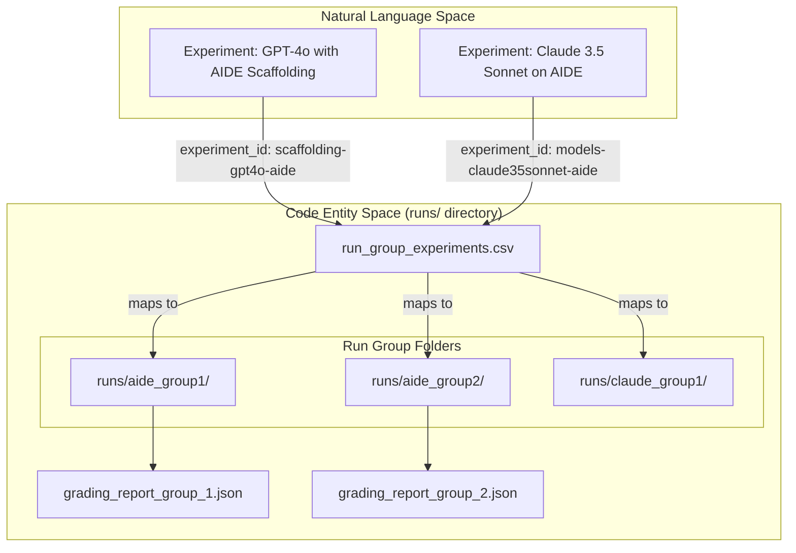
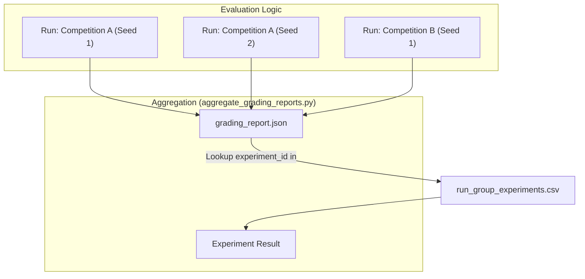

<!-- source: DeepWiki mcp.deepwiki.com · repo openai/mle-bench · page 8.1 Run Directory Structure and Grading Reports · fetched 2026-10-26 -->

# Run Directory Structure and Grading Reports

Relevant source files

The following files were used as context for generating this wiki page:

- [runs/README.md](runs/README.md)
- [runs/aba_group1/grading_report_group_1.json](runs/aba_group1/grading_report_group_1.json)
- [runs/aba_group2/grading_report_group_2.json](runs/aba_group2/grading_report_group_2.json)
- [runs/aba_group3/grading_report_group_3.json](runs/aba_group3/grading_report_group_3.json)
- [runs/mars_group3/grading_report_group_3.json](runs/mars_group3/grading_report_group_3.json)
- [runs/mars_plus_group1/grading_report_group_1.json](runs/mars_plus_group1/grading_report_group_1.json)
- [runs/mars_plus_group2/grading_report_group_2.json](runs/mars_plus_group2/grading_report_group_2.json)
- [runs/mars_plus_group3/grading_report_group_3.json](runs/mars_plus_group3/grading_report_group_3.json)
- [runs/run_group_experiments.csv](runs/run_group_experiments.csv)

The `runs/` directory serves as the central repository for all experimental results generated within MLE-bench. It organizes benchmark data into a hierarchy that maps specific execution instances (runs) to broader experimental configurations (experiments). This structure allows for the systematic tracking of agent performance across various scaffolding types, model versions, and hardware configurations.

## The runs/ Directory Hierarchy

The storage architecture is designed to handle a large volume of JSON-based grading reports. To maintain repository performance, large data files and the mapping CSV are managed via **Git LFS (Large File Storage)** [runs/run_group_experiments.csv:1-3]().

### Run Groups
A **Run Group** is a collection of run results spanning multiple competitions and seeds [runs/README.md:5-6](). Each run group is stored in its own subdirectory (e.g., `runs/mars_group3/`) and contains a `grading_report.json` file [runs/README.md:7-8]().

### Mapping Experiments to Runs
The relationship between high-level experiments and specific run groups is defined in `runs/run_group_experiments.csv` [runs/README.md:24-25]().

*   **Experiment ID**: A unique identifier for a specific agent setup (e.g., `scaffolding-gpt4o-aide`) [runs/README.md:11-12]().
*   **Run Group**: The specific directory containing the raw data for a set of seeds.

### Data Flow: From Run to Experiment
The following diagram illustrates how raw grading data is associated with technical experiment definitions.

**Entity Mapping: Run Groups to Experiments**

**Sources:** [runs/README.md:5-16](), [runs/run_group_experiments.csv:1-4]()

---

## Grading Report Schema

The `grading_report.json` file is the primary artifact of an evaluation. While the files themselves are stored in Git LFS, they follow a standardized schema that aggregates scores across competitions.

### Structure of a Grading Report
A typical report includes:
1.  **Competition Metadata**: The name of the competition and the split (e.g., low, medium, high).
2.  **Seed Information**: The specific seed used for the stochastic components of the agent.
3.  **Scores**: The numerical result achieved by the agent on the specific competition task.

In instances where more seeds exist than are reported, the system defaults to the final *N* seeds to ensure consistency across the experiment [runs/README.md:18-22]().

### Examples of Grading Report Storage
| File Path | Storage Method | Description |
| :--- | :--- | :--- |
| `runs/mars_group3/grading_report_group_3.json` | Git LFS | Scores for MARS agent group 3 [runs/mars_group3/grading_report_group_3.json:1-4]() |
| `runs/aba_group1/grading_report_group_1.json` | Git LFS | Scores for AIBuildAI agent group 1 [runs/aba_group1/grading_report_group_1.json:1-4]() |

**Sources:** [runs/README.md:5-8](), [runs/mars_group3/grading_report_group_3.json:1-4]()

---

## Experiment Catalog and Hardware Mapping

The `runs/README.md` file serves as the registry for `experiment_id` definitions. This mapping is critical for interpreting the results, as it details the hardware constraints and scaffolding used.

### Core Experiment Definitions
| experiment_id | Scaffolding | Model | Hardware / Constraints |
| :--- | :--- | :--- | :--- |
| `scaffolding-gpt4o-aide` | AIDE | GPT-4o | Standard MLE-bench env [runs/README.md:37]() |
| `scaffolding-gpt4o-mlab` | MLAB | GPT-4o | Standard MLE-bench env [runs/README.md:38]() |
| `deepseek-r1-ML-Master` | ML-Master | Deepseek-R1 | 12h, 36 vCPUs, 512GB RAM, 1 A100 [runs/README.md:41]() |
| `models-o1-preview-aide` | AIDE | o1-preview | Standard MLE-bench env [runs/README.md:35]() |

**System Logic: Run Aggregation**

**Sources:** [runs/README.md:28-63](), [runs/run_group_experiments.csv:1-4]()

## Data Management via Git LFS

Because the `runs/` directory contains hundreds of JSON files and tracking data, MLE-bench utilizes Git LFS to prevent repository bloat.

*   **Pointer Files**: The local repository contains small pointer files (approx. 300 bytes) instead of the full JSON data [runs/run_group_experiments.csv:3]().
*   **OIDs**: Each file is identified by a SHA256 hash (Object ID) [runs/mars_plus_group1/grading_report_group_1.json:2]().
*   **Retrieval**: Users must run `git lfs pull` to fetch the actual grading reports before running aggregation scripts.

**Sources:** [runs/run_group_experiments.csv:1-3](), [runs/mars_plus_group1/grading_report_group_1.json:1-4]()

---

