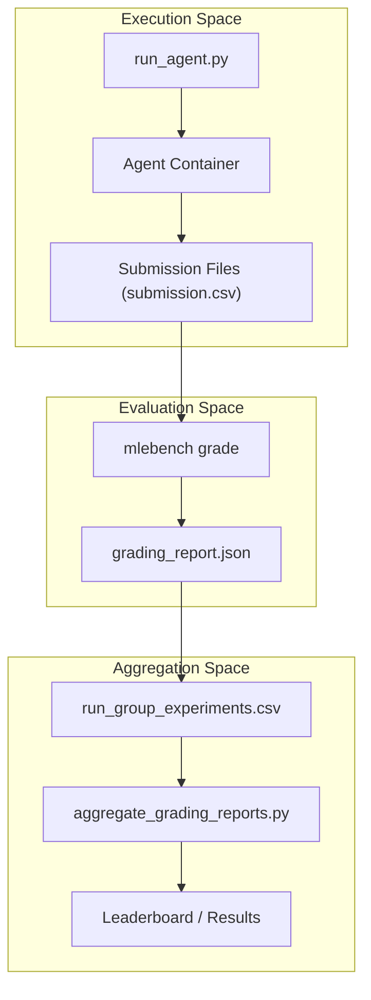
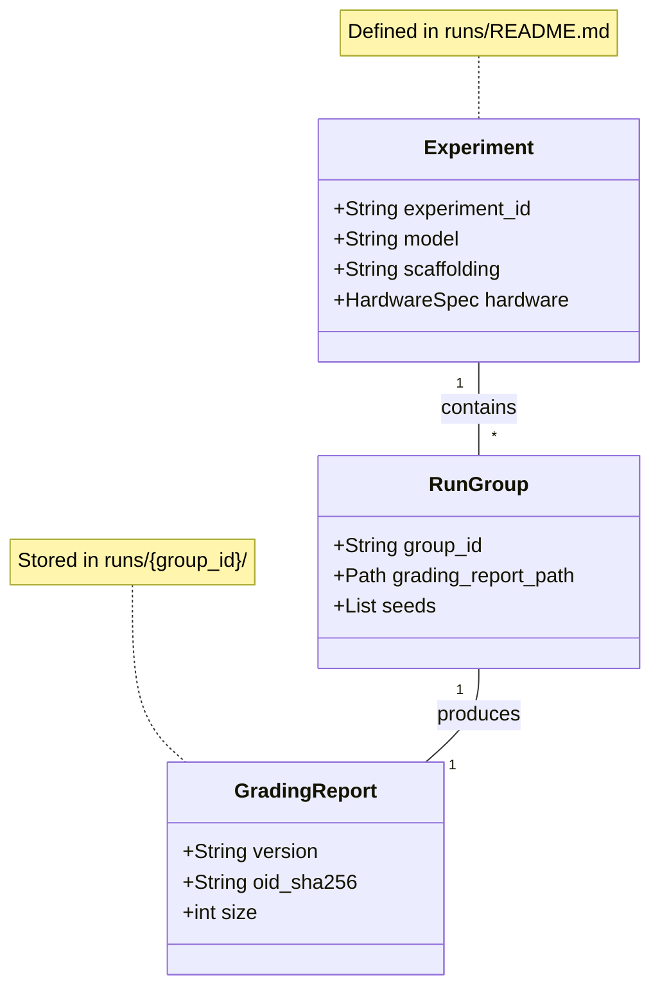

<!-- source: DeepWiki mcp.deepwiki.com · repo openai/mle-bench · page 8.2 Evaluated Agents and Experiment Catalog · fetched 2026-10-26 -->

# Evaluated Agents and Experiment Catalog

Relevant source files

The following files were used as context for generating this wiki page:

- [runs/Leeroo_group1/grading_report_group_1.json](runs/Leeroo_group1/grading_report_group_1.json)
- [runs/Leeroo_group2/grading_report_group_2.json](runs/Leeroo_group2/grading_report_group_2.json)
- [runs/Leeroo_group3/grading_report_group_3.json](runs/Leeroo_group3/grading_report_group_3.json)
- [runs/README.md](runs/README.md)
- [runs/aira-dojo_group1/grading_report_1.json](runs/aira-dojo_group1/grading_report_1.json)
- [runs/disarray_group_1/2026-02-03T08-54-09-GMT_grading_report.json](runs/disarray_group_1/2026-02-03T08-54-09-GMT_grading_report.json)
- [runs/disarray_group_2/2026-02-03T08-58-32-GMT_grading_report.json](runs/disarray_group_2/2026-02-03T08-58-32-GMT_grading_report.json)
- [runs/disarray_group_3/2026-02-03T09-01-47-GMT_grading_report.json](runs/disarray_group_3/2026-02-03T09-01-47-GMT_grading_report.json)
- [runs/famou-agent_group1/grading_report_group_1.json](runs/famou-agent_group1/grading_report_group_1.json)
- [runs/famou-agent_group2/grading_report_group_2.json](runs/famou-agent_group2/grading_report_group_2.json)
- [runs/famou-agent_group3/grading_report_group_3.json](runs/famou-agent_group3/grading_report_group_3.json)
- [runs/famou-agent_group4/grading_report_group_4.json](runs/famou-agent_group4/grading_report_group_4.json)
- [runs/famou-agent_group5/grading_report_group_5.json](runs/famou-agent_group5/grading_report_group_5.json)
- [runs/famou-agent_group6/grading_report_group_6.json](runs/famou-agent_group6/grading_report_group_6.json)
- [runs/internagent_group1/grading_report_group_1.json](runs/internagent_group1/grading_report_group_1.json)
- [runs/internagent_group2/grading_report_group_2.json](runs/internagent_group2/grading_report_group_2.json)
- [runs/internagent_group3/grading_report_group_3.json](runs/internagent_group3/grading_report_group_3.json)
- [runs/loongflow_group1/2026-02-09T07-43-11-GMT_grading_report.json](runs/loongflow_group1/2026-02-09T07-43-11-GMT_grading_report.json)
- [runs/loongflow_group2/2026-02-09T07-46-10-GMT_grading_report.json](runs/loongflow_group2/2026-02-09T07-46-10-GMT_grading_report.json)
- [runs/loongflow_group3/2026-02-09T07-50-35-GMT_grading_report.json](runs/loongflow_group3/2026-02-09T07-50-35-GMT_grading_report.json)
- [runs/mars_group3/grading_report_group_3.json](runs/mars_group3/grading_report_group_3.json)
- [runs/mars_plus_group1/grading_report_group_1.json](runs/mars_plus_group1/grading_report_group_1.json)
- [runs/mars_plus_group2/grading_report_group_2.json](runs/mars_plus_group2/grading_report_group_2.json)
- [runs/mars_plus_group3/grading_report_group_3.json](runs/mars_plus_group3/grading_report_group_3.json)
- [runs/mle_star_pro_group4/grading_report_group_4.json](runs/mle_star_pro_group4/grading_report_group_4.json)
- [runs/mle_star_pro_group5/grading_report_group_5.json](runs/mle_star_pro_group5/grading_report_group_5.json)
- [runs/mle_star_pro_group6/grading_report_group_6.json](runs/mle_star_pro_group6/grading_report_group_6.json)
- [runs/mlevolve_group1/grading_report_group_1.json](runs/mlevolve_group1/grading_report_group_1.json)
- [runs/mlevolve_group2/grading_report_group_2.json](runs/mlevolve_group2/grading_report_group_2.json)
- [runs/mlevolve_group3/grading_report_group_3.json](runs/mlevolve_group3/grading_report_group_3.json)
- [runs/mlmaster_group4/grading_report_group_4.json](runs/mlmaster_group4/grading_report_group_4.json)
- [runs/mlmaster_group5/grading_report_group_5.json](runs/mlmaster_group5/grading_report_group_5.json)
- [runs/mlmaster_group6/grading_report_group_6.json](runs/mlmaster_group6/grading_report_group_6.json)
- [runs/neo_group1/grading_report_group_1.json](runs/neo_group1/grading_report_group_1.json)
- [runs/neo_group2/grading_report_group_2.json](runs/neo_group2/grading_report_group_2.json)
- [runs/neo_group3/grading_report_group_3.json](runs/neo_group3/grading_report_group_3.json)
- [runs/operand_group1/README.md](runs/operand_group1/README.md)
- [runs/operand_group1/grading_report_group_1.json](runs/operand_group1/grading_report_group_1.json)
- [runs/operand_group2/README.md](runs/operand_group2/README.md)
- [runs/operand_group2/grading_report_group_2.json](runs/operand_group2/grading_report_group_2.json)
- [runs/operand_group3/README.md](runs/operand_group3/README.md)
- [runs/operand_group3/grading_report_group_3.json](runs/operand_group3/grading_report_group_3.json)
- [runs/pievolve_group1/grading_report_group_1.json](runs/pievolve_group1/grading_report_group_1.json)
- [runs/pievolve_group2/grading_report_group_2.json](runs/pievolve_group2/grading_report_group_2.json)
- [runs/pievolve_group3/grading_report_group_3.json](runs/pievolve_group3/grading_report_group_3.json)
- [runs/pievolve_group4/grading_report_group_4.json](runs/pievolve_group4/grading_report_group_4.json)
- [runs/pievolve_group5/grading_report_group_5.json](runs/pievolve_group5/grading_report_group_5.json)
- [runs/pievolve_group6/grading_report_group_6.json](runs/pievolve_group6/grading_report_group_6.json)
- [runs/rdagent_group1/grading_report_group_1.json](runs/rdagent_group1/grading_report_group_1.json)
- [runs/rdagent_group2/grading_report_group_2.json](runs/rdagent_group2/grading_report_group_2.json)
- [runs/rdagent_group3/grading_report_group_3.json](runs/rdagent_group3/grading_report_group_3.json)
- [runs/rdagent_group4/grading_report_group_4.json](runs/rdagent_group4/grading_report_group_4.json)
- [runs/rdagent_group5/grading_report_group_5.json](runs/rdagent_group5/grading_report_group_5.json)

This page provides a comprehensive catalog of the agents and experiment configurations evaluated within the MLE-bench framework. It details the specific hardware requirements, model backbones, and scaffolding architectures used to generate the benchmark results stored in the `runs/` directory.

## Experiment and Run Group Structure

MLE-bench organizes evaluation data into a hierarchy of experiments and run groups. An experiment represents a specific configuration of an agent (scaffolding + model + hardware).

- **Experiment ID**: A unique identifier for a specific agent setup (e.g., `scaffolding-gpt4o-aide`) [runs/README.md:11-12]().
- **Run Group**: A collection of run results across multiple competitions and seeds. Each run group contains a `grading_report.json` file [runs/README.md:5-8]().
- **Mapping**: The file `runs/run_group_experiments.csv` maps experiment IDs to their constituent run groups [runs/README.md:24-25]().

### Data Flow: From Run to Result

The following diagram illustrates how raw agent outputs are processed into the aggregated experiment results documented in this catalog.

**Agent Evaluation Data Flow**

Sources: [runs/README.md:5-12](), [runs/README.md:24-26]()

---

## Catalog of Evaluated Agents

The table below summarizes the agents evaluated in MLE-bench, including their hardware specifications and primary model backbones.

| Experiment ID | Model Backbone | Scaffolding | Hardware Requirements | Time Limit |
| :--- | :--- | :--- | :--- | :--- |
| `scaffolding-gpt4o-aide` | GPT-4o | AIDE | 1 GPU | 24 Hours |
| `scaffolding-gpt4o-mlab` | GPT-4o | MLAB | 1 GPU | 24 Hours |
| `scaffolding-gpt4o-opendevin` | GPT-4o | OpenDevin | 1 GPU | 24 Hours |
| `o1-preview-R&D-Agent` | o1-preview | R&D-Agent | 12 vCPUs, 220GB RAM, 1 V100 | - |
| `deepseek-r1-ML-Master` | Deepseek-R1 | ML-Master | 36 vCPUs, 512GB RAM, 1 A100 | 12 Hours |
| `multi-agent-Neo` | GPT-4.1 / Claude 3.5 | NEO | 24 vCPUs, 144GB RAM, 1 A100 | 36 Hours |
| `deepseek-r1-InternAgent` | Deepseek-R1 | InternAgent | 32 vCPUs, 230GB RAM, 1 A800 | 12 Hours |
| `MLE-STAR-Pro-1.5` | CAIR MLE-STAR | MLE-STAR-Pro | 24 vCPUs, 220GB RAM, 2 x A100-40GB | 24 Hours |
| `AIRA-dojo` | o3 | AIRA-DOJO | 24 vCPUs, 120GB RAM, 1 H200 | 24 Hours |
| `Leeroo` | Ensemble (Gemini/GPT) | Leeroo | 24 vCPUs, 150GB RAM, 1 H100 | 24 Hours |
| `PiEvolve_24hrs` | Gemini-3-Pro-preview | PiEvolve | 40 vCPUs, 240GB RAM, 1 H100 | 24 Hours |
| `MLEvolve` | Gemini-3-Pro-preview | MLEvolve | 21 vCPUs, 234GB RAM, 1 H200 | 12 Hours |
| `MARS+` | CAIR MARS+ | MARS+ | 48 vCPUs, 220GB RAM, 2 x H100 | 24 Hours |
| `Disarray` | Multi-Model Ensemble | Disarray | 24 vCPUs, 220GB RAM, 1 A100 | 24 Hours |

Sources: [runs/README.md:28-63]()

---

## Detailed Agent Configurations

### Baseline Scaffolding Agents
These experiments focus on standard agent frameworks using GPT-4o as the core reasoning engine.

*   **AIDE**: Used as the primary baseline for various model comparisons (Claude 3.5, Llama 3.1, o1-preview) [runs/README.md:33-35]().
*   **MLAB**: Integration with the MLAgentBench framework [runs/README.md:38]().
*   **OpenDevin**: Evaluation of the OpenHands (formerly OpenDevin) CodeActAgent [runs/README.md:39]().

### Advanced Research Agents
These agents often utilize specialized architectures or massive hardware resources.

*   **R&D-Agent**: Evaluated with `o1-preview`, `o3`, and `gpt-5` (placeholder for future models). It typically requires high memory (220GB RAM) and V100 GPUs [runs/README.md:40-45]().
*   **InternAgent**: Utilizes Deepseek-R1 with significant compute (A800 GPU) [runs/README.md:44]().
*   **Neo**: A multi-agent ensemble approach combining GPT and Claude models [runs/README.md:42]().
*   **MARS / MARS+**: Developed by CAIR, the MARS+ configuration represents one of the most resource-intensive evaluations using dual H100 GPUs [runs/README.md:61-62]().

### Specialized Ensembles
*   **Disarray**: Combines Claude-Opus-4.5, Claude-Sonnet-4.5, GPT-5.2-Codex, and Gemini-3-Pro-Preview [runs/README.md:59]().
*   **Leeroo**: An ensemble featuring Gemini-3-Pro-Preview and GPT-5 series models [runs/README.md:52]().

---

## Result Locations and Data Management

The benchmark results are stored as JSON grading reports. Due to their size and the volume of experiments, these files are managed via Git LFS.

**Code Entity to Result Mapping**

Sources: [runs/README.md:5-9](), [runs/README.md:24-27](), [runs/mars_group3/grading_report_group_3.json:1-3]()

### Grading Report Examples
The following paths contain the raw grading data for specific agent groups:
*   **MARS+**: `runs/mars_plus_group1/grading_report_group_1.json` [runs/mars_plus_group1/grading_report_group_1.json:1-4]()
*   **MLEvolve**: `runs/mlevolve_group1/grading_report_group_1.json` [runs/mlevolve_group1/grading_report_group_1.json:1-4]()
*   **Disarray**: `runs/disarray_group_1/2026-02-03T08-54-09-GMT_grading_report.json` [runs/disarray_group_1/2026-02-03T08-54-09-GMT_grading_report.json:1-4]()
*   **LoongFlow**: `runs/loongflow_group1/2026-02-09T07-43-11-GMT_grading_report.json` [runs/loongflow_group1/2026-02-09T07-43-11-GMT_grading_report.json:1-4]()

### Handling Hardware Failures
In instances where hardware issues caused early seeds to fail, the benchmark adopts a policy of taking the final *N* successful seeds for aggregation, where *N* is the minimum number of seeds completed across all competitions in that experiment [runs/README.md:18-22]().

Sources: [runs/README.md:1-63](), [runs/run_group_experiments.csv](), [runs/mars_group3/grading_report_group_3.json:1-4]()

---

