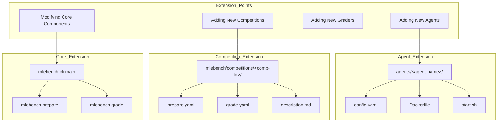
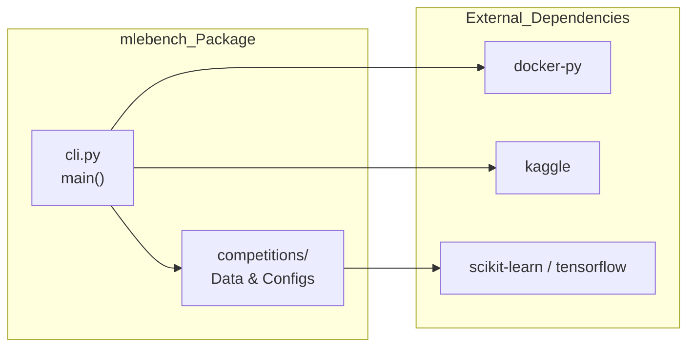
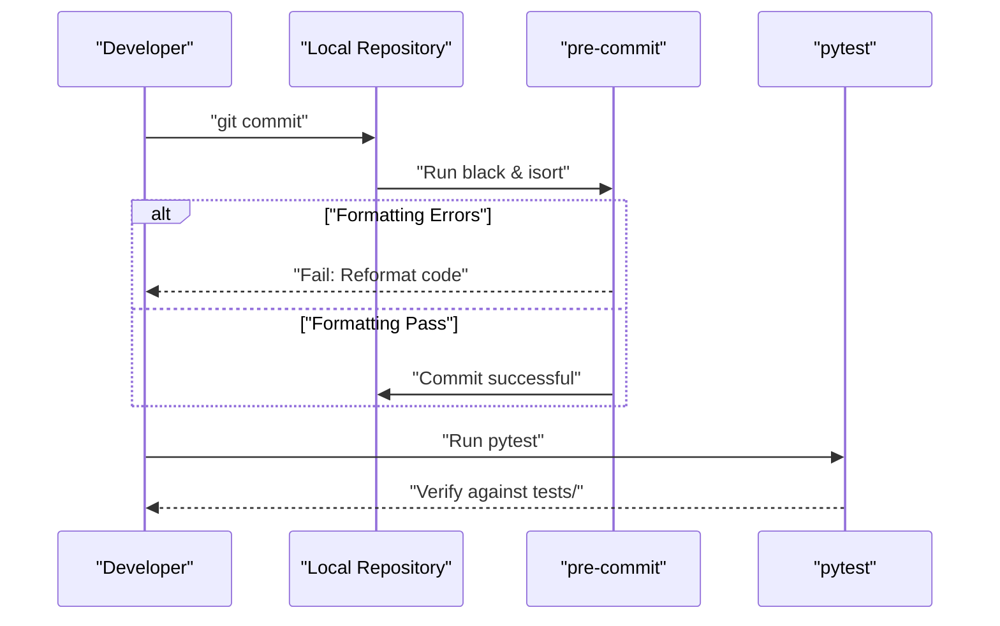

<!-- source: DeepWiki mcp.deepwiki.com · repo openai/mle-bench · page 9 Development Guide · fetched 2026-10-26 -->

# Development Guide

<details>
<summary>Relevant source files</summary>

The following files were used as context for generating this wiki page:

- [.gitattributes](.gitattributes)
- [pyproject.toml](pyproject.toml)

</details>


This guide provides resources for developers contributing to or extending MLE-bench. It covers development environment setup, best practices for extending the system, and references to detailed configuration documentation.

For detailed information on specific development topics, see:
- **Repository Configuration** ([Repository Configuration](#9.1)) — Explain .gitignore, .dockerignore, and .gitattributes configurations and their purposes
- **Code Quality and Pre-commit Hooks** ([Code Quality and Pre-commit Hooks](#9.2)) — Document the pre-commit hook configuration, black and isort settings, and development workflow
- **Testing Infrastructure** ([Testing Infrastructure](#9.3)) — Document the test suite structure, integration tests for competition grading, unit tests for data utilities, pytest configuration, and how to run tests locally
- **Security and License** ([Security and License](#9.4)) — Provide security policy information, vulnerability disclosure process, and licensing details

For information about agent-specific development environments and Docker configurations, see [Docker Environment](#5.2) and [Agent Framework](#6).

## Development Environment Setup

### Prerequisites

Developers working on MLE-bench should have the following installed:
- Python 3.11 or higher [pyproject.toml:8-8]()
- Docker with Sysbox runtime (for agent execution)
- Git with Git LFS enabled
- Pre-commit framework [pyproject.toml:44-44]()

### Initial Setup

1. **Clone the repository with Git LFS:**
   ```bash
   git clone https://github.com/openai/mle-bench
   cd mle-bench
   git lfs install
   git lfs pull
   ```

2. **Install development dependencies:**
   The project uses `setuptools` with optional dependency groups defined in `pyproject.toml`.
   ```bash
   pip install -e ".[dev,formatters]"
   ```
   This installs core dependencies like `docker`, `kaggle`, and `pandas`, along with development tools like `pytest`, `black`, and `isort` [pyproject.toml:10-34,42-44]().

3. **Set up pre-commit hooks:**
   ```bash
   pre-commit install
   ```

**Sources:** [pyproject.toml:8-44](), [.gitattributes:1-4]()

## Extending MLE-bench

MLE-bench is designed to be extensible in several key areas:


**Title:** MLE-bench Extension Points
**Sources:** [pyproject.toml:39-40](), [pyproject.toml:46-47]()

### Adding New Agents
To add a new agent, create a directory under `agents/`. Agents must follow standard directory structures to be compatible with the execution environment. See [Agent Architecture Overview](#6.1) for detailed specifications.

### Adding New Competitions
New competitions are added to `mlebench/competitions/`. The `pyproject.toml` ensures these are included as package data [pyproject.toml:46-47](). Each competition must implement the preparation and grading interfaces. See [Competition Framework](#5.3) for details.

### Modifying Core Components
Core components are organized in the `mlebench/` package [pyproject.toml:36-37](). The primary entry point is `mlebench.cli:main`, which is exposed as the `mlebench` command [pyproject.toml:39-40]().


**Title:** Core Package and Dependency Mapping
**Sources:** [pyproject.toml:10-34](), [pyproject.toml:36-40](), [pyproject.toml:46-47]()

## Development Workflow

### Standard Contribution Workflow
The project enforces code quality through `black` (line length 100) and `isort` [pyproject.toml:49-50]().


**Title:** Development Contribution Workflow
**Sources:** [pyproject.toml:42-44](), [pyproject.toml:49-50](), [pyproject.toml:52-57]()

### Testing Changes
The test suite is located in the `tests/` directory. Pytest is configured to look specifically in this path to avoid slow collection times when many Kaggle datasets are present [pyproject.toml:52-57]().
```bash
pytest
```
For details, see [Testing Infrastructure](#9.3).

### Working with Large Files
The repository uses Git LFS to manage large datasets and run artifacts. The following patterns are tracked in `.gitattributes`:
- All `.csv` files [ .gitattributes:1-1]()
- Solution archives in `top_solutions` [ .gitattributes:2-2]()
- Evaluation results in `runs/**/*.json` and `runs/**/*.jsonl` [ .gitattributes:3-4]()

See [Repository Configuration](#9.1) for complete LFS and ignore patterns.

**Sources:** [pyproject.toml:52-57](), [.gitattributes:1-4]()

---

