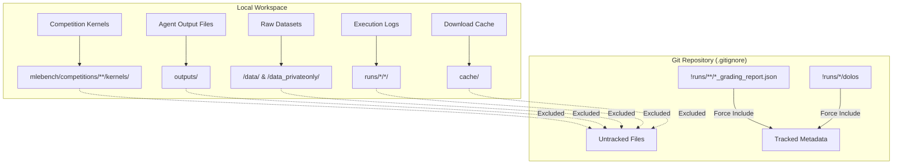
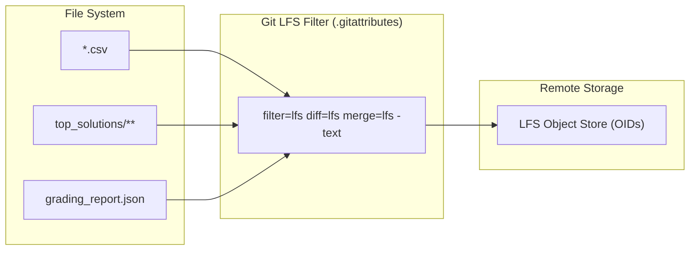

<!-- source: DeepWiki mcp.deepwiki.com · repo openai/mle-bench · page 9.1 Repository Configuration · fetched 2026-10-26 -->

# Repository Configuration

Relevant source files

The following files were used as context for generating this wiki page:

- [.gitattributes](.gitattributes)
- [.gitignore](.gitignore)
- [runs/thesis_group1/grading_report_group_1.json](runs/thesis_group1/grading_report_group_1.json)
- [runs/thesis_group2/grading_report_group_2.json](runs/thesis_group2/grading_report_group_2.json)
- [runs/thesis_group3/grading_report_group_3.json](runs/thesis_group3/grading_report_group_3.json)

This document covers the repository-level configuration files that control version control behavior, large file management, and environment exclusion patterns in MLE-bench. These configurations ensure that large datasets, temporary execution artifacts, and sensitive data are handled correctly across Git and Docker workflows.

## Git Configuration

The repository uses `.gitignore` and `.gitattributes` to manage which files are tracked, which are ignored, and how specific file types are handled by Git Large File Storage (LFS).

### Git Ignore Patterns

The `.gitignore` file separates persistent source code from ephemeral execution data. It specifically protects the repository from being bloated by competition datasets, agent outputs, and detailed execution logs.

**Natural Language to Code Entity Mapping: Git Exclusions**

The exclusion strategy is defined as follows:

| Category | Patterns | Purpose |
| :--- | :--- | :--- |
| **Data Storage** | `/data/`, `/data_privateonly/`, `cache/` | Prevents large competition datasets and downloaded Kaggle files from entering the repo [[.gitignore:4-5,17]](). |
| **Execution Artifacts** | `outputs/`, `mlebench/competitions/**/kernels/` | Excludes temporary code generated by agents and competition-specific kernels [[.gitignore:2-3]](). |
| **Run Logs** | `runs/*/*/` | Excludes deep subdirectories in `runs/` which contain verbose agent logs and intermediate files [[.gitignore:7]](). |
| **Selective Inclusion** | `!runs/**/*_grading_report.json`, `!runs/*/dolos` | Uses the `!` negation to ensure evaluation results and Dolos plagiarism reports are tracked even if their parent directories are ignored [[.gitignore:13-15]](). |

**Sources:** [.gitignore:1-18]()

### Git LFS Configuration

MLE-bench relies on Git LFS to track structured data files that are essential for evaluation but too large for standard Git delta compression. These include competition metadata, solution files, and grading reports.

**Data Flow: LFS Tracking via .gitattributes**

The `.gitattributes` file specifies that these files should be treated as binary blobs managed by the LFS filter rather than standard text files [[.gitattributes:1-4]]().

| Pattern | Targeted Content |
| :--- | :--- |
| `*.csv` | Competition datasets and submission templates [[.gitattributes:1]](). |
| `mlebench/competitions/*/top_solutions/**` | Reference solutions used for grading agent performance [[.gitattributes:2]](). |
| `runs/**/*.json` | Grading reports and run metadata (e.g., `grading_report_group_1.json`) [[.gitattributes:3]](). |
| `runs/**/*.jsonl` | Line-delimited JSON logs from agent executions [[.gitattributes:4]](). |

**Sources:** [.gitattributes:1-4](), [runs/thesis_group1/grading_report_group_1.json:1-2]()

## Docker Build Configuration

The `.dockerignore` file optimizes the Docker build process by preventing large or unnecessary files from being sent to the Docker daemon as part of the build context. This is critical for the `mlebench-env` base image and individual agent images.

| Pattern | Reason for Exclusion |
| :--- | :--- |
| `/data/` | Datasets are mounted as volumes at runtime; including them in the image would cause massive image sizes. |
| `/*runs/` | Prevents existing evaluation logs from being baked into new agent images. |
| `/runs*/` | Broad pattern to exclude any directory starting with "runs". |

This configuration ensures that the `docker build` command remains fast and that images contain only the necessary library code and configuration files.

## Python and Environment Defaults

The repository follows standard Python conventions for ignoring environment-specific files and build artifacts:

*   **Bytecode**: `__pycache__/`, `*.py[cod]` [[.gitignore:24-25]]().
*   **Virtual Envs**: `.venv`, `env/`, `venv/` [[.gitignore:128-130]]().
*   **Distribution**: `dist/`, `build/`, `*.egg-info/` [[.gitignore:33,35,47]]().
*   **Testing**: `.pytest_cache/`, `.coverage`, `htmlcov/` [[.gitignore:63,66,74]]().
*   **IDE/OS**: `.DS_Store`, `.vscode/`, `.idea/` [[.gitignore:21]]().

**Sources:** [.gitignore:20-152]()

---

