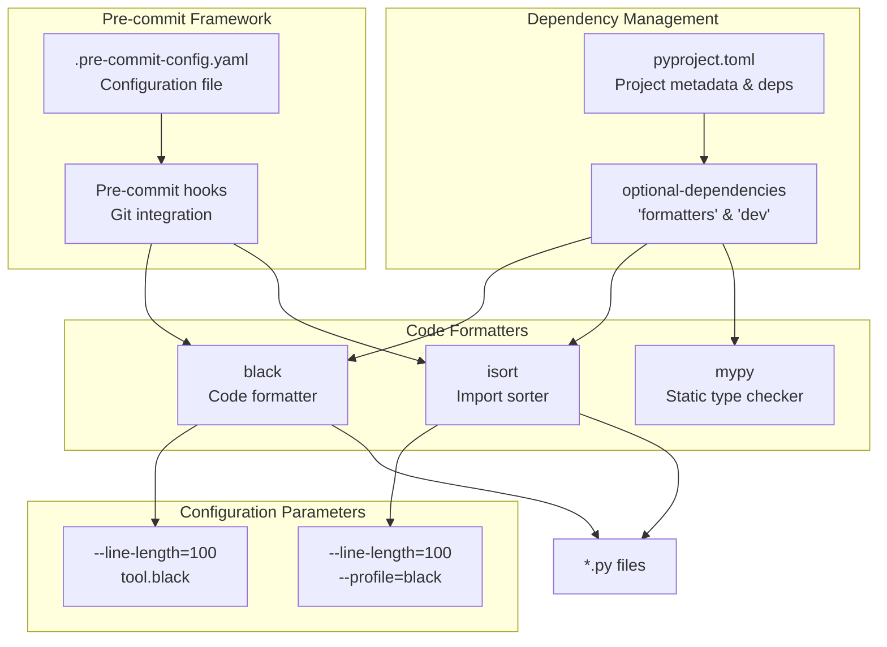
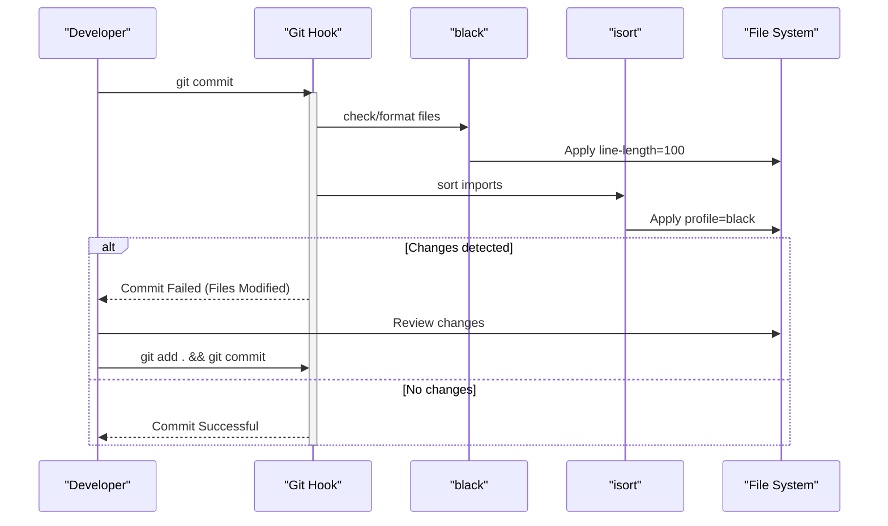

<!-- source: DeepWiki mcp.deepwiki.com · repo openai/mle-bench · page 9.2 Code Quality and Pre-commit Hooks · fetched 2026-10-26 -->

# Code Quality and Pre-commit Hooks

Relevant source files

The following files were used as context for generating this wiki page:

- [.github/PULL_REQUEST_TEMPLATE.md](.github/PULL_REQUEST_TEMPLATE.md)
- [pyproject.toml](pyproject.toml)

This document covers the automated code formatting and quality enforcement tools used in the MLE-bench repository. It documents the pre-commit hook configuration, code formatters, and import sorting tools that maintain consistent code style across the codebase.

For information about repository configuration and Git setup, see [9.1 Repository Configuration](). For details about project governance and security policies, see [9.4 Security and License]().

## Overview

MLE-bench uses a standardized code quality system built around pre-commit hooks to automatically format Python code and organize imports. This system ensures consistent code style across all contributions and reduces manual code review overhead for formatting issues. The project dependencies and tool configurations are managed via `pyproject.toml`.

### Code Quality Tools Architecture

Sources: [pyproject.toml:42-51](), [.pre-commit-config.yaml:1-15]()

## Dependency Specification

The development environment is defined in `pyproject.toml`. Formatting and quality tools are categorized into optional dependency groups to allow for lean installations in production (e.g., inside Docker containers) while providing full toolsets for developers.

| Group | Dependencies | Purpose |
|-------|--------------|---------|
| `formatters` | `black>=23.3`, `isort>=5.13` | Basic code styling tools |
| `dev` | `pytest>=8.2`, `mypy>=1.10`, `pre-commit>=3.7` | Full development and testing suite |

Sources: [pyproject.toml:42-44]()

## Pre-commit Configuration

The pre-commit hook system is configured through the `.pre-commit-config.yaml` file, which defines the primary repositories for code quality enforcement.

### Black Code Formatter

The Black formatter is configured to enforce consistent Python code formatting. The project standardizes on a 100-character line length, which is synchronized between the pre-commit configuration and the project metadata.

| Parameter | Value | Source |
|-----------|-------|--------|
| Repository | `https://github.com/psf/black` | [.pre-commit-config.yaml:2]() |
| Version | `22.8.0` | [.pre-commit-config.yaml:3]() |
| Line Length | `100` | [pyproject.toml:50](), [.pre-commit-config.yaml:5]() |

The `[tool.black]` section in `pyproject.toml` ensures that manual execution of `black .` matches the behavior of the pre-commit hook [pyproject.toml:49-50]().

### isort Import Sorter

The `isort` tool organizes Python imports consistently. It is configured to be compatible with Black's formatting style.

| Parameter | Value | Purpose |
|-----------|-------|---------|
| Repository | `https://github.com/pycqa/isort` | Official isort repository |
| Version | `5.12.0` | Pinned version for reproducibility |
| Profile | `black` | Ensures compatibility with Black formatter |

The isort configuration is defined in [.pre-commit-config.yaml:10-14](), using custom arguments to match the 100-character line limit.

### Selective isort Control

The configuration allows developers to bypass sorting for specific blocks where manual ordering is required for functional reasons (e.g., specific initialization orders):
- `# isort: off` - Disable isort for subsequent lines
- `# isort: on` - Re-enable isort for subsequent lines

Sources: [.pre-commit-config.yaml:8-9]()

## Development Workflow Integration

The following diagram illustrates how the code quality tools interact with the developer's Git workflow.

Sources: [.pre-commit-config.yaml:1-15](), [pyproject.toml:49-51]()

## Pull Request Requirements

Beyond automated formatting, the repository enforces quality and integrity via the `PULL_REQUEST_TEMPLATE.md`. Specifically for leaderboard submissions, contributors must verify that their agent scaffold does not leak signals from the held-out test set.

- **Leaderboard Submission Disclosure**: PRs updating the leaderboard must confirm that the harness does not expose signals derived from held-out test sets during rollouts [.github/PULL_REQUEST_TEMPLATE.md:1-5]().

## Tool Coordination

Both Black and isort are configured with identical line length settings (`100` characters) to ensure consistent formatting. The isort profile is explicitly set to `black` to prevent conflicts between the two tools' formatting decisions.

The tools run in sequence during pre-commit execution, with Black handling general code formatting and isort specifically managing import organization.

### Version Pinning

Both tools use pinned versions in `.pre-commit-config.yaml` (`22.8.0` for Black, `5.12.0` for isort) and minimum versions in `pyproject.toml` (`black>=23.3`, `isort>=5.13`), ensuring reproducible formatting behavior across different development environments and over time [.pre-commit-config.yaml:3-11](), [pyproject.toml:43]().

Sources: [.pre-commit-config.yaml:1-15](), [pyproject.toml:42-51]()

---

