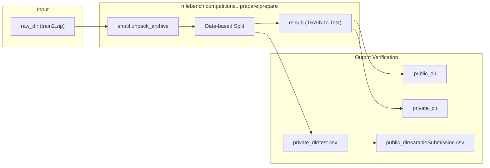

<!-- source: DeepWiki mcp.deepwiki.com · repo openai/mle-bench · page 9.3 Testing Infrastructure · fetched 2026-10-26 -->

# Testing Infrastructure

<details>
<summary>Relevant source files</summary>

The following files were used as context for generating this wiki page:

- [mlebench/cli.py](mlebench/cli.py)
- [mlebench/competitions/the-icml-2013-whale-challenge-right-whale-redux/prepare.py](mlebench/competitions/the-icml-2013-whale-challenge-right-whale-redux/prepare.py)
- [mlebench/registry.py](mlebench/registry.py)
- [pyproject.toml](pyproject.toml)

</details>


The MLE-bench testing infrastructure ensures the reliability of the benchmarking pipeline, covering everything from competition data preparation to the accuracy of the grading logic. The suite is built on `pytest` and is designed to validate the core components of the system before running expensive agent evaluations.

## Overview of Test Suite

The test suite is located in the `tests/` directory and is configured via `pyproject.toml`. Because MLE-bench can download large amounts of competition data, the test configuration is optimized to prevent slow test collection by explicitly defining the test paths.

| Component | Test Responsibility |
| :--- | :--- |
| **Data Utilities** | Validates checksum verification, dataset unzipping, and directory structures. |
| **Registry** | Ensures competition configurations (`config.yaml`) are correctly parsed into `Competition` objects. |
| **Grading Logic** | Tests `mlebench grade` and `mlebench grade-sample` against known gold submissions. |
| **Preparation Functions** | Validates custom `prepare.py` scripts for individual competitions. |

**Sources:**
- [pyproject.toml:52-57]()
- [mlebench/registry.py:16-48]()

## Test Configuration and Execution

MLE-bench uses `pytest` as its primary testing framework. Developers should install the development dependencies to run the full suite.

### Local Execution
To run the tests locally, use the following commands:
```bash
# Install dev dependencies
pip install -e ".[dev]"

# Run all tests
pytest

# Run a specific test file
pytest tests/test_registry.py
```

### Pytest Settings
The `pyproject.toml` file includes specific configurations to handle the scale of the repository. Specifically, it limits test discovery to the `tests/` directory to avoid recursing into large data directories created by Kaggle downloads.

**Sources:**
- [pyproject.toml:44-44]()
- [pyproject.toml:52-57]()

## Integration Tests: Competition Grading

Integration tests verify the end-to-end flow of the grading system. This involves taking a `gold_submission` (the ground truth provided in the competition config) and passing it through the `Grader` class to ensure it achieves a perfect or expected score.

### Grading Data Flow
The diagram below illustrates how the testing infrastructure validates the grading pipeline using the `Registry` and `Grader` entities.

**Grading Validation Logic**
```mermaid
graph TD
    subgraph "Natural Language Space"
        User["Developer/Tester"]
        CompID["Competition ID (e.g., titanic)"]
    end

    subgraph "Code Entity Space"
        CLI["mlebench.cli:main"]
        Reg["mlebench.registry:Registry"]
        CompObj["mlebench.registry:Competition"]
        GradeFn["mlebench.grade:grade_csv"]
        GraderObj["mlebench.grade_helpers:Grader"]
    end

    User -->| "mlebench grade-sample" | CLI
    CLI -->| "get_competition(id)" | Reg
    Reg -->| "loads config.yaml" | CompObj
    CompObj -->| "contains" | GraderObj
    CLI -->| "calls" | GradeFn
    GradeFn -->| "uses" | GraderObj
    GradeFn -->| "returns" | Report["Grading Report"]
end
```

**Sources:**
- [mlebench/registry.py:74-116]()
- [mlebench/cli.py:108-128]()
- [mlebench/cli.py:197-201]()

## Unit Tests: Data Preparation

Every competition in MLE-bench has a `prepare_fn` that handles splitting raw Kaggle data into public and private sets. The testing infrastructure validates these functions by ensuring they produce the correct file structures and mandatory files (e.g., `test.csv` and `sampleSubmission.csv`).

### Implementation Example: Whale Challenge
The preparation logic for `the-icml-2013-whale-challenge-right-whale-redux` is a typical target for unit testing. It must correctly handle ZIP extraction, filename regex substitution, and CSV generation.

**Preparation Logic Diagram**


**Sources:**
- [mlebench/competitions/the-icml-2013-whale-challenge-right-whale-redux/prepare.py:9-12]()
- [mlebench/competitions/the-icml-2013-whale-challenge-right-whale-redux/prepare.py:44-59]()
- [mlebench/competitions/the-icml-2013-whale-challenge-right-whale-redux/prepare.py:81-88]()

## Registry and Configuration Validation

The `Registry` class is tested to ensure it correctly maps competition IDs to their respective files on disk. Key assertions in the `Competition` dataclass `__post_init__` method act as runtime tests to prevent malformed competition metadata from entering the system.

| Field Validated | Type | Assertion Check |
| :--- | :--- | :--- |
| `id` | `str` | Non-empty string |
| `grader` | `Grader` | Instance of `Grader` class |
| `answers` | `Path` | Valid filesystem path |
| `prepare_fn` | `Callable` | Importable function |

**Sources:**
- [mlebench/registry.py:33-47]()
- [mlebench/registry.py:81-90]()

---

