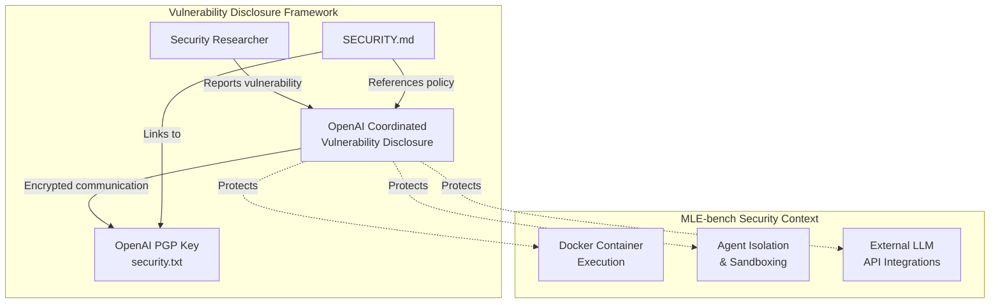
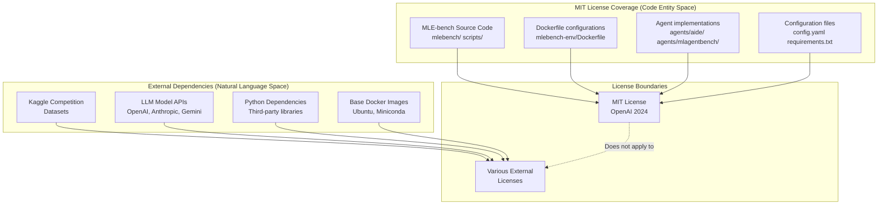

<!-- source: DeepWiki mcp.deepwiki.com · repo openai/mle-bench · page 9.4 Security and License · fetched 2026-10-26 -->

# Security and License

Relevant source files

The following files were used as context for generating this wiki page:

- [.github/PULL_REQUEST_TEMPLATE.md](.github/PULL_REQUEST_TEMPLATE.md)
- [README.md](README.md)

This document covers the security policies, vulnerability disclosure procedures, and licensing terms that govern the MLE-bench system. It provides essential information for developers, contributors, and users regarding legal compliance and security reporting.

## Security Policy

MLE-bench follows OpenAI's established security practices and vulnerability disclosure procedures. The project maintains a formal security policy that governs how security issues should be reported and handled.

### Vulnerability Disclosure Process

The project follows OpenAI's Coordinated Vulnerability Disclosure Policy for handling security vulnerabilities. This policy outlines the procedures for security researchers and users to report potential security issues responsibly.

**Vulnerability Disclosure Framework**

Sources: [SECURITY.md:1-5]()

### Security Contact Information

Security issues should be reported through OpenAI's official channels:

- **Policy Details**: OpenAI's Coordinated Vulnerability Disclosure Policy provides comprehensive guidance on the disclosure process [SECURITY.md:2-2]().
- **PGP Encryption**: OpenAI maintains a PGP key for secure communication of security issues [SECURITY.md:4-4]().
- **Contact Method**: The security contact information and PGP key are maintained at OpenAI's `security.txt` endpoint [SECURITY.md:3-3]().

Sources: [SECURITY.md:1-5]()

## License Information

MLE-bench is distributed under the MIT License, providing broad permissions for use, modification, and distribution while maintaining appropriate copyright attribution requirements.

### MIT License Terms

The project uses the standard MIT License with copyright held by OpenAI (2024). This license grants the following permissions:

| Permission | Description |
|------------|-------------|
| **Use** | Use the software for any purpose |
| **Modify** | Modify the source code |
| **Distribute** | Distribute copies of the software |
| **Sublicense** | Include in projects under different licenses |
| **Sell** | Use in commercial applications |

The license requires:
- **Copyright Notice**: Include the original copyright notice in all copies [LICENSE:13-14]().
- **License Notice**: Include the MIT license text in substantial portions [LICENSE:13-14]().

Sources: [LICENSE:1-21]()

### Scope and Limitations

The MIT License applies specifically to the MLE-bench codebase but has important limitations regarding external dependencies and data.

**License Boundary Mapping**

**Important Note**: The license explicitly states that it applies to the code in the repository but not to external datasets and files that may be downloaded while using the package [LICENSE:23-24]().

Sources: [LICENSE:1-24]()

## Leaderboard Submission Security

When submitting results to the leaderboard, users must adhere to strict integrity requirements to ensure evaluations are fair and comparable.

### Disclosure Requirements
As part of the submission process, contributors must verify that their agent scaffold or harness does not expose signals derived from the held-out test set during rollouts [.github/PULL_REQUEST_TEMPLATE.md:4-4](). This is critical for maintaining the security and validity of the benchmark results.

### Leaderboard Integrity
OpenAI monitors submissions to ensure they are fair. As of April 2026, the leaderboard process is being improved to ensure submissions remain comparable and secure [README.md:6-6]().

Sources: [README.md:6-6](), [.github/PULL_REQUEST_TEMPLATE.md:1-5]()

## Security Considerations in System Architecture

The MLE-bench system includes several security-relevant components that users and developers should be aware of.

### Container Security Model
The system uses Docker containers to isolate agent execution. While the core codebase is MIT licensed, the security of the execution environment depends on the underlying Docker configuration and the specific agent's requirements (e.g., some agents like OpenHands may require privileged mode for Docker-in-Docker functionality).

### Agent Execution Security
Each agent operates within defined security boundaries:

| Security Aspect | Implementation |
|-----------------|----------------|
| **File System Access** | Limited to directories like `SUBMISSION_DIR` and `LOGS_DIR`. |
| **Network Access** | Required for external LLM APIs (e.g., Gemini, GPT-4o, Claude) [README.md:10-37](). |
| **Process Isolation** | Provided by Docker containerization. |
| **Resource Limits** | Managed via Docker-imposed constraints during `run_agent.py` execution. |

Sources: [README.md:1-68](), [SECURITY.md:1-5](), [LICENSE:1-24]()

---

