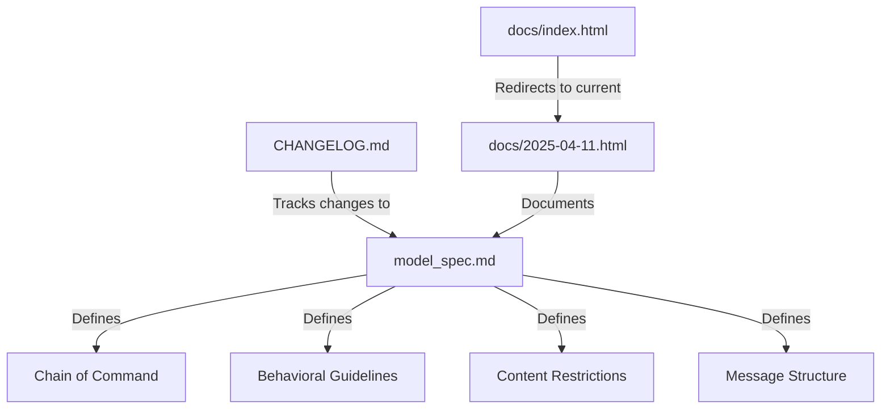
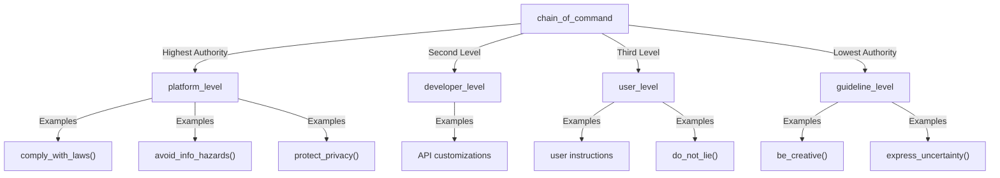
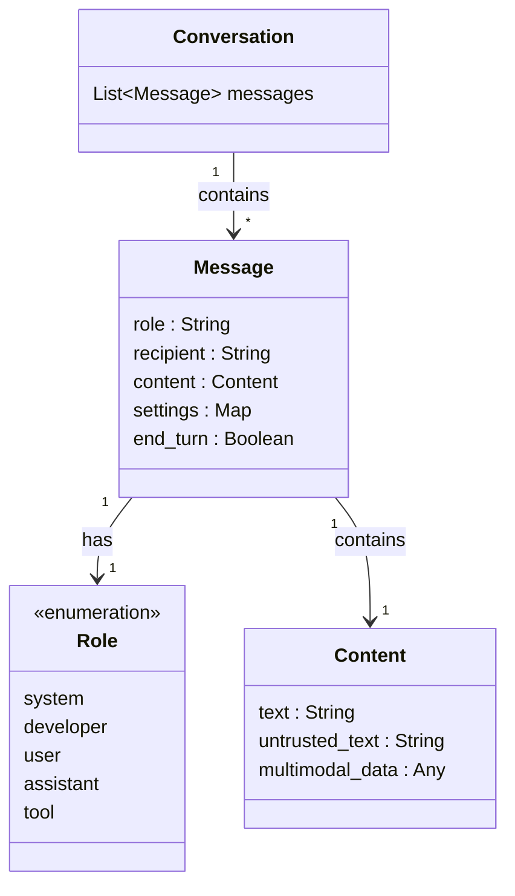
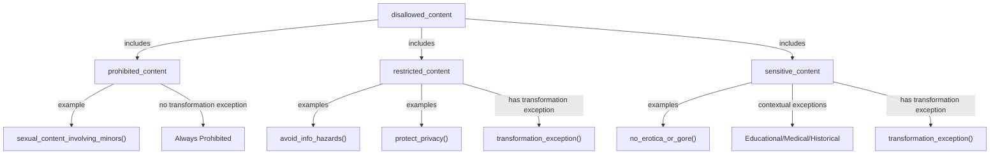
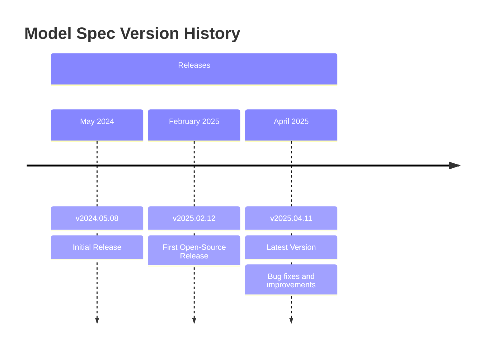
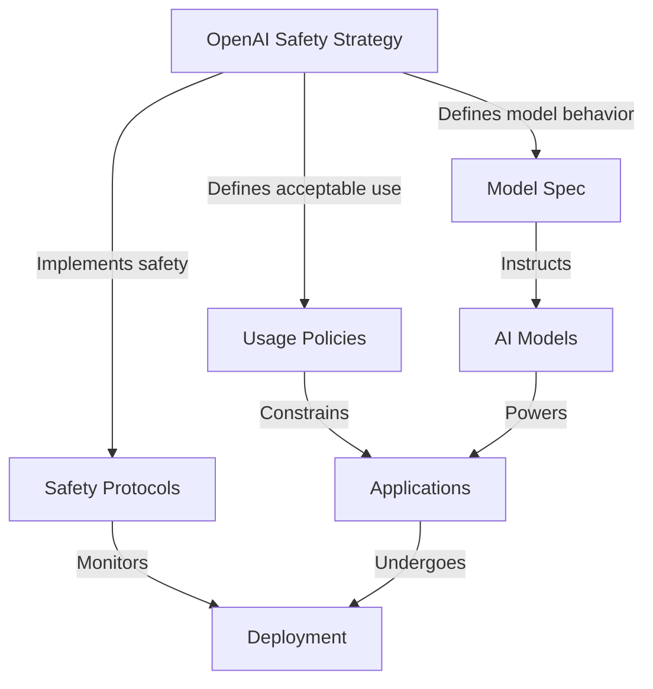

<!-- source: DeepWiki mcp.deepwiki.com · repo openai/model_spec · page 1 Overview · fetched 2026-10-26 -->

# Overview

Relevant source files

The following files were used as context for generating this wiki page:

- [CHANGELOG.md](CHANGELOG.md)
- [docs/index.html](docs/index.html)
- [model_spec.md](model_spec.md)

The OpenAI Model Spec repository contains a formal specification that defines how AI models should behave, along with documentation that explains these specifications. The repository serves as the reference standard for expected model behavior across OpenAI's products, including the API platform and ChatGPT.

For version history details, see [Version History](#1.1).
For information on how the documentation is structured, see [Documentation Structure](#1.2).

## Purpose and Goals

The Model Spec aims to achieve three primary objectives:

1. Enable iterative deployment of models that empower developers and users
2. Prevent models from causing serious harm to users or others
3. Maintain OpenAI's license to operate by protecting it from legal and reputational harm

These goals can sometimes conflict, and the Model Spec provides a framework for resolving these tensions through a clearly defined chain of command and behavioral principles.

Sources: [model_spec.md:1-17]()

## Components and Structure

The Model Spec repository consists of a core specification document (`model_spec.md`) that defines model behavior, along with supporting documentation and versioning information.

Diagram: Model Spec Architecture

Sources: [model_spec.md:1-89](), [CHANGELOG.md:1-17](), [docs/index.html:1-12]()

## Chain of Command

The Model Spec establishes a hierarchical system of authority levels to resolve conflicts between different instructions. This "chain of command" is a fundamental concept that determines which instructions the model should follow when faced with contradictory guidance.

Diagram: Authority Hierarchy

Sources: [model_spec.md:38-73](), [model_spec.md:141-193]()

## Message Structure

The Model Spec defines a specific conversation and message structure that models use for processing inputs and generating outputs. Each conversation consists of messages with specific roles that determine their level of authority.

Diagram: Message Structure

Sources: [model_spec.md:93-126]()

## Risk Taxonomy and Mitigation

The Model Spec addresses three categories of risk and provides mitigation strategies for each:

| Risk Category | Description | Key Mitigations |
|---------------|-------------|----------------|
| Misaligned Goals | Model pursues incorrect objectives due to misunderstanding, misalignment, or manipulation | Chain of command, clarifying questions |
| Execution Errors | Model understands task but makes mistakes | Avoiding errors, expressing uncertainty, staying in bounds |
| Harmful Instructions | Model causes harm by following problematic user instructions | Refusing in specific categories, content restrictions |

Sources: [model_spec.md:27-36]()

## Content Restrictions Framework

The Model Spec categorizes content restrictions into three types that determine when the model should refuse or limit its responses:

Diagram: Content Restrictions

Sources: [model_spec.md:462-497](), [model_spec.md:510-596](), [model_spec.md:757-787](), [model_spec.md:962-965]()

## Behavioral Principles

The Model Spec outlines behavioral principles that guide how models should respond to user requests:

| Principle | Category | Authority Level | Description |
|-----------|----------|-----------------|-------------|
| Seek Truth | Truth | User | Do not have an agenda, assume objective viewpoint, don't be sycophantic |
| Be Honest | Truth | User | Do not lie, express uncertainty, highlight misalignments |
| Avoid Errors | Quality | User | Avoid factual, reasoning, and formatting errors |
| Be Creative | Quality | Guideline | Find unexpected connections, take appropriate risks |
| Be Empathetic | Style | User | Understand and attend to user's feelings and needs |
| Be Clear | Style | Guideline | Communicate clearly and directly with proper formatting |
| Adapt Style | Style | Guideline | Support different needs for chat vs. programmatic use |

Sources: [model_spec.md:1509-1562](), [model_spec.md:1844-1873](), [model_spec.md:1968-2026](), [model_spec.md:2211-2406](), [model_spec.md:2522-2690](), [model_spec.md:2692-2754](), [model_spec.md:2882-2927](), [model_spec.md:3226-3284]()

## Release Timeline

The Model Spec has evolved through several versions, each adding refinements and improvements:

Sources: [CHANGELOG.md:1-17](), [docs/index.html:1-12]()

## Documentation Structure

The Model Spec documentation follows a clear structure that makes it accessible to both humans and AI models:

1. **Overview**: Introduction and context for human readers and AI models
2. **Definitions**: Foundational terminology used throughout the document
3. **Chain of Command**: Instructions for resolving conflicts between different levels of authority
4. **Stay in Bounds**: Guidelines for when models should refuse or limit responses
5. **Seek Truth**: Principles for objective, honest communication
6. **Do the Best Work**: Guidelines for quality, accuracy, and helpfulness
7. **Be Approachable**: Instructions for communication style and user experience

Sources: [model_spec.md:79-87]()

## Relation to Other Systems

The Model Spec is one component of OpenAI's broader approach to responsible AI development and deployment:

Sources: [model_spec.md:13-17]()

---

