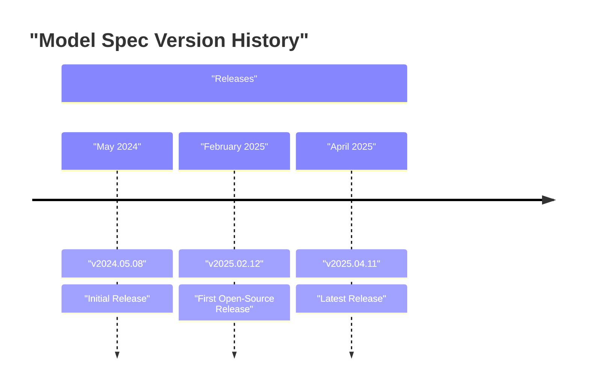
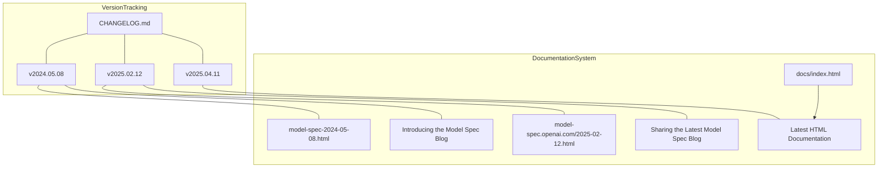
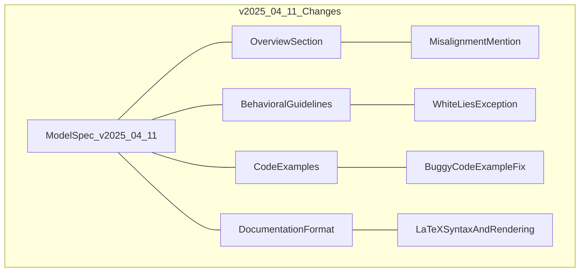
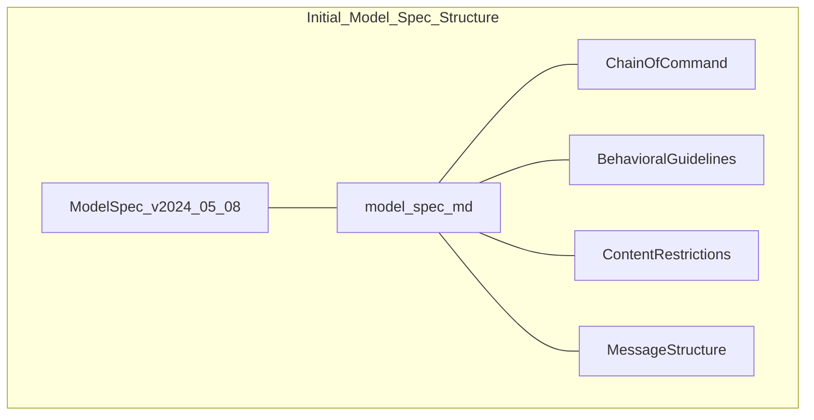

<!-- source: DeepWiki mcp.deepwiki.com · repo openai/model_spec · page 1.1 Version History · fetched 2026-10-26 -->

# Version History

Relevant source files

The following files were used as context for generating this wiki page:

- [CHANGELOG.md](CHANGELOG.md)
- [docs/2025-04-11.html](docs/2025-04-11.html)

## Purpose and Scope
This page documents the chronological evolution of the OpenAI Model Spec, tracking all major releases and significant changes since its initial release. It serves as a historical record of how the specification has developed and matured over time.

For information about how the documentation itself is structured and accessed, see [Documentation Structure](#1.2).

## Release Timeline

Sources: [CHANGELOG.md:3-17]()

## Documentation and Version Control

The following diagram illustrates how versions are tracked in the repository and how they relate to external documentation:

Sources: [CHANGELOG.md:3-17]()

## Major Releases

### v2025.04.11 (Latest Release)

Released in April 2025, this version focused on bug fixes and improvements:

1. Fixed an issue in the overview where misalignment was no longer mentioned as a possible reason for the assistant pursuing wrong goals
2. Narrowed the exception for "white lies" to the intended meaning of "pleasantries" 
3. Fixed a bug in the example "Transforming buggy code in an interactive chat"
4. Fixed LaTeX syntax in examples and added LaTeX rendering to the HTML version

Sources: [CHANGELOG.md:3-10]()

### v2025.02.12 (First Open-Source Release)

Released in February 2025, this marked the first open-source release of the Model Spec, making the specification available to the wider community. The release was accompanied by:
- A blog post: "Sharing the Latest Model Spec"
- HTML documentation available at the OpenAI Model Spec website

This release represented a significant milestone by making the Model Spec accessible to the broader developer community for the first time.

Sources: [CHANGELOG.md:11-13]()

### v2024.05.08 (Initial Release)

Released in May 2024, this was the first public release of the Model Spec. It established the foundational framework for defining AI model behavior according to OpenAI's standards.

The initial release introduced all the core components of the Model Spec:
- Chain of Command hierarchy
- Behavioral Guidelines
- Content Restrictions
- Message Structure specifications

The release was accompanied by:
- A blog post: "Introducing the Model Spec"
- HTML documentation

Sources: [CHANGELOG.md:15-17]()

## Component Change History

The following table summarizes which components of the Model Spec changed in each release:

| Component | v2024.05.08 | v2025.02.12 | v2025.04.11 |
|-----------|-------------|-------------|-------------|
| Chain of Command | Initial version | No significant changes | No significant changes |
| Behavioral Guidelines | Initial version | No significant changes | Updated misalignment references; Narrowed "white lies" exception |
| Content Restrictions | Initial version | No significant changes | No significant changes |
| Message Structure | Initial version | No significant changes | No significant changes |
| Examples | Initial examples | No significant changes | Fixed buggy code example; Fixed LaTeX syntax |
| Documentation Format | HTML version | Open-source HTML version | Added LaTeX rendering to HTML |

Sources: [CHANGELOG.md:3-17]()

---

