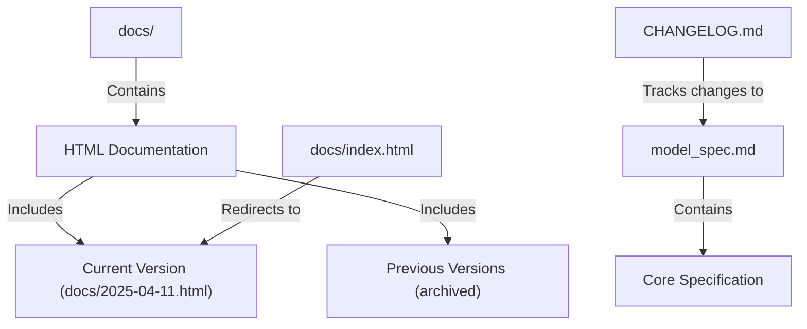
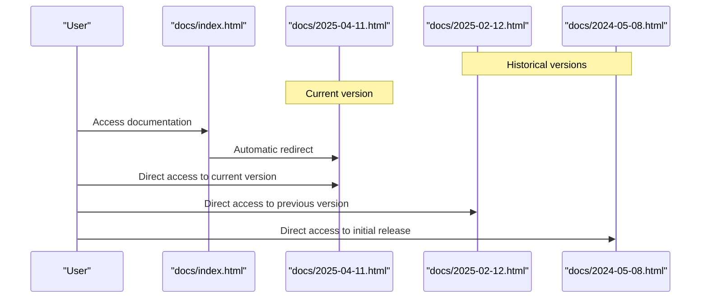
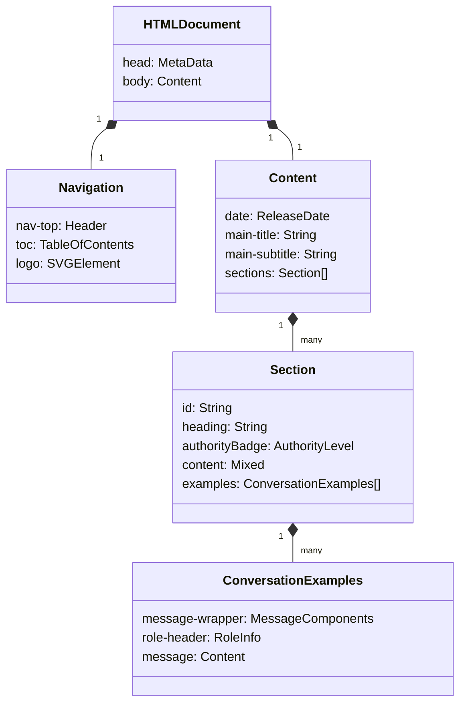
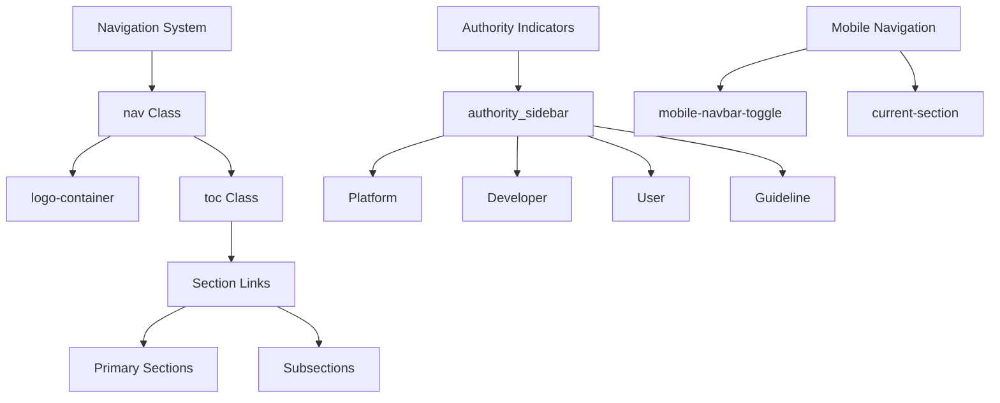
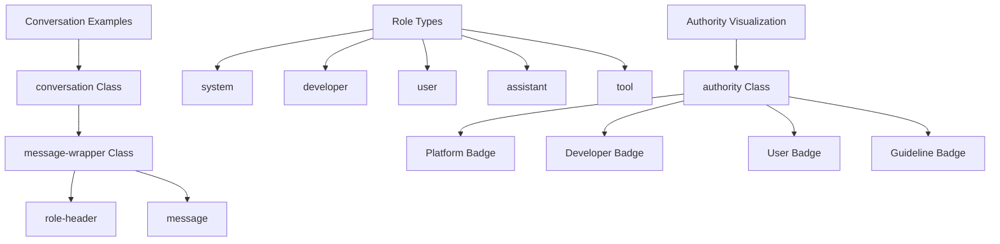
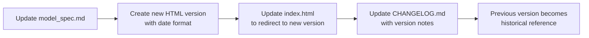

<!-- source: DeepWiki mcp.deepwiki.com · repo openai/model_spec · page 1.2 Documentation Structure · fetched 2026-10-26 -->

# Documentation Structure

Relevant source files

The following files were used as context for generating this wiki page:

- [docs/2025-04-11.html](docs/2025-04-11.html)
- [docs/index.html](docs/index.html)

This page explains how the OpenAI Model Spec documentation is organized, versioned, and accessed. It covers the documentation file structure, versioning conventions, navigation system, and the relationship between source files and rendered content. For information about the content of the Model Spec itself, see [Core Specification](#2).

## Documentation Components and File Structure

The Model Spec documentation consists of several key components organized in a specific file structure:

The documentation system follows a clear separation between the source specification and its rendered HTML counterparts. The HTML files provide a user-friendly interface for accessing the Model Spec content with navigation features, styling, and structural organization.

Sources: [docs/2025-04-11.html:1-1634](), [docs/index.html:1-12]()

## Versioning and Access Mechanism

The Model Spec documentation uses a date-based versioning system, with HTML files named according to their release date:

The `index.html` file contains a simple meta-refresh directive that automatically redirects users to the current version. This ensures users always see the most up-to-date documentation by default while preserving access to historical versions.

Sources: [docs/index.html:5](), [docs/2025-04-11.html:1615-1620]()

## HTML Structure and Components

The HTML documentation follows a structured format with several key components that form the complete user interface:

Each HTML document is organized with a consistent structure that includes metadata, navigation components, and content sections. The document uses CSS classes to define styling and behavior for different elements, with responsive design considerations for both desktop and mobile viewing.

Sources: [docs/2025-04-11.html:1-210](), [docs/2025-04-11.html:710-853]()

## Navigation System

The documentation implements a comprehensive navigation system that allows users to easily locate and access specific sections:

The navigation system uses a hierarchical structure with an ordered list (`ol`) containing links to each section and subsection. Authority levels are indicated with badges next to section titles, providing visual cues about the priority of different instructions in the Model Spec.

Sources: [docs/2025-04-11.html:710-853](), [docs/2025-04-11.html:1210-1610]()

## Content Rendering and Example Formatting

The documentation uses specialized formatting for rendering different types of content, particularly for example conversations:

Example conversations are rendered using a structured format that distinguishes between different roles (system, developer, user, assistant, and tool). Each message includes role information, content, and sometimes quality indicators or commentary.

Sources: [docs/2025-04-11.html:247-608](), [docs/2025-04-11.html:1732-1763]()

## Responsive Design System

The HTML documentation implements a responsive design system that adapts to different screen sizes and devices:

| Viewport Width | Layout Adjustments | CSS Media Query |
|----------------|-------------------|----------------|
| ≥ 1536px | Wider layout with left padding (230px) | `@media (min-width: 1536px)` |
| 1280px - 1536px | Medium layout with left padding (370px) | `@media (min-width: 1280px) and (max-width: 1536px)` |
| ≥ 1280px | Fixed navigation sidebar | `@media (min-width: 1280px)` |
| < 1280px | Collapsible navigation, simplified headings | `@media (max-width: 1279px)` |

The responsive design ensures that the documentation is accessible and readable across desktop computers, tablets, and mobile devices, with optimized layouts for each context.

Sources: [docs/2025-04-11.html:773-1173]()

## Styling and Typography

The documentation uses a consistent styling system for text elements, with specific typography rules applied to different content types:

| Element | Font Size | Line Height | Font Weight | CSS Class |
|---------|-----------|-------------|------------|-----------|
| Headings (h1) | 48px (desktop) | 1.16 | 500 | - |
| Headings (h2) | 30px (desktop) | 1.32 | 500 | - |
| Paragraph text | 17px | 28px | 400 | - |
| Code blocks | 14px | - | - | `code-block` |
| Messages | 16px | 1.6 | - | `message .text` |
| Authority badges | 14px | - | 500 | `authority` |

The styling creates a clear visual hierarchy that helps users navigate the documentation and understand the relationships between different content sections.

Sources: [docs/2025-04-11.html:29-171]()

## Implementation Details

The documentation structure implements several technical features that enhance functionality:

1. **Automatic section highlighting**: Current sections in view are highlighted in the table of contents using the `.in-view` class
2. **Collapsible subsections**: Child lists are hidden by default and shown when parent sections are active
3. **MathJax integration**: Mathematical notation is supported through MathJax library integration 
4. **Code syntax highlighting**: Code blocks use Prism.js for syntax highlighting

These technical implementations create an interactive documentation experience while maintaining accessibility and readability.

Sources: [docs/2025-04-11.html:1192-1207](), [docs/2025-04-11.html:834-852]()

## Versioning Workflow

The documentation versioning process follows a specific workflow when releasing new versions:

This workflow ensures that the documentation remains up-to-date while preserving the history of changes and allowing users to reference previous versions if needed.

Sources: [docs/index.html:5](), [docs/2025-04-11.html:1615]()

---

