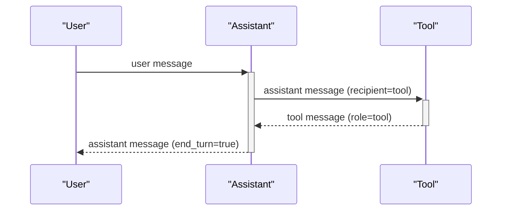
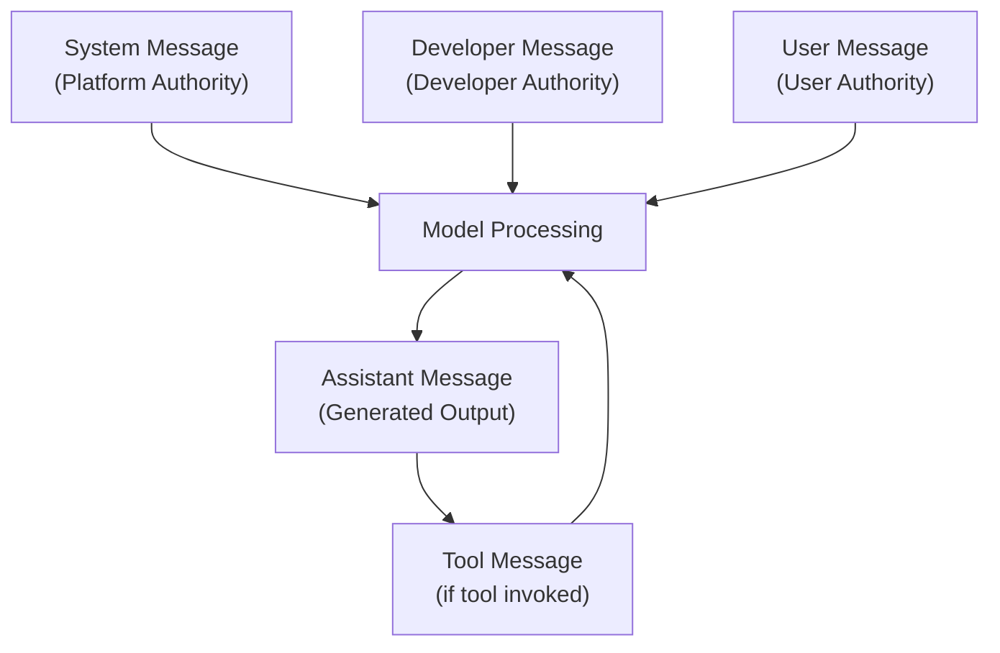

<!-- source: DeepWiki mcp.deepwiki.com · repo openai/model_spec · page 2.2 Message Structure · fetched 2026-10-26 -->

# Message Structure

<details>
<summary>Relevant source files</summary>

The following files were used as context for generating this wiki page:

- [model_spec.md](model_spec.md)

</details>


This document details the conversation and message format specifications used in OpenAI's models. It explains how inputs are structured for the model and how outputs are formatted, including the roles, content structure, settings, and other components that make up a valid conversation. For information about the hierarchy of authority in messages, see [Chain of Command](#2.1).

Sources: [model_spec.md:89-137]()

## Conversation Overview

A conversation is the fundamental unit of input to OpenAI's models. Each conversation consists of a list of messages from different participants (system, developer, user, assistant, and tool). The structure of these messages, their roles, and how they interact is essential for understanding how to communicate effectively with the models.

```mermaid
classDiagram
    class "Conversation" {
        List~Message~ messages
    }
    
    class "Message" {
        role : String
        recipient : String
        content : Content
        settings : Map
        end_turn : Boolean
    }
    
    class "Role" {
        <<enumeration>>
        system
        developer
        user
        assistant
        tool
    }
    
    "Conversation" "1" --> "*" "Message" : contains
    "Message" "1" --> "1" "Role" : has
```

Diagram: Conversation and Message Structure

Sources: [model_spec.md:97-111]()

## Message Components

Each message in a conversation contains several fields that determine how it's processed and interpreted by the model.

### Role

The `role` field is required and specifies the source of each message. This determines the authority level of any instructions contained within the message:

| Role | Description | Authority Level |
|------|-------------|----------------|
| system | Messages added by OpenAI | Platform |
| developer | From the application developer | Developer |
| user | Input from end users or catch-all for data | User |
| assistant | Generated by the language model | None |
| tool | Generated by programs, APIs, or code execution | None |

Sources: [model_spec.md:99-104]()

### Recipient

The `recipient` field is optional and controls how the message is handled by the application. It can be:

- The name of a function being called (`recipient=functions.foo`)
- The name of a tool (e.g., `recipient=browser`)

When the assistant wants to call a tool, it generates a message with the `recipient` field set to the name of the tool.

Sources: [model_spec.md:105]()

### Content

The `content` field is required and contains the actual data of the message. It can be:

- A sequence of text
- Untrusted text
- Multimodal data chunks (e.g., images or audio)

```mermaid
classDiagram
    class "Content" {
        List~ContentChunk~ chunks
    }
    
    class "ContentChunk" {
        <<interface>>
        type : String
    }
    
    class "TextChunk" {
        value : String
    }
    
    class "UntrustedTextChunk" {
        value : String
    }
    
    class "MultimodalDataChunk" {
        data : Bytes
        mimeType : String
    }
    
    "Content" "1" --> "*" "ContentChunk" : contains
    "ContentChunk" <|-- "TextChunk"
    "ContentChunk" <|-- "UntrustedTextChunk"
    "ContentChunk" <|-- "MultimodalDataChunk"
```

Diagram: Content Structure

Sources: [model_spec.md:106]()

### Settings

The `settings` field is optional and contains key-value pairs that update the model's settings. It can only be included in system or developer messages. Current supported settings include:

- `max_tokens`: integer controlling the maximum number of tokens the model can generate in subsequent messages

Sources: [model_spec.md:107-109]()

### End Turn

The `end_turn` field is required for assistant messages and indicates whether the assistant would like to stop taking actions and yield control back to the application. When set to `true`, the conversation typically returns to the user for the next input.

Sources: [model_spec.md:110]()

## Message Format Example

Messages are rendered in the Model Spec using XML-like syntax. Here's an example:

```
<assistant recipient="python" end_turn="false">
import this
</assistant>
```

This represents:
- `role=assistant`
- `recipient=python`
- `content="import this"`
- Empty `settings`
- `end_turn="false"`

Sources: [model_spec.md:111-119]()

## Tool Interaction

Tools are programs that can be called by the assistant to perform specific tasks (e.g., retrieving web pages or generating images). The assistant invokes a tool by generating a message with the `recipient` field set to the name of the tool.



Diagram: Tool Interaction Flow

The process works as follows:

1. A system or developer message lists available tools, including documentation of their functionality and required syntax
2. The assistant determines which tool is appropriate for the task
3. The assistant invokes the tool by setting the `recipient` field to the tool's name
4. The response from the tool is appended to the conversation as a new message with the `tool` role
5. The assistant is invoked again to process the tool's response
6. This cycle continues until the assistant generates a message with `end_turn=true`

Sources: [model_spec.md:123-124]()

## Chain of Thought Messages

Some of OpenAI's models can generate a hidden chain-of-thought message to reason through a problem before generating a final answer. These messages:

- Are used to guide the model's behavior
- Are not exposed to the user or developer except potentially in summarized form
- May include unaligned content (e.g., reasoning about potential answers that might violate Model Spec policies)

These hidden messages help the model work through complex problems step by step, improving the quality of its final response.

Sources: [model_spec.md:125-126]()

## Message Flow and Authority

The message structure is closely tied to the chain of command, which determines the authority level of instructions in each message.



Diagram: Message Flow and Authority Levels

The authority levels, from highest to lowest, are:
1. Platform (system messages)
2. Developer (developer messages)
3. User (user messages)
4. Guideline (from Model Spec)
5. No Authority (assistant and tool messages, quoted/untrusted text)

This hierarchy ensures that higher-authority instructions override lower-authority ones in cases of conflict.

Sources: [model_spec.md:141-158]()

## Token Limitations

A message is converted into a sequence of tokens (atomic units of text or multimodal data) before being passed to the model. Models typically have a fixed maximum number of tokens they can input or output in a single request. This limitation affects how conversations can be structured and how much content can be included in each message.

When working with large conversations or generating lengthy responses, developers need to be aware of token limits to avoid truncation.

Sources: [model_spec.md:127-128]()

---

