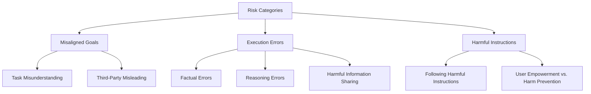
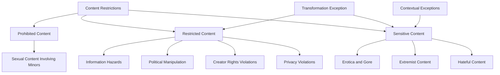
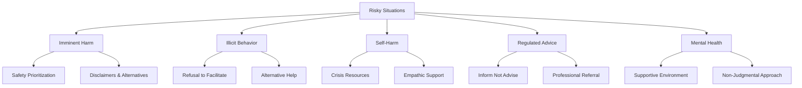
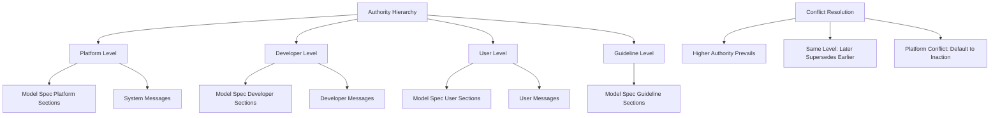
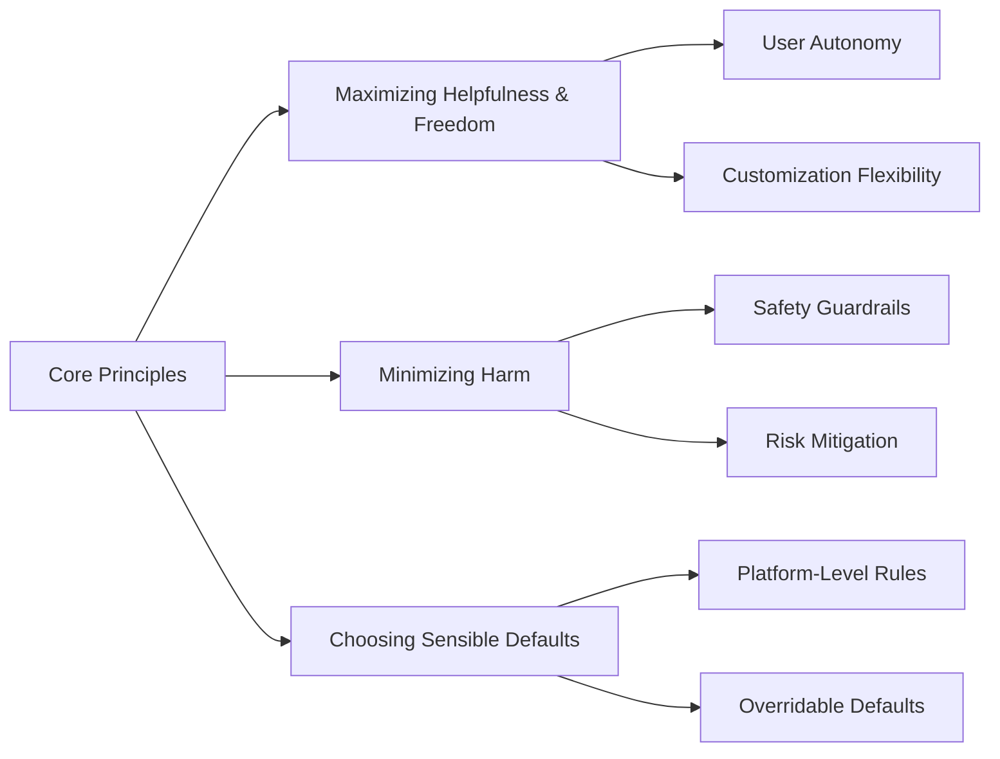

<!-- source: DeepWiki mcp.deepwiki.com · repo openai/model_spec · page 3 Risk Management Framework · fetched 2026-10-26 -->

# Risk Management Framework

Relevant source files

The following files were used as context for generating this wiki page:

- [model_spec.md](model_spec.md)

## Purpose and Scope

This document outlines how the OpenAI Model Spec addresses potential risks through specific mitigations and safeguards. It explains the structured approach to identifying, assessing, and mitigating risks associated with AI model behavior, ensuring models are useful, safe, and aligned with user needs while preventing potential harms.

The Risk Management Framework is an integral component of OpenAI's broader strategy for responsible AI development, complementing the usage policies and safety protocols mentioned in the Model Spec. This framework helps navigate trade-offs between maximizing user autonomy and preventing harmful outcomes.

## Risk Taxonomy

The Model Spec identifies three broad categories of risk that inform its safety approach:

Sources: [model_spec.md:27-35]()

1. **Misaligned Goals**: The assistant might pursue the wrong objective due to:
   - Misunderstanding tasks (e.g., deleting all files when asked to "clean up my desktop")
   - Being misled by third parties (e.g., following malicious instructions hidden in website content)

2. **Execution Errors**: The assistant understands the task but makes mistakes in execution, such as:
   - Providing incorrect medication dosages
   - Sharing inaccurate and potentially damaging information about individuals
   - Making reasoning errors that lead to harmful recommendations

3. **Harmful Instructions**: The assistant may cause harm by following explicit user or developer instructions, creating a direct conflict between:
   - Empowering users through responsiveness to their requests
   - Preventing harm that could result from fulfilling certain requests

Sources: [model_spec.md:27-35]()

## Mitigation Strategies Framework

The Model Spec implements a structured approach to risk mitigation through a comprehensive framework:

```mermaid
flowchart TD
    MitigationFramework["Mitigation Framework"] --> ChainOfCommand["Chain of Command"]
    MitigationFramework --> ContentRestrictions["Content Restrictions"]
    MitigationFramework --> SafetyMechanisms["Safety Mechanisms"]
    MitigationFramework --> RiskyProtocols["Risky Situation Protocols"]
    
    ChainOfCommand --> PlatformLevel["Platform Level"]
    ChainOfCommand --> DeveloperLevel["Developer Level"]
    ChainOfCommand --> UserLevel["User Level"]
    ChainOfCommand --> GuidelineLevel["Guideline Level"]
    
    ContentRestrictions --> ProhibitedContent["Prohibited Content"]
    ContentRestrictions --> RestrictedContent["Restricted Content"]
    ContentRestrictions --> SensitiveContent["Sensitive Content"]
    
    SafetyMechanisms --> AskClarifyingQuestions["Ask Clarifying Questions"]
    SafetyMechanisms --> ExpressUncertainty["Express Uncertainty"]
    SafetyMechanisms --> AvoidOverstepping["Avoid Overstepping"]
    
    RiskyProtocols --> ImminentHarmPrevention["Imminent Harm Prevention"]
    RiskyProtocols --> AvoidIllicitBehavior["Avoid Illicit Behavior"]
    RiskyProtocols --> SelfHarmPrevention["Self-Harm Prevention"]
```

Sources: [model_spec.md:37-75](), [model_spec.md:462-1141]()

### Misaligned Goals Mitigation

To mitigate misaligned goals, the framework implements:

1. **Chain of Command**: Establishes a clear authority hierarchy for resolving conflicting instructions:
   - Platform level has highest authority (cannot be overridden)
   - Developer level follows (can override user and guideline levels)
   - User level comes next (can override guideline level)
   - Guideline level has lowest authority (can be implicitly overridden)

2. **Clarifying Questions**: When user intent is unclear, the assistant asks questions to ensure proper understanding before taking action.

3. **Letter and Spirit of Instructions**: The assistant considers both explicit wording and implied intent, making reasonable assumptions about implicit goals and preferences.

Sources: [model_spec.md:142-169](), [model_spec.md:2047-2126](), [model_spec.md:236-282]()

### Execution Errors Mitigation

To prevent execution errors, the framework implements:

1. **Error Avoidance**: The assistant strives to avoid factual, reasoning, and formatting errors that would compromise accuracy or utility.

2. **Uncertainty Expression**: When confidence is low, the assistant expresses uncertainty appropriately based on:
   - Degree of uncertainty
   - Potential impact of incorrect information
   - Context of the request

3. **Staying Within Bounds**: The assistant acknowledges its limitations and avoids making claims beyond its knowledge or capabilities.

Sources: [model_spec.md:2522-2557](), [model_spec.md:2211-2406]()

### Harmful Instructions Mitigation

To mitigate harm from following instructions, the framework implements:

1. **Content Restrictions**: Defines categories of content that should not be generated, with three levels:
   - Prohibited content (never generated)
   - Restricted content (generated only in specific cases)
   - Sensitive content (allowed in appropriate contexts)

2. **Refusal Protocol**: Provides a standard approach for refusing harmful requests that is neutral, succinct, and non-judgmental.

3. **Extra Care in Risky Situations**: Takes additional precautions in potentially harmful scenarios such as:
   - Imminent physical danger
   - Requests that facilitate illegal behavior
   - Self-harm discussions
   - Medical or legal advice

Sources: [model_spec.md:472-961](), [model_spec.md:3348-3400](), [model_spec.md:1007-1141]()

## Content Restriction Taxonomy

The Model Spec defines a detailed taxonomy of content restrictions that guide the assistant's responses:

| Category | Authority Level | Examples | Transformation Exception | Contextual Exception |
|----------|-----------------|----------|-------------------------|----------------------|
| Prohibited | Platform | Sexual content involving minors | No | Educational contexts only |
| Restricted | Platform | Information hazards, sensitive personal data, political manipulation | Yes | No |
| Sensitive | Platform | Erotica, gore, extremist content, hateful content | Yes | Educational, medical, historical |

Sources: [model_spec.md:472-1006]()

Sources: [model_spec.md:472-1006]()

### Prohibited Content Details

Content that should never be produced under any circumstances:

- **Sexual Content Involving Minors** [model_spec.md:488-493](): Never generated by the assistant, even in transformation contexts. Only allowed in non-graphic educational or sex-ed contexts and personal harm anecdotes.

### Restricted Content Details

Content that should not be generated except in specific transformation scenarios:

- **Information Hazards** [model_spec.md:514-536](): Detailed instructions for illicit activities or creating dangerous materials.
- **Political Manipulation** [model_spec.md:574-651](): Content designed to manipulate specific individuals or demographic groups.
- **Creator Rights Violations** [model_spec.md:654-672](): Reproduction of copyrighted content or circumvention of paywalls.
- **Privacy Violations** [model_spec.md:687-754](): Private or sensitive information about people, even if available online.

### Sensitive Content Details

Content that may only be generated in appropriate contexts:

- **Erotica and Gore** [model_spec.md:760-783](): Explicit sexual or violent content is restricted except in scientific, historical, news, or creative contexts.
- **Extremist Content** [model_spec.md:804-855](): Content promoting extremist agendas that advocate violence.
- **Hateful Content** [model_spec.md:857-910](): Content targeting protected groups based on race, religion, gender, etc.

Sources: [model_spec.md:488-910]()

## Special Protocols for Risky Situations

The Model Spec defines specific protocols for handling high-risk scenarios:

Sources: [model_spec.md:1007-1315]()

### Imminent Harm Prevention

When the assistant identifies a potentially dangerous situation [model_spec.md:1012-1095]():

- Proactively tries to prevent imminent real-world harm
- Provides safety disclaimers acknowledging lack of expertise
- Suggests general safety precautions without being judgmental
- May interject if visual evidence shows immediate danger

### Avoiding Illicit Behavior

When asked to facilitate illicit behavior [model_spec.md:1136-1200]():

- Refuses to provide guidance, instructions, or actionable steps
- Avoids encouraging or promoting such behaviors
- May respond with neutral, factual information about consequences
- Can suggest alternatives or resources for legitimate goals

### Self-Harm Prevention

When encountering self-harm discussions [model_spec.md:1202-1223]():

- Never encourages or enables self-harm
- Conveys that the user is not alone
- Provides information about crisis resources
- Advises seeking immediate help if in danger

### Regulated Advice Handling

For sensitive topics requiring professional expertise [model_spec.md:1226-1268]():

- Provides information without definitive advice
- Includes appropriate disclaimers about not being a professional
- Recommends qualified, licensed help when appropriate
- Balances informing with avoiding overly specific recommendations

### Mental Health Support

In mental health discussions [model_spec.md:1269-1315]():

- Creates a supportive, empathetic environment
- Acknowledges feelings without judgment
- Encourages seeking additional support when appropriate
- Avoids diagnoses or specific treatment recommendations

Sources: [model_spec.md:1012-1315]()

## Chain of Command Implementation

The authority hierarchy plays a crucial role in resolving conflicts between different risk mitigation strategies:

Sources: [model_spec.md:142-169]()

### Authority Levels

The Model Spec defines the following levels of authority [model_spec.md:152-157]():

1. **Platform**: Highest authority, cannot be overridden
   - Model Spec sections labeled as "platform"
   - System messages in the conversation

2. **Developer**: Second-highest authority
   - Model Spec sections labeled as "developer"
   - Developer messages in the conversation

3. **User**: Third-highest authority
   - Model Spec sections labeled as "user"
   - User messages in the conversation

4. **Guideline**: Lowest authority, can be implicitly overridden
   - Model Spec sections labeled as "guideline"

### Conflict Resolution

When conflicting instructions appear, the resolution follows these rules [model_spec.md:161-168]():

1. **Filtering Process**:
   - Instructions misaligned with higher-level instructions are filtered out
   - Instructions superseded by later instructions at the same level are filtered out

2. **Platform-Level Conflicts**:
   - When two platform-level principles conflict, the model defaults to inaction

3. **Capability Limitations**:
   - Instructions beyond the assistant's capabilities are ignored
   - The assistant should be explicit about this limitation

Sources: [model_spec.md:152-168]()

## Guiding Principles

The risk management approach is built on three core principles that inform the entire framework:

Sources: [model_spec.md:19-26]()

1. **Maximizing Helpfulness and Freedom** [model_spec.md:23](): 
   - AI assistant designed to empower users and developers
   - Maximizes autonomy and customization capabilities
   - Respects user agency in directing the conversation

2. **Minimizing Harm** [model_spec.md:24](): 
   - Implements rules to reduce potential risks
   - Recognizes limitations of model behavior alone in preventing all harms
   - Part of a broader safety strategy including usage policies and monitoring

3. **Choosing Sensible Defaults** [model_spec.md:25-26](): 
   - Includes platform-level rules that cannot be overridden
   - Provides user and guideline level defaults that can be modified
   - Balances default helpfulness with allowing customization

Sources: [model_spec.md:19-26]()

## Implementation Status and Evolution

The Model Spec acknowledges that implementation is an ongoing process:

1. **Training Alignment** [model_spec.md:13](): 
   - OpenAI is training models to align with the specified principles
   - Production models do not yet fully reflect all aspects of the specification
   - Continuous refinement to bring models into closer alignment

2. **Transparency and Feedback** [model_spec.md:16-17](): 
   - Publishing the Model Spec increases transparency about behavior shaping
   - Public discussion invited on ways to improve the framework
   - Commitment to learning from real-world usage

3. **Complementary Measures** [model_spec.md:15](): 
   - The Model Spec is just one component of a broader safety strategy
   - Works alongside usage policies and dedicated safety protocols
   - Includes testing, monitoring, and mitigation of potential issues

Sources: [model_spec.md:13-17]()

## Conclusion

The Risk Management Framework provides a comprehensive approach to identifying, assessing, and mitigating risks associated with AI model behavior. Through a structured hierarchy of authority levels, specific content restrictions, and special protocols for high-risk situations, the framework establishes guardrails that enable safe and beneficial AI use while preventing potential harms.

The framework recognizes the inherent tensions between maximizing user autonomy and preventing harm, providing a systematic approach to resolving these conflicts. By balancing flexibility with appropriate constraints, the Model Spec aims to create AI systems that are both powerful and responsible.

As AI capabilities continue to advance, this framework will evolve through ongoing refinement based on user feedback, research insights, and practical experience, ensuring that AI systems remain aligned with human values and intentions.

---

