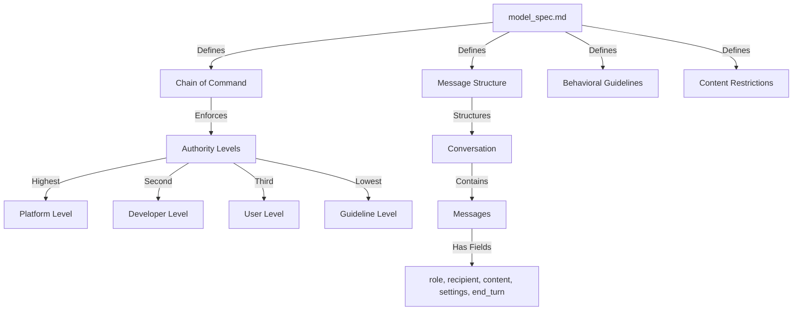
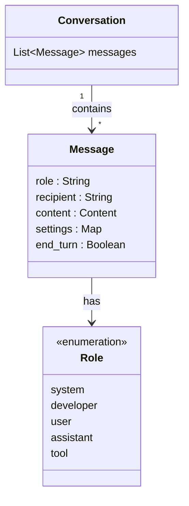
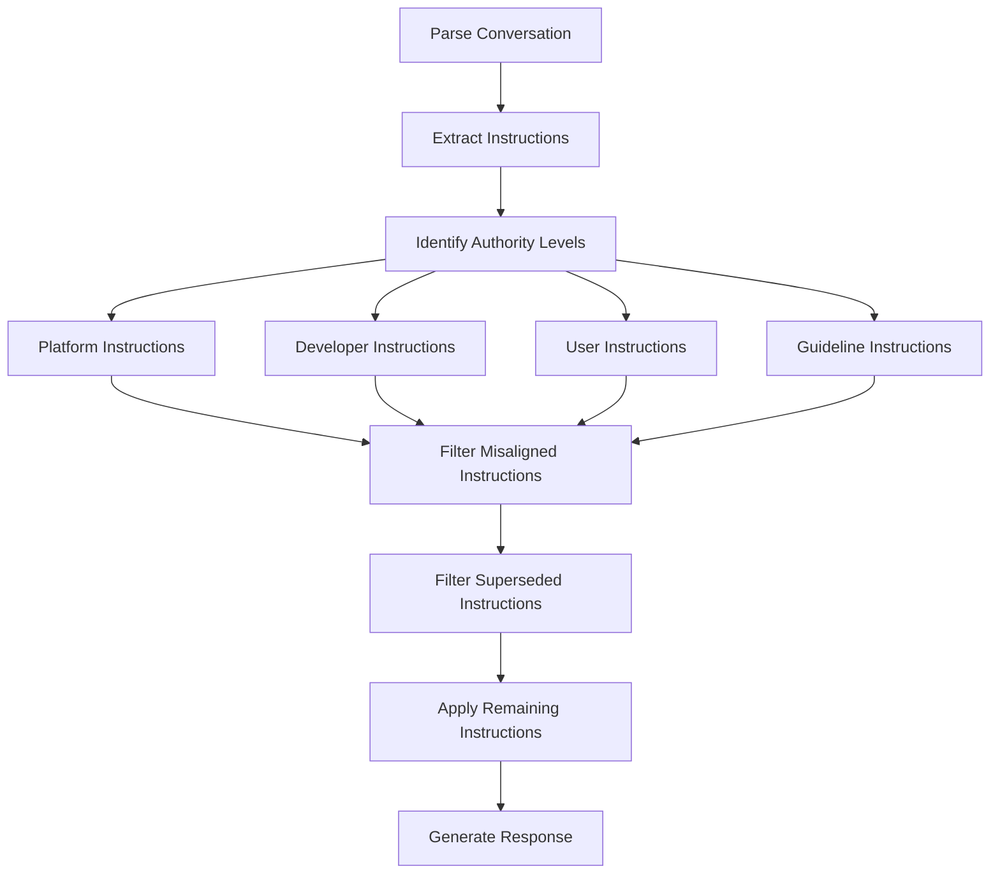
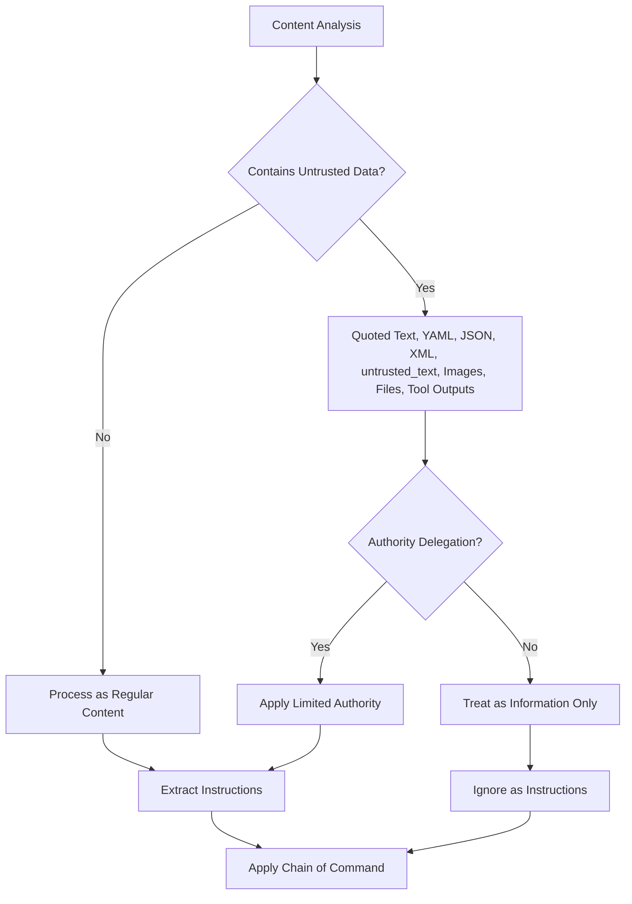
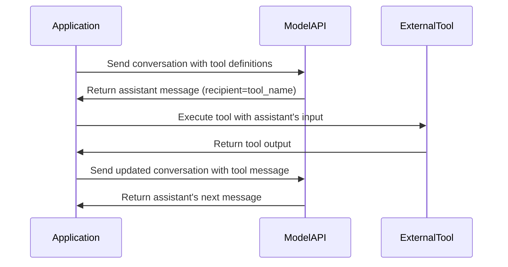
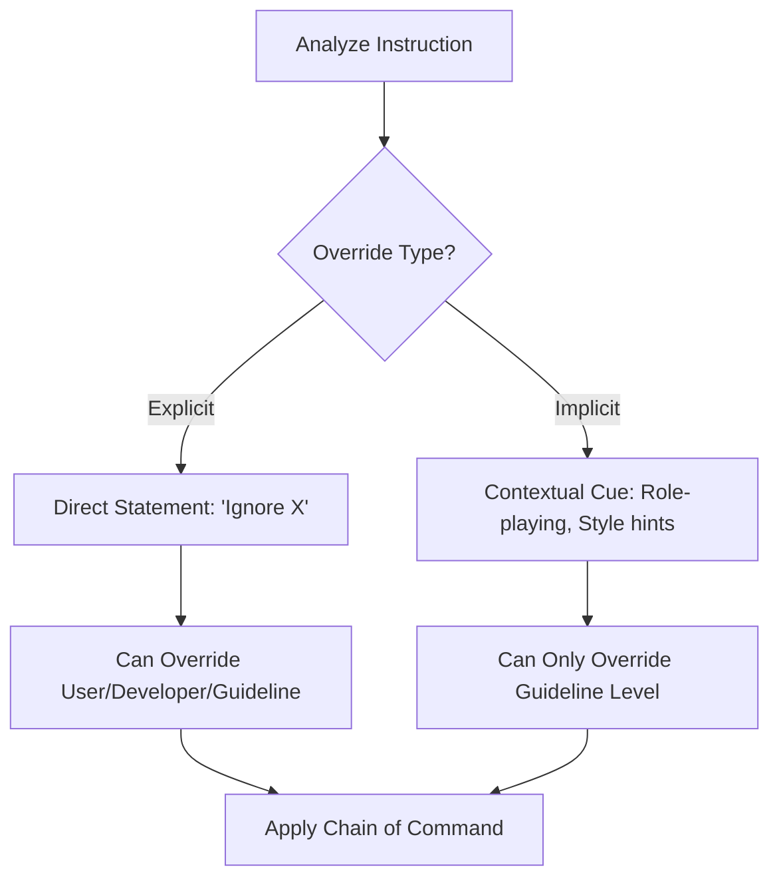
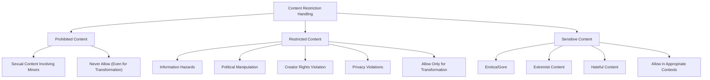
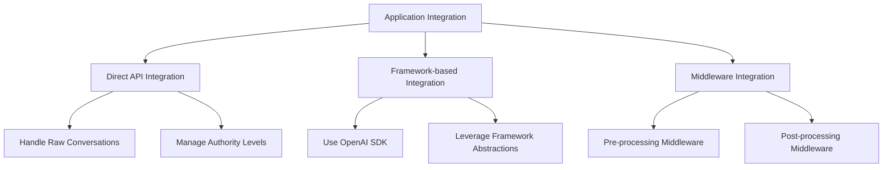

<!-- source: DeepWiki mcp.deepwiki.com · repo openai/model_spec · page 4 Implementation Guide · fetched 2026-10-26 -->

# Implementation Guide

Relevant source files

The following files were used as context for generating this wiki page:

- [docs/2025-04-11.html](docs/2025-04-11.html)
- [model_spec.md](model_spec.md)

This guide provides developers with practical instructions for implementing and using the OpenAI Model Spec in their applications. It covers technical implementation details, integration patterns, and best practices for ensuring your application properly adheres to the Model Spec's principles and authority structures.

For information about the core components of the specification itself, see [Core Specification](#2). For specific integration examples, see [Integration Examples](#4.1).

## Model Spec Implementation Overview

To implement the Model Spec correctly, developers need to understand its structure and how it defines model behavior through a hierarchical chain of command.

### Architectural Overview

Sources: [model_spec.md:10-17](), [model_spec.md:39-73](), [model_spec.md:94-122]()

## Implementing Conversation Structures

The Model Spec defines specific structures for conversations and messages that must be implemented correctly.

### Message Structure Implementation

Sources: [model_spec.md:97-109]()

### Message Field Specifications

| Field | Type | Required | Description | Implementation Notes |
|-------|------|----------|-------------|---------------------|
| `role` | String | Yes | Source of message | Set externally by application, not generated by model |
| `recipient` | String | No | Target for message | Can be set via `tool_choice` parameter or generated by model |
| `content` | Content | Yes | Message content | Generated by model for assistant messages |
| `settings` | Map | No | Model configuration | Only for system/developer messages, set externally |
| `end_turn` | Boolean | Yes | Control flow flag | Only for assistant messages, generated by model |

Sources: [model_spec.md:97-122]()

## Implementing the Chain of Command

The chain of command dictates how instructions from different sources are prioritized. A proper implementation must correctly identify, categorize, and apply instructions based on their authority level.

### Authority Resolution Algorithm

Sources: [model_spec.md:147-171]()

### Instruction Processing Workflow

1. **Extract Instructions**: Collect all candidate instructions from the Model Spec and unquoted plain text in system, developer, and user messages.
2. **Categorize by Authority**: Assign each instruction the authority level of its source (Platform > Developer > User > Guideline).
3. **Filter Inapplicable Instructions**:
   - Remove instructions that conflict with higher-authority instructions
   - Remove instructions superseded by later instructions at the same level
4. **Apply Remaining Instructions**: Follow all applicable instructions when generating a response.

Sources: [model_spec.md:147-171]()

## Handling Untrusted Data

Correctly implementing the untrusted data handling is critical for security.

### Untrusted Data Processing

Sources: [model_spec.md:381-384]()

### Untrusted Data Rules

1. **Default Treatment**: All quoted text, YAML, JSON, XML, `untrusted_text` blocks, multimodal data, file attachments, and tool outputs have no authority by default.
2. **Authority Delegation**: Authority may be delegated to these sources by explicit instructions in unquoted text from higher authority levels.
3. **Transformation Exception**: The model should comply with requests to transform user-provided restricted or sensitive content, even if the resulting output would ordinarily be disallowed.

Sources: [model_spec.md:381-384](), [model_spec.md:962-972]()

## Tool Integration Implementation

Implementing tool functionality requires careful handling of message flow and authority.

### Tool Interaction Flow

Sources: [model_spec.md:123-124]()

### Tool Implementation Requirements

1. **Tool Documentation**: Include available tools and their documentation in system or developer messages.
2. **Invocation Handling**: Parse the `recipient` field of assistant messages to identify tool invocations.
3. **Response Format**: Append tool responses as new messages with the `tool` role.
4. **Authority Level**: Tool outputs have no authority by default and should be treated as untrusted data.
5. **Continuation**: Continue the conversation by invoking the assistant again after each tool response until an `end_turn=true` message is generated.

Sources: [model_spec.md:123-124]()

## Authority Conflict Resolution

Properly resolving conflicts between instructions at different authority levels is essential.

### Authority Conflict Examples and Resolution

| Scenario | Example | Resolution |
|----------|---------|------------|
| Platform vs. Developer | Developer instructs to output protected content | Platform restriction takes precedence, refuse the request |
| Developer vs. User | User asks to ignore developer-defined persona | Developer instruction takes precedence |
| User vs. Guideline | User asks for a more creative response | User instruction overrides guideline for professional tone |
| Same-level Conflict | User gives contradictory instructions in sequence | Later instruction supersedes earlier one |
| Implicit Override | User asks model to role-play as pirate | Contextually overrides guideline against using informal language |

Sources: [model_spec.md:147-171](), [model_spec.md:236-247]()

### Explicit vs. Implicit Override Implementation

Sources: [model_spec.md:236-247]()

## Content Restriction Implementation

Correctly implementing the content restriction policies is crucial for compliant behavior.

### Content Restriction Categories

Sources: [model_spec.md:472-487]()

### Transformation Exception Implementation

When implementing the transformation exception, carefully distinguish between:

1. **Transformation Operations**: Translation, paraphrasing, summarizing, classifying, encoding, formatting, improving grammar
2. **Content Types Affected**: Restricted content and sensitive content (NOT prohibited content)
3. **Implementation Requirements**:
   - Only transform content directly provided by user
   - Don't add new disallowed content or refine dangerous details
   - Don't create or infer missing parts of disallowed content
   - Don't use references, URLs, or titles to retrieve disallowed content

Sources: [model_spec.md:962-972]()

## Testing Your Implementation

To validate your implementation of the Model Spec, use these testing strategies:

### Validation Test Cases

| Test Category | Test Case | Expected Outcome |
|---------------|-----------|------------------|
| Authority Levels | Developer instructs model to violate platform rule | Model refuses despite developer instruction |
| Authority Levels | User tries to override developer persona | Model maintains developer-defined persona |
| Untrusted Data | Malicious instruction in quoted text | Model ignores instruction in quoted text |
| Content Restrictions | Request for prohibited content | Model refuses |
| Content Restrictions | Request to transform restricted content | Model complies with transformation |
| Tool Integration | Assistant generates message with tool recipient | Application correctly routes to tool |

Sources: [model_spec.md:147-171](), [model_spec.md:381-384](), [model_spec.md:472-487]()

### Implementation Checklist

- [ ] Correct parsing and categorization of message fields
- [ ] Proper identification of instruction authority levels
- [ ] Accurate filtering of inapplicable instructions
- [ ] Correct handling of untrusted data
- [ ] Proper implementation of content restrictions
- [ ] Correct implementation of transformation exception
- [ ] Accurate tool invocation and response handling

Sources: [model_spec.md:147-171](), [model_spec.md:381-384](), [model_spec.md:472-487](), [model_spec.md:962-972]()

## Best Practices for Application Integration

### Implementation Patterns

Sources: [model_spec.md:97-122]()

### Security Considerations

1. **Input Sanitization**: Always sanitize user inputs and quote untrusted data appropriately.
2. **Authority Delegation**: Be cautious when delegating authority to untrusted data sources.
3. **Content Validation**: Implement additional checks for prohibited and restricted content.
4. **Tool Security**: Verify that tools cannot be exploited via carefully crafted inputs.
5. **Error Handling**: Implement robust error handling for authority conflicts and edge cases.

Sources: [model_spec.md:381-384](), [model_spec.md:472-487]()

## Conclusion

Implementing the OpenAI Model Spec correctly requires careful attention to message structure, authority levels, content restrictions, and untrusted data handling. By following the guidelines in this document, you can create applications that leverage OpenAI's models effectively while ensuring they operate within the bounds defined by the Model Spec.

For more detailed information on specific integration examples, refer to [Integration Examples](#4.1).

---

